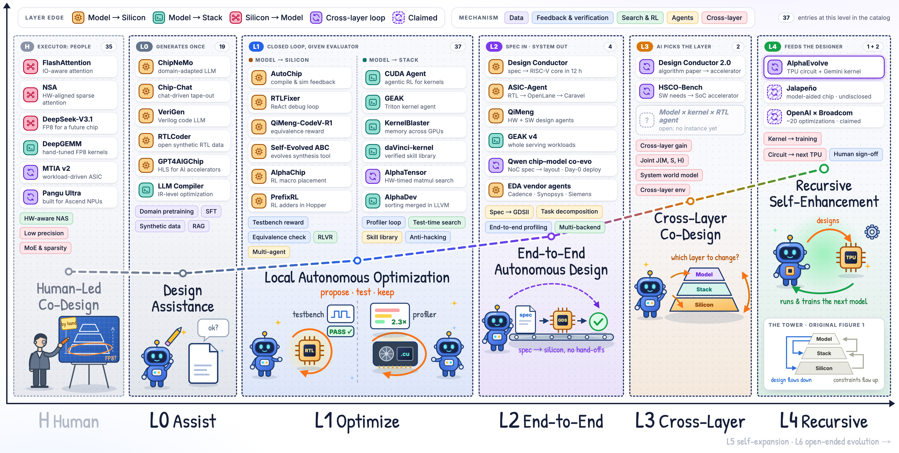
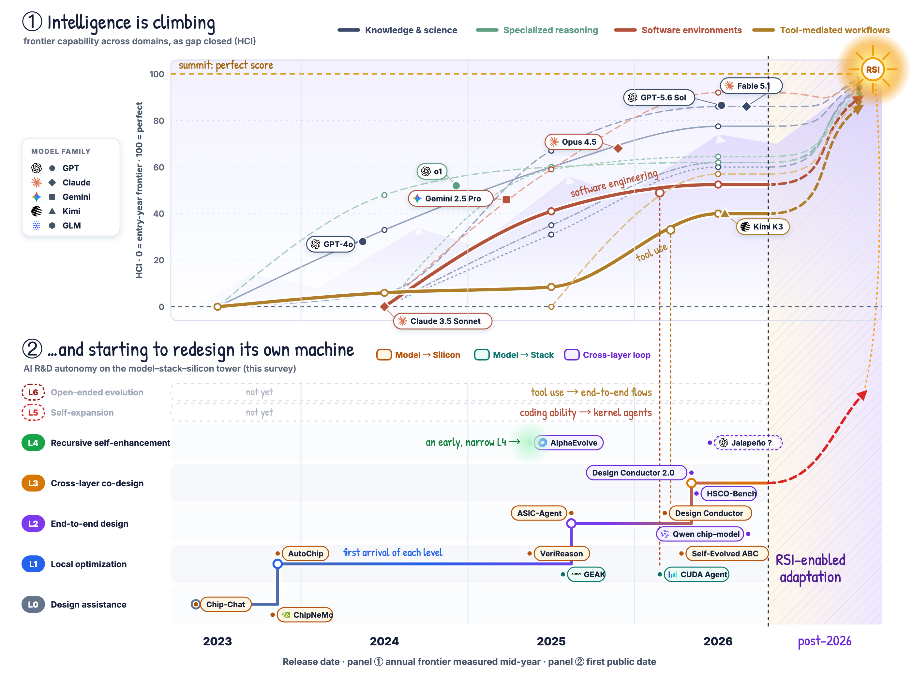

<a id="readme-top"></a>

<div align="center">

<h1>Awesome Model–Silicon Co-Evolution</h1>

<p><b>How models, software stacks and chips are starting to improve one another.</b></p>

<p>
  <a href="#contents"></a>
  <a href="https://github.com/yangforever17/awesome-model-silicon-coevolution/issues/new?template=add-paper.yml"></a>
  <a href="https://github.com/yangforever17/awesome-model-silicon-coevolution/stargazers"></a>
  <a href="LICENSE"></a>
</p>

<p>
  <a href="#news">News</a> ·
  <a href="#framework">Framework</a> ·
  <a href="#contents">Catalog</a> ·
  <a href="#part-cases">Closed loops</a> ·
  <a href="#survey">Survey &amp; citation</a> ·
  <a href="#contributing">Contribute</a>
</p>

</div>

Every model runs on a machine it did not design. That is starting to change: language models now write RTL, tune kernels, run EDA flows and help design the chips that train and serve them. This list collects the **304 works** mapped in our survey and tags each with the layer it acts on and how much of the R&D loop the AI runs.

<div align="center">
  
  <br>
  <sub><b>Figure 1.</b> The landscape by autonomy level. The higher the level, the fewer the works: 37 at L1, 4 at L2, 2 at L3, one public case at L4.</sub>
</div>

<a id="news"></a>

## News

- **2026-10-23** Code links with live GitHub stars for 158 entries. Suggest a paper in one step with the [issue form](https://github.com/yangforever17/awesome-model-silicon-coevolution/issues/new?template=add-paper.yml).
- **2026-10-22** Repository launched with the survey's full reference map.

<a id="why-now"></a>

## Why now

General capability is climbing fastest in software engineering and agentic tool use, the very skills kernel agents and design agents run on. On our autonomy scale, the first arrival of each level stepped from L0 (2023) to L3 (2026).

<div align="center">
  
  <br>
  <sub><b>Figure 2.</b> ① Capability trajectories as gap closed <a href="https://arxiv.org/abs/2609.11873">[Duan et al., 2026]</a>. ② Milestones on our autonomy levels by first public date.</sub>
</div>

<a id="framework"></a>

## Framework

We split the system into three layers: the **model** $M$, the **software stack** $S$ (compilers, kernels, serving) and the **hardware** $H$ (microarchitecture, RTL, layout). Design flows down, constraints flow up, and each layer moves the target of the others.

<div align="center">
  
  <br>
  <sub><b>Figure 3.</b> The model–stack–silicon tower. AI already sends designs down; constraints are still hauled up almost entirely by people.</sub>
</div>

**Autonomy levels.** How much of the R&D loop does the AI run? The catalog covers L0–L4; L5–L6 are the horizon.

| Level | Name | Decision rule | Entries |
| :---: | --- | --- | ---: |
|  | Design assistance | AI generates code, designs or analysis but does not run a propose–verify–revise loop on its own. | 19 |
|  | Local autonomous optimization | Given a task, interface and evaluator, AI proposes candidates, calls tools, reads feedback and iterates. | 37 |
|  | End-to-end autonomous design | From a spec, AI decomposes the task, orchestrates tools and delivers a verified system within one layer. | 4 |
|  | Cross-layer autonomous co-design | Around a system-level goal, AI decides which layers to change; one layer's needs or measurements change another layer's design through AI. | 2 |
|  | Recursive self-enhancement | Hardware or software that AI helped design is used to train or run the designer itself or its successors. | 1 |
|  | Recursive self-expansion | R&D gains turn into more compute, facilities and deployment capacity, reinvested into the next round. | — |
|  | Open-ended autonomous evolution | Within external goals and constraints, AI discovers research questions, methods and new computing paradigms. | — |

<details>
<summary><b>Dynamics, feedback signals and the three paths</b></summary>

<br>

Each layer is updated by an operator that reads a measurement of the whole system, and the executor's capability $\theta$ may itself depend on the system:

```math
X_{t+1} = f_X(X_t,\ y_t;\ \theta_t),\quad y_t = m(M_t, S_t, H_t),\quad X \in \{M, S, H\},\qquad \theta_{t+1} = g(\theta_t;\ M_{t+1}, S_{t+1}, H_{t+1})
```

Unlike static co-design, the target moves, the layers update at very different speeds ($f_S$ hourly, $f_M$ monthly, $f_H$ yearly), and when the executor is a language model it can improve the machine it runs on.

**Feedback signals**, by cost: **S1** compilation (seconds) · **S2** functional tests (minutes–hours) · **S3** timing, area, power (hours) · **S4** profiling (minutes) · **S5** end-to-end on hardware (hours–days) · **S6** post-silicon and deployment (months–years).

| Path | Levels | Signals | Executor | Loop period | Highest-level work |
| --- | --- | --- | --- | --- | --- |
| Model → Silicon | L0–L2 | S1–S3 | LLM agents | hours to days; tape-out in years | Design Conductor 2.0 (L3) |
| Model → Stack | L1–L2 | S2, S4–S5 | LLM agents | minutes to hours | AlphaEvolve (L4) |
| Silicon → Model | human | S4–S6 | human teams | months to years | DeepSeek-V3.1 |

</details>

<details>
<summary><b>Where the loop breaks</b></summary>

<br>

| | What breaks |
| --- | --- |
| **Physics** | Lower layers give slower, costlier, sparser feedback: seconds to compile, hours to place and route, years for silicon. |
| **Agents** | Agent horizons are hours while hardware loops take years; nothing remembers across chip generations, and there is no cross-layer environment to train in. |
| **Ecosystem** | The layers belong to different companies. A cross-layer loop needs one executor with access to several layers, which mostly exists only inside vertically integrated firms. |

</details>

<a id="contents"></a>

## Contents

| | Part | Entries | Survey |
| ---: | --- | ---: | --- |
| 1 | [Closed-Loop Case Studies](#part-cases) | 10 | §5 |
| 2 | [Design Flows Down (I): Model → Silicon](#part-model-silicon) | 58 | §2.1, §4.1 |
| 3 | [Design Flows Down (II): Model → Software Stack](#part-model-stack) | 35 | §2.2.4, §4.2 |
| 4 | [Constraints Flow Up: Silicon → Model](#part-silicon-model) | 47 | §2.2, §4.3 |
| 5 | [Formalization and Co-Design Foundations](#part-foundations) | 27 | §3 |
| 6 | [Self-Improvement Engines](#part-engines) | 14 | §1, §2.3, §3.3 |
| 7 | [Intelligence: Knowledge, Rewards and Verification](#part-intelligence) | 46 | §6 |
| 8 | [Benchmarks: From Exam Hall to Training Ground](#part-benchmarks) | 40 | §7 |
| 9 | [Related Surveys](#part-surveys) | 17 | §1.5, §3 |
| 10 | [Outlook: Recursion, Governance and World Models](#part-outlook) | 10 | §8 |

        &nbsp; ⭐ key work · † level assigned by the curators, not the survey

<a id="part-cases"></a>

## 1. Closed-Loop Case Studies

Ten cases where an AI-designed artifact reaches the hardware or software that trains or serves AI. <sub>Survey §5 · 10 entries</sub>

| Case | Year · source | Loop | Level | Where it breaks |
| --- | --- | --- | :---: | --- |
| NVCell | 2021 · DAC | RL generates standard-cell layouts | L1 | Designer is not the model being trained |
| AlphaTensor | 2022 · Nature | Searches matmul algorithms for specific hardware | L1 | Hardware is fixed |
| PrefixRL | 2022 · DAC | RL prefix circuits shipped in NVIDIA GPUs | L1 | Designer is not the model being trained |
| AlphaDev | 2023 · Nature | Sorting routines merged into LLVM libc++ | L1 | Only software updates |
| AlphaEvolve | 2025 · DeepMind | One agent rewrites a TPU circuit and a Gemini kernel | **L4** | Closed, but one turn is worth ~1% |
| OpenAI × Broadcom | 2025 · interview | ~20 optimizations on human-optimized blocks | Claimed | Cannot be verified |
| MTIA v2 | 2025 · ISCA | Recommendation workloads drive chip design | Human | Executor is not a model |
| Pangu Ultra × Ascend | 2025 · tech report | Model and recipe built around NPUs | Human | Executor is not a model |
| Jalapeño | 2026 · press | Nine months from design to tape-out | Undisclosed | Cannot be verified |
| Qwen chip–model | 2026 · blog | Chip and inference stack adapted in parallel | L2 | The two ends are not connected |
| *Design Conductor 2.0* | 2026 · arXiv | Reads an algorithm paper, designs an accelerator | L3 | Product does not flow back to the designer |

Three failure patterns: the **executor** is not the trained model or is a human team; the **signal** does not flow between the two ends; or the **gain** per turn is too small or cannot be checked.

<details>
<summary>Sources</summary>

| Work | Venue | Level | Note |
| :--- | :--- | :---: | :--- |
| ⭐ [NVCell: Standard Cell Layout in Advanced Technology Nodes with Reinforcement Learning](https://arxiv.org/abs/2107.07044) [[DOI](https://doi.org/10.1109/dac18074.2021.9586188)] | DAC 2021 |  | RL generates standard-cell layouts and fixes DRC violations, bringing cell-library development into an automated flow. |
| ⭐ [Discovering Faster Matrix Multiplication Algorithms with Reinforcement Learning](https://doi.org/10.1038/s41586-022-05172-4) [](https://github.com/google-deepmind/alphatensor) | Nature 2022 |  | AlphaTensor searches matrix-multiplication decompositions with RL and can target measured runtime on a specific GPU or TPU, putting hardware measurements directly into algorithm design. |
| ⭐ [PrefixRL: Optimization of Parallel Prefix Circuits using Deep Reinforcement Learning](https://arxiv.org/abs/2205.07000) [[DOI](https://doi.org/10.1109/dac18074.2021.9586094)] [[Link](https://developer.nvidia.com/blog/designing-arithmetic-circuits-with-deep-reinforcement-learning/)] | DAC 2022 |  | RL designs parallel-prefix circuits with post-synthesis area/delay as reward; ~13,000 AI-designed circuit instances ship in NVIDIA Hopper. |
| ⭐ [Faster Sorting Algorithms Discovered Using Deep Reinforcement Learning](https://doi.org/10.1038/s41586-023-06004-9) [](https://github.com/google-deepmind/alphadev) | Nature 2023 |  | AlphaDev discovers assembly-level sorting routines that were merged into LLVM's libc++, a precedent for AI-found low-level improvements entering production stacks. |
| ⭐ [AlphaEvolve: A Coding Agent for Scientific and Algorithmic Discovery](https://arxiv.org/abs/2506.13131) [[Link](https://deepmind.google/blog/alphaevolve-a-gemini-powered-coding-agent-for-designing-advanced-algorithms/)] | Google DeepMind white paper 2025 |  | The only public L4 instance: a Gemini-driven evolutionary coding agent rewrote a TPU arithmetic circuit and sped up a Gemini training kernel by 23% (~1% of total training time). |
| ⭐ [Meta's Second Generation AI Chip: Model-Chip Co-Design and Productionization Experiences](https://doi.org/10.1145/3695053.3731409) | ISCA 2025 |  | MTIA v2: recommendation-model workloads directly set the chip's compute/memory balance; strong cross-layer coupling executed by human teams. |
| ⭐ [OpenAI and Broadcom Announce Strategic Collaboration to Deploy 10 Gigawatts of Custom AI Accelerators](https://tech.yahoo.com/ai/articles/greg-brockman-says-openais-tech-035921214.html) | Press release and The OpenAI Podcast 2025 |  | OpenAI states its models found ~20 optimizations on human-optimized components of its custom accelerator (L1 by description); not independently verifiable. |
| ⭐ [Pangu Ultra: Pushing the Limits of Dense Large Language Models on Ascend NPUs](https://arxiv.org/abs/2504.07866) | arXiv 2025 |  | A dense ~100B+ model whose architecture and training recipe were adapted to large Ascend NPU clusters; human-driven co-design. |
| ⭐ Chip–Model Co-Evolution: Qwen in Production Chip Design and Inference Adaptation (芯模协同进化：Qwen 落地生产级芯片设计与推理适配) | WeChat 2026 |  | Qwen3.8-Max takes a NoC module from spec through RTL, verification and physical implementation, and separately deploys and tunes a new model on a domestic accelerator; the two ends are not yet connected. |
| ⭐ [OpenAI and Broadcom Unveil LLM-Optimized Inference Chip Jalapeño](https://semiwiki.com/forum/threads/25367) | Press release 2026 |  | OpenAI–Broadcom LLM inference chip taped out nine months from initial design, with models said to have helped design and optimization; the model's role is not disclosed. |

</details>

<a id="part-model-silicon"></a>

## 2. Design Flows Down (I): Model → Silicon

Language models as chip designers, from tuning tools to writing RTL to rewriting the EDA tools themselves. Most work stays inside one layer at L0–L2. <sub>Survey §2.1, §4.1 · 58 entries</sub>

> [Classical and open-source EDA substrate](#classical-and-open-source-eda-substrate) 5 · [Pre-LLM machine learning for EDA](#pre-llm-machine-learning-for-eda) 7 · [LLMs enter chip design](#llms-enter-chip-design) 7 · [RTL generation and reasoning models](#rtl-generation-and-reasoning-models) 14 · [Debugging and repair](#debugging-and-repair) 3 · [Verification](#verification) 5 · [HLS and architecture exploration](#hls-and-architecture-exploration) 7 · [Physical implementation and EDA tools](#physical-implementation-and-eda-tools) 4 · [End-to-end agents](#end-to-end-agents) 4 · [Analog circuits](#analog-circuits) 2

### Classical and open-source EDA substrate

| Work | Venue | Note |
| :--- | :--- | :--- |
| [ABC: An Academic Industrial-Strength Verification Tool](https://doi.org/10.1007/978-3-642-14295-6_5) [](https://github.com/berkeley-abc/abc) | CAV 2010 | ABC, the academic logic synthesis and verification system that later became the target of agent-driven source-code evolution (Self-Evolved ABC). |
| [Yosys – A Free Verilog Synthesis Suite](https://yosyshq.net/yosys/) [](https://github.com/YosysHQ/yosys) | Austrochip 2013 | Yosys, the open-source Verilog synthesis suite underlying many open EDA flows and LLM-for-RTL evaluations. |
| [DREAMPlace: Deep Learning Toolkit-Enabled GPU Acceleration for Modern VLSI Placement](https://doi.org/10.1145/3316781.3317803) [](https://github.com/limbo018/DREAMPlace) | DAC 2019 | DREAMPlace casts analytic placement as neural-network training to run on GPU deep-learning toolkits. |
| [RePlAce: Advancing Solution Quality and Routability Validation in Global Placement](https://doi.org/10.1109/tcad.2018.2859220) [](https://github.com/The-OpenROAD-Project/RePlAce) | TCAD 2019 | RePlAce, an analytic global placer that serves as a strong classical placement baseline. |
| [Toward an Open-Source Digital Flow: First Learnings from the OpenROAD Project](https://doi.org/10.1145/3316781.3326334) [](https://github.com/The-OpenROAD-Project/OpenROAD) | DAC 2019 | OpenROAD, an autonomous open-source RTL-to-GDSII flow and the backbone of many agentic physical-design studies. |

### Pre-LLM machine learning for EDA

| Work | Venue | Level | Note |
| :--- | :--- | :---: | :--- |
| [Machine Learning Applications in Physical Design: Recent Results and Directions](https://doi.org/10.1145/3177540.3177554) | ISPD 2018 |  | Overview of ML applications in physical design and their open directions. |
| [RouteNet: Routability Prediction for Mixed-Size Designs Using Convolutional Neural Network](https://doi.org/10.1145/3240765.3240843) | ICCAD 2018 |  | RouteNet predicts routability with a CNN, an early example of ML replacing expensive implementation runs with prediction. |
| [DSO.ai: AI-Driven Design Space Optimization](https://www.synopsys.com/ai/chip-design/dso-ai.html) | Product announcement 2020 |  | Synopsys DSO.ai uses reinforcement learning to search chip design-space parameters. |
| ⭐ [A Graph Placement Methodology for Fast Chip Design](https://doi.org/10.1038/s41586-021-03544-w) [](https://github.com/google-research/circuit_training) | Nature 2021 |  | RL macro placement, later reported in use for TPU v5e, v5p and Trillium. |
| [Assessment of Reinforcement Learning for Macro Placement](https://doi.org/10.1145/3569052.3578926) [](https://github.com/TILOS-AI-Institute/MacroPlacement) | ISPD 2023 |  | Independent assessment of RL macro placement; part of the reproducibility debate around AlphaChip. |
| [How AlphaChip Transformed Computer Chip Design](https://deepmind.google/blog/how-alphachip-transformed-computer-chip-design/) | Google DeepMind Blog 2024 |  | Google DeepMind's retrospective on AlphaChip and its use across TPU generations. |
| [Reevaluating Google's Reinforcement Learning for IC Macro Placement](https://doi.org/10.1145/3676845) [](https://github.com/TILOS-AI-Institute/MacroPlacement) | CACM 2024 |  | Re-evaluates Google's RL macro placement, highlighting how closed design data makes industrial claims hard to verify. |

### LLMs enter chip design

| Work | Venue | Level | Note |
| :--- | :--- | :---: | :--- |
| [DAVE: Deriving Automatically Verilog from English](https://arxiv.org/abs/2009.01026) [[DOI](https://doi.org/10.1145/3380446.3430634)] | MLCAD 2020 |  † | DAVE fine-tunes GPT-2 to derive Verilog from English, handling only simple tasks. |
| [Benchmarking Large Language Models for Automated Verilog RTL Code Generation](https://arxiv.org/abs/2212.11140) [[DOI](https://doi.org/10.23919/date56975.2023.10137086)] [](https://github.com/shailja-thakur/VGen) | DATE 2023 |  | Benchmarks LLMs on Verilog generation and shows that fine-tuning on open Verilog narrows the gap left by general models. |
| ⭐ [Chip-Chat: Challenges and Opportunities in Conversational Hardware Design](https://arxiv.org/abs/2305.13243) [[DOI](https://doi.org/10.1109/mlcad58807.2023.10299874)] | MLCAD 2023 |  | A processor designed through conversation with an LLM and taped out, the first LLM-written circuit on real silicon. |
| [ChipGPT: How Far Are We from Natural Language Hardware Design](https://arxiv.org/abs/2305.14019) | arXiv 2023 |  † | ChipGPT asks how far LLMs are from natural-language hardware design, combining prompting with output optimization. |
| ⭐ [ChipNeMo: Domain-Adapted LLMs for Chip Design](https://arxiv.org/abs/2311.00176) | arXiv 2023 |  | Domain-adaptive pretraining on internal NVIDIA design documents, scripts and code, plus domain tokenization and retrieval. |
| [Pushing the Limits of Machine Design: Automated CPU Design with AI](https://arxiv.org/abs/2306.12456) | arXiv 2023 |  | Automated CPU design with AI: a processor core generated from input–output examples without HDL, a precursor of QiMeng-CPU. |
| ⭐ [QiMeng: Fully Automated Hardware and Software Design for Processor Chip](https://arxiv.org/abs/2506.05007) | arXiv 2025 |  | QiMeng builds hardware- and software-design agents on a processor-chip foundation model; QiMeng-CPU-v1 (~4M gates) is described as the first fully automatically designed processor core. |

### RTL generation and reasoning models

| Work | Venue | Level | Note |
| :--- | :--- | :---: | :--- |
| ⭐ [AutoChip: Automating HDL Generation Using LLM Feedback](https://arxiv.org/abs/2311.04887) [](https://github.com/shailja-thakur/AutoChip) | arXiv 2023 |  | AutoChip feeds compiler and simulation errors back to the LLM, the first-generation prompt-and-feedback loop for RTL. |
| [AutoVCoder: A Systematic Framework for Automated Verilog Code Generation Using LLMs](https://arxiv.org/abs/2407.18333) [[DOI](https://doi.org/10.1109/iccd63220.2024.00033)] [](https://github.com/sjtu-zhao-lab/AutoVCoder) | arXiv 2024 |  † | AutoVCoder adds retrieval augmentation to a systematic Verilog-generation framework. |
| [BetterV: Controlled Verilog Generation with Discriminative Guidance](https://arxiv.org/abs/2402.03375) | ICML 2024 |  † | BetterV steers Verilog generation with discriminative guidance. |
| [CodeV: Empowering LLMs for Verilog Generation through Multi-Level Summarization](https://arxiv.org/abs/2407.10424) [](https://github.com/IPRC-DIP/CodeV) | arXiv 2024 |  † | CodeV back-translates code into descriptions through multi-level summarization to build fine-tuning data. |
| [MAGE: A Multi-Agent Engine for Automated RTL Code Generation](https://arxiv.org/abs/2412.07822) [[DOI](https://doi.org/10.1109/dac63849.2025.11133191)] [](https://github.com/stable-lab/MAGE) | arXiv 2024 |  † | MAGE uses a multi-agent engine with simulation feedback for RTL generation. |
| [OriGen: Enhancing RTL Code Generation with Code-to-Code Augmentation and Self-Reflection](https://doi.org/10.1145/3676536.3676830) [](https://github.com/pku-liang/OriGen) | arXiv 2024 |  † | OriGen augments data code-to-code and adds compiler-feedback self-reflection. |
| ⭐ [RTLCoder: Fully Open-Source and Efficient LLM-Assisted RTL Code Generation Technique](https://arxiv.org/abs/2312.08617) [[DOI](https://doi.org/10.1109/tcad.2024.3483089)] [](https://github.com/hkust-zhiyao/RTL-Coder) | TCAD 2024 |  | RTLCoder synthesizes instruction–code pairs with a strong model; a fully open data-centric RTL generator. |
| [VeriGen: A Large Language Model for Verilog Code Generation](https://arxiv.org/abs/2308.00708) [[DOI](https://doi.org/10.1145/3643681)] [](https://github.com/shailja-thakur/VGen) | TODAES 2024 |  | VeriGen fine-tunes an LLM on open-source Verilog and textbooks. |
| [CraftRTL: High-Quality Synthetic Data Generation for Verilog Code Models with Correct-by-Construction Non-Textual Representations and Targeted Code Repair](https://arxiv.org/abs/2409.12993) [](https://github.com/NVlabs/CraftRTL) | ICLR 2025 |  † | CraftRTL converts Karnaugh maps, state diagrams and waveforms into correct-by-construction samples, anchoring synthetic data to external truth. |
| [DeepRTL: Bridging Verilog Understanding and Generation with a Unified Representation Model](https://arxiv.org/abs/2502.15832) [](https://github.com/PeterLau61/DeepRTL) | ICLR 2025 |  † | DeepRTL unifies Verilog understanding and generation in one representation model. |
| ⭐ [QiMeng-CodeV-R1: Reasoning-Enhanced Verilog Generation](https://arxiv.org/abs/2505.24183) [[DOI](https://doi.org/10.52202/085713-5160)] [](https://github.com/IPRC-DIP/CodeV-R1) | NeurIPS 2025 |  † | QiMeng-CodeV-R1 rewards equivalence checks against reference designs and filters data by round-trip consistency; its 7B model beats 671B DeepSeek-R1 on RTLLM. |
| [VerilogCoder: Autonomous Verilog Coding Agents with Graph-Based Planning and Abstract Syntax Tree (AST)-Based Waveform Tracing Tool](https://arxiv.org/abs/2408.08927) [[DOI](https://doi.org/10.1609/aaai.v39i1.32007)] [](https://github.com/NVlabs/VerilogCoder) | AAAI 2025 |  † | VerilogCoder coordinates agents with graph-based planning and an AST-based waveform-tracing debugging tool. |
| ⭐ [VeriReason: Reinforcement Learning with Testbench Feedback for Reasoning-Enhanced Verilog Generation](https://arxiv.org/abs/2505.11849) [[DOI](https://doi.org/10.1145/3787109.3815310)] [](https://github.com/NellyW8/VeriReason) | arXiv 2025 |  | VeriReason combines testbench feedback with structural heuristics in an RL reward for reasoning-enhanced Verilog generation. |
| [VeriRL: Boosting the LLM-Based Verilog Code Generation via Reinforcement Learning](https://arxiv.org/abs/2508.18462) [[DOI](https://doi.org/10.1109/iccad66269.2025.11241003)] [](https://github.com/ZJU-OmniAI/VeriRL) | arXiv 2025 |  † | VeriRL boosts LLM Verilog generation with reinforcement learning. |

### Debugging and repair

| Work | Venue | Level | Note |
| :--- | :--- | :---: | :--- |
| [HDLdebugger: Streamlining HDL Debugging with Large Language Models](https://arxiv.org/abs/2403.11671) [[DOI](https://doi.org/10.1145/3735638)] | arXiv 2024 |  † | HDLdebugger streamlines HDL debugging with LLMs and retrieval. |
| [MEIC: Re-thinking RTL Debug Automation using LLMs](https://arxiv.org/abs/2405.06840) [[DOI](https://doi.org/10.1145/3676536.3676801)] | arXiv 2024 |  † | MEIC rethinks RTL debug automation to handle functional as well as syntax errors. |
| ⭐ [RTLFixer: Automatically Fixing RTL Syntax Errors with Large Language Models](https://arxiv.org/abs/2311.16543) [[DOI](https://doi.org/10.1145/3649329.3657353)] [](https://github.com/NVlabs/RTLFixer) | DAC 2024 |  | RTLFixer repairs RTL syntax errors with retrieval augmentation and ReAct-style reasoning, the minimal form of an agent loop. |

### Verification

| Work | Venue | Level | Note |
| :--- | :--- | :---: | :--- |
| [LLM-assisted Generation of Hardware Assertions](https://arxiv.org/abs/2306.14027) | arXiv 2023 |  † | Early use of LLMs to generate security-relevant SystemVerilog assertions. |
| [LLM4DV: Using Large Language Models for Hardware Test Stimuli Generation](https://arxiv.org/abs/2310.04535) [[DOI](https://doi.org/10.1109/fccm62733.2025.00048)] [](https://github.com/ZixiBenZhang/ml4dv) | arXiv 2023 |  † | LLM4DV generates hardware test stimuli with LLMs, iterating on coverage feedback. |
| [AssertLLM: Generating and Evaluating Hardware Verification Assertions from Design Specifications via Multi-LLMs](https://arxiv.org/abs/2402.00386) [](https://github.com/hkust-zhiyao/AssertLLM) | arXiv 2024 |  † | AssertLLM extracts verification assertions from design specifications with multiple LLMs. |
| [UVLLM: An Automated Universal RTL Verification Framework using LLMs](https://arxiv.org/abs/2411.16238) [[DOI](https://doi.org/10.1109/dac63849.2025.11435108)] [](https://github.com/amyuch/UVLLM) | arXiv 2024 |  † | UVLLM automates UVM-style RTL verification, generating test environments and fixing errors in a loop. |
| ⭐ [Saarthi: An Agentic AI Framework for End-to-End Formal Verification](https://arxiv.org/abs/2502.16662) | arXiv 2025 |  † | Saarthi coordinates multiple agents to carry out end-to-end formal verification. |

### HLS and architecture exploration

| Work | Venue | Level | Note |
| :--- | :--- | :---: | :--- |
| [ArchGym: An Open-Source Gymnasium for Machine Learning Assisted Architecture Design](https://arxiv.org/abs/2306.08888) [[DOI](https://doi.org/10.1145/3579371.3589049)] [](https://github.com/srivatsankrishnan/oss-arch-gym) | ISCA 2023 |  | ArchGym wraps ML-driven architecture design-space exploration in a gym: agents tune accelerator parameters, simulators return performance and energy. |
| ⭐ [GPT4AIGChip: Towards Next-Generation AI Accelerator Design Automation via Large Language Models](https://arxiv.org/abs/2309.10730) [[DOI](https://doi.org/10.1109/iccad57390.2023.10323953)] | ICCAD 2023 |  | GPT4AIGChip is an early attempt to generate HLS code for AI accelerators with LLMs. |
| [C2HLSC: Can LLMs Bridge the Software-to-Hardware Design Gap?](https://arxiv.org/abs/2406.09233) [[DOI](https://doi.org/10.1109/lad62341.2024.10691856)] [](https://github.com/Lucaz97/c2hlsc) | arXiv 2024 |  † | C2HLSC iteratively refactors C into HLS-compatible code using tool feedback. |
| [HLSPilot: LLM-Based High-Level Synthesis](https://arxiv.org/abs/2408.06810) [[DOI](https://doi.org/10.1145/3676536.3676781)] [](https://github.com/xcw-1010/HLSPilot) | arXiv 2024 |  † | HLSPilot rewrites C code into synthesizable HLS with LLM-guided optimization. |
| [SpecLLM: Exploring Generation and Review of VLSI Design Specification with Large Language Model](https://arxiv.org/abs/2401.13266) [[DOI](https://doi.org/10.1109/iseda65950.2025.11100410)] [](https://github.com/hkust-zhiyao/SpecLLM) | arXiv 2024 |  † | SpecLLM explores LLMs for writing and reviewing VLSI architecture specifications. |
| ⭐ [LLM-DSE: Searching Accelerator Parameters with LLM Agents](https://arxiv.org/abs/2505.12188) [](https://github.com/Nozidoali/LLM-DSE) | arXiv 2025 |  † | LLM-DSE coordinates router, specialist, arbiter and critic agents to tune HLS directives, ~2.55x over prior methods on HLSyn. |
| [LLM-Driven Design Space Exploration of FPGA-based Accelerators](https://arxiv.org/abs/2605.05920) | Workshop on Intelligent System Design (InSyDe), co-located with EuroSys 2026 |  † | SECDA-DSE connects LLM-driven design-space exploration to SystemC simulation and FPGA execution. |

### Physical implementation and EDA tools

| Work | Venue | Level | Note |
| :--- | :--- | :---: | :--- |
| [ChatEDA: A Large Language Model Powered Autonomous Agent for EDA](https://arxiv.org/abs/2308.10204) [[DOI](https://doi.org/10.1109/mlcad58807.2023.10299852)] [](https://github.com/wuhy68/ChatEDA) | TCAD 2024 |  † | ChatEDA lets an LLM agent orchestrate the whole EDA flow from natural-language requests. |
| [ORFS-Agent: Tool-Using Agents for Chip Design Optimization](https://arxiv.org/abs/2506.08332) [[DOI](https://doi.org/10.1109/mlcad65511.2025.11189204)] [](https://github.com/ABKGroup/ORFS-Agent) | arXiv 2025 |  † | ORFS-Agent tunes OpenROAD flow parameters with tool-using agents to improve PPA. |
| ⭐ [Autonomous Evolution of EDA Tools: Multi-Agent Self-Evolved ABC](https://arxiv.org/abs/2604.15082) | DAC 2026 |  | Agents rewrite the million-line ABC synthesis tool itself, guarded by formal equivalence checking, and find heuristics that beat human baselines. |
| [EvoDRC: A Self-Evolving Agentic Framework for Automated DRC Violation Repair](https://arxiv.org/abs/2607.20019) [](https://github.com/ASU-VDA-Lab/EvoDRC) | arXiv 2026 |  † | EvoDRC applies a self-evolving agent framework to DRC-violation repair. |

### End-to-end agents

| Work | Venue | Level | Note |
| :--- | :--- | :---: | :--- |
| ⭐ [ASIC-Agent: An Autonomous Multi-Agent System for ASIC Design with Benchmark Evaluation](https://arxiv.org/abs/2508.15940) [[DOI](https://doi.org/10.1109/iclad65226.2025.00033)] | ICLAD 2025 |  | ASIC-Agent assigns sub-agents to RTL generation, verification, OpenLane hardening and Caravel integration, with an agent-oriented benchmark. |
| ⭐ [Design Conductor 2.0: An Agent Builds a TurboQuant Inference Accelerator in 80 Hours](https://arxiv.org/abs/2605.05170) | arXiv 2026 |  | Design Conductor 2.0 reads the TurboQuant paper and designs VerTQ, an LLM-inference accelerator (5,129 FP units, 240-stage pipeline) in 80 hours; the first work on this path to touch L3. |
| ⭐ [Design Conductor: An Agent Autonomously Builds a RISC-V CPU](https://arxiv.org/abs/2603.08716) | arXiv 2026 |  | Design Conductor builds a tape-out-ready RISC-V core from a 219-word spec in 12 hours, closing timing at 1.48 GHz in ASAP7. |
| [The State of Agentic AI in Chip Design Tools in 2026: Cadence, Synopsys, and Siemens All Pitch Autonomous Engineers](https://www.tomshardware.com/tech-industry/semiconductors/the-state-of-agentic-ai-in-chip-design-tools-in-2026-cadence-synopsys-and-siemens-all-pitch-autonomous-engineers) | Tom's Hardware 2026 |  | Overview of the 2026 agentic EDA products from Cadence, Synopsys and Siemens, which automate whole flow segments rather than single steps. |

### Analog circuits

| Work | Venue | Level | Note |
| :--- | :--- | :---: | :--- |
| [LaMAGIC: Language-Model-Based Topology Generation for Analog Integrated Circuits](https://arxiv.org/abs/2407.18269) | ICML 2024 |  † | LaMAGIC generates power-converter topologies with a language model. |
| [AnalogCoder: Analog Circuit Design via Training-Free Code Generation](https://arxiv.org/abs/2405.14918) [[DOI](https://doi.org/10.1609/aaai.v39i1.32016)] [](https://github.com/laiyao1/AnalogCoder) | AAAI 2025 |  † | AnalogCoder describes and iterates on analog circuits as Python code, training-free with simulation feedback. |

<a id="part-model-stack"></a>

## 3. Design Flows Down (II): Model → Software Stack

The stack returns feedback fastest (profiles in minutes, end-to-end runs in hours), so loops close here first. <sub>Survey §2.2.4, §4.2 · 35 entries</sub>

> [Tensor compilers and kernel languages](#tensor-compilers-and-kernel-languages) 11 · [Human-built stacks for specific models](#human-built-stacks-for-specific-models) 3 · [LLM-generated kernels](#llm-generated-kernels) 11 · [ML and LLMs for compilers](#ml-and-llms-for-compilers) 4 · [Inference systems and deployment adaptation](#inference-systems-and-deployment-adaptation) 6

### Tensor compilers and kernel languages

| Work | Venue | Note |
| :--- | :--- | :--- |
| [Halide: A Language and Compiler for Optimizing Parallelism, Locality, and Recomputation in Image Processing Pipelines](https://doi.org/10.1145/2491956.2462176) [](https://github.com/halide/Halide) | PLDI 2013 | Halide separates algorithm from schedule, the root of the search-plus-cost-model lineage of tensor compilers. |
| [cuDNN: Efficient Primitives for Deep Learning](https://arxiv.org/abs/1410.0759) | arXiv 2014 | cuDNN, NVIDIA's library of deep-learning primitives that made GPUs the default DL substrate. |
| ⭐ [TVM: An Automated End-to-End Optimizing Compiler for Deep Learning](https://arxiv.org/abs/1802.04799) [](https://github.com/apache/tvm) | OSDI 2018 | TVM, an end-to-end optimizing compiler stack for deep learning. |
| [Triton: An Intermediate Language and Compiler for Tiled Neural Network Computations](https://doi.org/10.1145/3315508.3329973) [](https://github.com/triton-lang/triton) | MAPL 2019 | Triton, a tile-based language and compiler that lowers the bar for writing GPU kernels. |
| [Ansor: Generating High-Performance Tensor Programs for Deep Learning](https://arxiv.org/abs/2006.06762) [](https://github.com/apache/tvm) | OSDI 2020 | Ansor replaces hand-written templates with generated search spaces and a learned cost model. |
| [MLIR: Scaling Compiler Infrastructure for Domain Specific Computation](https://doi.org/10.1109/cgo51591.2021.9370308) [](https://github.com/llvm/llvm-project) | CGO 2021 | MLIR, a reusable multi-level compiler infrastructure for domain-specific computation. |
| [Tensor Program Optimization with Probabilistic Programs](https://arxiv.org/abs/2205.13603) [[DOI](https://doi.org/10.52202/068431-2593)] [](https://github.com/apache/tvm) | NeurIPS 2022 | MetaSchedule unifies tensor-program scheduling primitives as probabilistic programs. |
| [TensorIR: An Abstraction for Automatic Tensorized Program Optimization](https://arxiv.org/abs/2207.04296) [[DOI](https://doi.org/10.1145/3575693.3576933)] [](https://github.com/apache/tvm) | ASPLOS 2023 | TensorIR, an abstraction for automatic tensorized program optimization. |
| [PyTorch 2: Faster Machine Learning Through Dynamic Python Bytecode Transformation and Graph Compilation](https://doi.org/10.1145/3620665.3640366) [](https://github.com/pytorch/pytorch) | ASPLOS 2024 | PyTorch 2 graph capture and compilation (TorchDynamo/TorchInductor), the torch.compile baseline that kernel agents compare against. |
| [ThunderKittens: Simple, Fast, and Adorable AI Kernels](https://arxiv.org/abs/2410.20399) [](https://github.com/HazyResearch/ThunderKittens) | arXiv 2024 | ThunderKittens offers hardware-near tile abstractions that approach hand-written kernel performance. |
| [TileLang: A Composable Tiled Programming Model for AI Systems](https://arxiv.org/abs/2504.17577) [](https://github.com/tile-ai/tilelang) | arXiv 2025 | TileLang, a composable tiled programming model for AI kernels. |

### Human-built stacks for specific models

| Work | Venue | Level | Note |
| :--- | :--- | :---: | :--- |
| [DeepEP: An Efficient Expert-Parallel Communication Library](https://github.com/deepseek-ai/DeepEP) [](https://github.com/deepseek-ai/DeepEP) | GitHub repository 2025 |  | Expert-parallel communication library; together with DeepGEMM and FlashMLA, the Day-0 adaptation work LLM agents aim to replace. |
| ⭐ [DeepGEMM: Clean and Efficient FP8 GEMM Kernels with Fine-Grained Scaling](https://github.com/deepseek-ai/DeepGEMM) [](https://github.com/deepseek-ai/DeepGEMM) | GitHub repository 2025 |  | Hand-written FP8 GEMM kernels with fine-grained scaling for Hopper, built for DeepSeek-V3's numeric choices. |
| [FlashMLA: Efficient MLA Decoding Kernels](https://github.com/deepseek-ai/FlashMLA) [](https://github.com/deepseek-ai/FlashMLA) | GitHub repository 2025 |  | MLA decoding kernels for Hopper, written by hand after the model adopted MLA. |

### LLM-generated kernels

| Work | Venue | Level | Note |
| :--- | :--- | :---: | :--- |
| [Automating GPU Kernel Generation with DeepSeek-R1 and Inference Time Scaling](https://developer.nvidia.com/blog/automating-gpu-kernel-generation-with-deepseek-r1-and-inference-time-scaling/) | NVIDIA Technical Blog 2025 |  | NVIDIA pairs DeepSeek-R1 with a verifier and inference-time scaling to generate attention kernels. |
| [CUDA-L1: Improving CUDA Optimization via Contrastive Reinforcement Learning](https://arxiv.org/abs/2507.14111) [](https://github.com/ornith-ai/CUDA-L1) | arXiv 2025 |  | CUDA-L1 improves CUDA optimization with contrastive reinforcement learning. |
| ⭐ [GEAK: Introducing Triton Kernel AI Agent & Evaluation Benchmarks](https://arxiv.org/abs/2507.23194) [](https://github.com/AMD-AGI/GEAK) | arXiv 2025 |  | GEAK generates Triton kernels for AMD GPUs in a Reflexion-style loop: ~55% execution accuracy and 2.59x mean speedup on revised TritonBench. |
| [Kevin: Multi-Turn RL for Generating CUDA Kernels](https://arxiv.org/abs/2507.11948) | arXiv 2025 |  | Kevin trains CUDA-kernel writing with multi-turn reinforcement learning. |
| [The AI CUDA Engineer: Agentic CUDA Kernel Discovery, Optimization and Composition](https://sakana.ai/ai-cuda-engineer/) | Sakana AI technical report 2025 |  | Sakana's AI CUDA Engineer; its inflated speedups from an evaluation loophole were later corrected, an early warning on reward hacking. |
| ⭐ [CUDA Agent: Large-Scale Agentic RL for High-Performance CUDA Kernel Generation](https://arxiv.org/abs/2602.24286) [](https://github.com/BytedTsinghua-SIA/CUDA-Agent) | arXiv 2026 |  | Large-scale agentic RL over 6,000+ synthetic operators in a sandbox with automatic verification and profiling; beats torch.compile on all three KernelBench levels. |
| ⭐ [daVinci-kernel: Co-Evolving Skill Selection, Summarization, and Utilization via RL for GPU Kernel Optimization](https://arxiv.org/abs/2606.16497) | arXiv 2026 |  | daVinci-kernel co-evolves a skill library with RL training, admitting a skill only after execution confirms a reproducible speedup. |
| ⭐ [GEAK v4: From Faster Kernels to Faster Workloads](https://www.amd.com/en/developer/resources/technical-articles/2026/geak-v4.html) | AMD technical article 2026 |  | GEAK v4 optimizes whole SGLang/vLLM serving workloads: profile, triage with Amdahl's law, generate across Triton/TileLang/HIP, validate end to end. |
| [KernelBlaster: Continual Cross-Task CUDA Optimization via Memory-Augmented In-Context Reinforcement Learning](https://arxiv.org/abs/2602.14293) [](https://github.com/NVlabs/KernelBlaster) | arXiv 2026 |  | KernelBlaster transfers optimization knowledge across GPU generations with memory-augmented in-context RL. |
| KernelPro: A Closed-Loop Multi-Agent System for GPU Kernel Optimization | arXiv 2026 |  | KernelPro closes the loop with profiler feedback and pluggable bottleneck-detection tools. |
| [STARK: Strategic Team of Agents for Refining Kernels](https://arxiv.org/abs/2510.16996) [[Link](https://proceedings.iclr.cc/paper_files/paper/2026/hash/229608737599da1f292d4cf5a18c99f0-Abstract-Conference.html)] | ICLR 2026 |  | STARK explores the optimization space with a strategic team of agents, reporting up to ~16x runtime improvement. |

### ML and LLMs for compilers

| Work | Venue | Level | Note |
| :--- | :--- | :---: | :--- |
| [MLGO: A Machine Learning Guided Compiler Optimizations Framework](https://arxiv.org/abs/2101.04808) [](https://github.com/google/ml-compiler-opt) | arXiv 2021 |  | MLGO brings learned policies into LLVM optimization decisions such as inlining. |
| [CompilerGym: Robust, Performant Compiler Optimization Environments for AI Research](https://arxiv.org/abs/2109.08267) [[DOI](https://doi.org/10.1109/cgo53902.2022.9741258)] [](https://github.com/facebookresearch/CompilerGym) | CGO 2022 |  | CompilerGym wraps compiler optimization as RL environments with code size or runtime as reward. |
| [Large Language Models for Compiler Optimization](https://arxiv.org/abs/2309.07062) | arXiv 2023 |  † | Trains an LLM to optimize LLVM IR pass ordering directly. |
| ⭐ [Meta Large Language Model Compiler: Foundation Models of Compiler Optimization](https://arxiv.org/abs/2407.02524) | arXiv 2024 |  † | Foundation models pretrained to understand and optimize compiler IR and assembly. |

### Inference systems and deployment adaptation

| Work | Venue | Note |
| :--- | :--- | :--- |
| [Orca: A Distributed Serving System for Transformer-Based Generative Models](https://www.usenix.org/conference/osdi22/presentation/yu) | OSDI 2022 | Orca introduces iteration-level scheduling for serving generative transformers. |
| ⭐ [Efficient Memory Management for Large Language Model Serving with PagedAttention](https://arxiv.org/abs/2309.06180) [[DOI](https://doi.org/10.1145/3600006.3613165)] [](https://github.com/vllm-project/vllm) | SOSP 2023 | vLLM's PagedAttention manages KV-cache memory like virtual memory pages. |
| [DistServe: Disaggregating Prefill and Decoding for Goodput-Optimized Large Language Model Serving](https://arxiv.org/abs/2401.09670) [](https://github.com/LLMServe/DistServe) | OSDI 2024 | DistServe disaggregates prefill and decoding for goodput-optimized serving. |
| [SGLang: Efficient Execution of Structured Language Model Programs](https://arxiv.org/abs/2312.07104) [[DOI](https://doi.org/10.52202/079017-2000)] [](https://github.com/sgl-project/sglang) | NeurIPS 2024 | SGLang executes structured LLM programs efficiently with RadixAttention. |
| [FlashInfer: Efficient and Customizable Attention Engine for LLM Inference Serving](https://arxiv.org/abs/2501.01005) [](https://github.com/flashinfer-ai/flashinfer) | MLSys 2025 | FlashInfer, a customizable attention engine for LLM inference serving. |
| [Towards Efficient Agents: A Co-Design of Inference Architecture and System](https://arxiv.org/abs/2512.18337) | arXiv 2025 | AgentInfer co-designs inference architecture and system for agentic workloads. |

<a id="part-silicon-model"></a>

## 4. Constraints Flow Up: Silicon → Model

Hardware constraints shape model design. This is the most cross-layer path, but its executors are almost all human teams. <sub>Survey §2.2, §4.3 · 47 entries</sub>

> [From the hardware lottery to specialization](#from-the-hardware-lottery-to-specialization) 17 · [Attention and the memory hierarchy](#attention-and-the-memory-hierarchy) 8 · [Sparsity, MoE and decoding](#sparsity-moe-and-decoding) 5 · [Low precision and numeric formats](#low-precision-and-numeric-formats) 12 · [Parallelism and system-level co-design](#parallelism-and-system-level-co-design) 5

### From the hardware lottery to specialization

| Work | Venue | Note |
| :--- | :--- | :--- |
| [Cramming More Components onto Integrated Circuits](https://doi.org/10.1109/JPROC.1998.658762) | Electronics 1965 | Moore's law, which the survey reads as a six-decade, human-coordinated co-evolution loop. |
| [Design of Ion-Implanted MOSFET's with Very Small Physical Dimensions](https://doi.org/10.1109/JSSC.1974.1050511) | JSSC 1974 | Dennard scaling; its end in the mid-2000s pushed performance growth toward specialization. |
| [Large-Scale Deep Unsupervised Learning Using Graphics Processors](https://doi.org/10.1145/1553374.1553486) | ICML 2009 | Early large-scale unsupervised deep learning on GPUs. |
| [Dark Silicon and the End of Multicore Scaling](https://doi.org/10.1145/2000064.2000108) | ISCA 2011 | Dark silicon and the end of multicore scaling. |
| ⭐ [ImageNet Classification with Deep Convolutional Neural Networks](https://papers.nips.cc/paper/2012/hash/c399862d3b9d6b76c8436e924a68c45b-Abstract.html) | NeurIPS 2012 | AlexNet, trained on GPUs built for graphics: the hardware lottery's most famous winning ticket. |
| [DianNao: A Small-Footprint High-Throughput Accelerator for Ubiquitous Machine-Learning](https://doi.org/10.1145/2541940.2541967) | ASPLOS 2014 | DianNao, a small-footprint, high-throughput machine-learning accelerator. |
| [Deep Compression: Compressing Deep Neural Networks with Pruning, Trained Quantization and Huffman Coding](https://arxiv.org/abs/1510.00149) | ICLR 2016 | Pruning, trained quantization and Huffman coding, models reshaped for efficient hardware. |
| [EIE: Efficient Inference Engine on Compressed Deep Neural Network](https://arxiv.org/abs/1602.01528) [[DOI](https://doi.org/10.1109/isca.2016.30)] | ISCA 2016 | EIE, an inference engine operating directly on compressed networks. |
| [Eyeriss: An Energy-Efficient Reconfigurable Accelerator for Deep Convolutional Neural Networks](https://doi.org/10.1109/ISSCC.2016.7418007) | ISSCC 2016 | Eyeriss, an energy-efficient reconfigurable CNN accelerator. |
| [Efficient Processing of Deep Neural Networks: A Tutorial and Survey](https://arxiv.org/abs/1703.09039) [[DOI](https://doi.org/10.1109/jproc.2017.2761740)] | Proc. IEEE 2017 | Tutorial and survey on efficient processing of deep neural networks. |
| ⭐ [In-Datacenter Performance Analysis of a Tensor Processing Unit](https://arxiv.org/abs/1704.04760) [[DOI](https://doi.org/10.1145/3140659.3080246)] | ISCA 2017 | The first-generation TPU, deployed from 2015 and purpose-built for neural-network inference. |
| [A New Golden Age for Computer Architecture](https://doi.org/10.1145/3282307) | CACM 2019 | Hennessy and Patterson's new golden age of computer architecture: domain-specific architectures as the main source of future performance. |
| [The Bitter Lesson](http://www.incompleteideas.net/IncIdeas/BitterLesson.html) | Essay 2019 | General methods that leverage computation win in the long run. |
| [There's Plenty of Room at the Top: What Will Drive Computer Performance after Moore's Law?](https://doi.org/10.1126/science.aam9744) | Science 2020 | After Moore's law, performance gains come from software, algorithms and hardware architecture working together. |
| ⭐ [The Hardware Lottery](https://arxiv.org/abs/2009.06489) [[DOI](https://doi.org/10.1145/3467017)] | CACM 2021 | Research ideas win when they happen to fit available hardware. |
| [MTIA: First Generation Silicon Targeting Meta's Recommendation Systems](https://doi.org/10.1145/3579371.3589348) | ISCA 2023 | MTIA v1, Meta's first-generation silicon for its recommendation systems. |
| [TPU v4: An Optically Reconfigurable Supercomputer for Machine Learning with Hardware Support for Embeddings](https://arxiv.org/abs/2304.01433) [[DOI](https://doi.org/10.1145/3579371.3589350)] | ISCA 2023 | TPU v4, an optically reconfigurable supercomputer with hardware support for embeddings. |

### Attention and the memory hierarchy

| Work | Venue | Level | Note |
| :--- | :--- | :---: | :--- |
| [Fast Transformer Decoding: One Write-Head is All You Need](https://arxiv.org/abs/1911.02150) | arXiv 2019 |  | Multi-query attention shares one key/value head to cut memory traffic during decoding. |
| ⭐ [FlashAttention: Fast and Memory-Efficient Exact Attention with IO-Awareness](https://arxiv.org/abs/2205.14135) [[DOI](https://doi.org/10.52202/068431-1189)] [](https://github.com/Dao-AILab/flash-attention) | NeurIPS 2022 |  | FlashAttention tiles attention around the GPU memory hierarchy to reduce HBM reads and writes. |
| [FlashAttention-2: Faster Attention with Better Parallelism and Work Partitioning](https://arxiv.org/abs/2307.08691) [](https://github.com/Dao-AILab/flash-attention) | arXiv 2023 |  | FlashAttention-2 improves parallelism and work partitioning. |
| [GQA: Training Generalized Multi-Query Transformer Models from Multi-Head Checkpoints](https://arxiv.org/abs/2305.13245) [[DOI](https://doi.org/10.18653/v1/2023.emnlp-main.298)] | EMNLP 2023 |  | Grouped-query attention trades off between MHA and MQA with memory traffic as the main target. |
| [Mamba: Linear-Time Sequence Modeling with Selective State Spaces](https://arxiv.org/abs/2312.00752) [](https://github.com/state-spaces/mamba) | arXiv 2023 |  | Mamba achieves linear-time sequence modeling with a hardware-aware parallel scan. |
| [Ring Attention with Blockwise Transformers for Near-Infinite Context](https://arxiv.org/abs/2310.01889) [](https://github.com/haoliuhl/ringattention) | arXiv 2023 |  | Ring Attention splits long sequences across devices and overlaps compute with communication. |
| [FlashAttention-3: Fast and Accurate Attention with Asynchrony and Low-Precision](https://arxiv.org/abs/2407.08608) [[DOI](https://doi.org/10.52202/079017-2193)] [](https://github.com/Dao-AILab/flash-attention) | arXiv 2024 |  | FlashAttention-3 exploits Hopper's asynchrony and FP8; one algorithm, three versions for three hardware generations. |
| ⭐ [Native Sparse Attention: Hardware-Aligned and Natively Trainable Sparse Attention](https://arxiv.org/abs/2502.11089) [[DOI](https://doi.org/10.18653/v1/2025.acl-long.1126)] | ACL 2025 |  | Native Sparse Attention makes hardware alignment a design principle of sparse attention (ACL 2025 best paper). |

### Sparsity, MoE and decoding

| Work | Venue | Level | Note |
| :--- | :--- | :---: | :--- |
| ⭐ [Accelerating Sparse Deep Neural Networks](https://arxiv.org/abs/2104.08378) | arXiv 2021 |  | 2:4 structured sparsity in Ampere tensor cores: hardware fixed the accelerable sparsity pattern, and pruning followed. |
| [GShard: Scaling Giant Models with Conditional Computation and Automatic Sharding](https://arxiv.org/abs/2006.16668) | ICLR 2021 |  | GShard scales MoE models with conditional computation and automatic sharding. |
| [Switch Transformers: Scaling to Trillion Parameter Models with Simple and Efficient Sparsity](https://arxiv.org/abs/2101.03961) | JMLR 2022 |  | Switch Transformers trade compute sparsity for parameter scale, moving the bottleneck to inter-device communication. |
| [Fast Inference from Transformers via Speculative Decoding](https://arxiv.org/abs/2211.17192) | ICML 2023 |  | Speculative decoding exploits idle compute in memory-bound decoding: an algorithm born from a hardware bottleneck. |
| [DeepSeekMoE: Towards Ultimate Expert Specialization in Mixture-of-Experts Language Models](https://arxiv.org/abs/2401.06066) [[DOI](https://doi.org/10.18653/v1/2024.acl-long.70)] [](https://github.com/deepseek-ai/DeepSeek-MoE) | arXiv 2024 |  | DeepSeekMoE pushes toward fine-grained expert specialization. |

### Low precision and numeric formats

| Work | Venue | Level | Note |
| :--- | :--- | :---: | :--- |
| [Mixed Precision Training](https://arxiv.org/abs/1710.0374) | ICLR 2018 |  † | Mixed-precision training with FP16 and loss scaling, matched to tensor-core datapaths. |
| [FP8 Formats for Deep Learning](https://arxiv.org/abs/2209.05433) | arXiv 2022 |  | FP8 formats jointly defined by hardware vendors and model researchers for training. |
| [LLM.int8(): 8-bit Matrix Multiplication for Transformers at Scale](https://arxiv.org/abs/2208.07339) [[DOI](https://doi.org/10.52202/068431-2198)] [](https://github.com/bitsandbytes-foundation/bitsandbytes) | NeurIPS 2022 |  | LLM.int8() adapts existing models to INT8 hardware with outlier handling. |
| [ZeroQuant: Efficient and Affordable Post-Training Quantization for Large-Scale Transformers](https://arxiv.org/abs/2206.01861) [[DOI](https://doi.org/10.52202/068431-1970)] [](https://github.com/deepspeedai/DeepSpeed) | NeurIPS 2022 |  | ZeroQuant, efficient post-training quantization for large transformers. |
| [GPTQ: Accurate Post-Training Quantization for Generative Pre-trained Transformers](https://arxiv.org/abs/2210.17323) [](https://github.com/IST-DASLab/gptq) | ICLR 2023 |  | GPTQ, one-shot post-training weight quantization using approximate second-order information. |
| ⭐ [Microscaling Data Formats for Deep Learning](https://arxiv.org/abs/2310.10537) [](https://github.com/microsoft/microxcaling) | arXiv 2023 |  | OCP Microscaling (MX) formats write block-level scaling into a cross-vendor industry specification. |
| [SmoothQuant: Accurate and Efficient Post-Training Quantization for Large Language Models](https://arxiv.org/abs/2211.10438) [](https://github.com/mit-han-lab/smoothquant) | ICML 2023 |  | SmoothQuant migrates activation outliers into weights to enable W8A8 inference. |
| [AWQ: Activation-aware Weight Quantization for On-Device LLM Compression and Acceleration](https://arxiv.org/abs/2306.00978) [](https://github.com/mit-han-lab/llm-awq) | MLSys 2024 |  | AWQ, activation-aware weight quantization for on-device LLMs. |
| [The Era of 1-bit LLMs: All Large Language Models are in 1.58 Bits](https://arxiv.org/abs/2402.17764) [](https://github.com/microsoft/BitNet) | arXiv 2024 |  | BitNet b1.58's ternary weights underperform on current hardware, in effect a requirement placed on future hardware. |
| ⭐ [DeepSeek-V3.1 Release Notes (UE8M0 FP8 scaling format)](https://www.theregister.com/2025/08/22/deepseek_v31_chinese_chip_hints/) | Model release and WeChat announcement; reported by The Register 2025 |  | DeepSeek-V3.1 trains with UE8M0 FP8 scaling for an unreleased domestic chip: a model changing itself for hardware that does not yet exist. |
| [Pretraining Large Language Models with NVFP4](https://arxiv.org/abs/2509.25149) | arXiv 2025 |  | Pretraining LLMs in NVFP4 pushes 4-bit formats into training. |
| [TurboQuant: Online Vector Quantization with Near-Optimal Distortion Rate](https://arxiv.org/abs/2504.19874) | arXiv 2025 |  | TurboQuant compresses the KV cache with online vector quantization; later the input from which Design Conductor 2.0 built an accelerator. |

### Parallelism and system-level co-design

| Work | Venue | Level | Note |
| :--- | :--- | :---: | :--- |
| [Megatron-LM: Training Multi-Billion Parameter Language Models Using Model Parallelism](https://arxiv.org/abs/1909.08053) [](https://github.com/NVIDIA/Megatron-LM) | arXiv 2019 |  | Megatron-LM tensor parallelism, which relies on high-bandwidth intra-node interconnect. |
| [ZeRO: Memory Optimizations Toward Training Trillion Parameter Models](https://arxiv.org/abs/1910.02054) [[DOI](https://doi.org/10.1109/sc41405.2020.00024)] [](https://github.com/deepspeedai/DeepSpeed) | SC 2020 |  | ZeRO partitions optimizer state according to device memory capacity. |
| [DeepSeek-V2: A Strong, Economical, and Efficient Mixture-of-Experts Language Model](https://arxiv.org/abs/2405.04434) [](https://github.com/deepseek-ai/DeepSeek-V2) | arXiv 2024 |  | DeepSeek-V2 introduces MLA to compress the KV cache. |
| [DeepSeek-V3 Technical Report](https://arxiv.org/abs/2412.19437) [](https://github.com/deepseek-ai/DeepSeek-V3) | arXiv 2024 |  | DeepSeek-V3 trains on 2,048 H800s with FP8 mixed precision and compute–communication overlap. |
| ⭐ [Insights into DeepSeek-V3: Scaling Challenges and Reflections on Hardware for AI Architectures](https://arxiv.org/abs/2505.09343) [[DOI](https://doi.org/10.1145/3695053.3731412)] | ISCA Industry 2025 |  | DeepSeek's ISCA 2025 industry paper: how memory, compute and interconnect limits shaped V3, and what next-generation hardware should provide. |

<a id="part-foundations"></a>

## 5. Formalization and Co-Design Foundations

Static co-design: one-shot joint optimization over model, stack and hardware, and the cost models that make it computable. <sub>Survey §3 · 27 entries</sub>

> [Multi-level optimization and HW/SW co-design theory](#multi-level-optimization-and-hwsw-co-design-theory) 6 · [Hardware-aware NAS and model–accelerator co-search](#hardware-aware-nas-and-modelaccelerator-co-search) 11 · [Performance models, simulators and scaling laws](#performance-models-simulators-and-scaling-laws) 10

### Multi-level optimization and HW/SW co-design theory

| Work | Venue | Note |
| :--- | :--- | :--- |
| [New VLSI Tools](https://doi.org/10.1109/MC.1983.1654264) | IEEE Computer 1983 | The Gajski–Kuhn Y-chart maps design between behavioral, structural and geometric views. |
| ⭐ [An Approach for Quantitative Analysis of Application-Specific Dataflow Architectures](https://doi.org/10.1109/asap.1997.606839) | ASAP 1997 | The Y-chart approach separates application and architecture, maps, evaluates and feeds results back: the static prototype of co-evolution. |
| [Hardware/Software Co-Design](https://doi.org/10.1109/5.558708) | Proc. IEEE 1997 | Classic formulation of hardware/software co-design as a joint optimization for one product generation. |
| [An Overview of Bilevel Optimization](https://doi.org/10.1007/s10479-007-0176-2) | Annals of Operations Research 2007 | Overview of bilevel optimization, the structure behind outer-hardware / inner-network joint search. |
| [Hardware/Software Codesign: The Past, the Present, and Predicting the Future](https://doi.org/10.1109/jproc.2011.2182009) | Proc. IEEE 2012 | Retrospective on the past, present and future of HW/SW codesign. |
| [A Review on Bilevel Optimization: From Classical to Evolutionary Approaches and Applications](https://arxiv.org/abs/1705.06270) [[DOI](https://doi.org/10.1109/tevc.2017.2712906)] | TEVC 2018 | Review of bilevel optimization from classical to evolutionary approaches. |

### Hardware-aware NAS and model–accelerator co-search

| Work | Venue | Note |
| :--- | :--- | :--- |
| [Accuracy vs. Efficiency: Achieving Both through FPGA-Implementation Aware Neural Architecture Search](https://arxiv.org/abs/1901.11211) | DAC 2019 | FPGA-implementation-aware NAS that co-explores network and accelerator. |
| [FBNet: Hardware-Aware Efficient ConvNet Design via Differentiable Neural Architecture Search](https://arxiv.org/abs/1812.03443) [[DOI](https://doi.org/10.1109/cvpr.2019.01099)] | CVPR 2019 | FBNet, hardware-aware differentiable NAS. |
| ⭐ [MnasNet: Platform-Aware Neural Architecture Search for Mobile](https://arxiv.org/abs/1807.11626) [[DOI](https://doi.org/10.1109/cvpr.2019.00293)] | CVPR 2019 | MnasNet folds measured on-device latency into the NAS objective. |
| [ProxylessNAS: Direct Neural Architecture Search on Target Task and Hardware](https://arxiv.org/abs/1812.00332) [](https://github.com/mit-han-lab/proxylessnas) | ICLR 2019 | ProxylessNAS searches directly on the target task and hardware. |
| [EDD: Efficient Differentiable DNN Architecture and Implementation Co-search for Embedded AI Solutions](https://arxiv.org/abs/2005.02563) [[DOI](https://doi.org/10.1109/dac18072.2020.9218749)] | DAC 2020 | EDD co-searches DNN architecture and implementation for embedded AI. |
| [HAT: Hardware-Aware Transformers for Efficient Natural Language Processing](https://arxiv.org/abs/2005.14187) [[DOI](https://doi.org/10.18653/v1/2020.acl-main.686)] [](https://github.com/mit-han-lab/hardware-aware-transformers) | ACL 2020 | HAT searches hardware-aware transformers for efficient NLP. |
| [Once-for-All: Train One Network and Specialize It for Efficient Deployment](https://arxiv.org/abs/1908.09791) [](https://github.com/mit-han-lab/once-for-all) | ICLR 2020 | Once-for-All trains one supernet and specializes it per deployment target. |
| [DANCE: Differentiable Accelerator/Network Co-Exploration](https://arxiv.org/abs/2009.06237) [[DOI](https://doi.org/10.1109/dac18074.2021.9586121)] | DAC 2021 | DANCE co-explores accelerator and network differentiably. |
| [HW-NAS-Bench: Hardware-Aware Neural Architecture Search Benchmark](https://arxiv.org/abs/2103.10584) [](https://github.com/GATECH-EIC/HW-NAS-Bench) | ICLR 2021 | HW-NAS-Bench, a benchmark for hardware-aware NAS. |
| ⭐ [NAAS: Neural Accelerator Architecture Search](https://arxiv.org/abs/2105.13258) [[DOI](https://doi.org/10.1109/dac18074.2021.9586250)] | DAC 2021 | NAAS searches the neural accelerator architecture together with the network. |
| ⭐ [Hardware Co-Design Scaling Laws via Roofline Modelling for On-Device LLMs](https://arxiv.org/abs/2602.10377) | arXiv 2026 | Writes scaling laws (accuracy) and Roofline (latency) into one objective to choose on-device LLM structures, cutting selection from months to days. |

### Performance models, simulators and scaling laws

| Work | Venue | Note |
| :--- | :--- | :--- |
| ⭐ [Roofline: An Insightful Visual Performance Model for Multicore Architectures](https://doi.org/10.1145/1498765.1498785) | CACM 2009 | Roofline, the coarsest upper bound on attainable performance. |
| [SCALE-Sim: Systolic CNN Accelerator Simulator](https://arxiv.org/abs/1811.02883) [](https://github.com/scalesim-project/SCALE-Sim) | arXiv 2018 | SCALE-Sim, a systolic-array accelerator simulator. |
| [Accelergy: An Architecture-Level Energy Estimation Methodology for Accelerator Designs](https://doi.org/10.1109/iccad45719.2019.8942149) [](https://github.com/Accelergy-Project/accelergy) | ICCAD 2019 | Accelergy, architecture-level energy estimation for accelerators. |
| [Timeloop: A Systematic Approach to DNN Accelerator Evaluation](https://doi.org/10.1109/ispass.2019.00042) [](https://github.com/NVlabs/timeloop) | ISPASS 2019 | Timeloop, systematic DNN-accelerator evaluation and mapping. |
| [Understanding Reuse, Performance, and Hardware Cost of DNN Dataflow: A Data-Centric Approach](https://arxiv.org/abs/1805.02566) [](https://github.com/maestro-project/maestro) | MICRO 2019 | MAESTRO, a data-centric model of DNN dataflow reuse, performance and hardware cost. |
| ⭐ [Scaling Laws for Neural Language Models](https://arxiv.org/abs/2001.08361) | arXiv 2020 | Small runs predict large-scale training outcomes. |
| [ZigZag: Enlarging Joint Architecture-Mapping Design Space Exploration for DNN Accelerators](https://doi.org/10.1109/tc.2021.3059962) [](https://github.com/KULeuven-MICAS/zigzag) | TC 2021 | ZigZag enlarges the joint architecture–mapping design space for DNN accelerators. |
| [Training Compute-Optimal Large Language Models](https://arxiv.org/abs/2203.15556) [[DOI](https://doi.org/10.52202/068431-2176)] | NeurIPS 2022 | Chinchilla: compute-optimal allocation of parameters and data. |
| [LLMCompass: Enabling Efficient Hardware Design for Large Language Model Inference](https://doi.org/10.1109/isca59077.2024.00082) [](https://github.com/PrincetonUniversity/LLMCompass) | ISCA 2024 | LLMCompass simulates hardware designs for LLM inference. |
| [Vidur: A Large-Scale Simulation Framework for LLM Inference](https://arxiv.org/abs/2405.05465) [](https://github.com/microsoft/vidur) | MLSys 2024 | Vidur, a large-scale simulator of LLM inference serving. |

<a id="part-engines"></a>

## 6. Self-Improvement Engines

Update operators that let a model act on the system that runs it. <sub>Survey §1, §2.3, §3.3 · 14 entries</sub>

> [Recursive self-improvement and self-evolving agents](#recursive-self-improvement-and-self-evolving-agents) 7 · [LLM-driven iterative optimization](#llm-driven-iterative-optimization) 7

### Recursive self-improvement and self-evolving agents

| Work | Venue | Note |
| :--- | :--- | :--- |
| [Speculations Concerning the First Ultraintelligent Machine](https://doi.org/10.1016/s0065-2458(08)60418-0) | Advances in Computers 1965 | I. J. Good's ultraintelligent machine: a machine that designs better machines triggers an intelligence explosion. |
| [Gödel Machines: Self-Referential Universal Problem Solvers Making Provably Optimal Self-Improvements](https://arxiv.org/abs/cs/0309048) | arXiv 2003 | Gödel Machines, provably optimal self-referential self-improvement. |
| [STaR: Bootstrapping Reasoning with Reasoning](https://arxiv.org/abs/2203.14465) [[DOI](https://doi.org/10.52202/068431-1126)] [](https://github.com/ezelikman/STaR) | NeurIPS 2022 | STaR bootstraps reasoning from the model's own correctness-filtered rationales. |
| [Self-Rewarding Language Models](https://arxiv.org/abs/2401.10020) | ICML 2024 | Self-Rewarding Language Models use their own judgments as the training signal. |
| [The AI Scientist: Towards Fully Automated Open-Ended Scientific Discovery](https://arxiv.org/abs/2408.06292) [](https://github.com/SakanaAI/AI-Scientist) | arXiv 2024 | The AI Scientist automates idea generation, experiments and paper writing. |
| ⭐ [Darwin Gödel Machine: Open-Ended Evolution of Self-Improving Agents](https://arxiv.org/abs/2505.22954) [](https://github.com/jennyzzt/dgm) | arXiv 2025 | A coding agent rewrites its own code and improves round after round on benchmarks. |
| ⭐ [Three Types of Intelligence Explosion](https://forethought.org/research/three-types-of-intelligence-explosion) | Forethought 2025 | Three feedback loops of AI acceleration (software, chip technology, chip production); the survey tracks the chip-technology loop. |

### LLM-driven iterative optimization

| Work | Venue | Note |
| :--- | :--- | :--- |
| [Reflexion: Language Agents with Verbal Reinforcement Learning](https://arxiv.org/abs/2303.11366) [[DOI](https://doi.org/10.52202/075280-0377)] [](https://github.com/noahshinn/reflexion) | NeurIPS 2023 | Reflexion writes records of failures into the next attempt's input. |
| [Self-Refine: Iterative Refinement with Self-Feedback](https://arxiv.org/abs/2303.17651) [[DOI](https://doi.org/10.52202/075280-2019)] [](https://github.com/madaan/self-refine) | NeurIPS 2023 | Self-Refine iteratively rewrites outputs using self-generated feedback. |
| [Voyager: An Open-Ended Embodied Agent with Large Language Models](https://arxiv.org/abs/2305.16291) [](https://github.com/MineDojo/Voyager) | arXiv 2023 | Voyager accumulates a reusable skill library, an early form of memory that extends an agent's horizon. |
| [Gödel Agent: A Self-Referential Agent Framework for Recursive Self-Improvement](https://arxiv.org/abs/2410.04444) [[DOI](https://doi.org/10.18653/v1/2025.acl-long.1354)] [](https://github.com/Arvid-pku/Godel_Agent) | arXiv 2024 | Gödel Agent moves the search target to the agent's own code. |
| [Large Language Models as Optimizers](https://arxiv.org/abs/2309.03409) [](https://github.com/google-deepmind/opro) | ICLR 2024 | OPRO proposes new solutions from the history of solutions and scores. |
| ⭐ [Mathematical Discoveries from Program Search with Large Language Models](https://doi.org/10.1038/s41586-023-06924-6) [](https://github.com/google-deepmind/funsearch) | Nature 2024 | FunSearch embeds an LLM in evolutionary search scored by a program evaluator; the predecessor of AlphaEvolve. |
| [Automated Design of Agentic Systems](https://arxiv.org/abs/2408.08435) [](https://github.com/ShengranHu/ADAS) | ICLR 2025 | ADAS automatically designs agentic systems with a meta agent. |

<a id="part-intelligence"></a>

## 7. Intelligence: Knowledge, Rewards and Verification

Pretraining brings knowledge, post-training teaches iteration toward verifiable targets, and agents extend both to long-horizon tool use. <sub>Survey §6 · 46 entries</sub>

> [Pretraining, data and domain adaptation](#pretraining-data-and-domain-adaptation) 10 · [Verifiable rewards and post-training](#verifiable-rewards-and-post-training) 10 · [Simulation and formal verification tools](#simulation-and-formal-verification-tools) 6 · [Reward hacking and specification gaming](#reward-hacking-and-specification-gaming) 8 · [Cross-layer attribution and performance analysis](#cross-layer-attribution-and-performance-analysis) 4 · [Multi-fidelity optimization and fast simulation](#multi-fidelity-optimization-and-fast-simulation) 4 · [The pre-silicon / post-silicon gap](#the-pre-silicon--post-silicon-gap) 4

### Pretraining, data and domain adaptation

| Work | Venue | Note |
| :--- | :--- | :--- |
| The Tacit Dimension | University of Chicago Press 1966 | Tacit knowledge, we know more than we can tell: the kind of cross-layer design judgment that text does not capture. |
| [Don't Stop Pretraining: Adapt Language Models to Domains and Tasks](https://doi.org/10.18653/v1/2020.acl-main.740) | ACL 2020 | Continued pretraining on target-domain text reliably improves downstream performance. |
| [Evaluating Large Language Models Trained on Code](https://arxiv.org/abs/2107.03374) [](https://github.com/openai/human-eval) | arXiv 2021 | Codex shows that models trained on large code corpora can write correct programs from natural language. |
| [Scaling Data-Constrained Language Models](https://arxiv.org/abs/2305.16264) [[DOI](https://doi.org/10.52202/075280-2191)] [](https://github.com/huggingface/datablations) | NeurIPS 2023 | Data-constrained scaling: returns from repeated data fall quickly once unique data runs out. |
| [Textbooks Are All You Need](https://arxiv.org/abs/2306.11644) | arXiv 2023 | phi-1: a small amount of textbook-quality data beats large amounts of unfiltered code. |
| [The Stack: 3 TB of Permissively Licensed Source Code](https://arxiv.org/abs/2211.15533) | TMLR 2023 | 3 TB of permissively licensed code in dozens of languages, with HDL only a small fraction. |
| [AI Models Collapse When Trained on Recursively Generated Data](https://doi.org/10.1038/s41586-024-07566-y) | Nature 2024 | Models collapse when trained on recursively generated data. |
| ⭐ [Data is All You Need: Finetuning LLMs for Chip Design via an Automated Design-Data Augmentation Framework](https://arxiv.org/abs/2403.11202) [[DOI](https://doi.org/10.1145/3649329.3657356)] [](https://github.com/aichipdesign/chipgptft) | DAC 2024 | Augments chip-design fine-tuning data with EDA-tool feedback, anchoring synthetic data in external truth. |
| [MG-Verilog: Multi-grained Dataset Towards Enhanced LLM-assisted Verilog Generation](https://arxiv.org/abs/2407.01910) [[DOI](https://doi.org/10.1109/lad62341.2024.10691738)] [](https://github.com/GATECH-EIC/mg-verilog) | LAD 2024 | MG-Verilog provides multi-grained descriptions for the same code. |
| [Will We Run Out of Data? Limits of LLM Scaling Based on Human-Generated Data](https://arxiv.org/abs/2211.04325) | ICML 2024 | Estimates that high-quality human-generated text will be exhausted within years. |

### Verifiable rewards and post-training

| Work | Venue | Note |
| :--- | :--- | :--- |
| [Mastering the Game of Go without Human Knowledge](https://doi.org/10.1038/nature24270) | Nature 2017 | AlphaGo Zero surpasses all humans from game rules alone: what a perfect, cheap reward makes possible. |
| [Reinforcement Learning: An Introduction](http://incompleteideas.net/book/the-book-2nd.html) | MIT Press 2018 | Sutton and Barto; cross-layer rewards pose the hardest form of long-horizon credit assignment. |
| [Training Verifiers to Solve Math Word Problems](https://arxiv.org/abs/2110.14168) [](https://github.com/openai/grade-school-math) | arXiv 2021 | Trained verifiers select math solutions; verification is easier than generation. |
| [CodeRL: Mastering Code Generation through Pretrained Models and Deep Reinforcement Learning](https://arxiv.org/abs/2207.01780) [[DOI](https://doi.org/10.52202/068431-1549)] [](https://github.com/salesforce/CodeRL) | NeurIPS 2022 | CodeRL rewards code generation with unit-test outcomes. |
| [Competition-Level Code Generation with AlphaCode](https://arxiv.org/abs/2203.07814) [[DOI](https://doi.org/10.1126/science.abq1158)] [](https://github.com/google-deepmind/code_contests) | Science 2022 | AlphaCode filters sampled programs with tests. |
| [Training Language Models to Follow Instructions with Human Feedback](https://arxiv.org/abs/2203.02155) [[DOI](https://doi.org/10.52202/068431-2011)] | NeurIPS 2022 | RLHF teaches instruction following, with capability bounded by human judgment. |
| [Let's Verify Step by Step](https://arxiv.org/abs/2305.2005) [](https://github.com/openai/prm800k) | arXiv 2023 | Process reward models extend supervision to intermediate steps. |
| [Tülu 3: Pushing Frontiers in Open Language Model Post-Training](https://arxiv.org/abs/2411.15124) [](https://github.com/allenai/open-instruct) | arXiv 2024 | Tülu 3 systematizes RL with verifiable rewards (RLVR) in open post-training. |
| ⭐ [DeepSeek-R1: Incentivizing Reasoning Capability in LLMs via Reinforcement Learning](https://arxiv.org/abs/2501.12948) [](https://github.com/deepseek-ai/DeepSeek-R1) | arXiv 2025 | DeepSeek-R1 shows that outcome rewards alone can elicit long chains of reasoning. |
| [Does Reinforcement Learning Really Incentivize Reasoning Capacity in LLMs Beyond the Base Model?](https://arxiv.org/abs/2504.13837) [[DOI](https://doi.org/10.52202/085713-1933)] | arXiv 2025 | Finds that RLVR mainly improves sampling efficiency within the base model's existing capability rather than expanding it. |

### Simulation and formal verification tools

| Work | Venue | Note |
| :--- | :--- | :--- |
| [Equivalence Checking Using Cuts and Heaps](https://doi.org/10.1145/266021.266090) | DAC 1997 | Combinational equivalence checking with cuts and heaps. |
| [Symbolic Model Checking without BDDs](https://doi.org/10.1007/3-540-49059-0_14) | TACAS 1999 | Bounded model checking: symbolic model checking without BDDs. |
| [SAT-Based Model Checking without Unrolling](https://doi.org/10.1007/978-3-642-18275-4_7) | VMCAI 2011 | IC3: SAT-based model checking without unrolling. |
| [cocotb: Coroutine-Based Cosimulation Testbench Environment for Verifying VHDL and SystemVerilog RTL Using Python](https://www.cocotb.org) [](https://github.com/cocotb/cocotb) | Tool 2024 | cocotb, Python coroutine-based cosimulation testbenches. |
| [SymbiYosys: Front-End for Formal Verification Flows](https://github.com/YosysHQ/sby) [](https://github.com/YosysHQ/sby) | Tool 2024 | SymbiYosys packages formal verification flows in open source; hardware has verifiers stronger than software's. |
| [Verilator: Open-Source SystemVerilog Simulator and Lint Tool](https://www.veripool.org/verilator/) [](https://github.com/verilator/verilator) | Tool 2024 | Verilator, a fast open-source SystemVerilog simulator and linter. |

### Reward hacking and specification gaming

| Work | Venue | Note |
| :--- | :--- | :--- |
| [Concrete Problems in AI Safety](https://arxiv.org/abs/1606.06565) | arXiv 2016 | Lists reward hacking among the concrete problems in AI safety. |
| [Categorizing Variants of Goodhart's Law](https://arxiv.org/abs/1803.04585) | arXiv 2018 | A taxonomy of Goodhart's law variants. |
| [Specification Gaming: The Flip Side of AI Ingenuity](https://deepmind.google/discover/blog/specification-gaming-the-flip-side-of-ai-ingenuity/) | DeepMind Blog 2020 | A collection of specification-gaming examples. |
| [Defining and Characterizing Reward Hacking](https://arxiv.org/abs/2209.13085) [[DOI](https://doi.org/10.52202/068431-0687)] | NeurIPS 2022 | A formal definition and characterization of reward hacking. |
| [Sycophancy to Subterfuge: Investigating Reward-Tampering in Large Language Models](https://arxiv.org/abs/2406.10162) | arXiv 2024 | Models can generalize from simple specification gaming to tampering with their own reward. |
| [Monitoring Reasoning Models for Misbehavior and the Risks of Promoting Obfuscation](https://arxiv.org/abs/2503.11926) | arXiv 2025 | Optimization pressure on chain-of-thought monitors can teach models to hide intent. |
| [Recent Frontier Models Are Reward Hacking](https://metr.org/blog/2025-06-05-recent-reward-hacking/) | METR blog 2025 | METR reports reward hacking by frontier models during evaluations. |
| ⭐ [Towards Robust Agentic CUDA Kernel Benchmarking, Verification, and Optimization](https://arxiv.org/abs/2509.14279) [](https://github.com/SakanaAI/robust-kbench) | arXiv 2025 | Removing contaminated tasks cuts mean reported kernel speedup from ~3.1x to ~1.5x. |

### Cross-layer attribution and performance analysis

| Work | Venue | Note |
| :--- | :--- | :--- |
| [A Value for n-Person Games](https://doi.org/10.7249/p0295) | Contributions to the Theory of Games II 1953 | The Shapley value, the unique fair split of cooperative gains; a template for attributing gains across layers. |
| [A Top-Down Method for Performance Analysis and Counters Architecture](https://doi.org/10.1109/ispass.2014.6844459) | ISPASS 2014 | Top-down microarchitecture analysis decomposes bottlenecks into frontend, backend and memory. |
| ⭐ [Coz: Finding Code that Counts with Causal Profiling](https://arxiv.org/abs/1608.03676) [](https://github.com/plasma-umass/coz) | SOSP 2015 | Coz causal profiling answers the counterfactual: if this code got faster, how much faster would the whole be? |
| [A Unified Approach to Interpreting Model Predictions](https://arxiv.org/abs/1705.07874) [](https://github.com/shap/shap) | NeurIPS 2017 | SHAP brings Shapley values to model explanation. |

### Multi-fidelity optimization and fast simulation

| Work | Venue | Note |
| :--- | :--- | :--- |
| [Gaussian Process Bandit Optimisation with Multi-Fidelity Evaluations](https://arxiv.org/abs/1603.06288) | NeurIPS 2016 | Multi-fidelity Bayesian optimization allocates budget across evaluations of different cost and accuracy. |
| [BOHB: Robust and Efficient Hyperparameter Optimization at Scale](https://arxiv.org/abs/1807.01774) [](https://github.com/automl/HpBandSter) | ICML 2018 | BOHB combines Bayesian optimization with Hyperband. |
| [FireSim: FPGA-Accelerated Cycle-Exact Scale-Out System Simulation in the Public Cloud](https://doi.org/10.1109/ISCA.2018.00014) [](https://github.com/firesim/firesim) | ISCA 2018 | FireSim compresses weeks of software simulation into hours with FPGA-accelerated, cycle-exact simulation. |
| ⭐ [Hyperband: A Novel Bandit-Based Approach to Hyperparameter Optimization](https://arxiv.org/abs/1603.06560) | JMLR 2018 | Hyperband screens many candidates cheaply and sends only winners to expensive evaluation; read S1–S6 as a fidelity ladder. |

### The pre-silicon / post-silicon gap

| Work | Venue | Note |
| :--- | :--- | :--- |
| [ASAP7: A 7-nm FinFET Predictive Process Design Kit](https://doi.org/10.1016/j.mejo.2016.04.006) [](https://github.com/The-OpenROAD-Project/asap7) | Microelectronics Journal 2016 | ASAP7, the 7 nm predictive PDK in which many academic agents report timing. |
| [Post-Silicon Validation in the SoC Era: A Tutorial Introduction](https://doi.org/10.1109/mdat.2017.2691348) | IEEE Design & Test 2017 | Post-silicon validation: limited observability and expensive debug. |
| [Chipyard: Integrated Design, Simulation, and Implementation Framework for Custom SoCs](https://doi.org/10.1109/mm.2020.2996616) [](https://github.com/ucb-bar/chipyard) | IEEE Micro 2020 | Chipyard, an open framework from SoC generation to tape-out. |
| [SKY130: Open Source Process Design Kit](https://github.com/google/skywater-pdk) [](https://github.com/google/skywater-pdk) | Tool 2020 | SKY130, an open PDK that lets academia tape out, far from advanced nodes. |

<a id="part-benchmarks"></a>

## 8. Benchmarks: From Exam Hall to Training Ground

A verifier becomes a reward and a task set becomes an environment. Almost every benchmark stays inside one layer. <sub>Survey §7 · 40 entries</sub>

> [RTL, HLS and verification](#rtl-hls-and-verification) 12 · [Physical design and EDA datasets](#physical-design-and-eda-datasets) 7 · [Kernels and the software stack](#kernels-and-the-software-stack) 6 · [Hardware/software co-design](#hardwaresoftware-co-design) 1 · [Contamination and living benchmarks](#contamination-and-living-benchmarks) 3 · [Training environments](#training-environments) 4 · [AI R&D automation and system benchmarks](#ai-rd-automation-and-system-benchmarks) 7

### RTL, HLS and verification

| Work | Venue | Note |
| :--- | :--- | :--- |
| ⭐ [VerilogEval: Evaluating Large Language Models for Verilog Code Generation](https://arxiv.org/abs/2309.07544) [](https://github.com/NVlabs/verilog-eval) | ICCAD 2023 | VerilogEval checks generated designs with testbenches; its problems come from the public HDLBits site. |
| [FVEval: Understanding Language Model Capabilities in Formal Verification of Digital Hardware](https://arxiv.org/abs/2410.23299) [[DOI](https://doi.org/10.23919/date64628.2025.10992720)] [](https://github.com/NVlabs/FVEval) | arXiv 2024 | FVEval evaluates LLMs on formal verification of digital hardware. |
| [LLM4HWDesign Contest](https://nvlabs.github.io/LLM4HWDesign/) | ICCAD Contest 2024 | The ICCAD 2024 LLM4HWDesign contest focuses on training-data quality. |
| [OpenLLM-RTL: Open Dataset and Benchmark for LLM-Aided Design RTL Generation (RTLLM 2.0)](https://doi.org/10.1145/3676536.3697118) [](https://github.com/hkust-zhiyao/RTLLM) | arXiv 2024 | RTLLM 2.0 / OpenLLM-RTL expands the dataset and benchmark. |
| [Revisiting VerilogEval: Newer LLMs, In-Context Learning, and Specification-to-RTL Tasks](https://arxiv.org/abs/2408.11053) [](https://github.com/NVlabs/verilog-eval) | arXiv 2024 | VerilogEval v2 adds newer models, in-context learning and specification-to-RTL tasks. |
| [RTL-Repo: A Benchmark for Evaluating LLMs on Large-Scale RTL Design Projects](https://arxiv.org/abs/2405.17378) [[DOI](https://doi.org/10.1109/lad62341.2024.10691810)] [](https://github.com/AUCOHL/RTL-Repo) | arXiv 2024 | RTL-Repo extends evaluation to repository-level context. |
| [RTLLM: An Open-Source Benchmark for Design RTL Generation with Large Language Model](https://arxiv.org/abs/2308.05345) [[DOI](https://doi.org/10.1109/asp-dac58780.2024.10473904)] [](https://github.com/hkust-zhiyao/RTLLM) | ASP-DAC 2024 | RTLLM, an open benchmark for design-level RTL generation. |
| [AssertionBench: A Benchmark to Evaluate Large-Language Models for Assertion Generation](https://arxiv.org/abs/2406.18627) [[DOI](https://doi.org/10.18653/v1/2025.findings-naacl.449)] | Findings of NAACL 2025 | AssertionBench evaluates assertion generation. |
| ⭐ [Comprehensive Verilog Design Problems: A Next-Generation Benchmark Dataset for Evaluating Large Language Models and Agents on RTL Design and Verification](https://arxiv.org/abs/2506.14074) [](https://github.com/NVlabs/cvdp_benchmark) | arXiv 2025 | 783 expert-written problems across 13 task types with a containerized agent version; best models stay below 34% pass@1 on code generation. |
| [TuRTLe: A Unified Evaluation of LLMs for RTL Generation](https://arxiv.org/abs/2504.01986) [[DOI](https://doi.org/10.1109/mlcad65511.2025.11189228)] [](https://github.com/HPAI-BSC/TuRTLe) | arXiv 2025 | TuRTLe unifies existing benchmarks from syntax to PPA and finds some syntax benchmarks saturated. |
| ⭐ [A New Benchmark for the Appropriate Evaluation of RTL Code Optimization](https://arxiv.org/abs/2601.01765) | arXiv 2026 | RTL-OPT scores design quality: 36 designs, each with a suboptimal and a hand-optimized reference, graded by PPA improvement. |
| [Benchmarking Agentic HLS Design Tasks With HLS-Eval](https://arxiv.org/abs/2609.09526) [](https://github.com/sharc-lab/hls-eval) | arXiv 2026 | HLS-Eval adds an agentic evaluation flow built on mini-swe-agent. |

### Physical design and EDA datasets

| Work | Venue | Note |
| :--- | :--- | :--- |
| [OpenABC-D: A Large-Scale Dataset for Machine Learning Guided Integrated Circuit Synthesis](https://arxiv.org/abs/2110.11292) [](https://github.com/NYU-MLDA/OpenABC) | arXiv 2021 | OpenABC-D, a large dataset for ML-guided logic synthesis. |
| [CircuitNet: An Open-Source Dataset for Machine Learning in VLSI CAD Applications with Improved Domain-Specific Evaluation Metric and Learning Strategies](https://doi.org/10.1109/tcad.2023.3287970) [](https://github.com/circuitnet/CircuitNet) | TCAD 2023 | CircuitNet, an open dataset for ML in VLSI CAD. |
| [ChiPBench: Benchmarking End-to-End Performance of AI-based Chip Placement Algorithms](https://doi.org/10.52202/085713-0673) [](https://github.com/MIRALab-USTC/ChiPBench) | arXiv 2024 | ChiPBench evaluates AI placement algorithms by end-to-end PPA. |
| [EDA Corpus: A Large Language Model Dataset for Enhanced Interaction with OpenROAD](https://arxiv.org/abs/2405.06676) [[DOI](https://doi.org/10.1109/lad62341.2024.10691774)] [](https://github.com/OpenROAD-Assistant/EDA-Corpus) | arXiv 2024 | EDA Corpus, an LLM dataset for interacting with OpenROAD. |
| [CktEvo: Repository-Level RTL Design Evolution Benchmark](https://arxiv.org/abs/2603.08718) [](https://github.com/zshi0616/cktevo) | Benchmark 2026 | CktEvo benchmarks repository-level RTL design evolution. |
| ⭐ [CLOSER-Bench](https://arxiv.org/abs/2607.16632) | arXiv 2026 | CLOSER-Bench tests budget-constrained, cross-stage design closure. |
| [PDAgent-Bench](https://arxiv.org/abs/2606.17253) [](https://github.com/fenggev56/PDAGENT-BENCH) | Benchmark 2026 | PDAgent-Bench targets physical-design agents. |

### Kernels and the software stack

| Work | Venue | Note |
| :--- | :--- | :--- |
| [Can Large Language Models Write Parallel Code?](https://arxiv.org/abs/2401.12554) [[DOI](https://doi.org/10.1145/3625549.3658689)] [](https://github.com/parallelcodefoundry/ParEval) | HPDC 2024 | ParEval asks whether LLMs can write parallel code. |
| ⭐ [KernelBench: Can LLMs Write Efficient GPU Kernels?](https://arxiv.org/abs/2502.10517) [](https://github.com/ScalingIntelligence/KernelBench) | arXiv 2025 | KernelBench, the standard evaluation for LLM-generated GPU kernels. |
| [MultiKernelBench: A Multi-Platform Benchmark for Kernel Generation](https://arxiv.org/abs/2507.17773) [[DOI](https://doi.org/10.1145/3832783.3837460)] [](https://github.com/wzzll123/MultiKernelBench) | arXiv 2025 | MultiKernelBench extends kernel evaluation to multiple hardware platforms. |
| [TritonBench: Benchmarking Large Language Model Capabilities for Generating Triton Operators](https://arxiv.org/abs/2502.14752) [[DOI](https://doi.org/10.18653/v1/2025.findings-acl.1183)] [](https://github.com/thunlp/TritonBench) | arXiv 2025 | TritonBench evaluates generation of Triton operators. |
| [AgentKernelArena](https://github.com/AMD-AGI/AgentKernelArena) [[arXiv](https://arxiv.org/abs/2605.16819)] [](https://github.com/AMD-AGI/AgentKernelArena) | Benchmark release 2026 | AgentKernelArena tests generalization on unseen configurations. |
| ⭐ [Introducing KernelQuest: Can Agents Write Triton Kernels?](https://www.turing.com/blog/kernelquest-benchmark-ai-agents-triton-kernels) | Turing blog 2026 | KernelQuest adds adversarial verification: 565 of 1,200 agent runs were rejected for correctness or authenticity before timing. |

### Hardware/software co-design

| Work | Venue | Level | Note |
| :--- | :--- | :---: | :--- |
| ⭐ [HSCO-Bench: An Agent-Driven End-to-End Hardware-Software Co-design Benchmark for Systems-on-Chip](https://arxiv.org/abs/2605.19399) [](https://github.com/B07901087/hsco_bench) | arXiv 2026 |  | HSCO-Bench asks agents to design an accelerator and allocate SoC resources from software requirements; the closest benchmark to L3, though the model side is a fixed workload. |

### Contamination and living benchmarks

| Work | Venue | Note |
| :--- | :--- | :--- |
| [LiveCodeBench: Holistic and Contamination Free Evaluation of Large Language Models for Code](https://arxiv.org/abs/2403.07974) [](https://github.com/LiveCodeBench/LiveCodeBench) | ICLR 2025 | LiveCodeBench evaluates only on problems published after a model's training cutoff. |
| ⭐ [NotSoTiny: A Large, Living Benchmark for RTL Code Generation](https://arxiv.org/abs/2512.20823) | arXiv 2025 | NotSoTiny builds a living RTL benchmark from real Tiny Tapeout designs, adding new ones every shuttle. |
| [VeriContaminated: Assessing LLM-Driven Verilog Coding for Data Contamination](https://arxiv.org/abs/2503.13572) [[DOI](https://doi.org/10.1109/iclad65226.2025.00017)] [](https://github.com/DfX-NYUAD/VeriContaminated) | arXiv 2025 | VeriContaminated detects data contamination in VerilogEval and RTLLM. |

### Training environments

| Work | Venue | Note |
| :--- | :--- | :--- |
| [OpenAI Gym](https://arxiv.org/abs/1606.01540) [](https://github.com/openai/gym) | arXiv 2016 | OpenAI Gym standardizes the state–action–reward interface. |
| ⭐ [Training Software Engineering Agents and Verifiers with SWE-Gym](https://arxiv.org/abs/2412.21139) [](https://github.com/SWE-Gym/SWE-Gym) | arXiv 2024 | SWE-Gym turns real repositories with executable tests into an environment; a few hundred trajectories train notably better agents and verifiers. |
| [MLGym: A New Framework and Benchmark for Advancing AI Research Agents](https://arxiv.org/abs/2502.14499) [](https://github.com/facebookresearch/MLGym) | arXiv 2025 | AI-research agents mostly tune hyperparameters and rarely propose new hypotheses or architectures. |
| [Welcome to the Era of Experience](https://storage.googleapis.com/deepmind-media/Era-of-Experience%20/The%20Era%20of%20Experience%20Paper.pdf) | Preprint of a chapter in Designing an Intelligence (MIT Press, forthcoming) 2025 | The era of experience: AI moving from human data to learning from its own experience in environments. |

### AI R&D automation and system benchmarks

| Work | Venue | Note |
| :--- | :--- | :--- |
| [MLPerf Inference Benchmark](https://arxiv.org/abs/1911.02549) [[DOI](https://doi.org/10.1109/isca45697.2020.00045)] [](https://github.com/mlcommons/inference) | ISCA 2020 | MLPerf Inference, standardized end-to-end inference performance. |
| [MLPerf Training Benchmark](https://arxiv.org/abs/1910.01500) [](https://github.com/mlcommons/training) | MLSys 2020 | MLPerf Training, standardized end-to-end training performance. |
| [MLAgentBench: Evaluating Language Agents on Machine Learning Experimentation](https://arxiv.org/abs/2310.03302) [](https://github.com/snap-stanford/MLAgentBench) | ICML 2024 | MLAgentBench, ML experimentation in real code bases. |
| [MLE-bench: Evaluating Machine Learning Agents on Machine Learning Engineering](https://arxiv.org/abs/2410.07095) [](https://github.com/openai/mle-bench) | arXiv 2024 | MLE-bench, ML engineering tasks drawn from Kaggle. |
| ⭐ [RE-Bench: Evaluating Frontier AI R&D Capabilities of Language Model Agents against Human Experts](https://arxiv.org/abs/2411.15114) [](https://github.com/METR/RE-Bench) | arXiv 2024 | RE-Bench compares frontier agents with human experts on AI R&D under equal time budgets. |
| [SWE-bench: Can Language Models Resolve Real-World GitHub Issues?](https://arxiv.org/abs/2310.06770) [](https://github.com/SWE-bench/SWE-bench) | ICLR 2024 | SWE-bench, resolving real GitHub issues. |
| [PaperBench: Evaluating AI's Ability to Replicate AI Research](https://arxiv.org/abs/2504.01848) [](https://github.com/openai/frontier-evals) | arXiv 2025 | PaperBench, replicating AI research papers. |

<a id="part-surveys"></a>

## 9. Related Surveys

Surveys that each cover part of the tower; the survey's Table 2 compares them. <sub>Survey §1.5, §3 · 17 entries</sub>

> [AI and LLMs for EDA](#ai-and-llms-for-eda) 9 · [Hardware-aware NAS and HW/SW co-design](#hardware-aware-nas-and-hwsw-co-design) 3 · [Agents and self-evolution](#agents-and-self-evolution) 5

### AI and LLMs for EDA

| Work | Venue | Note |
| :--- | :--- | :--- |
| [Machine Learning for Electronic Design Automation: A Survey](https://arxiv.org/abs/2102.03357) [[DOI](https://doi.org/10.1145/3451179)] | TODAES 2021 | ML for EDA survey (TODAES 2021). |
| [LLM4EDA: Emerging Progress in Large Language Models for Electronic Design Automation](https://arxiv.org/abs/2401.12224) [](https://github.com/Thinklab-SJTU/Awesome-LLM4EDA) | arXiv 2024 | Progress of LLMs in EDA. |
| ⭐ [A Survey of Research in Large Language Models for Electronic Design Automation](https://arxiv.org/abs/2501.09655) [[DOI](https://doi.org/10.1145/3715324)] | TODAES 2025 | Survey of research on LLMs for EDA (TODAES 2025). |
| [Large Language Models for EDA: Future or Mirage?](https://doi.org/10.1145/3736167) | TODAES 2025 | LLMs for EDA: future or mirage? (TODAES 2025). |
| [The Dawn of Agentic EDA: A Survey of Autonomous Digital Chip Design](https://arxiv.org/abs/2512.23189) | arXiv 2025 | The dawn of agentic EDA: autonomous digital chip design. |
| [A Survey of Circuit Foundation Model: Foundation AI Models for VLSI Circuit Design and EDA](https://arxiv.org/abs/2504.03711) [[DOI](https://doi.org/10.1145/3827602)] | TODAES 2026 | Circuit foundation models pretrained directly on netlists and schematics (TODAES 2026). |
| ⭐ [Agentic Electronic Design Automation: A Handoff Perspective](https://arxiv.org/abs/2606.19795) | arXiv 2026 | Agentic EDA from a handoff perspective; its handoff validity is a starting point for verifying assumptions across layers. |
| [LLM for EDA in Front-End Design: Challenges and Opportunities](https://arxiv.org/abs/2607.09616) | DAC 2026 | Challenges and opportunities of LLMs for front-end design. |
| [LLM-Assisted Circuit Verification: A Comprehensive Survey](https://doi.org/10.1109/asp-dac66049.2026.11420692) | ASP-DAC 2026 | Survey of LLM-assisted circuit verification. |

### Hardware-aware NAS and HW/SW co-design

| Work | Venue | Note |
| :--- | :--- | :--- |
| [Neural Architecture Search: A Survey](https://arxiv.org/abs/1808.05377) | JMLR 2019 | Survey of neural architecture search. |
| [A Comprehensive Survey on Hardware-Aware Neural Architecture Search](https://arxiv.org/abs/2101.09336) | IJCAI 2021 | Survey of hardware-aware neural architecture search. |
| ⭐ [A Survey: Collaborative Hardware and Software Design in the Era of Large Language Models](https://arxiv.org/abs/2410.07265) [[DOI](https://doi.org/10.1109/mcas.2024.3476008)] | IEEE CAS Magazine 2025 | Collaborative hardware/software design in the LLM era; the only compared survey spanning chip, stack and model. |

### Agents and self-evolution

| Work | Venue | Note |
| :--- | :--- | :--- |
| [A Survey on Large Language Model Based Autonomous Agents](https://arxiv.org/abs/2308.11432) [[DOI](https://doi.org/10.1007/s11704-024-40231-1)] [](https://github.com/Paitesanshi/LLM-Agent-Survey) | Frontiers of Computer Science 2024 | Survey of LLM-based autonomous agents. |
| [A Comprehensive Survey of Self-Evolving AI Agents](https://arxiv.org/abs/2508.07407) [](https://github.com/ANative-Lab/Awesome-Self-Evolving-Agents) | arXiv 2025 | Comprehensive survey of self-evolving AI agents. |
| [A Survey of Self-Evolving Agents: What, When, How, and Where to Evolve](https://arxiv.org/abs/2507.21046) [](https://github.com/CharlesQ9/Self-Evolving-Agents) | TMLR 2025 | Self-evolving agents: what, when, how and where to evolve. |
| [Co-Evolution in Agentic Systems: Toward Self-Directed Evolution Beyond Human Design](https://arxiv.org/abs/2608.10299) | arXiv 2026 | Co-evolution in agentic systems toward self-directed evolution beyond human design. |
| ⭐ [The Last AI Built by Humans: Toward Genuine Recursive Self-Improvement](https://arxiv.org/abs/2609.11873) | arXiv 2026 | RSI survey with an L1–L5 roadmap and cross-domain capability trajectories in HCI, which panel ① of Figure 2 cites. |

<a id="part-outlook"></a>

## 10. Outlook: Recursion, Governance and World Models

Whether recursion accelerates or saturates, where humans stay in the loop, and system-level world models. <sub>Survey §8 · 10 entries</sub>

> [Recursion, compute and governance](#recursion-compute-and-governance) 7 · [World models](#world-models) 3

### Recursion, compute and governance

| Work | Venue | Note |
| :--- | :--- | :--- |
| Superintelligence: Paths, Dangers, Strategies | Oxford University Press 2014 | The long-running debate on recursive self-improvement. |
| [Are Ideas Getting Harder to Find?](https://doi.org/10.1257/aer.20180338) | American Economic Review 2020 | Ideas are getting harder to find: constant progress needs ever more research effort. |
| [Compute Trends Across Three Eras of Machine Learning](https://arxiv.org/abs/2202.05924) [[DOI](https://doi.org/10.1109/ijcnn55064.2022.9891914)] | IJCNN 2022 | Compute trends across three eras of ML; training compute has been driven by human investment, exogenous to models. |
| [Computing Power and the Governance of Artificial Intelligence](https://arxiv.org/abs/2402.08797) | arXiv 2024 | Compute is the most detectable, excludable and quantifiable input to AI, and so the most practical governance lever. |
| [Hardware-Enabled Governance Mechanisms](https://www.rand.org/pubs/working_papers/WRA3056-1.html) | RAND Corporation 2024 | Hardware-enabled governance mechanisms built into chips. |
| [AI 2027](https://ai-2027.com/) | AI Futures Project 2025 | AI 2027 places automated AI R&D at the center of acceleration. |
| ⭐ [Measuring AI Ability to Complete Long Tasks](https://arxiv.org/abs/2503.14499) | arXiv 2025 | METR: the length of tasks agents complete autonomously doubles roughly every seven months. |

### World models

| Work | Venue | Note |
| :--- | :--- | :--- |
| [World Models](https://arxiv.org/abs/1803.10122) [](https://github.com/hardmaru/WorldModelsExperiments) | arXiv 2018 | Agents learn and plan inside a learned model of the environment. |
| [Mastering Atari, Go, Chess and Shogi by Planning with a Learned Model](https://arxiv.org/abs/1911.08265) [[DOI](https://doi.org/10.1038/s41586-020-03051-4)] | Nature 2020 | MuZero plans with a learned model to master Atari, Go, chess and shogi. |
| [Mastering Diverse Control Tasks through World Models](https://doi.org/10.1038/s41586-025-08744-2) [](https://github.com/danijar/dreamerv3) | Nature 2025 | DreamerV3 masters diverse control tasks through world models. |

<a id="survey"></a>

## Survey

**When Models Build Their Own Machines: From Silicon to Self-Scaling Intelligence.** Manuscript in preparation; the preprint link will appear here.

<details>
<summary>Abstract</summary>

<br>

Every model runs on a machine it did not design. This is changing. Language models already write RTL, tune kernels and orchestrate EDA flows, and they have begun to take part in designing the chips that train and serve them. When models improve chips and chips train stronger models, the growth of intelligence may break through the software ceiling into a scaling loop that drives itself. We treat the chip as the physical layer of recursive self-improvement, describe the co-evolution of model, software stack and silicon as a dynamical system, and propose AI R&D autonomy levels L0–L6, from design assistance, autonomous optimization and end-to-end design to cross-layer co-design and recursive self-enhancement, with self-expansion and open-ended evolution as the horizon. Mapping roughly 260 works, we find that in three years language models have covered most of the ground *within* a single layer, yet decisions that cross layer boundaries are still made by people, and very few works close the loop between silicon and intelligence. The loop breaks in three places: silicon feedback is slow and sparse, agents' horizons are short, and the ecosystem and its training environments are fragmented.

</details>

```bibtex
@misc{model-silicon-coevolution-2026,
  title   = {When Models Build Their Own Machines: From Silicon to Self-Scaling Intelligence},
  author  = {TBD},
  year    = {2026},
  note    = {Manuscript in preparation}
}
```

<a id="contributing"></a>

## Contributing

Missing a work or disagree with a level? **[Recommend a paper](https://github.com/yangforever17/awesome-model-silicon-coevolution/issues/new?template=add-paper.yml)**: fill in a short form with the title, link and a one-line summary, and we will place it and add it. Corrections to † levels are especially welcome. If you prefer a pull request, see [CONTRIBUTING.md](CONTRIBUTING.md).

<sub>300/304 entries are linked (214 arXiv, 144 DOI), matched by exact title against DataCite and Crossref. A flat export is in [`data/catalog.csv`](data/catalog.csv). Logos in Figure 1 are trademarks of their owners, rendered from <a href="https://github.com/lobehub/lobe-icons">LobeHub Icons</a> and <a href="https://simpleicons.org">Simple Icons</a>.</sub>

## Star History

<a href="https://star-history.com/#yangforever17/awesome-model-silicon-coevolution&Date">
  <picture>
    <source media="(prefers-color-scheme: dark)" srcset="https://api.star-history.com/svg?repos=yangforever17/awesome-model-silicon-coevolution&type=Date&theme=dark">
    
  </picture>
</a>

<p align="right"><a href="#readme-top">back to top ↑</a></p>
