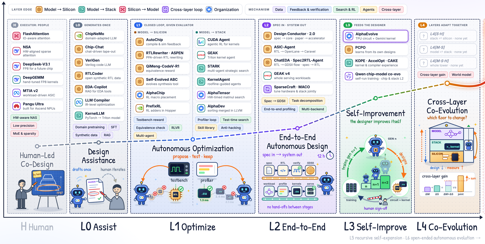
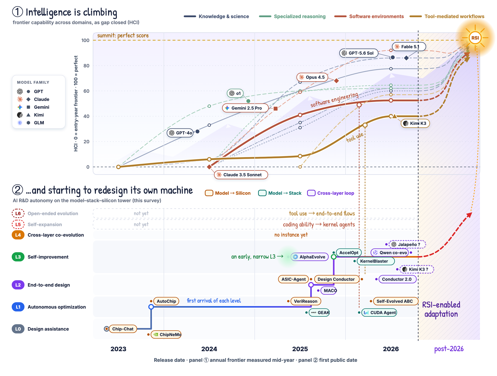
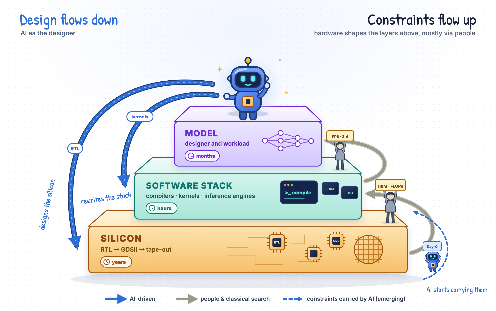

<a id="readme-top"></a>

<div align="center">

<h1>Awesome Model–Silicon Co-Evolution</h1>

<p><b>How models, software stacks and chips are starting to improve one another.</b></p>

<p>
  <a href="#contents"></a>
  <a href="https://github.com/yangforever17/awesome-model-silicon-coevolution/issues/new?template=add-paper.yml"></a>
  <a href="https://github.com/yangforever17/awesome-model-silicon-coevolution/stargazers"></a>
  <a href="LICENSE"></a>
</p>

<p>
  <a href="#news">News</a> ·
  <a href="#framework">Framework</a> ·
  <a href="#contents">Contents</a> ·
  <a href="#part-cases">Closed loops</a> ·
  <a href="#survey">Survey &amp; citation</a> ·
  <a href="#contributing">Contribute</a>
</p>

</div>

Every model runs on a machine it did not design. That is starting to change: language models now write RTL, tune kernels, run EDA flows and help design the chips that train and serve them. This list collects the **454 works** mapped in our survey and tags each with the layer it acts on and how much of the R&D loop the AI runs.

<div align="center">
  
  <p><sub><b>Figure 1.</b> The landscape by autonomy level. The higher the level, the fewer the works; L4 has no instance yet.</sub></p>
</div>

<a id="news"></a>

## News

- **2026-11-04** Synced with the latest survey: 454 works, including 150 new entries (RTL and PPA optimization, end-to-end workloads, harnesses and model–harness co-evolution, cross-layer co-design). Levels follow the revised scale: L3 is self-improvement and L4, cross-layer co-evolution, has no instance yet.
- **2026-10-23** Code links with live GitHub stars for 158 entries. Suggest a paper in one step with the [issue form](https://github.com/yangforever17/awesome-model-silicon-coevolution/issues/new?template=add-paper.yml).
- **2026-10-22** Repository launched with the survey's full reference map.

<a id="contents"></a>

## Contents

**Background** · [Why now](#why-now) · [Framework: layers and autonomy levels](#framework) · [Survey &amp; citation](#survey) · [Contributing](#contributing)

| | Part | Entries | Survey |
| ---: | --- | ---: | --- |
| 1 | [Closed-Loop Case Studies](#part-cases) | 12 | §5 |
| 2 | [Design Flows Down (I): Model → Silicon](#part-model-silicon) | 102 | §2.1, §4.1 |
| 3 | [Design Flows Down (II): Model → Software Stack](#part-model-stack) | 73 | §2.2.4, §4.2 |
| 4 | [Constraints Flow Up: Silicon → Model](#part-silicon-model) | 68 | §2.2, §4.3 |
| 5 | [Who Carries the Constraints Up? LLM-Involved Cross-Layer Co-Design](#part-cross) | 4 | §4.4 |
| 6 | [Formalization and Co-Design Foundations](#part-foundations) | 27 | §3 |
| 7 | [Self-Improvement Engines](#part-engines) | 15 | §1, §2.3, §3.3 |
| 8 | [Intelligence: Knowledge, Rewards and Verification](#part-intelligence) | 82 | §6 |
| 9 | [Benchmarks: From Exam Hall to Training Ground](#part-benchmarks) | 44 | §7 |
| 10 | [Related Surveys](#part-surveys) | 17 | §1.5, §3 |
| 11 | [Outlook: Recursion, Governance and World Models](#part-outlook) | 10 | §8 |

<a id="why-now"></a>

## Why now

General capability is climbing fastest in software engineering and agentic tool use, the very skills kernel agents and design agents run on. On our autonomy scale, the first arrival of each level stepped from L0 (2023) to L3 (late 2025), with AlphaEvolve an earlier, narrow L3.

<div align="center">
  
  <p><sub><b>Figure 2.</b> ① Capability trajectories as gap closed <a href="https://arxiv.org/abs/2609.11873">[Duan et al., 2026]</a>. ② Milestones on our autonomy levels by first public date.</sub></p>
</div>

<a id="framework"></a>

## Framework

We split the system into three layers: the **model** $M$, the **software stack** $S$ (compilers, kernels, serving) and the **hardware** $H$ (microarchitecture, RTL, layout). Design flows down, constraints flow up, and each layer moves the target of the others.

<div align="center">
  
  <p><sub><b>Figure 3.</b> The model–stack–silicon tower. AI already sends designs down; constraints are still hauled up almost entirely by people.</sub></p>
</div>

**Autonomy levels.** How much of the R&D loop does the AI run? The catalog covers L0–L4; L5–L6 are the horizon.

| Level | Name | Decision rule | Entries |
| :---: | --- | --- | ---: |
|  | Design assistance | AI generates code, design proposals or analysis but does not run the propose–verify–revise loop on its own. | 21 |
|  | Autonomous optimization | Given a task, interface and evaluator, AI proposes candidates, calls tools, reads feedback and iterates. | 43 |
|  | End-to-end autonomous design | From a target spec, AI decomposes the task, orchestrates tools, carries the design through verification and delivers a working system. | 9 |
|  | Self-improvement | Design results flow back into the designer itself or its successors, raising the capability or efficiency of its later R&D. | 8 |
|  | Cross-layer co-evolution | AI decides which layers to update; at least two of model, stack and hardware keep adapting to one another, and the gains return to the designer. | — |
|  | Recursive self-expansion | R&D gains turn into more compute, facilities and deployment capacity, reinvested into the next round. | — |
|  | Open-ended autonomous evolution | Within external goals and constraints, AI discovers research questions, methods and new computing paradigms. | — |

<details>
<summary><b>Dynamics, feedback signals and the three paths</b></summary>

<br>

Each layer is updated by an operator that reads a measurement of the whole system, and the executor's capability $\theta$ may itself depend on the system:

```math
X_{t+1} = f_X(X_t,\ y_t;\ \theta_t),\quad y_t = m(M_t, S_t, H_t),\quad X \in \{M, S, H\},\qquad \theta_{t+1} = g(\theta_t;\ M_{t+1}, S_{t+1}, H_{t+1})
```

Unlike static co-design, the target moves, the layers update at very different speeds ($f_S$ hourly, $f_M$ monthly, $f_H$ yearly), and when the executor is a language model it can improve the machine it runs on.

**Feedback signals**, by cost: **S1** compilation (seconds) · **S2** functional tests (minutes–hours) · **S3** timing, area, power (hours) · **S4** profiling (minutes) · **S5** end-to-end on hardware (hours–days) · **S6** post-silicon and deployment (months–years).

| Path | Levels | Signals | Executor | Loop period | Highest-level work |
| --- | --- | --- | --- | --- | --- |
| Model → Silicon | L0–L2 | S1–S3 | LLM agents | hours to days; tape-out in years | AlphaEvolve, PCPO (L3) |
| Model → Stack | L1–L2 | S2, S4–S5 | LLM agents | minutes to hours | AlphaEvolve, CAKE (L3) |
| Silicon → Model | not rated | S4–S6 | human teams | months to years | DeepSeek-V2 to V4, Step-3 |

</details>

<details>
<summary><b>Where the loop breaks</b></summary>

<br>

| | What breaks |
| --- | --- |
| **Physics** | Lower layers give slower, costlier, sparser feedback: seconds to compile, hours to place and route, years for silicon. |
| **Agents** | Agent horizons are hours while hardware loops take years; nothing remembers across chip generations, and there is no cross-layer environment to train in. |
| **Ecosystem** | The layers belong to different companies. A cross-layer loop needs one executor with access to several layers, which mostly exists only inside vertically integrated firms. |

</details>

<a id="catalog"></a>

> **How to read the tables.**        autonomy level &nbsp;·&nbsp; ⭐ key work &nbsp;·&nbsp; † level assigned by the curators, not the survey &nbsp;·&nbsp; the venue links to the DOI or proceedings page

<a id="part-cases"></a>

## 1. Closed-Loop Case Studies

Cases where an AI-designed artifact reaches the hardware or software that trains or serves AI. <sub>Survey §5 · 12 entries</sub>

| Case | Year · source | Loop | Level | Where it breaks |
| --- | --- | --- | :---: | --- |
| NVCell | 2021&nbsp;·&nbsp;DAC | RL generates standard-cell layouts | L1 | Designer is not the model being trained |
| AlphaTensor | 2022&nbsp;·&nbsp;Nature | Searches matmul algorithms for specific hardware | L1 | Hardware is fixed |
| PrefixRL | 2022&nbsp;·&nbsp;DAC | RL prefix circuits shipped in NVIDIA GPUs | L1 | Designer is not the model being trained |
| AlphaDev | 2023&nbsp;·&nbsp;Nature | Sorting routines merged into LLVM libc++ | L1 | Only software updates |
| AlphaEvolve | 2025&nbsp;·&nbsp;DeepMind | One agent rewrites a TPU circuit and a Gemini kernel | **L3** | Closed, but one turn is worth ~1% |
| OpenAI × Broadcom | 2025&nbsp;·&nbsp;interview | ~20 optimizations on human-optimized blocks | Possible L1 | Cannot be verified |
| MTIA v2 | 2025&nbsp;·&nbsp;ISCA | Recommendation workloads drive chip design | Human | Executor is not a model |
| Pangu Ultra × Ascend | 2025&nbsp;·&nbsp;tech&nbsp;report | Model and recipe built around NPUs | Human | Executor is not a model |
| Jalapeño | 2026&nbsp;·&nbsp;press | Nine months from design to tape-out | Possible L3 | Cannot be verified |
| Qwen chip–model | 2026&nbsp;·&nbsp;blog | Chip and inference stack adapted in parallel | L3 | The two ends are not connected |
| *Design Conductor 2.0* | 2026&nbsp;·&nbsp;arXiv | Reads an algorithm paper, designs an accelerator | L2 | Product does not flow back to the designer |

Three failure patterns: the **executor** is not the trained model or is a human team; the **signal** does not flow between the two ends; or the **gain** per turn is too small or cannot be checked.

<details>
<summary>Sources</summary>

| Work | Venue | Level | Note |
| :--- | :--- | :---: | :--- |
| ⭐ [NVCell: Standard Cell Layout in Advanced Technology Nodes with Reinforcement Learning](https://arxiv.org/abs/2107.07044) | [DAC&nbsp;2021](https://doi.org/10.1109/dac18074.2021.9586188) |  | RL generates standard-cell layouts and fixes DRC violations, bringing cell-library development into an automated flow. |
| ⭐ [Discovering Faster Matrix Multiplication Algorithms with Reinforcement Learning](https://doi.org/10.1038/s41586-022-05172-4) [](https://github.com/google-deepmind/alphatensor) | Nature&nbsp;2022 |  | AlphaTensor searches matrix-multiplication decompositions with RL and can target measured runtime on a specific GPU or TPU, putting hardware measurements directly into algorithm design. |
| ⭐ [PrefixRL: Optimization of Parallel Prefix Circuits using Deep Reinforcement Learning](https://arxiv.org/abs/2205.07000) [[Link](https://developer.nvidia.com/blog/designing-arithmetic-circuits-with-deep-reinforcement-learning/)] | [DAC&nbsp;2022](https://doi.org/10.1109/dac18074.2021.9586094) |  | RL designs parallel-prefix circuits with post-synthesis area/delay as reward; ~13,000 AI-designed circuit instances ship in NVIDIA Hopper. |
| ⭐ [Faster Sorting Algorithms Discovered Using Deep Reinforcement Learning](https://doi.org/10.1038/s41586-023-06004-9) [](https://github.com/google-deepmind/alphadev) | Nature&nbsp;2023 |  | AlphaDev discovers assembly-level sorting routines that were merged into LLVM's libc++, a precedent for AI-found low-level improvements entering production stacks. |
| ⭐ [AlphaEvolve: A Coding Agent for Scientific and Algorithmic Discovery](https://arxiv.org/abs/2506.13131) | [Google DeepMind white paper&nbsp;2025](https://deepmind.google/blog/alphaevolve-a-gemini-powered-coding-agent-for-designing-advanced-algorithms/) |  | An early, narrow L3: a Gemini-driven evolutionary coding agent rewrote a TPU arithmetic circuit and sped up a Gemini training kernel by 23% (~1% of total training time). |
| ⭐ [Meta's Second Generation AI Chip: Model-Chip Co-Design and Productionization Experiences](https://doi.org/10.1145/3695053.3731409) | ISCA&nbsp;2025 |  | MTIA v2: recommendation-model workloads directly set the chip's compute/memory balance; strong cross-layer coupling executed by human teams. |
| ⭐ [OpenAI and Broadcom Announce Strategic Collaboration to Deploy 10 Gigawatts of Custom AI Accelerators](https://tech.yahoo.com/ai/articles/greg-brockman-says-openais-tech-035921214.html) | Press release and The OpenAI Podcast&nbsp;2025 |  | OpenAI states its models found ~20 optimizations on human-optimized components of its custom accelerator (L1 by description); not independently verifiable. |
| [Pangu Ultra MoE: How to Train Your Big MoE on Ascend NPUs](https://arxiv.org/abs/2505.04519) | arXiv&nbsp;2025 |  | Pangu Ultra on Ascend: simulation before training picks hyperparameters suited to the NPU, and a 718B model trains at 30% MFU on 6K Ascend NPUs. |
| ⭐ [Pangu Ultra: Pushing the Limits of Dense Large Language Models on Ascend NPUs](https://arxiv.org/abs/2504.07866) | arXiv&nbsp;2025 |  | A dense ~100B+ model whose architecture and training recipe were adapted to large Ascend NPU clusters; human-driven co-design. |
| [Alibaba Reports Progress on Omni-Modal Models, with Qwen4 and a Next-Generation Video Model in Training (阿里公布全模态模型新进展，Qwen4 和下代视频模型均在训练中)](https://www.qbitai.com/2026/09/493625.html) | QbitAI report on the 2026 Apsara Conference&nbsp;2026 |  | Alibaba Cloud reports that a model iterated its own training for over a month and 33 rounds without humans, raising its Artificial Analysis score from 40 to 45. |
| ⭐ [Chip–Model Co-Evolution: Qwen in Production Chip Design and Inference Adaptation (芯模协同进化：Qwen 落地生产级芯片设计与推理适配)](https://mp.weixin.qq.com/s/UosZXtL16-VxSrDQ5WGwOw) | Qwen official WeChat account&nbsp;2026 |  | Qwen3.8-Max takes a NoC module from spec through RTL, verification and physical implementation, and separately deploys and tunes a new model on a domestic accelerator; the two ends are not yet connected. |
| ⭐ [OpenAI and Broadcom Unveil LLM-Optimized Inference Chip Jalapeño](https://openai.com/index/openai-broadcom-jalapeno-inference-chip/) | Press release&nbsp;2026 |  | OpenAI–Broadcom LLM inference chip taped out nine months from initial design, with models said to have helped design and optimization; the model's role is not disclosed. |

</details>

<p align="right"><a href="#contents"></a></p>

<a id="part-model-silicon"></a>

## 2. Design Flows Down (I): Model → Silicon

Language models as chip designers, from tuning tools to writing RTL to rewriting the EDA tools themselves. Most work stays inside one layer at L0–L2. <sub>Survey §2.1, §4.1 · 102 entries</sub>

> [Classical and open-source EDA substrate](#classical-and-open-source-eda-substrate) 5 · [Pre-LLM machine learning for EDA](#pre-llm-machine-learning-for-eda) 7 · [LLMs enter chip design](#llms-enter-chip-design) 7 · [RTL generation and reasoning models](#rtl-generation-and-reasoning-models) 26 · [Debugging and repair](#debugging-and-repair) 4 · [Verification](#verification) 9 · [HLS and architecture exploration](#hls-and-architecture-exploration) 13 · [Physical implementation and EDA tools](#physical-implementation-and-eda-tools) 16 · [End-to-end agents](#end-to-end-agents) 9 · [Analog circuits](#analog-circuits) 6

### Classical and open-source EDA substrate

<details>
<summary>Show 5 entries · 2010–2019</summary>

| Work | Venue | Note |
| :--- | :--- | :--- |
| [ABC: An Academic Industrial-Strength Verification Tool](https://doi.org/10.1007/978-3-642-14295-6_5) [](https://github.com/berkeley-abc/abc) | CAV&nbsp;2010 | ABC, the academic logic synthesis and verification system that later became the target of agent-driven source-code evolution (Self-Evolved ABC). |
| [Yosys – A Free Verilog Synthesis Suite](https://yosyshq.net/yosys/) [](https://github.com/YosysHQ/yosys) | Austrochip&nbsp;2013 | Yosys, the open-source Verilog synthesis suite underlying many open EDA flows and LLM-for-RTL evaluations. |
| [DREAMPlace: Deep Learning Toolkit-Enabled GPU Acceleration for Modern VLSI Placement](https://doi.org/10.1145/3316781.3317803) [](https://github.com/limbo018/DREAMPlace) | DAC&nbsp;2019 | DREAMPlace casts analytic placement as neural-network training to run on GPU deep-learning toolkits. |
| [RePlAce: Advancing Solution Quality and Routability Validation in Global Placement](https://doi.org/10.1109/tcad.2018.2859220) [](https://github.com/The-OpenROAD-Project/RePlAce) | TCAD&nbsp;2019 | RePlAce, an analytic global placer that serves as a strong classical placement baseline. |
| [Toward an Open-Source Digital Flow: First Learnings from the OpenROAD Project](https://doi.org/10.1145/3316781.3326334) [](https://github.com/The-OpenROAD-Project/OpenROAD) | DAC&nbsp;2019 | OpenROAD, an autonomous open-source RTL-to-GDSII flow and the backbone of many agentic physical-design studies. |

</details>

### Pre-LLM machine learning for EDA

<details>
<summary>Show 7 entries · 2018–2024</summary>

| Work | Venue | Level | Note |
| :--- | :--- | :---: | :--- |
| [Machine Learning Applications in Physical Design: Recent Results and Directions](https://doi.org/10.1145/3177540.3177554) | ISPD&nbsp;2018 |  | Overview of ML applications in physical design and their open directions. |
| [RouteNet: Routability Prediction for Mixed-Size Designs Using Convolutional Neural Network](https://doi.org/10.1145/3240765.3240843) | ICCAD&nbsp;2018 |  | RouteNet predicts routability with a CNN, an early example of ML replacing expensive implementation runs with prediction. |
| [DSO.ai: AI-Driven Design Space Optimization](https://www.synopsys.com/ai/chip-design/dso-ai.html) | Press release, March 11, 2020&nbsp;2020 |  | Synopsys DSO.ai uses reinforcement learning to search chip design-space parameters. |
| ⭐ [A Graph Placement Methodology for Fast Chip Design](https://doi.org/10.1038/s41586-021-03544-w) [](https://github.com/google-research/circuit_training) | Nature&nbsp;2021 |  | RL macro placement, later reported in use for TPU v5e, v5p and Trillium. |
| [Assessment of Reinforcement Learning for Macro Placement](https://doi.org/10.1145/3569052.3578926) [](https://github.com/TILOS-AI-Institute/MacroPlacement) | ISPD&nbsp;2023 |  | Independent assessment of RL macro placement; part of the reproducibility debate around AlphaChip. |
| [How AlphaChip Transformed Computer Chip Design](https://deepmind.google/blog/how-alphachip-transformed-computer-chip-design/) | Google DeepMind Blog&nbsp;2024 |  | Google DeepMind's retrospective on AlphaChip and its use across TPU generations. |
| [Reevaluating Google's Reinforcement Learning for IC Macro Placement](https://doi.org/10.1145/3676845) [](https://github.com/TILOS-AI-Institute/MacroPlacement) | CACM&nbsp;2024 |  | Re-evaluates Google's RL macro placement, highlighting how closed design data makes industrial claims hard to verify. |

</details>

### LLMs enter chip design

| Work | Venue | Level | Note |
| :--- | :--- | :---: | :--- |
| [DAVE: Deriving Automatically Verilog from English](https://arxiv.org/abs/2009.01026) | [MLCAD&nbsp;2020](https://doi.org/10.1145/3380446.3430634) |  † | DAVE fine-tunes GPT-2 to derive Verilog from English, handling only simple tasks. |
| [Benchmarking Large Language Models for Automated Verilog RTL Code Generation](https://arxiv.org/abs/2212.11140) [](https://github.com/shailja-thakur/VGen) | [DATE&nbsp;2023](https://doi.org/10.23919/date56975.2023.10137086) |  | Benchmarks LLMs on Verilog generation and shows that fine-tuning on open Verilog narrows the gap left by general models. |
| ⭐ [Chip-Chat: Challenges and Opportunities in Conversational Hardware Design](https://arxiv.org/abs/2305.13243) | [MLCAD&nbsp;2023](https://doi.org/10.1109/mlcad58807.2023.10299874) |  | A processor designed through conversation with an LLM and taped out, the first LLM-written circuit on real silicon. |
| [ChipGPT: How Far Are We from Natural Language Hardware Design](https://arxiv.org/abs/2305.14019) | arXiv&nbsp;2023 |  † | ChipGPT asks how far LLMs are from natural-language hardware design, combining prompting with output optimization. |
| ⭐ [ChipNeMo: Domain-Adapted LLMs for Chip Design](https://arxiv.org/abs/2311.00176) | arXiv&nbsp;2023 |  | Domain-adaptive pretraining on internal NVIDIA design documents, scripts and code, plus domain tokenization and retrieval. |
| [Pushing the Limits of Machine Design: Automated CPU Design with AI](https://arxiv.org/abs/2306.12456) | arXiv&nbsp;2023 |  | Automated CPU design with AI: a processor core generated from input–output examples without HDL, a precursor of QiMeng-CPU. |
| ⭐ [QiMeng: Fully Automated Hardware and Software Design for Processor Chip](https://arxiv.org/abs/2506.05007) | arXiv&nbsp;2025 |  | QiMeng builds hardware- and software-design agents on a processor-chip foundation model; QiMeng-CPU-v1 (~4M gates) is described as the first fully automatically designed processor core. |

### RTL generation and reasoning models

| Work | Venue | Level | Note |
| :--- | :--- | :---: | :--- |
| ⭐ [AutoChip: Automating HDL Generation Using LLM Feedback](https://arxiv.org/abs/2311.04887) [](https://github.com/shailja-thakur/AutoChip) | arXiv&nbsp;2023 |  | AutoChip feeds compiler and simulation errors back to the LLM, the first-generation prompt-and-feedback loop for RTL. |
| [AutoVCoder: A Systematic Framework for Automated Verilog Code Generation Using LLMs](https://arxiv.org/abs/2407.18333) [](https://github.com/sjtu-zhao-lab/AutoVCoder) | [ICCD&nbsp;2024](https://doi.org/10.1109/iccd63220.2024.00033) |  † | AutoVCoder adds retrieval augmentation to a systematic Verilog-generation framework. |
| [BetterV: Controlled Verilog Generation with Discriminative Guidance](https://arxiv.org/abs/2402.03375) | ICML&nbsp;2024 |  † | BetterV steers Verilog generation with discriminative guidance. |
| [OriGen: Enhancing RTL Code Generation with Code-to-Code Augmentation and Self-Reflection](https://doi.org/10.1145/3676536.3676830) [](https://github.com/pku-liang/OriGen) | ICCAD&nbsp;2024 |  † | OriGen augments data code-to-code and adds compiler-feedback self-reflection. |
| [RTLRewriter: Methodologies for Large Models aided RTL Code Optimization](https://arxiv.org/abs/2409.11414) | [ICCAD&nbsp;2024](https://doi.org/10.1145/3676536.3676775) |  | RTLRewriter rewrites RTL with circuit partitioning, retrieval and cost-aware MCTS, rewarding synthesis results and guarding correctness with equivalence checking. |
| [VeriGen: A Large Language Model for Verilog Code Generation](https://arxiv.org/abs/2308.00708) [](https://github.com/shailja-thakur/VGen) | [TODAES&nbsp;2024](https://doi.org/10.1145/3643681) |  | VeriGen fine-tunes an LLM on open-source Verilog and textbooks. |
| ASPEN: LLM-Guided E-Graph Rewriting for RTL Datapath Optimization | MLCAD&nbsp;2025 |  | ASPEN has an LLM propose and select e-graph rewrite rules scored by real EDA area and timing, cutting area by 16.51% on average. |
| [CraftRTL: High-Quality Synthetic Data Generation for Verilog Code Models with Correct-by-Construction Non-Textual Representations and Targeted Code Repair](https://arxiv.org/abs/2409.12993) [](https://github.com/NVlabs/CraftRTL) | ICLR&nbsp;2025 |  † | CraftRTL converts Karnaugh maps, state diagrams and waveforms into correct-by-construction samples, anchoring synthetic data to external truth. |
| [DeepRTL: Bridging Verilog Understanding and Generation with a Unified Representation Model](https://arxiv.org/abs/2502.15832) [](https://github.com/PeterLau61/DeepRTL) | ICLR&nbsp;2025 |  † | DeepRTL unifies Verilog understanding and generation in one representation model. |
| [Hardware Generation with High Flexibility using Reinforcement Learning Enhanced LLMs](https://doi.org/10.1109/dac63849.2025.11132897) | DAC&nbsp;2025 |  | PPA-RTL writes post-synthesis PPA into the RL reward, securing functional correctness first and then optimizing power, delay and area. |
| [MAGE: A Multi-Agent Engine for Automated RTL Code Generation](https://arxiv.org/abs/2412.07822) [](https://github.com/stable-lab/MAGE) | [DAC&nbsp;2025](https://doi.org/10.1109/dac63849.2025.11133191) |  † | MAGE uses a multi-agent engine with simulation feedback for RTL generation. |
| ⭐ [QiMeng-CodeV-R1: Reasoning-Enhanced Verilog Generation](https://arxiv.org/abs/2505.24183) [](https://github.com/IPRC-DIP/CodeV-R1) | [NeurIPS&nbsp;2025](https://doi.org/10.52202/085713-5160) |  † | QiMeng-CodeV-R1 rewards equivalence checks against reference designs and filters data by round-trip consistency; its 7B model beats 671B DeepSeek-R1 on RTLLM. |
| ⭐ [RTLCoder: Fully Open-Source and Efficient LLM-Assisted RTL Code Generation Technique](https://arxiv.org/abs/2312.08617) [](https://github.com/hkust-zhiyao/RTL-Coder) | [TCAD&nbsp;2025](https://doi.org/10.1109/tcad.2024.3483089) |  | RTLCoder synthesizes instruction–code pairs with a strong model; a fully open data-centric RTL generator. |
| [ScaleRTL: Scaling LLMs with Reasoning Data and Test-Time Compute for Accurate RTL Code Generation](https://arxiv.org/abs/2506.05566) | [MLCAD&nbsp;2025](https://doi.org/10.1109/mlcad65511.2025.11189212) |  | ScaleRTL trains an RTL reasoning model on 3.5B tokens of long chain-of-thought data with test-time scaling, beating 18 baselines by up to 18.4% on VerilogEval. |
| [SymRTLO: Enhancing RTL Code Optimization with LLMs and Neuron-Inspired Symbolic Reasoning](https://arxiv.org/abs/2504.10369) | [NeurIPS&nbsp;2025](https://doi.org/10.52202/085713-1670) |  | SymRTLO combines LLM rewriting with symbolic reasoning and FSM optimization. |
| [VerilogCoder: Autonomous Verilog Coding Agents with Graph-Based Planning and Abstract Syntax Tree (AST)-Based Waveform Tracing Tool](https://arxiv.org/abs/2408.08927) [](https://github.com/NVlabs/VerilogCoder) | [AAAI&nbsp;2025](https://doi.org/10.1609/aaai.v39i1.32007) |  † | VerilogCoder coordinates agents with graph-based planning and an AST-based waveform-tracing debugging tool. |
| ⭐ [VeriReason: Reinforcement Learning with Testbench Feedback for Reasoning-Enhanced Verilog Generation](https://arxiv.org/abs/2505.11849) [](https://github.com/NellyW8/VeriReason) | [arXiv&nbsp;2025](https://doi.org/10.1145/3787109.3815310) |  | VeriReason combines testbench feedback with structural heuristics in an RL reward for reasoning-enhanced Verilog generation. |
| [VeriRL: Boosting the LLM-Based Verilog Code Generation via Reinforcement Learning](https://arxiv.org/abs/2508.18462) [](https://github.com/ZJU-OmniAI/VeriRL) | [ICCAD&nbsp;2025](https://doi.org/10.1109/iccad66269.2025.11241003) |  † | VeriRL boosts LLM Verilog generation with reinforcement learning. |
| [VFlow: Discovering Optimal Agentic Workflows for Verilog Generation](https://arxiv.org/abs/2504.03723) | [arXiv&nbsp;2025](https://doi.org/10.1109/asp-dac66049.2026.11420713) |  | VFlow evolves the agentic workflow that generates RTL with multi-population co-evolution and MCTS, jointly optimizing correctness, PPA and token cost. |
| [Agentic Hardware Design as Repository-Level Code Evolution](https://arxiv.org/abs/2606.28279) | arXiv&nbsp;2026 |  | HORIZON treats hardware design as repository-level code evolution under an executable evaluator and acceptance conditions. |
| [AutoGate: Automated Clock Gating via Toggling-Aware LLM-based RTL Rewriting](https://arxiv.org/abs/2606.17461) | arXiv&nbsp;2026 |  | AutoGate inserts fine-grained clock gating from real-workload toggle activity, reducing dynamic power on NVDLA by 19.34%. |
| Cedar: Learning to Optimize RTL via Accumulating Verified Rewrite Rules | ICCAD&nbsp;2026 |  | Cedar has an LLM propose rewrite rules, verifies each with Z3 and keeps verified rules for later designs, cutting area and power by ~19% on RTLLM. |
| [ChipSeek: Optimizing Verilog Generation via EDA-Integrated Reinforcement Learning](https://arxiv.org/abs/2507.04736) | [ACL&nbsp;2026](https://doi.org/10.18653/v1/2026.acl-long.1154) |  | ChipSeek puts post-synthesis PPA into the RL reward after functional correctness, bringing S3 signals into training. |
| [CodeV: Empowering LLMs With HDL Generation Through Multilevel Summarization](https://arxiv.org/abs/2407.10424) [](https://github.com/IPRC-DIP/CodeV) | TCAD&nbsp;2026 |  † | CodeV back-translates code into descriptions through multi-level summarization to build fine-tuning data. |
| [Dr. RTL: Autonomous Agentic RTL Optimization through Tool-Grounded Self-Improvement](https://arxiv.org/abs/2604.14989) | ICCAD&nbsp;2026 |  | Dr. RTL distills a reusable skill library from parallel rewrites, improving WNS/TNS by 21%/17% and area by 6% against a commercial tool on 20 real designs. |
| [QiMeng-ChipV-RTL: Exploiting Information Locality for IP-level Verilog Generation](https://arxiv.org/abs/2602.00704) | ICML&nbsp;2026 |  | QiMeng-ChipV-RTL splits long specifications into local tasks, raising the RealBench pass rate from 21.6% to 45.0% as the frontier moves to IP level. |

### Debugging and repair

| Work | Venue | Level | Note |
| :--- | :--- | :---: | :--- |
| [MEIC: Re-thinking RTL Debug Automation using LLMs](https://arxiv.org/abs/2405.06840) | [ICCAD&nbsp;2024](https://doi.org/10.1145/3676536.3676801) |  † | MEIC rethinks RTL debug automation to handle functional as well as syntax errors. |
| ⭐ [RTLFixer: Automatically Fixing RTL Syntax Errors with Large Language Models](https://arxiv.org/abs/2311.16543) [](https://github.com/NVlabs/RTLFixer) | [DAC&nbsp;2024](https://doi.org/10.1145/3649329.3657353) |  | RTLFixer repairs RTL syntax errors with retrieval augmentation and ReAct-style reasoning, the minimal form of an agent loop. |
| [HDLdebugger: Streamlining HDL Debugging with Large Language Models](https://arxiv.org/abs/2403.11671) | [TODAES&nbsp;2025](https://doi.org/10.1145/3735638) |  † | HDLdebugger streamlines HDL debugging with LLMs and retrieval. |
| [HWE-Bench: Benchmarking LLM Agents on Real-World Hardware Bug Repair Tasks](https://arxiv.org/abs/2604.14709) | ICCAD&nbsp;2026 |  | On 417 real bugs from six projects the best agent resolves 70.7%, but under 65% on SoC-level projects; failures cluster in fault localization and cross-file edits. |

### Verification

| Work | Venue | Level | Note |
| :--- | :--- | :---: | :--- |
| [LLM-assisted Generation of Hardware Assertions](https://arxiv.org/abs/2306.14027) | arXiv&nbsp;2023 |  † | Early use of LLMs to generate security-relevant SystemVerilog assertions. |
| [AssertLLM: Generating and Evaluating Hardware Verification Assertions from Design Specifications via Multi-LLMs](https://arxiv.org/abs/2402.00386) [](https://github.com/hkust-zhiyao/AssertLLM) | LAD&nbsp;2024 |  † | AssertLLM extracts verification assertions from design specifications with multiple LLMs. |
| [AssertionForge: Enhancing Formal Verification Assertion Generation with Structured Representation of Specifications and RTL](https://arxiv.org/abs/2503.19174) | [ICLAD&nbsp;2025](https://doi.org/10.1109/iclad65226.2025.00009) |  | AssertionForge builds a knowledge graph from the specification and RTL and generates formal assertions from it. |
| [LLM4DV: Using Large Language Models for Hardware Test Stimuli Generation](https://arxiv.org/abs/2310.04535) [](https://github.com/ZixiBenZhang/ml4dv) | [FCCM&nbsp;2025](https://doi.org/10.1109/fccm62733.2025.00048) |  † | LLM4DV generates hardware test stimuli with LLMs, iterating on coverage feedback. |
| ⭐ [Saarthi: An Agentic AI Framework for End-to-End Formal Verification](https://arxiv.org/abs/2502.16662) | arXiv&nbsp;2025 |  † | Saarthi coordinates multiple agents to carry out end-to-end formal verification. |
| [UVLLM: An Automated Universal RTL Verification Framework using LLMs](https://arxiv.org/abs/2411.16238) [](https://github.com/amyuch/UVLLM) | [DAC&nbsp;2025](https://doi.org/10.1109/dac63849.2025.11435108) |  † | UVLLM automates UVM-style RTL verification, generating test environments and fixing errors in a loop. |
| [HierSVA: A Data Synthesis Pipeline, Dataset, and Benchmark for LLM-Driven Hierarchical Hardware Formal Verification](https://arxiv.org/abs/2606.13706) | NeurIPS&nbsp;2026 |  | 82.1% of generated assertions prove non-vacuously yet catch only 70.2% of injected faults; a provable assertion is not a reliable gate. |
| [LLM4Cov: Execution-Aware Agentic Learning for High-Coverage Testbench Generation](https://arxiv.org/abs/2602.16953) | ICML&nbsp;2026 |  | LLM4Cov approaches coverage closure through offline agent learning, bringing a 4B model to 90.4% average coverage. |
| [PRO-V-R1: Reasoning Enhanced Programming Agent for RTL Verification](https://arxiv.org/abs/2506.12200) | DAC&nbsp;2026 |  | PRO-V-R1 trains an open verification agent with simulation feedback as reward, raising functional correctness from 25.7% to 57.7%. |

### HLS and architecture exploration

| Work | Venue | Level | Note |
| :--- | :--- | :---: | :--- |
| [ArchGym: An Open-Source Gymnasium for Machine Learning Assisted Architecture Design](https://arxiv.org/abs/2306.08888) [](https://github.com/srivatsankrishnan/oss-arch-gym) | [ISCA&nbsp;2023](https://doi.org/10.1145/3579371.3589049) |  | ArchGym wraps ML-driven architecture design-space exploration in a gym: agents tune accelerator parameters, simulators return performance and energy. |
| ⭐ [GPT4AIGChip: Towards Next-Generation AI Accelerator Design Automation via Large Language Models](https://arxiv.org/abs/2309.10730) | [ICCAD&nbsp;2023](https://doi.org/10.1109/iccad57390.2023.10323953) |  | GPT4AIGChip is an early attempt to generate HLS code for AI accelerators with LLMs. |
| [C2HLSC: Can LLMs Bridge the Software-to-Hardware Design Gap?](https://arxiv.org/abs/2406.09233) [](https://github.com/Lucaz97/c2hlsc) | [LAD&nbsp;2024](https://doi.org/10.1109/lad62341.2024.10691856) |  † | C2HLSC iteratively refactors C into HLS-compatible code using tool feedback. |
| [HLSPilot: LLM-Based High-Level Synthesis](https://arxiv.org/abs/2408.06810) [](https://github.com/xcw-1010/HLSPilot) | [ICCAD&nbsp;2024](https://doi.org/10.1145/3676536.3676781) |  † | HLSPilot rewrites C code into synthesizable HLS with LLM-guided optimization. |
| ⭐ [LLM-DSE: Searching Accelerator Parameters with LLM Agents](https://arxiv.org/abs/2505.12188) [](https://github.com/Nozidoali/LLM-DSE) | arXiv&nbsp;2025 |  † | LLM-DSE coordinates router, specialist, arbiter and critic agents to tune HLS directives, ~2.55x over prior methods on HLSyn. |
| [LLMulator: Generalizable Cost Modeling for Dataflow Accelerators with Input-Adaptive Control Flow](https://arxiv.org/abs/2508.17826) | [MICRO&nbsp;2025](https://doi.org/10.1145/3725843.3756027) |  | LLMulator uses a language model as the performance model of dataflow accelerators, with 11.2% cycle error after RL calibration. |
| [SpecLLM: Exploring Generation and Review of VLSI Design Specification with Large Language Model](https://arxiv.org/abs/2401.13266) [](https://github.com/hkust-zhiyao/SpecLLM) | [ISEDA&nbsp;2025](https://doi.org/10.1109/iseda65950.2025.11100410) |  † | SpecLLM explores LLMs for writing and reviewing VLSI architecture specifications. |
| [ArchAgent: Agentic AI-driven Computer Architecture Discovery](https://arxiv.org/abs/2602.22425) | arXiv&nbsp;2026 |  | ArchAgent explores architecture with an agent and exposes the risk of agents exploiting loopholes in the simulator. |
| [Can Agents Design Better Chips with a Higher Level Abstraction?](https://arxiv.org/abs/2609.21157) | ICCAD&nbsp;2026 |  | Across 11 FPGA tasks, writing HLS first and then refining RTL gives designs 2.6× faster than writing RTL directly. |
| [HLS-Seek: QoR-Aware Code Generation for High-Level Synthesis via Proxy Comparative Reward Reinforcement Learning](https://arxiv.org/abs/2605.13536) | ICCAD&nbsp;2026 |  | HLS-Seek trains a 7B model against a learned pairwise reward, reaching 81.4% functional pass@5 on HLS-Eval and beating GPT-5.1. |
| [LLM-Driven Design Space Exploration of FPGA-based Accelerators](https://arxiv.org/abs/2605.05920) | Workshop on Intelligent System Design (InSyDe), co-located with EuroSys&nbsp;2026 |  † | SECDA-DSE connects LLM-driven design-space exploration to SystemC simulation and FPGA execution. |
| [MicroEvo: Knowledge-Guided LLM Sampling for Efficient Microarchitecture Design Space Exploration](https://arxiv.org/abs/2608.06183) | ICCAD&nbsp;2026 |  | MicroEvo uses LLMs as evolutionary operators inside MCTS to explore CPU microarchitectures, improving Pareto-front quality by up to 36.2% over NSGA-II. |
| PF-LLM: Large Language Model Hinted Hardware Prefetching | ASPLOS&nbsp;2026 |  | PF-LLM has a language model supply hints to a hardware prefetcher. |

### Physical implementation and EDA tools

| Work | Venue | Level | Note |
| :--- | :--- | :---: | :--- |
| [ChatEDA: A Large Language Model Powered Autonomous Agent for EDA](https://arxiv.org/abs/2308.10204) [](https://github.com/wuhy68/ChatEDA) | [TCAD&nbsp;2024](https://doi.org/10.1109/mlcad58807.2023.10299852) |  | ChatEDA lets an LLM agent orchestrate the whole EDA flow from natural-language requests. |
| [ORAssistant: A Custom RAG-based Conversational Assistant for OpenROAD](https://arxiv.org/abs/2410.03845) | arXiv&nbsp;2024 |  | ORAssistant uses retrieval augmentation to answer questions about OpenROAD tools and flows. |
| BUFFALO: PPA-Configurable, LLM-based Buffer Tree Generation via Group Relative Policy Optimization | ICCAD&nbsp;2025 |  | BUFFALO trains an LLM with GRPO to generate buffer trees for all violating nets in one pass, beating a leading commercial tool by 71% in TNS on 7 nm designs. |
| [ChipAlign: Instruction Alignment in Large Language Models for Chip Design via Geodesic Interpolation](https://arxiv.org/abs/2412.19819) | [DAC&nbsp;2025](https://doi.org/10.1109/dac63849.2025.11132537) |  | ChipAlign merges a general instruction-tuned model with a chip-domain model in weight space, separating domain knowledge from instruction following. |
| [EDA-Copilot: A RAG-Powered Intelligent Assistant for EDA Tools](https://doi.org/10.1145/3715326) | TODAES&nbsp;2025 |  | EDA-Copilot uses retrieval augmentation to answer tool questions and help write EDA scripts and code. |
| [MCP4EDA: LLM-Powered Model Context Protocol RTL-to-GDSII Automation with Backend Aware Synthesis Optimization](https://arxiv.org/abs/2507.19570) | arXiv&nbsp;2025 |  | MCP4EDA connects synthesis, simulation and place-and-route tools over MCP, feeding back-end timing, power and area into synthesis scripts. |
| [ORFS-Agent: Tool-Using Agents for Chip Design Optimization](https://arxiv.org/abs/2506.08332) [](https://github.com/ABKGroup/ORFS-Agent) | [MLCAD&nbsp;2025](https://doi.org/10.1109/mlcad65511.2025.11189204) |  † | ORFS-Agent tunes OpenROAD flow parameters with tool-using agents to improve PPA. |
| [Automated QoR Improvement in OpenROAD with Coding Agents](https://arxiv.org/abs/2601.06268) | ICCAD&nbsp;2026 |  | AuDoPEDA edits OpenROAD's C++ source directly, cutting power by up to 19.4%. |
| ⭐ [Autonomous Evolution of EDA Tools: Multi-Agent Self-Evolved ABC](https://arxiv.org/abs/2604.15082) | DAC&nbsp;2026 |  | Agents rewrite the million-line ABC synthesis tool itself, guarded by formal equivalence checking, and find heuristics that beat human baselines. |
| [EvoDRC: A Self-Evolving Agentic Framework for Automated DRC Violation Repair](https://arxiv.org/abs/2607.20019) [](https://github.com/ASU-VDA-Lab/EvoDRC) | arXiv&nbsp;2026 |  † | EvoDRC applies a self-evolving agent framework to DRC-violation repair. |
| [EvoPlace: Evolution of Optimization Algorithms for Global Placement via Large Language Models](https://arxiv.org/abs/2504.17801) | [TCAD&nbsp;2026](https://doi.org/10.1109/tcad.2026.3652945) |  | EvoPlace evolves the optimization algorithm of global placement with LLMs, improving wirelength by 8.30% on ISPD2019. |
| [HELIX: Placement Heuristics Evolution via LLM-Instructed Code Exploration](https://vlsicad.ucsd.edu/Publications/Conferences/430/c430.pdf) | ICCAD&nbsp;2026 |  | HELIX edits OpenROAD's C++ source directly, cutting routed wirelength by 5.6% in geometric mean and up to 23%. |
| [MappingEvolve: LLM-Driven Code Evolution for Technology Mapping](https://arxiv.org/abs/2604.26591) | [DAC&nbsp;2026](https://doi.org/10.1145/3770743.3803988) |  | MappingEvolve evolves technology-mapping code, reducing area by 10.04% against ABC. |
| [See it to Place it: Evolving Macro Placements with Vision-Language Models](https://arxiv.org/abs/2603.28733) | NeurIPS&nbsp;2026 |  | VeoPlace has a vision-language model draw region constraints for an existing placer, improving DREAMPlace by up to 4.4% on Superblue designs. |
| [Self-Evolving Algorithm-Design Agents: Escaping In-Context Evolutionary Stagnation via Population-Curated Policy Optimization](https://arxiv.org/abs/2609.38757) | arXiv&nbsp;2026 |  | PCPO's algorithm-designing model grows stronger through its own placement designs, bringing chip design into L3. |
| [StateTune: Transforming LLM-Assisted EDA Flow Tuning into a Stateful, Closed-Loop Process](https://arxiv.org/abs/2608.23601) | ICCAD&nbsp;2026 |  | StateTune keeps a persistent memory for flow tuning, reaching the best hypervolume on all six blocks of a Cadence industrial flow; removing memory loses 58.5%. |

### End-to-end agents

| Work | Venue | Level | Note |
| :--- | :--- | :---: | :--- |
| ⭐ [ASIC-Agent: An Autonomous Multi-Agent System for ASIC Design with Benchmark Evaluation](https://arxiv.org/abs/2508.15940) | [ICLAD&nbsp;2025](https://doi.org/10.1109/iclad65226.2025.00033) |  | ASIC-Agent assigns sub-agents to RTL generation, verification, OpenLane hardening and Caravel integration, with an agent-oriented benchmark. |
| [Spec2RTL-Agent: Automated Hardware Code Generation from Complex Specifications Using LLM Agent Systems](https://arxiv.org/abs/2506.13905) | ICLAD&nbsp;2025 |  | Spec2RTL-Agent goes from complex specifications through pseudocode, Python and synthesizable C++ to RTL, cutting human interventions by up to 75%. |
| [AMS-IO-Bench and AMS-IO-Agent: Benchmarking and Structured Reasoning for Analog and Mixed-Signal Integrated Circuit Input/Output Design](https://arxiv.org/abs/2512.21613) | [AAAI&nbsp;2026](https://doi.org/10.1609/aaai.v40i2.37134) |  | AMS-IO-Agent generates an I/O ring that was taped out in a 28 nm process, a single subsystem rather than a whole chip. |
| ⭐ [Design Conductor 2.0: An Agent Builds a TurboQuant Inference Accelerator in 80 Hours](https://arxiv.org/abs/2605.05170) | arXiv&nbsp;2026 |  | Design Conductor 2.0 reads the TurboQuant paper and designs VerTQ, an LLM-inference accelerator (5,129 FP units, 240-stage pipeline) in 80 hours; a cross-layer decision made from the model side, at L2. |
| ⭐ [Design Conductor: An Agent Autonomously Builds a RISC-V CPU](https://arxiv.org/abs/2603.08716) | arXiv&nbsp;2026 |  | Design Conductor builds a tape-out-ready RISC-V core from a 219-word spec in 12 hours, closing timing at 1.48 GHz in ASAP7. |
| [How OpenAI Used Its Own LLMs to Design Its Jalapeño Chip](https://spectrum.ieee.org/llms-for-chip-design) | IEEE Spectrum, September 14, 2026&nbsp;2026 |  | Jalapeño's first silicon returned in May 2026, human-led with models contributing to the front end. |
| [PCBgen: Self-Evolving LLM Agent for Specification-to-Schematic PCB Design with Parameter Tuning](https://doi.org/10.1145/3770743.3803934) | DAC&nbsp;2026 |  | PCBgen has a self-evolving agent generate PCB schematics from specifications and tune their parameters, reaching beyond the chip itself. |
| [Redwood: A Frontier AI Accelerator Designed, Verified, and Deployed from Scratch in 2 Weeks by AI](https://arxiv.org/abs/2608.26418) | arXiv&nbsp;2026 |  | An accelerator SoC whose performance model, RTL, verification and firmware were produced by AI in two weeks; FPGA only so far. |
| [The State of Agentic AI in Chip Design Tools in 2026: Cadence, Synopsys, and Siemens All Pitch Autonomous Engineers](https://www.tomshardware.com/tech-industry/semiconductors/the-state-of-agentic-ai-in-chip-design-tools-in-2026-cadence-synopsys-and-siemens-all-pitch-autonomous-engineers) | Tom's Hardware&nbsp;2026 |  | Overview of the 2026 agentic EDA products from Cadence, Synopsys and Siemens, which automate whole flow segments rather than single steps. |

### Analog circuits

| Work | Venue | Level | Note |
| :--- | :--- | :---: | :--- |
| [LaMAGIC: Language-Model-Based Topology Generation for Analog Integrated Circuits](https://arxiv.org/abs/2407.18269) | ICML&nbsp;2024 |  † | LaMAGIC generates power-converter topologies with a language model. |
| [AnalogCoder: Analog Circuit Design via Training-Free Code Generation](https://arxiv.org/abs/2405.14918) [](https://github.com/laiyao1/AnalogCoder) | [AAAI&nbsp;2025](https://doi.org/10.1609/aaai.v39i1.32016) |  † | AnalogCoder describes and iterates on analog circuits as Python code, training-free with simulation feedback. |
| [AnalogGenie: A Generative Engine for Automatic Discovery of Analog Circuit Topologies](https://arxiv.org/abs/2503.00205) | ICLR&nbsp;2025 |  | AnalogGenie designs a sequence representation for analog topologies; 93.2% of generated circuits are valid. |
| [AnalogCoder-Pro: Unifying Analog Circuit Generation and Optimization via Multi-Modal LLMs](https://arxiv.org/abs/2508.02518) | [TCAD&nbsp;2026](https://doi.org/10.1109/tcad.2026.3673493) |  | AnalogCoder-Pro extends AnalogCoder with waveform feedback and a subcircuit library. |
| [SAFTAC: Simulation-Augmented Fine-Tuning of Open-Source LLMs for Analog Circuit Design](https://neurips.cc/virtual/2026/poster/155090) | NeurIPS&nbsp;2026 |  | SAFTAC builds 8,626 netlist tasks with testbenches and trains open models with simulation rewards. |
| [SLIC: Reinforcement Fine-Tuning Small LMs for Multi-Turn Analog Circuit Optimization](https://neurips.cc/virtual/2026/poster/153101) | NeurIPS&nbsp;2026 |  | SLIC trains a 7B model with RL on simulation feedback and beats a 1.6T-parameter baseline by 12.7 points on multi-turn circuit optimization. |

<p align="right"><a href="#contents"></a></p>

<a id="part-model-stack"></a>

## 3. Design Flows Down (II): Model → Software Stack

The stack returns feedback fastest (profiles in minutes, end-to-end runs in hours), so loops close here first. <sub>Survey §2.2.4, §4.2 · 73 entries</sub>

> [Tensor compilers and kernel languages](#tensor-compilers-and-kernel-languages) 16 · [Human-built stacks for specific models](#human-built-stacks-for-specific-models) 7 · [LLM-generated kernels](#llm-generated-kernels) 25 · [From kernels to end-to-end workloads](#from-kernels-to-end-to-end-workloads) 8 · [ML and LLMs for compilers](#ml-and-llms-for-compilers) 8 · [Inference systems and deployment adaptation](#inference-systems-and-deployment-adaptation) 9

### Tensor compilers and kernel languages

| Work | Venue | Note |
| :--- | :--- | :--- |
| [Halide: A Language and Compiler for Optimizing Parallelism, Locality, and Recomputation in Image Processing Pipelines](https://doi.org/10.1145/2491956.2462176) [](https://github.com/halide/Halide) | PLDI&nbsp;2013 | Halide separates algorithm from schedule, the root of the search-plus-cost-model lineage of tensor compilers. |
| [cuDNN: Efficient Primitives for Deep Learning](https://arxiv.org/abs/1410.0759) | arXiv&nbsp;2014 | cuDNN, NVIDIA's library of deep-learning primitives that made GPUs the default DL substrate. |
| ⭐ [TVM: An Automated End-to-End Optimizing Compiler for Deep Learning](https://arxiv.org/abs/1802.04799) [](https://github.com/apache/tvm) | OSDI&nbsp;2018 | TVM, an end-to-end optimizing compiler stack for deep learning. |
| [Triton: An Intermediate Language and Compiler for Tiled Neural Network Computations](https://doi.org/10.1145/3315508.3329973) [](https://github.com/triton-lang/triton) | MAPL&nbsp;2019 | Triton, a tile-based language and compiler that lowers the bar for writing GPU kernels. |
| [Ansor: Generating High-Performance Tensor Programs for Deep Learning](https://arxiv.org/abs/2006.06762) [](https://github.com/apache/tvm) | OSDI&nbsp;2020 | Ansor replaces hand-written templates with generated search spaces and a learned cost model. |
| [MLIR: Scaling Compiler Infrastructure for Domain Specific Computation](https://doi.org/10.1109/cgo51591.2021.9370308) [](https://github.com/llvm/llvm-project) | CGO&nbsp;2021 | MLIR, a reusable multi-level compiler infrastructure for domain-specific computation. |
| [Tensor Program Optimization with Probabilistic Programs](https://arxiv.org/abs/2205.13603) [](https://github.com/apache/tvm) | [NeurIPS&nbsp;2022](https://doi.org/10.52202/068431-2593) | MetaSchedule unifies tensor-program scheduling primitives as probabilistic programs. |
| [TensorIR: An Abstraction for Automatic Tensorized Program Optimization](https://arxiv.org/abs/2207.04296) [](https://github.com/apache/tvm) | [ASPLOS&nbsp;2023](https://doi.org/10.1145/3575693.3576933) | TensorIR, an abstraction for automatic tensorized program optimization. |
| [PyTorch 2: Faster Machine Learning Through Dynamic Python Bytecode Transformation and Graph Compilation](https://doi.org/10.1145/3620665.3640366) [](https://github.com/pytorch/pytorch) | ASPLOS&nbsp;2024 | PyTorch 2 graph capture and compilation (TorchDynamo/TorchInductor), the torch.compile baseline that kernel agents compare against. |
| [Mirage: A Multi-Level Superoptimizer for Tensor Programs](https://arxiv.org/abs/2405.05751) | OSDI&nbsp;2025 | Mirage searches tensor programs by superoptimization with equivalence verification. |
| [ThunderKittens: Simple, Fast, and Adorable Kernels](https://arxiv.org/abs/2410.20399) [](https://github.com/HazyResearch/ThunderKittens) | [ICLR&nbsp;2025](https://iclr.cc/virtual/2025/poster/31243) | ThunderKittens offers hardware-near tile abstractions that approach hand-written kernel performance. |
| [FlashAttention-4: Algorithm and Kernel Pipelining Co-Design for Asymmetric Hardware Scaling](https://arxiv.org/abs/2603.05451) | MLSys&nbsp;2026 | FlashAttention-4 is written in CuTe DSL for Blackwell and runs 1.3× faster than cuDNN on B200. |
| [MPK: A Compiler and Runtime for Mega-Kernelizing Tensor Programs](https://arxiv.org/abs/2512.22219) | OSDI&nbsp;2026 | MPK compiles multi-GPU inference into a single persistent megakernel. |
| [Optimal Software Pipelining and Warp Specialization for Tensor Core GPUs](https://arxiv.org/abs/2512.18134) | OSDI&nbsp;2026 | Twill uses SMT solving for optimal software pipelining and warp specialization, within 2% of expert schedules on FA3 and FA4. |
| [ParallelKittens: Systematic and Practical Simplification of Multi-GPU AI Kernels](https://arxiv.org/abs/2511.13940) | MLSys&nbsp;2026 | ParallelKittens extends embedded kernel DSLs to multi-GPU and expert-parallel settings. |
| [TileLang: Bridge Programmability and Performance in Modern Neural Kernels](https://arxiv.org/abs/2504.17577) [](https://github.com/tile-ai/tilelang) | [ICLR&nbsp;2026](https://iclr.cc/virtual/2026/poster/10010186) | TileLang, a composable tiled programming model for AI kernels. |

### Human-built stacks for specific models

| Work | Venue | Level | Note |
| :--- | :--- | :---: | :--- |
| [DeepEP: An Efficient Expert-Parallel Communication Library](https://github.com/deepseek-ai/DeepEP) [](https://github.com/deepseek-ai/DeepEP) | GitHub repository&nbsp;2025 |  | Expert-parallel communication library; together with DeepGEMM and FlashMLA, the Day-0 adaptation work LLM agents aim to replace. |
| ⭐ [DeepGEMM: Clean and Efficient FP8 GEMM Kernels with Fine-Grained Scaling](https://github.com/deepseek-ai/DeepGEMM) [](https://github.com/deepseek-ai/DeepGEMM) | GitHub repository&nbsp;2025 |  | Hand-written FP8 GEMM kernels with fine-grained scaling for Hopper, built for DeepSeek-V3's numeric choices. |
| [DeepSeek-V3.2-Exp: Boosting Long-Context Efficiency with DeepSeek Sparse Attention](https://github.com/deepseek-ai/DeepSeek-V3.2-Exp) [](https://github.com/deepseek-ai/DeepSeek-V3.2-Exp) | Model release and technical report&nbsp;2025 |  | DeepSeek-V3.2 introduces DeepSeek Sparse Attention; DeepGEMM and FlashMLA gain new kernels and vLLM and SGLang follow on release day. |
| [FlashMLA: Efficient MLA Decoding Kernels](https://github.com/deepseek-ai/FlashMLA) [](https://github.com/deepseek-ai/FlashMLA) | GitHub repository&nbsp;2025 |  | MLA decoding kernels for Hopper, written by hand after the model adopted MLA. |
| [Serving Large Language Models on Huawei CloudMatrix384](https://arxiv.org/abs/2506.12708) | arXiv&nbsp;2025 |  | Huawei rebuilds the serving stack for DeepSeek-R1 on its CloudMatrix384 supernode, the same rewrite on non-NVIDIA hardware. |
| [DeepSeek-V4.1-Flash: Pushing the Limits of KV Cache Compression](https://arxiv.org/abs/2609.19969) | arXiv&nbsp;2026 |  | By V4.1, FlashMLA drops Hopper and older models and targets Blackwell and Ascend 950: the stack is rewritten with each model. |
| [TileKernels: A Kernel Library Written in TileLang](https://github.com/deepseek-ai/TileKernels) [](https://github.com/deepseek-ai/TileKernels) | GitHub repository&nbsp;2026 |  | TileKernels, DeepSeek's new kernel library written in TileLang. |

### LLM-generated kernels

| Work | Venue | Level | Note |
| :--- | :--- | :---: | :--- |
| [AccelOpt: A Self-Improving LLM Agentic System for AI Accelerator Kernel Optimization](https://arxiv.org/abs/2511.15915) | arXiv&nbsp;2025 |  | AccelOpt distills experience from slow/fast kernel pairs and keeps improving on AWS Trainium as experience accumulates. |
| [Adaptive Self-Improvement LLM Agentic System for ML Library Development](https://arxiv.org/abs/2502.02534) | ICML&nbsp;2025 |  | Agents filter high-quality samples from accumulated experience and reuse them as demonstrations, improving ML library generation by up to 3.9×. |
| [Automating GPU Kernel Generation with DeepSeek-R1 and Inference Time Scaling](https://developer.nvidia.com/blog/automating-gpu-kernel-generation-with-deepseek-r1-and-inference-time-scaling/) | NVIDIA Technical Blog&nbsp;2025 |  | NVIDIA pairs DeepSeek-R1 with a verifier and inference-time scaling to generate attention kernels. |
| ⭐ [GEAK: Introducing Triton Kernel AI Agent & Evaluation Benchmarks](https://arxiv.org/abs/2507.23194) [](https://github.com/AMD-AGI/GEAK) | arXiv&nbsp;2025 |  | GEAK generates Triton kernels for AMD GPUs in a Reflexion-style loop: ~55% execution accuracy and 2.59x mean speedup on revised TritonBench. |
| [KernelLLM: Making Kernel Development More Accessible](https://huggingface.co/facebook/KernelLLM) | Hugging Face model release, Meta&nbsp;2025 |  | Meta's KernelLLM translates PyTorch modules directly into Triton kernels. |
| [The AI CUDA Engineer: Agentic CUDA Kernel Discovery, Optimization and Composition](https://sakana.ai/ai-cuda-engineer/) | Sakana AI technical report&nbsp;2025 |  | Sakana's AI CUDA Engineer; its inflated speedups from an evaluation loophole were later corrected, an early warning on reward hacking. |
| [Agentic Operator Generation for ML ASICs](https://arxiv.org/abs/2512.10977) | Conference on Machine Learning and Systems (MLSys), Industry Track&nbsp;2026 |  | TritorX generates ATen operators for MTIA on real chips and simulators of next-generation chips, so an operator library exists before the chip. |
| [Beyond Scaling: Self-Evolving LLM Agents for Hardware Kernel Optimization via an Experience-Driven Workflow and Experience Graph Memory](https://arxiv.org/abs/2608.25570) | arXiv&nbsp;2026 |  | KOPE organizes Ascend kernel-optimization experience into a graph; with the base model unchanged, the pass rate rises from 55.2% to 84.6%. |
| [CAKE: Compiler-Agent Co-Design for Frontier Kernel Evolution](https://arxiv.org/abs/2608.12629) | arXiv&nbsp;2026 |  | CAKE lets agents extend the IR, verifier rules, compiler and cost model when a kernel exposes an expressiveness gap, so later kernels use the improved toolchain. |
| [CANNBot-CAKE: Collaborative Agentic Kernel Evolution for Ascend NPU](https://arxiv.org/abs/2610.31034) | arXiv&nbsp;2026 |  | CANNBot-CAKE analyzes recurring failures in its run logs and proposes changes to its own skills, routing and prompts, with merging left to humans. |
| ⭐ [CUDA Agent: Large-Scale Agentic RL for High-Performance CUDA Kernel Generation](https://arxiv.org/abs/2602.24286) [](https://github.com/BytedTsinghua-SIA/CUDA-Agent) | arXiv&nbsp;2026 |  | Large-scale agentic RL over 6,000+ synthetic operators in a sandbox with automatic verification and profiling; beats torch.compile on all three KernelBench levels. |
| [CUDA-L1: Improving CUDA Optimization via Contrastive Reinforcement Learning](https://arxiv.org/abs/2507.14111) [](https://github.com/ornith-ai/CUDA-L1) | [ICLR&nbsp;2026](https://iclr.cc/virtual/2026/poster/10007945) |  | CUDA-L1 improves CUDA optimization with contrastive reinforcement learning. |
| ⭐ [daVinci-kernel: Co-Evolving Skill Selection, Summarization, and Utilization via RL for GPU Kernel Optimization](https://arxiv.org/abs/2606.16497) | arXiv&nbsp;2026 |  | daVinci-kernel co-evolves a skill library with RL training, admitting a skill only after execution confirms a reproducible speedup. |
| [Dr. Kernel: Reinforcement Learning Done Right for Triton Kernel Generations](https://arxiv.org/abs/2602.05885) | ICML&nbsp;2026 |  | Dr. Kernel corrects a gradient bias in multi-turn GRPO and uses profiling-based rewards against reward hacking, bringing a 14B model level with Claude 4.5 Sonnet. |
| [DRTriton: Large-Scale Synthetic Data Driven Reinforcement Learning for Triton Kernel Generation](https://arxiv.org/abs/2603.21465) | NeurIPS&nbsp;2026 |  | DRTriton trains a 7B model with synthetic data and curriculum RL, beating PyTorch on 92% of KernelBench Level-2 tasks against 23% for GPT-5.2. |
| [Efficient Agentic GPU Kernel Optimization with a Compact Domain-Specific Language and Speed-of-Light Guidance](https://arxiv.org/abs/2603.29010) | NeurIPS&nbsp;2026 |  | Rewriting a compact CUTLASS DSL instead of low-level code turns a 0.40× regression on H100 into a 1.27× speedup; unchecked speedups can be inflated up to 1.9×. |
| ⭐ [GEAK v4: From Faster Kernels to Faster Workloads](https://www.amd.com/en/developer/resources/technical-articles/2026/geak-v4.html) | AMD technical article&nbsp;2026 |  | GEAK v4 optimizes whole SGLang/vLLM serving workloads: profile, triage with Amdahl's law, generate across Triton/TileLang/HIP, validate end to end. |
| [KernelAgent: Hardware-Guided GPU Kernel Optimization via Multi-Agent Orchestration](https://pytorch.org/blog/kernelagent-hardware-guided-gpu-kernel-optimization-via-multi-agent-orchestration/) | PyTorch Blog&nbsp;2026 |  | Meta's KernelAgent diagnoses bottlenecks with Nsight Compute and roofline analysis, reaching 1.56× over torch.compile on KernelBench Level 1. |
| [KernelBand: Steering LLM-based Kernel Optimization via Hardware-Aware Multi-Armed Bandits](https://arxiv.org/abs/2511.18868) | ICML&nbsp;2026 |  | KernelBand treats kernel optimization as a multi-armed bandit pruned by profiling bounds, up to 1.91× faster than the strongest agent baseline. |
| [KernelBlaster: Continual Cross-Task CUDA Optimization via Memory-Augmented In-Context Reinforcement Learning](https://arxiv.org/abs/2602.14293) [](https://github.com/NVlabs/KernelBlaster) | arXiv&nbsp;2026 |  | KernelBlaster transfers optimization knowledge across GPU generations with memory-augmented in-context RL. |
| [KernelEvolve: Scaling Agentic Kernel Coding for Heterogeneous AI Accelerators at Meta](https://arxiv.org/abs/2512.23236) | ISCA&nbsp;2026 |  | KernelEvolve deploys a graph-search kernel agent on Meta's production recommendation models across NVIDIA, AMD and MTIA, cutting development from weeks to hours. |
| [Kevin: Multi-Turn RL for Generating CUDA Kernels](https://arxiv.org/abs/2507.11948) | [ICLR&nbsp;2026](https://iclr.cc/virtual/2026/poster/10006612) |  | Kevin trains CUDA-kernel writing with multi-turn reinforcement learning. |
| [Optimizing CUDA like a Human: Micro-Profiling Tools as Expert Surrogates for LLM-Based GPU Kernel Optimization](https://arxiv.org/abs/2606.26453) | arXiv&nbsp;2026 |  | KernelPro closes the loop with profiler feedback and pluggable bottleneck-detection tools. |
| [QiMeng-Tensify: Scaling Up Tensor Computation Optimization via Architecture-Aware LLM-Guided MCTS](https://doi.org/10.1109/isca66397.2026.00038) | ISCA&nbsp;2026 |  | Tensify has an LLM supply priors to MCTS and widens optimization from a kernel to a computation graph, 1.22× faster than TensorRT-LLM on A100. |
| [STARK: Strategic Team of Agents for Refining Kernels](https://arxiv.org/abs/2510.16996) | [ICLR&nbsp;2026](https://proceedings.iclr.cc/paper_files/paper/2026/hash/229608737599da1f292d4cf5a18c99f0-Abstract-Conference.html) |  | STARK explores the optimization space with a strategic team of agents, reporting up to ~16x runtime improvement. |

### From kernels to end-to-end workloads

| Work | Venue | Level | Note |
| :--- | :--- | :---: | :--- |
| [Barbarians at the Gate: How AI is Upending Systems Research](https://arxiv.org/abs/2510.06189) | arXiv&nbsp;2025 |  | ADRS uses evolutionary coding to beat human designs on several systems problems, evaluated mostly in simulators. |
| [KernelFalcon: Autonomous GPU Kernel Generation via Deep Agents](https://pytorch.org/blog/kernelfalcon-autonomous-gpu-kernel-generation-via-deep-agents/) | PyTorch Blog&nbsp;2025 |  | KernelFalcon decomposes a model into subgraphs, generates kernels in parallel and checks numerics at whole-model level; orchestration is deterministic and only correctness is reported. |
| [Arbor: Tree Search as a Cognition Layer for Autonomous Agents](https://arxiv.org/abs/2606.12563) | arXiv&nbsp;2026 |  | Arbor tunes inference serving on MI355X for days with a cross-session knowledge base, raising throughput up to 193%, yet 39% of its kernel-level wins slow end-to-end throughput. |
| [GEAK 4.0.0 Release Notes](https://rocm.docs.amd.com/projects/geak/en/latest/release-notes.html) | ROCm documentation&nbsp;2026 |  | GEAK v4 release notes: deterministic code runs the control flow while the language model makes the judgment calls on end-to-end profiles. |
| [Glia: A Human-Inspired AI for Automated Systems Design and Optimization](https://arxiv.org/abs/2510.27176) | CAIS&nbsp;2026 |  | Glia designs request routing, batch scheduling and autoscaling for distributed vLLM, matching in about two hours what took a human expert two weeks. |
| [LLM4LLM: Bridging Kernel Benchmarks and Real Deployment via Closed-Loop Agentic Optimization](https://arxiv.org/abs/2608.21836) | [EMNLP&nbsp;2026](https://doi.org/10.18653/2026.emnlp-main.859) |  | LLM4LLM explains why kernel wins fail to compose: cache residency changes inside the model, and prefill gains may not carry over to decode. |
| [LLMs Optimizing LLMs: Automated MegaKernel Generation for Inference Acceleration](https://neurips.cc/virtual/2026/poster/153146) | NeurIPS&nbsp;2026 |  | AutoMegaKernel fuses hundreds of fine-grained kernels into one, reaching up to 5.04× vLLM and 2.42× SGLang. |
| [Optimizing PyTorch Inference with LLM-Based Multi-Agent Systems](https://arxiv.org/abs/2511.16964) | MLSys&nbsp;2026 |  | A multi-agent system 1.85× faster than torch.compile on tasks that include whole models; the steadiest gains come from fusing a whole model or large subgraph. |

### ML and LLMs for compilers

| Work | Venue | Level | Note |
| :--- | :--- | :---: | :--- |
| [MLGO: A Machine Learning Guided Compiler Optimizations Framework](https://arxiv.org/abs/2101.04808) [](https://github.com/google/ml-compiler-opt) | arXiv&nbsp;2021 |  | MLGO brings learned policies into LLVM optimization decisions such as inlining. |
| [CompilerGym: Robust, Performant Compiler Optimization Environments for AI Research](https://arxiv.org/abs/2109.08267) [](https://github.com/facebookresearch/CompilerGym) | [CGO&nbsp;2022](https://doi.org/10.1109/cgo53902.2022.9741258) |  | CompilerGym wraps compiler optimization as RL environments with code size or runtime as reward. |
| [Large Language Models for Compiler Optimization](https://arxiv.org/abs/2309.07062) | arXiv&nbsp;2023 |  † | Trains an LLM to optimize LLVM IR pass ordering directly. |
| [Compiler-R1: Towards Agentic Compiler Auto-tuning with Reinforcement Learning](https://arxiv.org/abs/2506.15701) | NeurIPS&nbsp;2025 |  | Compiler-R1 trains an agent with RL to choose LLVM pass sequences, cutting IR instruction count a further 8.46% beyond opt -Oz. |
| ⭐ [LLM Compiler: Foundation Language Models for Compiler Optimization](https://arxiv.org/abs/2407.02524) | CC&nbsp;2025 |  † | Foundation models pretrained to understand and optimize compiler IR and assembly. |
| [Reasoning Compiler: LLM-Guided Optimizations for Efficient Model Serving](https://arxiv.org/abs/2506.01374) | NeurIPS&nbsp;2025 |  | Reasoning Compiler has an LLM guide MCTS over tensor programs, with 10.8× the sample efficiency of TVM's evolutionary search. |
| [CIRBench: Evaluating Large Language Models as LLVM IR Optimizers](https://icml.cc/virtual/2026/poster/65497) | ICML&nbsp;2026 |  | Rewriting IR on their own, the median of six mainstream models falls below the -O3 baseline. |
| [LPO: Discovering Missed Peephole Optimizations with Large Language Models](https://arxiv.org/abs/2508.16125) | [ASPLOS&nbsp;2026](https://doi.org/10.1145/3779212.3790184) |  | LPO has an LLM propose peephole optimizations and a formal verifier check them, recovering 22 of 25 known misses and finding 62 new ones (28 confirmed by LLVM). |

### Inference systems and deployment adaptation

| Work | Venue | Note |
| :--- | :--- | :--- |
| [Orca: A Distributed Serving System for Transformer-Based Generative Models](https://www.usenix.org/conference/osdi22/presentation/yu) | OSDI&nbsp;2022 | Orca introduces iteration-level scheduling for serving generative transformers. |
| ⭐ [Efficient Memory Management for Large Language Model Serving with PagedAttention](https://arxiv.org/abs/2309.06180) [](https://github.com/vllm-project/vllm) | [SOSP&nbsp;2023](https://doi.org/10.1145/3600006.3613165) | vLLM's PagedAttention manages KV-cache memory like virtual memory pages. |
| [DistServe: Disaggregating Prefill and Decoding for Goodput-Optimized Large Language Model Serving](https://arxiv.org/abs/2401.09670) [](https://github.com/LLMServe/DistServe) | OSDI&nbsp;2024 | DistServe disaggregates prefill and decoding for goodput-optimized serving. |
| [SGLang: Efficient Execution of Structured Language Model Programs](https://arxiv.org/abs/2312.07104) [](https://github.com/sgl-project/sglang) | [NeurIPS&nbsp;2024](https://doi.org/10.52202/079017-2000) | SGLang executes structured LLM programs efficiently with RadixAttention. |
| [FlashInfer: Efficient and Customizable Attention Engine for LLM Inference Serving](https://arxiv.org/abs/2501.01005) [](https://github.com/flashinfer-ai/flashinfer) | MLSys&nbsp;2025 | FlashInfer, a customizable attention engine for LLM inference serving. |
| [Mooncake: Trading More Storage for Less Computation–-A KVCache-centric Architecture for Serving LLM Chatbot](https://www.usenix.org/conference/fast25/presentation/qin) | FAST&nbsp;2025 | Mooncake's KV-cache-centric disaggregated architecture is part of the basic shape of today's inference systems. |
| [Towards Efficient Agents: A Co-Design of Inference Architecture and System](https://arxiv.org/abs/2512.18337) | arXiv&nbsp;2025 | AgentInfer co-designs inference architecture and system for agentic workloads. |
| [SEIS: Self-Evolving Inference Systems](https://arxiv.org/abs/2610.04646) | arXiv&nbsp;2026 | SEIS evolves an inference engine across sessions; the inherited experience only keeps improving the same engine. |
| [ThunderAgent: A Fast, Simple, and Program-Aware Agentic Inference System](https://icml.cc/virtual/2026/poster/62040) | ICML&nbsp;2026 | ThunderAgent schedules a multi-turn agent workflow as one program, raising serving throughput 1.5–3.6× and RL rollout throughput 1.8–3.9×. |

<p align="right"><a href="#contents"></a></p>

<a id="part-silicon-model"></a>

## 4. Constraints Flow Up: Silicon → Model

Hardware constraints shape model design. This is the most cross-layer path, but its executors are almost all human teams. <sub>Survey §2.2, §4.3 · 68 entries</sub>

> [From the hardware lottery to specialization](#from-the-hardware-lottery-to-specialization) 17 · [Attention and the memory hierarchy](#attention-and-the-memory-hierarchy) 13 · [Sparsity, MoE and decoding](#sparsity-moe-and-decoding) 8 · [Low precision and numeric formats](#low-precision-and-numeric-formats) 19 · [Parallelism and system-level co-design](#parallelism-and-system-level-co-design) 11

### From the hardware lottery to specialization

<details>
<summary>Show 17 entries · 1965–2023</summary>

| Work | Venue | Note |
| :--- | :--- | :--- |
| [Cramming More Components onto Integrated Circuits](https://doi.org/10.1109/JPROC.1998.658762) | Electronics&nbsp;1965 | Moore's law, which the survey reads as a six-decade, human-coordinated co-evolution loop. |
| [Design of Ion-Implanted MOSFET's with Very Small Physical Dimensions](https://doi.org/10.1109/JSSC.1974.1050511) | JSSC&nbsp;1974 | Dennard scaling; its end in the mid-2000s pushed performance growth toward specialization. |
| [Large-Scale Deep Unsupervised Learning Using Graphics Processors](https://doi.org/10.1145/1553374.1553486) | ICML&nbsp;2009 | Early large-scale unsupervised deep learning on GPUs. |
| [Dark Silicon and the End of Multicore Scaling](https://doi.org/10.1145/2000064.2000108) | ISCA&nbsp;2011 | Dark silicon and the end of multicore scaling. |
| ⭐ [ImageNet Classification with Deep Convolutional Neural Networks](https://papers.nips.cc/paper/2012/hash/c399862d3b9d6b76c8436e924a68c45b-Abstract.html) | NeurIPS&nbsp;2012 | AlexNet, trained on GPUs built for graphics: the hardware lottery's most famous winning ticket. |
| [DianNao: A Small-Footprint High-Throughput Accelerator for Ubiquitous Machine-Learning](https://doi.org/10.1145/2541940.2541967) | ASPLOS&nbsp;2014 | DianNao, a small-footprint, high-throughput machine-learning accelerator. |
| [Deep Compression: Compressing Deep Neural Networks with Pruning, Trained Quantization and Huffman Coding](https://arxiv.org/abs/1510.00149) | ICLR&nbsp;2016 | Pruning, trained quantization and Huffman coding, models reshaped for efficient hardware. |
| [EIE: Efficient Inference Engine on Compressed Deep Neural Network](https://arxiv.org/abs/1602.01528) | [ISCA&nbsp;2016](https://doi.org/10.1109/isca.2016.30) | EIE, an inference engine operating directly on compressed networks. |
| [Eyeriss: An Energy-Efficient Reconfigurable Accelerator for Deep Convolutional Neural Networks](https://doi.org/10.1109/ISSCC.2016.7418007) | ISSCC&nbsp;2016 | Eyeriss, an energy-efficient reconfigurable CNN accelerator. |
| [Efficient Processing of Deep Neural Networks: A Tutorial and Survey](https://arxiv.org/abs/1703.09039) | [Proc. IEEE&nbsp;2017](https://doi.org/10.1109/jproc.2017.2761740) | Tutorial and survey on efficient processing of deep neural networks. |
| ⭐ [In-Datacenter Performance Analysis of a Tensor Processing Unit](https://arxiv.org/abs/1704.04760) | [ISCA&nbsp;2017](https://doi.org/10.1145/3140659.3080246) | The first-generation TPU, deployed from 2015 and purpose-built for neural-network inference. |
| [A New Golden Age for Computer Architecture](https://doi.org/10.1145/3282307) | CACM&nbsp;2019 | Hennessy and Patterson's new golden age of computer architecture: domain-specific architectures as the main source of future performance. |
| [The Bitter Lesson](http://www.incompleteideas.net/IncIdeas/BitterLesson.html) | Essay&nbsp;2019 | General methods that leverage computation win in the long run. |
| [There's Plenty of Room at the Top: What Will Drive Computer Performance after Moore's Law?](https://doi.org/10.1126/science.aam9744) | Science&nbsp;2020 | After Moore's law, performance gains come from software, algorithms and hardware architecture working together. |
| ⭐ [The Hardware Lottery](https://arxiv.org/abs/2009.06489) | [CACM&nbsp;2021](https://doi.org/10.1145/3467017) | Research ideas win when they happen to fit available hardware. |
| [MTIA: First Generation Silicon Targeting Meta's Recommendation Systems](https://doi.org/10.1145/3579371.3589348) | ISCA&nbsp;2023 | MTIA v1, Meta's first-generation silicon for its recommendation systems. |
| [TPU v4: An Optically Reconfigurable Supercomputer for Machine Learning with Hardware Support for Embeddings](https://arxiv.org/abs/2304.01433) | [ISCA&nbsp;2023](https://doi.org/10.1145/3579371.3589350) | TPU v4, an optically reconfigurable supercomputer with hardware support for embeddings. |

</details>

### Attention and the memory hierarchy

| Work | Venue | Level | Note |
| :--- | :--- | :---: | :--- |
| [Fast Transformer Decoding: One Write-Head is All You Need](https://arxiv.org/abs/1911.02150) | arXiv&nbsp;2019 |  | Multi-query attention shares one key/value head to cut memory traffic during decoding. |
| ⭐ [FlashAttention: Fast and Memory-Efficient Exact Attention with IO-Awareness](https://arxiv.org/abs/2205.14135) [](https://github.com/Dao-AILab/flash-attention) | [NeurIPS&nbsp;2022](https://doi.org/10.52202/068431-1189) |  | FlashAttention tiles attention around the GPU memory hierarchy to reduce HBM reads and writes. |
| [FlashAttention-2: Faster Attention with Better Parallelism and Work Partitioning](https://arxiv.org/abs/2307.08691) [](https://github.com/Dao-AILab/flash-attention) | arXiv&nbsp;2023 |  | FlashAttention-2 improves parallelism and work partitioning. |
| [GQA: Training Generalized Multi-Query Transformer Models from Multi-Head Checkpoints](https://arxiv.org/abs/2305.13245) | [EMNLP&nbsp;2023](https://doi.org/10.18653/v1/2023.emnlp-main.298) |  | Grouped-query attention trades off between MHA and MQA with memory traffic as the main target. |
| [Mamba: Linear-Time Sequence Modeling with Selective State Spaces](https://arxiv.org/abs/2312.00752) [](https://github.com/state-spaces/mamba) | arXiv&nbsp;2023 |  | Mamba achieves linear-time sequence modeling with a hardware-aware parallel scan. |
| [Ring Attention with Blockwise Transformers for Near-Infinite Context](https://arxiv.org/abs/2310.01889) [](https://github.com/haoliuhl/ringattention) | arXiv&nbsp;2023 |  | Ring Attention splits long sequences across devices and overlaps compute with communication. |
| [FlashAttention-3: Fast and Accurate Attention with Asynchrony and Low-Precision](https://arxiv.org/abs/2407.08608) [](https://github.com/Dao-AILab/flash-attention) | [NeurIPS&nbsp;2024](https://doi.org/10.52202/079017-2193) |  | FlashAttention-3 exploits Hopper's asynchrony and FP8; one algorithm, three versions for three hardware generations. |
| [Jet-Nemotron: Efficient Language Model with Post Neural Architecture Search](https://arxiv.org/abs/2508.15884) | [NeurIPS&nbsp;2025](https://doi.org/10.52202/085713-1572) |  | Jet-Nemotron's architecture search finds long-context throughput governed by KV-cache size, reaching up to 53.6× the decoding throughput of Qwen3-1.7B at 256K. |
| [Kimi Linear: An Expressive, Efficient Attention Architecture](https://arxiv.org/abs/2510.26692) | arXiv&nbsp;2025 |  | Kimi Linear mixes the linear attention KDA with MLA and cuts the KV cache by up to 75%. |
| [MiniMax-01: Scaling Foundation Models with Lightning Attention](https://arxiv.org/abs/2501.08313) | arXiv&nbsp;2025 |  | MiniMax-01 adopts a hybrid linear-attention architecture. |
| ⭐ [Native Sparse Attention: Hardware-Aligned and Natively Trainable Sparse Attention](https://arxiv.org/abs/2502.11089) | [ACL&nbsp;2025](https://doi.org/10.18653/v1/2025.acl-long.1126) |  | Native Sparse Attention makes hardware alignment a design principle of sparse attention (ACL 2025 best paper). |
| [Step-3 is Large yet Affordable: Model-system Co-design for Cost-effective Decoding](https://arxiv.org/abs/2507.19427) | arXiv&nbsp;2025 |  | Step-3 sets attention arithmetic intensity at 128 to match A800 and Ascend 910B (MLA's 512 matches H800) and places attention and FFN on separate GPUs. |
| [Why Did M2 End Up as a Full Attention Model?](https://huggingface.co/blog/MiniMax-AI/why-did-m2-end-up-as-a-full-attention-model) | Hugging Face blog&nbsp;2025 |  | MiniMax-M2 returns to full attention because linear-attention kernels are memory-bound, precision-sensitive and lack mature prefix caching and speculative decoding. |

### Sparsity, MoE and decoding

| Work | Venue | Level | Note |
| :--- | :--- | :---: | :--- |
| ⭐ [Accelerating Sparse Deep Neural Networks](https://arxiv.org/abs/2104.08378) | arXiv&nbsp;2021 |  | 2:4 structured sparsity in Ampere tensor cores: hardware fixed the accelerable sparsity pattern, and pruning followed. |
| [GShard: Scaling Giant Models with Conditional Computation and Automatic Sharding](https://arxiv.org/abs/2006.16668) | ICLR&nbsp;2021 |  | GShard scales MoE models with conditional computation and automatic sharding. |
| [Switch Transformers: Scaling to Trillion Parameter Models with Simple and Efficient Sparsity](https://arxiv.org/abs/2101.03961) | JMLR&nbsp;2022 |  | Switch Transformers trade compute sparsity for parameter scale, moving the bottleneck to inter-device communication. |
| [Fast Inference from Transformers via Speculative Decoding](https://arxiv.org/abs/2211.17192) | ICML&nbsp;2023 |  | Speculative decoding exploits idle compute in memory-bound decoding: an algorithm born from a hardware bottleneck. |
| [DeepSeekMoE: Towards Ultimate Expert Specialization in Mixture-of-Experts Language Models](https://arxiv.org/abs/2401.06066) [](https://github.com/deepseek-ai/DeepSeek-MoE) | [ACL&nbsp;2024](https://doi.org/10.18653/v1/2024.acl-long.70) |  | DeepSeekMoE pushes toward fine-grained expert specialization. |
| [EAGLE-3: Scaling up Inference Acceleration of Large Language Models via Training-Time Test](https://arxiv.org/abs/2503.01840) | [NeurIPS&nbsp;2025](https://doi.org/10.52202/085713-4562) |  | EAGLE-3 drafts directly from fused features of several target-model layers, with speedups up to 6.5×. |
| [Pangu Pro MoE: Mixture of Grouped Experts for Efficient Sparsity](https://arxiv.org/abs/2505.21411) | arXiv&nbsp;2025 |  | Pangu Pro MoE groups experts by device so each token activates the same number per group, balancing load by construction. |
| [DeepSeek-V4: Towards Highly Efficient Million-Token Context Intelligence](https://arxiv.org/abs/2606.19348) | arXiv&nbsp;2026 |  | DeepSeek-V4 derives a balance point between interconnect and compute, hides communication with a fused EP kernel, and stores expert weights in FP4 computed as FP4×FP8. |

### Low precision and numeric formats

| Work | Venue | Level | Note |
| :--- | :--- | :---: | :--- |
| [Mixed Precision Training](https://arxiv.org/abs/1710.0374) | ICLR&nbsp;2018 |  † | Mixed-precision training with FP16 and loss scaling, matched to tensor-core datapaths. |
| [FP8 Formats for Deep Learning](https://arxiv.org/abs/2209.05433) | arXiv&nbsp;2022 |  | FP8 formats jointly defined by hardware vendors and model researchers for training. |
| [LLM.int8(): 8-bit Matrix Multiplication for Transformers at Scale](https://arxiv.org/abs/2208.07339) [](https://github.com/bitsandbytes-foundation/bitsandbytes) | [NeurIPS&nbsp;2022](https://doi.org/10.52202/068431-2198) |  | LLM.int8() adapts existing models to INT8 hardware with outlier handling. |
| [ZeroQuant: Efficient and Affordable Post-Training Quantization for Large-Scale Transformers](https://arxiv.org/abs/2206.01861) [](https://github.com/deepspeedai/DeepSpeed) | [NeurIPS&nbsp;2022](https://doi.org/10.52202/068431-1970) |  | ZeroQuant, efficient post-training quantization for large transformers. |
| [GPTQ: Accurate Post-Training Quantization for Generative Pre-trained Transformers](https://arxiv.org/abs/2210.17323) [](https://github.com/IST-DASLab/gptq) | ICLR&nbsp;2023 |  | GPTQ, one-shot post-training weight quantization using approximate second-order information. |
| ⭐ [Microscaling Data Formats for Deep Learning](https://arxiv.org/abs/2310.10537) [](https://github.com/microsoft/microxcaling) | arXiv&nbsp;2023 |  | OCP Microscaling (MX) formats write block-level scaling into a cross-vendor industry specification. |
| [SmoothQuant: Accurate and Efficient Post-Training Quantization for Large Language Models](https://arxiv.org/abs/2211.10438) [](https://github.com/mit-han-lab/smoothquant) | ICML&nbsp;2023 |  | SmoothQuant migrates activation outliers into weights to enable W8A8 inference. |
| [Ascend HiFloat8 Format for Deep Learning](https://arxiv.org/abs/2409.16626) | arXiv&nbsp;2024 |  | Huawei's HiFloat8 uses tapered precision to cover both forward and backward training passes with one 8-bit format for Ascend. |
| [AWQ: Activation-aware Weight Quantization for On-Device LLM Compression and Acceleration](https://arxiv.org/abs/2306.00978) [](https://github.com/mit-han-lab/llm-awq) | MLSys&nbsp;2024 |  | AWQ, activation-aware weight quantization for on-device LLMs. |
| [The Era of 1-bit LLMs: All Large Language Models are in 1.58 Bits](https://arxiv.org/abs/2402.17764) [](https://github.com/microsoft/BitNet) | arXiv&nbsp;2024 |  | BitNet b1.58's ternary weights underperform on current hardware, in effect a requirement placed on future hardware. |
| ⭐ [DeepSeek-V3.1 Release Notes (UE8M0 FP8 scaling format)](https://www.theregister.com/2025/08/22/deepseek_v31_chinese_chip_hints/) | Model release and WeChat announcement; reported by The Register&nbsp;2025 |  | DeepSeek-V3.1 trains with UE8M0 FP8 scaling for an unreleased domestic chip: a model changing itself for hardware that does not yet exist. |
| [gpt-oss-120b & gpt-oss-20b Model Card](https://arxiv.org/abs/2508.10925) | arXiv&nbsp;2025 |  | gpt-oss ships its expert weights in MXFP4, fitting the 120B model on a single 80GB GPU. |
| [MX+: Pushing the Limits of Microscaling Formats for Efficient Large Language Model Serving](https://arxiv.org/abs/2510.14557) | MICRO&nbsp;2025 |  | MX+ repurposes the exponent bits of each block's outlier as mantissa bits: architects revising the MX standard. |
| [Pretraining Large Language Models with NVFP4](https://arxiv.org/abs/2509.25149) | arXiv&nbsp;2025 |  | Pretraining LLMs in NVFP4 pushes 4-bit formats into training. |
| [Quartet: Native FP4 Training Can Be Optimal for Large Language Models](https://arxiv.org/abs/2505.14669) | [NeurIPS&nbsp;2025](https://doi.org/10.52202/085713-1449) |  | Quartet argues that FP4 training can be optimal on hardware with native FP4 support. |
| [Scaling Laws for Precision](https://arxiv.org/abs/2411.04330) | ICLR&nbsp;2025 |  | Precision scaling laws put the compute-optimal training precision at about 7–8 bits. |
| [M2XFP: A Metadata-Augmented Microscaling Data Format for Efficient Low-bit Quantization](https://arxiv.org/abs/2601.19213) | [ASPLOS&nbsp;2026](https://doi.org/10.1145/3779212.3790185) |  | M2XFP attaches a little metadata to each block, cutting MXFP4's accuracy loss by 70.63%. |
| [Nemotron 3 Super: Open, Efficient Mixture-of-Experts Hybrid Mamba-Transformer Model for Agentic Reasoning](https://arxiv.org/abs/2604.12374) | arXiv&nbsp;2026 |  | NVIDIA pretrains the production model Nemotron 3 Super on 25T tokens in NVFP4. |
| [TurboQuant: Online Vector Quantization with Near-Optimal Distortion Rate](https://arxiv.org/abs/2504.19874) | [ICLR&nbsp;2026](https://iclr.cc/virtual/2026/poster/10006985) |  | TurboQuant compresses the KV cache with online vector quantization; later the input from which Design Conductor 2.0 built an accelerator. |

### Parallelism and system-level co-design

| Work | Venue | Level | Note |
| :--- | :--- | :---: | :--- |
| [Megatron-LM: Training Multi-Billion Parameter Language Models Using Model Parallelism](https://arxiv.org/abs/1909.08053) [](https://github.com/NVIDIA/Megatron-LM) | arXiv&nbsp;2019 |  | Megatron-LM tensor parallelism, which relies on high-bandwidth intra-node interconnect. |
| [ZeRO: Memory Optimizations Toward Training Trillion Parameter Models](https://arxiv.org/abs/1910.02054) [](https://github.com/deepspeedai/DeepSpeed) | [SC&nbsp;2020](https://doi.org/10.1109/sc41405.2020.00024) |  | ZeRO partitions optimizer state according to device memory capacity. |
| [DeepSeek-V2: A Strong, Economical, and Efficient Mixture-of-Experts Language Model](https://arxiv.org/abs/2405.04434) [](https://github.com/deepseek-ai/DeepSeek-V2) | arXiv&nbsp;2024 |  | DeepSeek-V2 introduces MLA to compress the KV cache. |
| [DeepSeek-V3 Technical Report](https://arxiv.org/abs/2412.19437) [](https://github.com/deepseek-ai/DeepSeek-V3) | arXiv&nbsp;2024 |  | DeepSeek-V3 trains on 2,048 H800s with FP8 mixed precision and compute–communication overlap. |
| ⭐ [Insights into DeepSeek-V3: Scaling Challenges and Reflections on Hardware for AI Architectures](https://arxiv.org/abs/2505.09343) | [ISCA Industry&nbsp;2025](https://doi.org/10.1145/3695053.3731412) |  | DeepSeek's ISCA 2025 industry paper: how memory, compute and interconnect limits shaped V3, and what next-generation hardware should provide. |
| [Ladder-Residual: Parallelism-Aware Architecture for Accelerating Large Model Inference with Communication Overlapping](https://arxiv.org/abs/2501.06589) | ICML&nbsp;2025 |  | Ladder-Residual reroutes residual connections to overlap tensor-parallel communication, making 70B inference 29% faster under 8-way TP. |
| [MegaScale-Infer: Efficient Mixture-of-Experts Model Serving with Disaggregated Expert Parallelism](https://arxiv.org/abs/2504.02263) | ACM SIGCOMM Conference&nbsp;2025 |  | MegaScale-Infer places attention and FFN on separate GPUs, designing model structure and serving system together. |
| Scaling Llama 3 Training with Efficient Parallelism Strategies | ISCA&nbsp;2025 |  | Meta trains Llama 3 with four kinds of parallelism at once and draws recommendations for future hardware. |
| [Early Silicon of Raptor: The First 3D-DRAM Accelerator for Generative Inference](https://doi.org/10.1109/isca66397.2026.00183) | ISCA&nbsp;2026 |  | d-Matrix's Raptor stacks logic on DRAM, providing up to 100 TB/s per card for decoding. |
| [Hardwired-Neuron Language Processing Units as General-Purpose Cognitive Substrates](https://arxiv.org/abs/2508.16151) | ASPLOS&nbsp;2026 |  | HNLPU hardwires model weights into the chip, reaching 5,555× GPU throughput by its own evaluation at the price of a tape-out per weight update. |
| [MTIA 300: Meta's First Training Chip Featuring Built-in NICs and Collective Offloading Engines](https://doi.org/10.1109/isca66397.2026.00085) | ISCA&nbsp;2026 |  | Meta's MTIA 300 training chip builds network interfaces and collective-offload engines into the chip. |

<p align="right"><a href="#contents"></a></p>

<a id="part-cross"></a>

## 5. Who Carries the Constraints Up? LLM-Involved Cross-Layer Co-Design

The first works in which an LLM changes two layers in one loop. Each adapts in one direction over one generation: precursors of L4, not yet co-evolution. <sub>Survey §4.4 · 4 entries</sub>

| Work | Venue | Level | Note |
| :--- | :--- | :---: | :--- |
| [MACO: A Multi-Agent LLM Framework for Automated CGRA Hardware/Software Co-Design](https://arxiv.org/abs/2509.13557) | arXiv&nbsp;2025 |  | MACO sets CGRA hardware parameters and compiler options jointly with multiple agents over dozens of iterations; the designer itself does not grow stronger. |
| [Accelerating the Inference Era with AI-Driven, Globally Optimized HW/SW Co-Design](https://neurips.cc/virtual/2026/poster/154818) | NeurIPS&nbsp;2026 |  | CHEETAH has an LLM outer loop steer an LP inner loop over hardware datapath, schedule and compiler transforms, ~22× faster than TPU-v3 in six hours; a cross-layer L1. |
| [Kimi K3: Open Frontier Intelligence](https://arxiv.org/abs/2607.24653) | arXiv&nbsp;2026 |  | An early Kimi K3 checkpoint did most of the kernel optimization for K3's own modules; kernels adapt to the model in one direction, a precursor of L4[M·S]. |
| [SparseCraft: Agentic Hardware-Software Co-Optimization for Sparse Computing](https://arxiv.org/abs/2610.05037) | arXiv&nbsp;2026 |  | SparseCraft has Claude Opus 5 modify Gemmini's Chisel RTL and its sparse-kernel schedule in one loop, cutting EDP 11.8× in 15 iterations; a precursor of L4[S·H]. |

<p align="right"><a href="#contents"></a></p>

<a id="part-foundations"></a>

## 6. Formalization and Co-Design Foundations

Static co-design: one-shot joint optimization over model, stack and hardware, and the cost models that make it computable. <sub>Survey §3 · 27 entries</sub>

> [Multi-level optimization and HW/SW co-design theory](#multi-level-optimization-and-hwsw-co-design-theory) 6 · [Hardware-aware NAS and model–accelerator co-search](#hardware-aware-nas-and-modelaccelerator-co-search) 11 · [Performance models, simulators and scaling laws](#performance-models-simulators-and-scaling-laws) 10

### Multi-level optimization and HW/SW co-design theory

<details>
<summary>Show 6 entries · 1983–2018</summary>

| Work | Venue | Note |
| :--- | :--- | :--- |
| [New VLSI Tools](https://doi.org/10.1109/MC.1983.1654264) | IEEE Computer&nbsp;1983 | The Gajski–Kuhn Y-chart maps design between behavioral, structural and geometric views. |
| ⭐ [An Approach for Quantitative Analysis of Application-Specific Dataflow Architectures](https://doi.org/10.1109/asap.1997.606839) | ASAP&nbsp;1997 | The Y-chart approach separates application and architecture, maps, evaluates and feeds results back: the static prototype of co-evolution. |
| [Hardware/Software Co-Design](https://doi.org/10.1109/5.558708) | Proc. IEEE&nbsp;1997 | Classic formulation of hardware/software co-design as a joint optimization for one product generation. |
| [An Overview of Bilevel Optimization](https://doi.org/10.1007/s10479-007-0176-2) | Annals of Operations Research&nbsp;2007 | Overview of bilevel optimization, the structure behind outer-hardware / inner-network joint search. |
| [Hardware/Software Codesign: The Past, the Present, and Predicting the Future](https://doi.org/10.1109/jproc.2011.2182009) | Proc. IEEE&nbsp;2012 | Retrospective on the past, present and future of HW/SW codesign. |
| [A Review on Bilevel Optimization: From Classical to Evolutionary Approaches and Applications](https://arxiv.org/abs/1705.06270) | [TEVC&nbsp;2018](https://doi.org/10.1109/tevc.2017.2712906) | Review of bilevel optimization from classical to evolutionary approaches. |

</details>

### Hardware-aware NAS and model–accelerator co-search

<details>
<summary>Show 11 entries · 2019–2026</summary>

| Work | Venue | Note |
| :--- | :--- | :--- |
| [Accuracy vs. Efficiency: Achieving Both through FPGA-Implementation Aware Neural Architecture Search](https://arxiv.org/abs/1901.11211) | DAC&nbsp;2019 | FPGA-implementation-aware NAS that co-explores network and accelerator. |
| [FBNet: Hardware-Aware Efficient ConvNet Design via Differentiable Neural Architecture Search](https://arxiv.org/abs/1812.03443) | [CVPR&nbsp;2019](https://doi.org/10.1109/cvpr.2019.01099) | FBNet, hardware-aware differentiable NAS. |
| ⭐ [MnasNet: Platform-Aware Neural Architecture Search for Mobile](https://arxiv.org/abs/1807.11626) | [CVPR&nbsp;2019](https://doi.org/10.1109/cvpr.2019.00293) | MnasNet folds measured on-device latency into the NAS objective. |
| [ProxylessNAS: Direct Neural Architecture Search on Target Task and Hardware](https://arxiv.org/abs/1812.00332) [](https://github.com/mit-han-lab/proxylessnas) | ICLR&nbsp;2019 | ProxylessNAS searches directly on the target task and hardware. |
| [EDD: Efficient Differentiable DNN Architecture and Implementation Co-search for Embedded AI Solutions](https://arxiv.org/abs/2005.02563) | [DAC&nbsp;2020](https://doi.org/10.1109/dac18072.2020.9218749) | EDD co-searches DNN architecture and implementation for embedded AI. |
| [HAT: Hardware-Aware Transformers for Efficient Natural Language Processing](https://arxiv.org/abs/2005.14187) [](https://github.com/mit-han-lab/hardware-aware-transformers) | [ACL&nbsp;2020](https://doi.org/10.18653/v1/2020.acl-main.686) | HAT searches hardware-aware transformers for efficient NLP. |
| [Once-for-All: Train One Network and Specialize It for Efficient Deployment](https://arxiv.org/abs/1908.09791) [](https://github.com/mit-han-lab/once-for-all) | ICLR&nbsp;2020 | Once-for-All trains one supernet and specializes it per deployment target. |
| [DANCE: Differentiable Accelerator/Network Co-Exploration](https://arxiv.org/abs/2009.06237) | [DAC&nbsp;2021](https://doi.org/10.1109/dac18074.2021.9586121) | DANCE co-explores accelerator and network differentiably. |
| [HW-NAS-Bench: Hardware-Aware Neural Architecture Search Benchmark](https://arxiv.org/abs/2103.10584) [](https://github.com/GATECH-EIC/HW-NAS-Bench) | ICLR&nbsp;2021 | HW-NAS-Bench, a benchmark for hardware-aware NAS. |
| ⭐ [NAAS: Neural Accelerator Architecture Search](https://arxiv.org/abs/2105.13258) | [DAC&nbsp;2021](https://doi.org/10.1109/dac18074.2021.9586250) | NAAS searches the neural accelerator architecture together with the network. |
| ⭐ [Hardware Co-Design Scaling Laws via Roofline Modelling for On-Device LLMs](https://arxiv.org/abs/2602.10377) | arXiv&nbsp;2026 | Writes scaling laws (accuracy) and Roofline (latency) into one objective to choose on-device LLM structures, cutting selection from months to days. |

</details>

### Performance models, simulators and scaling laws

<details>
<summary>Show 10 entries · 2009–2024</summary>

| Work | Venue | Note |
| :--- | :--- | :--- |
| ⭐ [Roofline: An Insightful Visual Performance Model for Multicore Architectures](https://doi.org/10.1145/1498765.1498785) | CACM&nbsp;2009 | Roofline, the coarsest upper bound on attainable performance. |
| [SCALE-Sim: Systolic CNN Accelerator Simulator](https://arxiv.org/abs/1811.02883) [](https://github.com/scalesim-project/SCALE-Sim) | arXiv&nbsp;2018 | SCALE-Sim, a systolic-array accelerator simulator. |
| [Accelergy: An Architecture-Level Energy Estimation Methodology for Accelerator Designs](https://doi.org/10.1109/iccad45719.2019.8942149) [](https://github.com/Accelergy-Project/accelergy) | ICCAD&nbsp;2019 | Accelergy, architecture-level energy estimation for accelerators. |
| [Timeloop: A Systematic Approach to DNN Accelerator Evaluation](https://doi.org/10.1109/ispass.2019.00042) [](https://github.com/NVlabs/timeloop) | ISPASS&nbsp;2019 | Timeloop, systematic DNN-accelerator evaluation and mapping. |
| [Understanding Reuse, Performance, and Hardware Cost of DNN Dataflow: A Data-Centric Approach](https://arxiv.org/abs/1805.02566) [](https://github.com/maestro-project/maestro) | MICRO&nbsp;2019 | MAESTRO, a data-centric model of DNN dataflow reuse, performance and hardware cost. |
| ⭐ [Scaling Laws for Neural Language Models](https://arxiv.org/abs/2001.08361) | arXiv&nbsp;2020 | Small runs predict large-scale training outcomes. |
| [ZigZag: Enlarging Joint Architecture-Mapping Design Space Exploration for DNN Accelerators](https://doi.org/10.1109/tc.2021.3059962) [](https://github.com/KULeuven-MICAS/zigzag) | TC&nbsp;2021 | ZigZag enlarges the joint architecture–mapping design space for DNN accelerators. |
| [Training Compute-Optimal Large Language Models](https://arxiv.org/abs/2203.15556) | [NeurIPS&nbsp;2022](https://doi.org/10.52202/068431-2176) | Chinchilla: compute-optimal allocation of parameters and data. |
| [LLMCompass: Enabling Efficient Hardware Design for Large Language Model Inference](https://doi.org/10.1109/isca59077.2024.00082) [](https://github.com/PrincetonUniversity/LLMCompass) | ISCA&nbsp;2024 | LLMCompass simulates hardware designs for LLM inference. |
| [Vidur: A Large-Scale Simulation Framework for LLM Inference](https://arxiv.org/abs/2405.05465) [](https://github.com/microsoft/vidur) | MLSys&nbsp;2024 | Vidur, a large-scale simulator of LLM inference serving. |

</details>

<p align="right"><a href="#contents"></a></p>

<a id="part-engines"></a>

## 7. Self-Improvement Engines

Update operators that let a model act on the system that runs it. <sub>Survey §1, §2.3, §3.3 · 15 entries</sub>

> [Recursive self-improvement and self-evolving agents](#recursive-self-improvement-and-self-evolving-agents) 7 · [LLM-driven iterative optimization](#llm-driven-iterative-optimization) 8

### Recursive self-improvement and self-evolving agents

| Work | Venue | Note |
| :--- | :--- | :--- |
| [Speculations Concerning the First Ultraintelligent Machine](https://doi.org/10.1016/s0065-2458(08)60418-0) | Advances in Computers&nbsp;1965 | I. J. Good's ultraintelligent machine: a machine that designs better machines triggers an intelligence explosion. |
| [Gödel Machines: Self-Referential Universal Problem Solvers Making Provably Optimal Self-Improvements](https://arxiv.org/abs/cs/0309048) | arXiv&nbsp;2003 | Gödel Machines, provably optimal self-referential self-improvement. |
| [STaR: Bootstrapping Reasoning with Reasoning](https://arxiv.org/abs/2203.14465) [](https://github.com/ezelikman/STaR) | [NeurIPS&nbsp;2022](https://doi.org/10.52202/068431-1126) | STaR bootstraps reasoning from the model's own correctness-filtered rationales. |
| [Self-Rewarding Language Models](https://arxiv.org/abs/2401.10020) | ICML&nbsp;2024 | Self-Rewarding Language Models use their own judgments as the training signal. |
| [The AI Scientist: Towards Fully Automated Open-Ended Scientific Discovery](https://arxiv.org/abs/2408.06292) [](https://github.com/SakanaAI/AI-Scientist) | arXiv&nbsp;2024 | The AI Scientist automates idea generation, experiments and paper writing. |
| ⭐ [Three Types of Intelligence Explosion](https://forethought.org/research/three-types-of-intelligence-explosion) | Forethought&nbsp;2025 | Three feedback loops of AI acceleration (software, chip technology, chip production); the survey tracks the chip-technology loop. |
| ⭐ [Darwin Gödel Machine: Open-Ended Evolution of Self-Improving Agents](https://arxiv.org/abs/2505.22954) [](https://github.com/jennyzzt/dgm) | [ICLR&nbsp;2026](https://iclr.cc/virtual/2026/poster/10007327) | A coding agent rewrites its own code and improves round after round on benchmarks. |

### LLM-driven iterative optimization

| Work | Venue | Note |
| :--- | :--- | :--- |
| [Reflexion: Language Agents with Verbal Reinforcement Learning](https://arxiv.org/abs/2303.11366) [](https://github.com/noahshinn/reflexion) | [NeurIPS&nbsp;2023](https://doi.org/10.52202/075280-0377) | Reflexion writes records of failures into the next attempt's input. |
| [Self-Refine: Iterative Refinement with Self-Feedback](https://arxiv.org/abs/2303.17651) [](https://github.com/madaan/self-refine) | [NeurIPS&nbsp;2023](https://doi.org/10.52202/075280-2019) | Self-Refine iteratively rewrites outputs using self-generated feedback. |
| [Voyager: An Open-Ended Embodied Agent with Large Language Models](https://arxiv.org/abs/2305.16291) [](https://github.com/MineDojo/Voyager) | arXiv&nbsp;2023 | Voyager accumulates a reusable skill library, an early form of memory that extends an agent's horizon. |
| [Large Language Models as Optimizers](https://arxiv.org/abs/2309.03409) [](https://github.com/google-deepmind/opro) | ICLR&nbsp;2024 | OPRO proposes new solutions from the history of solutions and scores. |
| ⭐ [Mathematical Discoveries from Program Search with Large Language Models](https://doi.org/10.1038/s41586-023-06924-6) [](https://github.com/google-deepmind/funsearch) | Nature&nbsp;2024 | FunSearch embeds an LLM in evolutionary search scored by a program evaluator; the predecessor of AlphaEvolve. |
| [Automated Design of Agentic Systems](https://arxiv.org/abs/2408.08435) [](https://github.com/ShengranHu/ADAS) | ICLR&nbsp;2025 | ADAS automatically designs agentic systems with a meta agent. |
| [Gödel Agent: A Self-Referential Agent Framework for Recursively Self-Improvement](https://arxiv.org/abs/2410.04444) [](https://github.com/Arvid-pku/Godel_Agent) | [ACL&nbsp;2025](https://doi.org/10.18653/v1/2025.acl-long.1354) | Gödel Agent moves the search target to the agent's own code. |
| [EvoMAS: Heuristics in the Loop–-Evolving Smarter Agentic Workflows](https://proceedings.mlr.press/v306/wei26m.html) | ICML&nbsp;2026 | EvoMAS has a meta-controller propose and revise heuristic rules during evolution. |

<p align="right"><a href="#contents"></a></p>

<a id="part-intelligence"></a>

## 8. Intelligence: Knowledge, Rewards and Verification

Pretraining brings knowledge, post-training teaches iteration toward verifiable targets, and agents extend both to long-horizon tool use. <sub>Survey §6 · 82 entries</sub>

> [Pretraining, data and domain adaptation](#pretraining-data-and-domain-adaptation) 10 · [Verifiable rewards, post-training and agentic RL](#verifiable-rewards-post-training-and-agentic-rl) 21 · [Harnesses and skills](#harnesses-and-skills) 18 · [Model–harness co-evolution](#modelharness-co-evolution) 7 · [Simulation and formal verification tools](#simulation-and-formal-verification-tools) 6 · [Reward hacking and specification gaming](#reward-hacking-and-specification-gaming) 8 · [Cross-layer attribution and performance analysis](#cross-layer-attribution-and-performance-analysis) 4 · [Multi-fidelity optimization and fast simulation](#multi-fidelity-optimization-and-fast-simulation) 4 · [The pre-silicon / post-silicon gap](#the-pre-silicon--post-silicon-gap) 4

### Pretraining, data and domain adaptation

| Work | Venue | Note |
| :--- | :--- | :--- |
| The Tacit Dimension | University of Chicago Press&nbsp;1966 | Tacit knowledge, we know more than we can tell: the kind of cross-layer design judgment that text does not capture. |
| [Don't Stop Pretraining: Adapt Language Models to Domains and Tasks](https://doi.org/10.18653/v1/2020.acl-main.740) | ACL&nbsp;2020 | Continued pretraining on target-domain text reliably improves downstream performance. |
| [Evaluating Large Language Models Trained on Code](https://arxiv.org/abs/2107.03374) [](https://github.com/openai/human-eval) | arXiv&nbsp;2021 | Codex shows that models trained on large code corpora can write correct programs from natural language. |
| [Scaling Data-Constrained Language Models](https://arxiv.org/abs/2305.16264) [](https://github.com/huggingface/datablations) | [NeurIPS&nbsp;2023](https://doi.org/10.52202/075280-2191) | Data-constrained scaling: returns from repeated data fall quickly once unique data runs out. |
| [Textbooks Are All You Need](https://arxiv.org/abs/2306.11644) | arXiv&nbsp;2023 | phi-1: a small amount of textbook-quality data beats large amounts of unfiltered code. |
| [The Stack: 3 TB of Permissively Licensed Source Code](https://arxiv.org/abs/2211.15533) | TMLR&nbsp;2023 | 3 TB of permissively licensed code in dozens of languages, with HDL only a small fraction. |
| [AI Models Collapse When Trained on Recursively Generated Data](https://doi.org/10.1038/s41586-024-07566-y) | Nature&nbsp;2024 | Models collapse when trained on recursively generated data. |
| ⭐ [Data is All You Need: Finetuning LLMs for Chip Design via an Automated Design-Data Augmentation Framework](https://arxiv.org/abs/2403.11202) [](https://github.com/aichipdesign/chipgptft) | [DAC&nbsp;2024](https://doi.org/10.1145/3649329.3657356) | Augments chip-design fine-tuning data with EDA-tool feedback, anchoring synthetic data in external truth. |
| [MG-Verilog: Multi-grained Dataset Towards Enhanced LLM-assisted Verilog Generation](https://arxiv.org/abs/2407.01910) [](https://github.com/GATECH-EIC/mg-verilog) | [LAD&nbsp;2024](https://doi.org/10.1109/lad62341.2024.10691738) | MG-Verilog provides multi-grained descriptions for the same code. |
| [Position: Will We Run Out of Data? Limits of LLM Scaling Based on Human-Generated Data](https://arxiv.org/abs/2211.04325) | [ICML&nbsp;2024](https://proceedings.mlr.press/v235/villalobos24a.html) | Estimates that high-quality human-generated text will be exhausted within years. |

### Verifiable rewards, post-training and agentic RL

| Work | Venue | Note |
| :--- | :--- | :--- |
| [Mastering the Game of Go without Human Knowledge](https://doi.org/10.1038/nature24270) | Nature&nbsp;2017 | AlphaGo Zero surpasses all humans from game rules alone: what a perfect, cheap reward makes possible. |
| [Proximal Policy Optimization Algorithms](https://arxiv.org/abs/1707.06347) | arXiv&nbsp;2017 | PPO optimizes the policy through a learned reward model. |
| [Reinforcement Learning: An Introduction](http://incompleteideas.net/book/the-book-2nd.html) | MIT Press&nbsp;2018 | Sutton and Barto; cross-layer rewards pose the hardest form of long-horizon credit assignment. |
| [Training Verifiers to Solve Math Word Problems](https://arxiv.org/abs/2110.14168) [](https://github.com/openai/grade-school-math) | arXiv&nbsp;2021 | Trained verifiers select math solutions; verification is easier than generation. |
| [CodeRL: Mastering Code Generation through Pretrained Models and Deep Reinforcement Learning](https://arxiv.org/abs/2207.01780) [](https://github.com/salesforce/CodeRL) | [NeurIPS&nbsp;2022](https://doi.org/10.52202/068431-1549) | CodeRL rewards code generation with unit-test outcomes. |
| [Competition-Level Code Generation with AlphaCode](https://arxiv.org/abs/2203.07814) [](https://github.com/google-deepmind/code_contests) | [Science&nbsp;2022](https://doi.org/10.1126/science.abq1158) | AlphaCode filters sampled programs with tests. |
| [Training Language Models to Follow Instructions with Human Feedback](https://arxiv.org/abs/2203.02155) | [NeurIPS&nbsp;2022](https://doi.org/10.52202/068431-2011) | RLHF teaches instruction following, with capability bounded by human judgment. |
| [Direct Preference Optimization: Your Language Model is Secretly a Reward Model](https://arxiv.org/abs/2305.18290) | NeurIPS&nbsp;2023 | DPO writes preferences directly as a classification loss, removing the reward model and online sampling. |
| [Let's Verify Step by Step](https://arxiv.org/abs/2305.2005) [](https://github.com/openai/prm800k) | arXiv&nbsp;2023 | Process reward models extend supervision to intermediate steps. |
| [DeepSeekMath: Pushing the Limits of Mathematical Reasoning in Open Language Models](https://arxiv.org/abs/2402.03300) | arXiv&nbsp;2024 | GRPO replaces the value network with the relative scores of several answers to one prompt, lowering the cost of RLVR. |
| [On-Policy Distillation of Language Models: Learning from Self-Generated Mistakes](https://arxiv.org/abs/2306.13649) | ICLR&nbsp;2024 | On-policy distillation: the student learns on its own sampled trajectories while a teacher scores every token. |
| [Tülu 3: Pushing Frontiers in Open Language Model Post-Training](https://arxiv.org/abs/2411.15124) [](https://github.com/allenai/open-instruct) | arXiv&nbsp;2024 | Tülu 3 systematizes RL with verifiable rewards (RLVR) in open post-training. |
| ⭐ [DeepSeek-R1: Incentivizing Reasoning Capability in LLMs via Reinforcement Learning](https://arxiv.org/abs/2501.12948) [](https://github.com/deepseek-ai/DeepSeek-R1) | arXiv&nbsp;2025 | DeepSeek-R1 shows that outcome rewards alone can elicit long chains of reasoning. |
| [Does Reinforcement Learning Really Incentivize Reasoning Capacity in LLMs Beyond the Base Model?](https://arxiv.org/abs/2504.13837) [[Link](https://neurips.cc/virtual/2025/poster/119944)] | [NeurIPS&nbsp;2025](https://doi.org/10.52202/085713-1933) | Finds that RLVR mainly improves sampling efficiency within the base model's existing capability rather than expanding it. |
| [Kimi K2: Open Agentic Intelligence](https://arxiv.org/abs/2507.20534) | arXiv&nbsp;2025 | Kimi K2 trains its agent jointly on large-scale synthetic tool-use data and RL. |
| [On-Policy Distillation](https://doi.org/10.64434/tml.20251026) | [Thinking Machines Lab: Connectionism&nbsp;2025](https://thinkingmachines.ai/blog/on-policy-distillation/) | Thinking Machines reports on-policy distillation surpassing RL on a reasoning benchmark at about a tenth of the compute. |
| [Qwen3 Technical Report](https://arxiv.org/abs/2505.09388) | arXiv&nbsp;2025 | Qwen3 uses on-policy distillation to train its smaller models. |
| [RAGEN: Understanding Self-Evolution in LLM Agents via Multi-Turn Reinforcement Learning](https://arxiv.org/abs/2504.20073) | arXiv&nbsp;2025 | RAGEN studies the instability of multi-turn RL and finds an "echo trap" of reused reasoning. |
| [Search-R1: Training LLMs to Reason and Leverage Search Engines with Reinforcement Learning](https://arxiv.org/abs/2503.09516) | arXiv&nbsp;2025 | Search-R1 teaches a model when to search while it reasons. |
| [SWE-RL: Advancing LLM Reasoning via Reinforcement Learning on Open Software Evolution](https://arxiv.org/abs/2502.18449) | [NeurIPS&nbsp;2025](https://doi.org/10.52202/085713-2629) | SWE-RL uses the evolution history of open-source software as an environment for learning to repair real repositories. |
| [The Landscape of Agentic Reinforcement Learning for LLMs: A Survey](https://arxiv.org/abs/2509.02547) | TMLR&nbsp;2025 | Agentic RL rewards a trajectory rather than an answer: the model calls tools, reads feedback and corrects itself, rewarded only when the task ends. |

### Harnesses and skills

| Work | Venue | Note |
| :--- | :--- | :--- |
| [Introducing the Model Context Protocol](https://www.anthropic.com/news/model-context-protocol) | Tool&nbsp;2024 | The Model Context Protocol standardizes the interface between models and tools. |
| [SWE-agent: Agent-Computer Interfaces Enable Automated Software Engineering](https://arxiv.org/abs/2405.15793) | [NeurIPS&nbsp;2024](https://doi.org/10.52202/079017-1601) | SWE-agent shows that a suitable agent–computer interface greatly raises task completion rates. |
| [Equipping Agents for the Real World with Agent Skills](https://www.anthropic.com/engineering/equipping-agents-for-the-real-world-with-agent-skills) | Anthropic Engineering Blog, https://www.anthropic.com/engineering/equipping-agents-for-the-real-world-with-agent-skills&nbsp;2025 | Agent Skills packages instructions, scripts and resources into folders loaded on demand. |
| [Agent Skills for Large Language Models: Architecture, Acquisition, Security, and the Path Forward](https://arxiv.org/abs/2602.12430) | arXiv&nbsp;2026 | A survey of agent skills finds about a quarter of community-contributed skills carry security risks. |
| [AlgoEvo: Self-Evolving Agentic Search for Automated Algorithm Discovery](https://arxiv.org/abs/2609.15820) | arXiv&nbsp;2026 | AlgoEvo distills past search trajectories into hierarchical experience and cross-task skills. |
| [Can AI Agents Really Complete RTL-to-GDS? Lessons from Benchmarking Tool-Interactive EDA Workflows](https://arxiv.org/abs/2607.17528) | arXiv&nbsp;2026 | In RTL-to-GDS agents, mismatched tool interfaces, especially Tcl commands that change across versions, are the main source of physical-design failures. |
| [EvoSkill: Automated Skill Discovery for Multi-Agent Systems](https://arxiv.org/abs/2603.02766) | arXiv&nbsp;2026 | EvoSkill distills skills from failed trajectories and keeps only those that improve validation performance. |
| [Experience Funnel: A State–Policy Alternating Loop for Self-Evolving Agents](https://arxiv.org/abs/2609.08919) | arXiv&nbsp;2026 | Experience Funnel distills useful behavior from external skills into model parameters, linking non-parametric and parametric self-improvement. |
| [HarnessDev: Can LLMs Create and Evolve Their Own Agent Harness?](https://arxiv.org/abs/2609.01437) | arXiv&nbsp;2026 | Model-generated harnesses match hand-designed ones on some tasks but lag on coding and retrieval, and self-evolution gains are unstable. |
| [HarnessEvolve: Learning from Reference Trajectories for Reliable Agent Self-Evolution](https://arxiv.org/abs/2609.00829) | arXiv&nbsp;2026 | HarnessEvolve aligns failures against reference trajectories and adopts prompt, skill and tool changes only after a quality gate and a performance gate. |
| [Huxley-Gödel Machine: Human-Level Coding Agent Development by an Approximation of the Optimal Self-Improving Machine](https://arxiv.org/abs/2510.21614) | ICLR&nbsp;2026 | The Huxley-Gödel Machine shows benchmark scores do not indicate improvement potential and guides search by the performance of descendants. |
| [Hyperagents](https://arxiv.org/abs/2603.19461) | NeurIPS&nbsp;2026 | Hyperagents makes the improvement procedure itself editable, with meta-level gains that transfer across domains. |
| [Recursive Self-Improvement of AI Research Agents](https://arxiv.org/abs/2609.26457) | arXiv&nbsp;2026 | An agent rewrites its own search, memory and context-management code, improving seven times in succession over eight days. |
| [Sedima: Cross-Run Hierarchical Insight Memory for Evolutionary Search Agents](https://arxiv.org/abs/2610.02361) | [arXiv&nbsp;2026](https://doi.org/10.18653/2026.realm-1.62) | Sedima distills past search trajectories into hierarchical experience and cross-task skills. |
| [Self-Harness: Harnesses That Improve Themselves](https://arxiv.org/abs/2606.09498) | arXiv&nbsp;2026 | Self-Harness lets an agent iteratively rewrite its own harness, improving pass rates on every test combination. |
| [Serve Now or Improve Later? Scheduling Self-Evolution in Online Agent Systems](https://arxiv.org/abs/2610.06212) | arXiv&nbsp;2026 | LearnSched weighs a capability's reuse window against the timely return of GPUs to serving, deciding when to evolve and when to yield. |
| [Stop Comparing LLM Agents Without Disclosing the Harness](https://arxiv.org/abs/2605.23950) | [arXiv&nbsp;2026](https://doi.org/10.20944/preprints202605.0711.v1) | On long-horizon tasks, the difference made by the harness can exceed that of switching models. |
| [The Interplay of Harness Design and Post-Training in LLM Agents](https://arxiv.org/abs/2606.25447) | [arXiv&nbsp;2026](https://doi.org/10.18653/2026.findings-emnlp.2207) | An agent stays robust in unfamiliar tool environments only when the harness and post-training are co-designed. |

### Model–harness co-evolution

| Work | Venue | Note |
| :--- | :--- | :--- |
| [Co-Evolving Harnesses and Models: On-Policy Correction Helps Weaker Models Catch Up Where Imitation Fails](https://arxiv.org/abs/2609.09134) | arXiv&nbsp;2026 | As the harness improves, imitating a stronger model's full trajectories hurts; only local corrections where the model itself fails restore the fit. |
| [Co-Harness: Co-Evolving Harnesses and Model Weights for LLM Agents](https://arxiv.org/abs/2607.22688) | arXiv&nbsp;2026 | Co-Harness alternates between revising the harness and fine-tuning the model. |
| [CoEvo-RSI: When Harnesses Evolve, Which Models Should Follow?](https://arxiv.org/abs/2610.25078) | arXiv&nbsp;2026 | CoEvo-RSI jointly selects among past harnesses and checkpoints and evolves for ten rounds. |
| [Harness-Aware Self-Evolving: Co-Evolving Model Weights, Harness, and Task Solutions](https://arxiv.org/abs/2607.03935) | arXiv&nbsp;2026 | HASE has the same model generate data, rewrite its own harness and train its own weights, with no external teacher. |
| [HarnessForge: Joint Harness and Policy Evolution for Adaptive Agent Systems](https://arxiv.org/abs/2606.01779) | arXiv&nbsp;2026 | HarnessForge alternates between revising the harness and fine-tuning the model. |
| [MetaRSI: A Meta-Recursive Self-Improving System for Recursive Self-Improving Systems Themselves](https://arxiv.org/abs/2609.06396) | arXiv&nbsp;2026 | MetaRSI has the same model generate data, rewrite its own harness and train its own weights, with no external teacher. |
| [Qwen-Planner-Agent: A Closed-Loop AI-for-AI Framework for Real-World Mobile Planner Agents](https://arxiv.org/abs/2609.29892) | arXiv&nbsp;2026 | Qwen-Planner-Agent rewrites the harness after each RL round from the new model's failures and keeps training under the new harness. |

### Simulation and formal verification tools

| Work | Venue | Note |
| :--- | :--- | :--- |
| [Equivalence Checking Using Cuts and Heaps](https://doi.org/10.1145/266021.266090) | DAC&nbsp;1997 | Combinational equivalence checking with cuts and heaps. |
| [Symbolic Model Checking without BDDs](https://doi.org/10.1007/3-540-49059-0_14) | TACAS&nbsp;1999 | Bounded model checking: symbolic model checking without BDDs. |
| [SAT-Based Model Checking without Unrolling](https://doi.org/10.1007/978-3-642-18275-4_7) | VMCAI&nbsp;2011 | IC3: SAT-based model checking without unrolling. |
| [cocotb: Coroutine-Based Cosimulation Testbench Environment for Verifying VHDL and SystemVerilog RTL Using Python](https://www.cocotb.org) [](https://github.com/cocotb/cocotb) | Tool&nbsp;2024 | cocotb, Python coroutine-based cosimulation testbenches. |
| [SymbiYosys: Front-End for Formal Verification Flows](https://github.com/YosysHQ/sby) [](https://github.com/YosysHQ/sby) | Tool&nbsp;2024 | SymbiYosys packages formal verification flows in open source; hardware has verifiers stronger than software's. |
| [Verilator: Open-Source SystemVerilog Simulator and Lint Tool](https://www.veripool.org/verilator/) [](https://github.com/verilator/verilator) | Tool&nbsp;2024 | Verilator, a fast open-source SystemVerilog simulator and linter. |

### Reward hacking and specification gaming

| Work | Venue | Note |
| :--- | :--- | :--- |
| [Concrete Problems in AI Safety](https://arxiv.org/abs/1606.06565) | arXiv&nbsp;2016 | Lists reward hacking among the concrete problems in AI safety. |
| [Categorizing Variants of Goodhart's Law](https://arxiv.org/abs/1803.04585) | arXiv&nbsp;2018 | A taxonomy of Goodhart's law variants. |
| [Specification Gaming: The Flip Side of AI Ingenuity](https://deepmind.google/discover/blog/specification-gaming-the-flip-side-of-ai-ingenuity/) | DeepMind Blog&nbsp;2020 | A collection of specification-gaming examples. |
| [Defining and Characterizing Reward Hacking](https://arxiv.org/abs/2209.13085) | [NeurIPS&nbsp;2022](https://doi.org/10.52202/068431-0687) | A formal definition and characterization of reward hacking. |
| [Sycophancy to Subterfuge: Investigating Reward-Tampering in Large Language Models](https://arxiv.org/abs/2406.10162) | arXiv&nbsp;2024 | Models can generalize from simple specification gaming to tampering with their own reward. |
| [Monitoring Reasoning Models for Misbehavior and the Risks of Promoting Obfuscation](https://arxiv.org/abs/2503.11926) | arXiv&nbsp;2025 | Optimization pressure on chain-of-thought monitors can teach models to hide intent. |
| [Recent Frontier Models Are Reward Hacking](https://metr.org/blog/2025-06-05-recent-reward-hacking/) | METR blog&nbsp;2025 | METR reports reward hacking by frontier models during evaluations. |
| ⭐ [Towards Robust Agentic CUDA Kernel Benchmarking, Verification, and Optimization](https://arxiv.org/abs/2509.14279) [](https://github.com/SakanaAI/robust-kbench) | arXiv&nbsp;2025 | Removing contaminated tasks cuts mean reported kernel speedup from ~3.1x to ~1.5x. |

### Cross-layer attribution and performance analysis

| Work | Venue | Note |
| :--- | :--- | :--- |
| [A Value for n-Person Games](https://doi.org/10.7249/p0295) | Contributions to the Theory of Games II&nbsp;1953 | The Shapley value, the unique fair split of cooperative gains; a template for attributing gains across layers. |
| [A Top-Down Method for Performance Analysis and Counters Architecture](https://doi.org/10.1109/ispass.2014.6844459) | ISPASS&nbsp;2014 | Top-down microarchitecture analysis decomposes bottlenecks into frontend, backend and memory. |
| ⭐ [Coz: Finding Code that Counts with Causal Profiling](https://arxiv.org/abs/1608.03676) [](https://github.com/plasma-umass/coz) | SOSP&nbsp;2015 | Coz causal profiling answers the counterfactual: if this code got faster, how much faster would the whole be? |
| [A Unified Approach to Interpreting Model Predictions](https://arxiv.org/abs/1705.07874) [](https://github.com/shap/shap) | NeurIPS&nbsp;2017 | SHAP brings Shapley values to model explanation. |

### Multi-fidelity optimization and fast simulation

| Work | Venue | Note |
| :--- | :--- | :--- |
| [Gaussian Process Bandit Optimisation with Multi-Fidelity Evaluations](https://arxiv.org/abs/1603.06288) | NeurIPS&nbsp;2016 | Multi-fidelity Bayesian optimization allocates budget across evaluations of different cost and accuracy. |
| [BOHB: Robust and Efficient Hyperparameter Optimization at Scale](https://arxiv.org/abs/1807.01774) [](https://github.com/automl/HpBandSter) | ICML&nbsp;2018 | BOHB combines Bayesian optimization with Hyperband. |
| [FireSim: FPGA-Accelerated Cycle-Exact Scale-Out System Simulation in the Public Cloud](https://doi.org/10.1109/ISCA.2018.00014) [](https://github.com/firesim/firesim) | ISCA&nbsp;2018 | FireSim compresses weeks of software simulation into hours with FPGA-accelerated, cycle-exact simulation. |
| ⭐ [Hyperband: A Novel Bandit-Based Approach to Hyperparameter Optimization](https://arxiv.org/abs/1603.06560) | JMLR&nbsp;2018 | Hyperband screens many candidates cheaply and sends only winners to expensive evaluation; read S1–S6 as a fidelity ladder. |

### The pre-silicon / post-silicon gap

| Work | Venue | Note |
| :--- | :--- | :--- |
| [ASAP7: A 7-nm FinFET Predictive Process Design Kit](https://doi.org/10.1016/j.mejo.2016.04.006) [](https://github.com/The-OpenROAD-Project/asap7) | Microelectronics Journal&nbsp;2016 | ASAP7, the 7 nm predictive PDK in which many academic agents report timing. |
| [Post-Silicon Validation in the SoC Era: A Tutorial Introduction](https://doi.org/10.1109/mdat.2017.2691348) | IEEE Design & Test&nbsp;2017 | Post-silicon validation: limited observability and expensive debug. |
| [Chipyard: Integrated Design, Simulation, and Implementation Framework for Custom SoCs](https://doi.org/10.1109/mm.2020.2996616) [](https://github.com/ucb-bar/chipyard) | IEEE Micro&nbsp;2020 | Chipyard, an open framework from SoC generation to tape-out. |
| [SKY130: Open Source Process Design Kit](https://github.com/google/skywater-pdk) [](https://github.com/google/skywater-pdk) | Tool&nbsp;2020 | SKY130, an open PDK that lets academia tape out, far from advanced nodes. |

<p align="right"><a href="#contents"></a></p>

<a id="part-benchmarks"></a>

## 9. Benchmarks: From Exam Hall to Training Ground

A verifier becomes a reward and a task set becomes an environment. Almost every benchmark stays inside one layer. <sub>Survey §7 · 44 entries</sub>

> [RTL, HLS and verification](#rtl-hls-and-verification) 13 · [Physical design and EDA datasets](#physical-design-and-eda-datasets) 7 · [Kernels and the software stack](#kernels-and-the-software-stack) 8 · [Hardware/software co-design](#hardwaresoftware-co-design) 1 · [Contamination and living benchmarks](#contamination-and-living-benchmarks) 3 · [Training environments](#training-environments) 5 · [AI R&D automation and system benchmarks](#ai-rd-automation-and-system-benchmarks) 7

### RTL, HLS and verification

| Work | Venue | Note |
| :--- | :--- | :--- |
| ⭐ [VerilogEval: Evaluating Large Language Models for Verilog Code Generation](https://arxiv.org/abs/2309.07544) [](https://github.com/NVlabs/verilog-eval) | ICCAD&nbsp;2023 | VerilogEval checks generated designs with testbenches; its problems come from the public HDLBits site. |
| [FVEval: Understanding Language Model Capabilities in Formal Verification of Digital Hardware](https://arxiv.org/abs/2410.23299) [](https://github.com/NVlabs/FVEval) | [arXiv&nbsp;2024](https://doi.org/10.23919/date64628.2025.10992720) | FVEval evaluates LLMs on formal verification of digital hardware. |
| [Invited Paper: LLM4HWDesign Contest: Constructing a Comprehensive Dataset for LLM-Assisted Hardware Code Generation with Community Efforts](https://nvlabs.github.io/LLM4HWDesign/) | ICCAD&nbsp;2024 | The ICCAD 2024 LLM4HWDesign contest focuses on training-data quality. |
| [OpenLLM-RTL: Open Dataset and Benchmark for LLM-Aided Design RTL Generation](https://arxiv.org/abs/2503.15112) [](https://github.com/hkust-zhiyao/RTLLM) | [ICCAD&nbsp;2024](https://doi.org/10.1145/3676536.3697118) | RTLLM 2.0 / OpenLLM-RTL expands the dataset and benchmark. |
| [Revisiting VerilogEval: A Year of Improvements in Large-Language Models for Hardware Code Generation](https://arxiv.org/abs/2408.11053) [](https://github.com/NVlabs/verilog-eval) | arXiv&nbsp;2024 | VerilogEval v2 adds newer models, in-context learning and specification-to-RTL tasks. |
| [RTL-Repo: A Benchmark for Evaluating LLMs on Large-Scale RTL Design Projects](https://arxiv.org/abs/2405.17378) [](https://github.com/AUCOHL/RTL-Repo) | [LAD&nbsp;2024](https://doi.org/10.1109/lad62341.2024.10691810) | RTL-Repo extends evaluation to repository-level context. |
| [RTLLM: An Open-Source Benchmark for Design RTL Generation with Large Language Model](https://arxiv.org/abs/2308.05345) [](https://github.com/hkust-zhiyao/RTLLM) | [ASP-DAC&nbsp;2024](https://doi.org/10.1109/asp-dac58780.2024.10473904) | RTLLM, an open benchmark for design-level RTL generation. |
| [AssertionBench: A Benchmark to Evaluate Large-Language Models for Assertion Generation](https://arxiv.org/abs/2406.18627) | [Findings of NAACL&nbsp;2025](https://doi.org/10.18653/v1/2025.findings-naacl.449) | AssertionBench evaluates assertion generation. |
| ⭐ [Comprehensive Verilog Design Problems: A Next-Generation Benchmark Dataset for Evaluating Large Language Models and Agents on RTL Design and Verification](https://arxiv.org/abs/2506.14074) [](https://github.com/NVlabs/cvdp_benchmark) | arXiv&nbsp;2025 | 783 expert-written problems across 13 task types with a containerized agent version; best models stay below 34% pass@1 on code generation. |
| [TuRTLe: A Unified Evaluation of LLMs for RTL Generation](https://arxiv.org/abs/2504.01986) [](https://github.com/HPAI-BSC/TuRTLe) | [MLCAD&nbsp;2025](https://doi.org/10.1109/mlcad65511.2025.11189228) | TuRTLe unifies existing benchmarks from syntax to PPA and finds some syntax benchmarks saturated. |
| ⭐ [A New Benchmark for the Appropriate Evaluation of RTL Code Optimization](https://arxiv.org/abs/2601.01765) | arXiv&nbsp;2026 | RTL-OPT scores design quality: 36 designs, each with a suboptimal and a hand-optimized reference, graded by PPA improvement. |
| [Benchmarking Agentic HLS Design Tasks With HLS-Eval](https://arxiv.org/abs/2609.09526) [](https://github.com/sharc-lab/hls-eval) | arXiv&nbsp;2026 | HLS-Eval adds an agentic evaluation flow built on mini-swe-agent. |
| [Is Agentic AI Ready for Real-World Hardware Engineering? A Deep Dive with Phoenix-bench](https://arxiv.org/abs/2605.15226) | NeurIPS&nbsp;2026 | On hardware bug repair, a file-level localization oracle adds only 1.4%, while one round of test feedback lifts the resolved rate by 42–45%. |

### Physical design and EDA datasets

| Work | Venue | Note |
| :--- | :--- | :--- |
| [OpenABC-D: A Large-Scale Dataset for Machine Learning Guided Integrated Circuit Synthesis](https://arxiv.org/abs/2110.11292) [](https://github.com/NYU-MLDA/OpenABC) | arXiv&nbsp;2021 | OpenABC-D, a large dataset for ML-guided logic synthesis. |
| [CircuitNet: An Open-Source Dataset for Machine Learning in VLSI CAD Applications with Improved Domain-Specific Evaluation Metric and Learning Strategies](https://doi.org/10.1109/tcad.2023.3287970) [](https://github.com/circuitnet/CircuitNet) | TCAD&nbsp;2023 | CircuitNet, an open dataset for ML in VLSI CAD. |
| [EDA Corpus: A Large Language Model Dataset for Enhanced Interaction with OpenROAD](https://arxiv.org/abs/2405.06676) [](https://github.com/OpenROAD-Assistant/EDA-Corpus) | [LAD&nbsp;2024](https://doi.org/10.1109/lad62341.2024.10691774) | EDA Corpus, an LLM dataset for interacting with OpenROAD. |
| [Benchmarking End-To-End Performance of AI-Based Chip Placement Algorithms](https://arxiv.org/abs/2407.15026) [[Link](https://neurips.cc/virtual/2025/poster/121520)] [](https://github.com/MIRALab-USTC/ChiPBench) | [NeurIPS&nbsp;2025](https://doi.org/10.52202/085713-0673) | ChiPBench evaluates AI placement algorithms by end-to-end PPA. |
| [CktEvo: Repository-Level RTL Code Benchmark for Design Evolution](https://arxiv.org/abs/2603.08718) [](https://github.com/zshi0616/cktevo) | arXiv&nbsp;2026 | CktEvo benchmarks repository-level RTL design evolution. |
| ⭐ [CLOSER-Bench: Evaluating Budgeted Cross-Stage Design Closure for Hardware Agents](https://arxiv.org/abs/2607.16632) | arXiv&nbsp;2026 | CLOSER-Bench tests budget-constrained, cross-stage design closure. |
| [PDAgent-Bench: Characterizing, Grounding, and Architecting LLM/VLM Agents for VLSI Physical Design](https://arxiv.org/abs/2606.17253) [](https://github.com/fenggev56/PDAGENT-BENCH) | arXiv&nbsp;2026 | PDAgent-Bench targets physical-design agents. |

### Kernels and the software stack

| Work | Venue | Note |
| :--- | :--- | :--- |
| [Can Large Language Models Write Parallel Code?](https://arxiv.org/abs/2401.12554) [](https://github.com/parallelcodefoundry/ParEval) | [HPDC&nbsp;2024](https://doi.org/10.1145/3625549.3658689) | ParEval asks whether LLMs can write parallel code. |
| ⭐ [KernelBench: Can LLMs Write Efficient GPU Kernels?](https://arxiv.org/abs/2502.10517) [](https://github.com/ScalingIntelligence/KernelBench) | ICML&nbsp;2025 | KernelBench, the standard evaluation for LLM-generated GPU kernels. |
| [MultiKernelBench: A Multi-Platform Benchmark for Kernel Generation](https://arxiv.org/abs/2507.17773) [](https://github.com/wzzll123/MultiKernelBench) | [arXiv&nbsp;2025](https://doi.org/10.1145/3832783.3837460) | MultiKernelBench extends kernel evaluation to multiple hardware platforms. |
| [TritonBench: Benchmarking Large Language Model Capabilities for Generating Triton Operators](https://arxiv.org/abs/2502.14752) [](https://github.com/thunlp/TritonBench) | [Findings of the Association for Computational Linguistics: ACL 2025&nbsp;2025](https://doi.org/10.18653/v1/2025.findings-acl.1183) | TritonBench evaluates generation of Triton operators. |
| [AccelEval: A Whole-Program Benchmark for LLM-Generated CPU-to-GPU Code Acceleration](https://doi.org/10.2139/ssrn.6835659) | [NeurIPS&nbsp;2026](https://papers.ssrn.com/sol3/papers.cfm?abstract_id=6835659) | The best of eight models reaches only 0.75× the performance of human-written CUDA. |
| [AgentKernelArena: Benchmarking Performance and Generalization of AI Coding Agents on GPU Kernels Optimization](https://github.com/AMD-AGI/AgentKernelArena) [](https://github.com/AMD-AGI/AgentKernelArena) | [NeurIPS&nbsp;2026](https://arxiv.org/abs/2605.16819) | AgentKernelArena tests generalization on unseen configurations. |
| ⭐ [Introducing KernelQuest: Can Agents Write Triton Kernels?](https://www.turing.com/blog/kernelquest-benchmark-ai-agents-triton-kernels) | Turing blog&nbsp;2026 | KernelQuest adds adversarial verification: 565 of 1,200 agent runs were rejected for correctness or authenticity before timing. |
| [SOL-ExecBench: Speed-of-Light Benchmarking for Real-World GPU Kernels Against Hardware Limits](https://arxiv.org/abs/2603.19173) | NeurIPS&nbsp;2026 | SOL-ExecBench drops software baselines and scores kernels against analytically derived hardware limits. |

### Hardware/software co-design

| Work | Venue | Note |
| :--- | :--- | :--- |
| ⭐ [HSCO-Bench: An Agent-Driven End-to-End Hardware-Software Co-design Benchmark for Systems-on-Chip](https://arxiv.org/abs/2605.19399) [](https://github.com/B07901087/hsco_bench) | [NeurIPS&nbsp;2026](https://neurips.cc/virtual/2026/poster/139247) | HSCO-Bench asks agents to design an accelerator and allocate SoC resources from software requirements; the closest benchmark to cross-layer co-design, though the model side is a fixed workload. |

### Contamination and living benchmarks

| Work | Venue | Note |
| :--- | :--- | :--- |
| [LiveCodeBench: Holistic and Contamination Free Evaluation of Large Language Models for Code](https://arxiv.org/abs/2403.07974) [](https://github.com/LiveCodeBench/LiveCodeBench) | ICLR&nbsp;2025 | LiveCodeBench evaluates only on problems published after a model's training cutoff. |
| ⭐ [NotSoTiny: A Large, Living Benchmark for RTL Code Generation](https://arxiv.org/abs/2512.20823) | arXiv&nbsp;2025 | NotSoTiny builds a living RTL benchmark from real Tiny Tapeout designs, adding new ones every shuttle. |
| [VeriContaminated: Assessing LLM-Driven Verilog Coding for Data Contamination](https://arxiv.org/abs/2503.13572) [](https://github.com/DfX-NYUAD/VeriContaminated) | [ICLAD&nbsp;2025](https://doi.org/10.1109/iclad65226.2025.00017) | VeriContaminated detects data contamination in VerilogEval and RTLLM. |

### Training environments

| Work | Venue | Note |
| :--- | :--- | :--- |
| [OpenAI Gym](https://arxiv.org/abs/1606.01540) [](https://github.com/openai/gym) | arXiv&nbsp;2016 | OpenAI Gym standardizes the state–action–reward interface. |
| [MLGym: A New Framework and Benchmark for Advancing AI Research Agents](https://arxiv.org/abs/2502.14499) [](https://github.com/facebookresearch/MLGym) | arXiv&nbsp;2025 | AI-research agents mostly tune hyperparameters and rarely propose new hypotheses or architectures. |
| ⭐ [Training Software Engineering Agents and Verifiers with SWE-Gym](https://arxiv.org/abs/2412.21139) [](https://github.com/SWE-Gym/SWE-Gym) | [ICML&nbsp;2025](https://icml.cc/virtual/2025/poster/46038) | SWE-Gym turns real repositories with executable tests into an environment; a few hundred trajectories train notably better agents and verifiers. |
| [Welcome to the Era of Experience](https://storage.googleapis.com/deepmind-media/Era-of-Experience%20/The%20Era%20of%20Experience%20Paper.pdf) | Preprint of a chapter in Designing an Intelligence (MIT Press, forthcoming)&nbsp;2025 | The era of experience: AI moving from human data to learning from its own experience in environments. |
| [Echoverse: Deep, Evolving Environments for Training Computer-Use Agents at Scale](https://arxiv.org/abs/2607.28074) | arXiv&nbsp;2026 | Echoverse grades agents and routes genuine capability gaps into training data while defects in the environment, task or verifier go to fixer agents, so environment and model improve together. |

### AI R&D automation and system benchmarks

| Work | Venue | Note |
| :--- | :--- | :--- |
| [MLPerf Inference Benchmark](https://arxiv.org/abs/1911.02549) [](https://github.com/mlcommons/inference) | [ISCA&nbsp;2020](https://doi.org/10.1109/isca45697.2020.00045) | MLPerf Inference, standardized end-to-end inference performance. |
| [MLPerf Training Benchmark](https://arxiv.org/abs/1910.01500) [](https://github.com/mlcommons/training) | MLSys&nbsp;2020 | MLPerf Training, standardized end-to-end training performance. |
| [MLAgentBench: Evaluating Language Agents on Machine Learning Experimentation](https://arxiv.org/abs/2310.03302) [](https://github.com/snap-stanford/MLAgentBench) | ICML&nbsp;2024 | MLAgentBench, ML experimentation in real code bases. |
| [SWE-bench: Can Language Models Resolve Real-World GitHub Issues?](https://arxiv.org/abs/2310.06770) [](https://github.com/SWE-bench/SWE-bench) | ICLR&nbsp;2024 | SWE-bench, resolving real GitHub issues. |
| [MLE-bench: Evaluating Machine Learning Agents on Machine Learning Engineering](https://arxiv.org/abs/2410.07095) [](https://github.com/openai/mle-bench) | [ICLR&nbsp;2025](https://iclr.cc/virtual/2025/poster/30860) | MLE-bench, ML engineering tasks drawn from Kaggle. |
| [PaperBench: Evaluating AI's Ability to Replicate AI Research](https://arxiv.org/abs/2504.01848) [](https://github.com/openai/frontier-evals) | [ICML&nbsp;2025](https://icml.cc/virtual/2025/poster/43586) | PaperBench, replicating AI research papers. |
| ⭐ [RE-Bench: Evaluating Frontier AI R&D Capabilities of Language Model Agents against Human Experts](https://arxiv.org/abs/2411.15114) [](https://github.com/METR/RE-Bench) | [ICML&nbsp;2025](https://icml.cc/virtual/2025/poster/46519) | RE-Bench compares frontier agents with human experts on AI R&D under equal time budgets. |

<p align="right"><a href="#contents"></a></p>

<a id="part-surveys"></a>

## 10. Related Surveys

Surveys that each cover part of the tower; the survey's Table 2 compares them. <sub>Survey §1.5, §3 · 17 entries</sub>

> [AI and LLMs for EDA](#ai-and-llms-for-eda) 9 · [Hardware-aware NAS and HW/SW co-design](#hardware-aware-nas-and-hwsw-co-design) 3 · [Agents and self-evolution](#agents-and-self-evolution) 5

### AI and LLMs for EDA

| Work | Venue | Note |
| :--- | :--- | :--- |
| [Machine Learning for Electronic Design Automation: A Survey](https://arxiv.org/abs/2102.03357) | [TODAES&nbsp;2021](https://doi.org/10.1145/3451179) | ML for EDA survey (TODAES 2021). |
| [LLM4EDA: Emerging Progress in Large Language Models for Electronic Design Automation](https://arxiv.org/abs/2401.12224) [](https://github.com/Thinklab-SJTU/Awesome-LLM4EDA) | arXiv&nbsp;2024 | Progress of LLMs in EDA. |
| ⭐ [A Survey of Research in Large Language Models for Electronic Design Automation](https://arxiv.org/abs/2501.09655) | [TODAES&nbsp;2025](https://doi.org/10.1145/3715324) | Survey of research on LLMs for EDA (TODAES 2025). |
| [Large Language Models for EDA: Future or Mirage?](https://doi.org/10.1145/3736167) | TODAES&nbsp;2025 | LLMs for EDA: future or mirage? (TODAES 2025). |
| [The Dawn of Agentic EDA: A Survey of Autonomous Digital Chip Design](https://arxiv.org/abs/2512.23189) | arXiv&nbsp;2025 | The dawn of agentic EDA: autonomous digital chip design. |
| [A Survey of Circuit Foundation Model: Foundation AI Models for VLSI Circuit Design and EDA](https://arxiv.org/abs/2504.03711) | [TODAES&nbsp;2026](https://doi.org/10.1145/3827602) | Circuit foundation models pretrained directly on netlists and schematics (TODAES 2026). |
| ⭐ [Agentic Electronic Design Automation: A Handoff Perspective](https://arxiv.org/abs/2606.19795) | arXiv&nbsp;2026 | Agentic EDA from a handoff perspective; its handoff validity is a starting point for verifying assumptions across layers. |
| [LLM for EDA in Front-End Design: Challenges and Opportunities](https://arxiv.org/abs/2607.09616) | DAC&nbsp;2026 | Challenges and opportunities of LLMs for front-end design. |
| [LLM-Assisted Circuit Verification: A Comprehensive Survey](https://doi.org/10.1109/asp-dac66049.2026.11420692) | ASP-DAC&nbsp;2026 | Survey of LLM-assisted circuit verification. |

### Hardware-aware NAS and HW/SW co-design

| Work | Venue | Note |
| :--- | :--- | :--- |
| [Neural Architecture Search: A Survey](https://arxiv.org/abs/1808.05377) | JMLR&nbsp;2019 | Survey of neural architecture search. |
| [Hardware-Aware Neural Architecture Search: Survey and Taxonomy](https://arxiv.org/abs/2101.09336) | IJCAI&nbsp;2021 | Survey of hardware-aware neural architecture search. |
| ⭐ [A Survey: Collaborative Hardware and Software Design in the Era of Large Language Models](https://arxiv.org/abs/2410.07265) | [IEEE CAS Magazine&nbsp;2025](https://doi.org/10.1109/mcas.2024.3476008) | Collaborative hardware/software design in the LLM era; the only compared survey spanning chip, stack and model. |

### Agents and self-evolution

| Work | Venue | Note |
| :--- | :--- | :--- |
| [A Survey on Large Language Model Based Autonomous Agents](https://arxiv.org/abs/2308.11432) [](https://github.com/Paitesanshi/LLM-Agent-Survey) | [Frontiers of Computer Science&nbsp;2024](https://doi.org/10.1007/s11704-024-40231-1) | Survey of LLM-based autonomous agents. |
| [A Comprehensive Survey of Self-Evolving AI Agents: A New Paradigm Bridging Foundation Models and Lifelong Agentic Systems](https://arxiv.org/abs/2508.07407) [](https://github.com/ANative-Lab/Awesome-Self-Evolving-Agents) | arXiv&nbsp;2025 | Comprehensive survey of self-evolving AI agents. |
| [A Survey of Self-Evolving Agents: What, When, How, and Where to Evolve on the Path to Artificial Super Intelligence](https://arxiv.org/abs/2507.21046) [](https://github.com/CharlesQ9/Self-Evolving-Agents) | TMLR&nbsp;2025 | Self-evolving agents: what, when, how and where to evolve. |
| [Co-Evolution in Agentic Systems: Toward Self-Directed Evolution Beyond Human Design](https://arxiv.org/abs/2608.10299) | arXiv&nbsp;2026 | Co-evolution in agentic systems toward self-directed evolution beyond human design. |
| ⭐ [The Last AI Built by Humans: Toward Genuine Recursive Self-Improvement](https://arxiv.org/abs/2609.11873) | arXiv&nbsp;2026 | RSI survey with an L1–L5 roadmap and cross-domain capability trajectories in HCI, which panel ① of Figure 2 cites. |

<p align="right"><a href="#contents"></a></p>

<a id="part-outlook"></a>

## 11. Outlook: Recursion, Governance and World Models

Whether recursion accelerates or saturates, where humans stay in the loop, and system-level world models. <sub>Survey §8 · 10 entries</sub>

> [Recursion, compute and governance](#recursion-compute-and-governance) 7 · [World models](#world-models) 3

### Recursion, compute and governance

| Work | Venue | Note |
| :--- | :--- | :--- |
| Superintelligence: Paths, Dangers, Strategies | Oxford University Press&nbsp;2014 | The long-running debate on recursive self-improvement. |
| [Are Ideas Getting Harder to Find?](https://doi.org/10.1257/aer.20180338) | American Economic Review&nbsp;2020 | Ideas are getting harder to find: constant progress needs ever more research effort. |
| [Compute Trends Across Three Eras of Machine Learning](https://arxiv.org/abs/2202.05924) | [IJCNN&nbsp;2022](https://doi.org/10.1109/ijcnn55064.2022.9891914) | Compute trends across three eras of ML; training compute has been driven by human investment, exogenous to models. |
| [Computing Power and the Governance of Artificial Intelligence](https://arxiv.org/abs/2402.08797) | arXiv&nbsp;2024 | Compute is the most detectable, excludable and quantifiable input to AI, and so the most practical governance lever. |
| [Hardware-Enabled Governance Mechanisms](https://www.rand.org/pubs/working_papers/WRA3056-1.html) | RAND Corporation&nbsp;2024 | Hardware-enabled governance mechanisms built into chips. |
| [AI 2027](https://ai-2027.com/) | AI Futures Project&nbsp;2025 | AI 2027 places automated AI R&D at the center of acceleration. |
| ⭐ [Measuring AI Ability to Complete Long Tasks](https://arxiv.org/abs/2503.14499) | NeurIPS&nbsp;2025 | METR: the length of tasks agents complete autonomously doubles roughly every seven months. |

### World models

| Work | Venue | Note |
| :--- | :--- | :--- |
| [World Models](https://arxiv.org/abs/1803.10122) [](https://github.com/hardmaru/WorldModelsExperiments) | arXiv&nbsp;2018 | Agents learn and plan inside a learned model of the environment. |
| [Mastering Atari, Go, Chess and Shogi by Planning with a Learned Model](https://arxiv.org/abs/1911.08265) | [Nature&nbsp;2020](https://doi.org/10.1038/s41586-020-03051-4) | MuZero plans with a learned model to master Atari, Go, chess and shogi. |
| [Mastering Diverse Control Tasks through World Models](https://doi.org/10.1038/s41586-025-08744-2) [](https://github.com/danijar/dreamerv3) | Nature&nbsp;2025 | DreamerV3 masters diverse control tasks through world models. |

<p align="right"><a href="#contents"></a></p>

<a id="survey"></a>

## Survey

**When Models Build Their Own Machines: From Silicon to Self-Scaling Intelligence.** Manuscript in preparation; the preprint link will appear here.

<details>
<summary>Abstract</summary>

<br>

Every model runs on a machine it did not design. This is changing. Language models already write RTL, tune kernels and orchestrate EDA flows, and they have begun to take part in designing the chips that train and serve them. When models improve chips and chips train stronger models, the growth of intelligence may break through the software ceiling into a scaling loop that drives itself. We treat the chip as the physical layer of recursive self-improvement, describe the co-evolution of model, software stack and silicon as a dynamical system, and propose the Levels of Self-Scaling Intelligence L0–L6, from design assistance, autonomous optimization and end-to-end design to self-improvement and cross-layer co-evolution, with recursive self-expansion and open-ended autonomous evolution as the horizon. Mapping over 400 works, we find that in three years language models have covered most of the ground *within* a single layer, yet decisions that cross layer boundaries are still mostly made by people, and very few works close the loop between silicon and intelligence. The loop breaks in three places: silicon feedback is slow and sparse, agents' horizons and training environments are confined to a single layer, and the ecosystem is fragmented. Intelligence was once shaped by machines; now it is beginning to shape them. The loop is not yet finished, and its next line may well be written by the machines themselves.

</details>

```bibtex
@misc{model-silicon-coevolution-2026,
  title   = {When Models Build Their Own Machines: From Silicon to Self-Scaling Intelligence},
  author  = {TBD},
  year    = {2026},
  note    = {Manuscript in preparation}
}
```

<a id="contributing"></a>

## Contributing

Missing a work or disagree with a level? **[Recommend a paper](https://github.com/yangforever17/awesome-model-silicon-coevolution/issues/new?template=add-paper.yml)**: fill in a short form with the title, link and a one-line summary, and we will place it and add it. Corrections to † levels are especially welcome. If you prefer a pull request, see [CONTRIBUTING.md](CONTRIBUTING.md).

<sub>447/454 entries are linked (335 arXiv, 175 DOI), matched by exact title against DataCite and Crossref. A flat export is in [`data/catalog.csv`](data/catalog.csv). Logos in Figure 1 are trademarks of their owners, rendered from <a href="https://github.com/lobehub/lobe-icons">LobeHub Icons</a> and <a href="https://simpleicons.org">Simple Icons</a>.</sub>

## Star History

<a href="https://star-history.com/#yangforever17/awesome-model-silicon-coevolution&Date">
  <picture>
    <source media="(prefers-color-scheme: dark)" srcset="https://api.star-history.com/svg?repos=yangforever17/awesome-model-silicon-coevolution&type=Date&theme=dark">
    
  </picture>
</a>

<div align="center">
  <br>
  <a href="#readme-top"></a>
</div>
