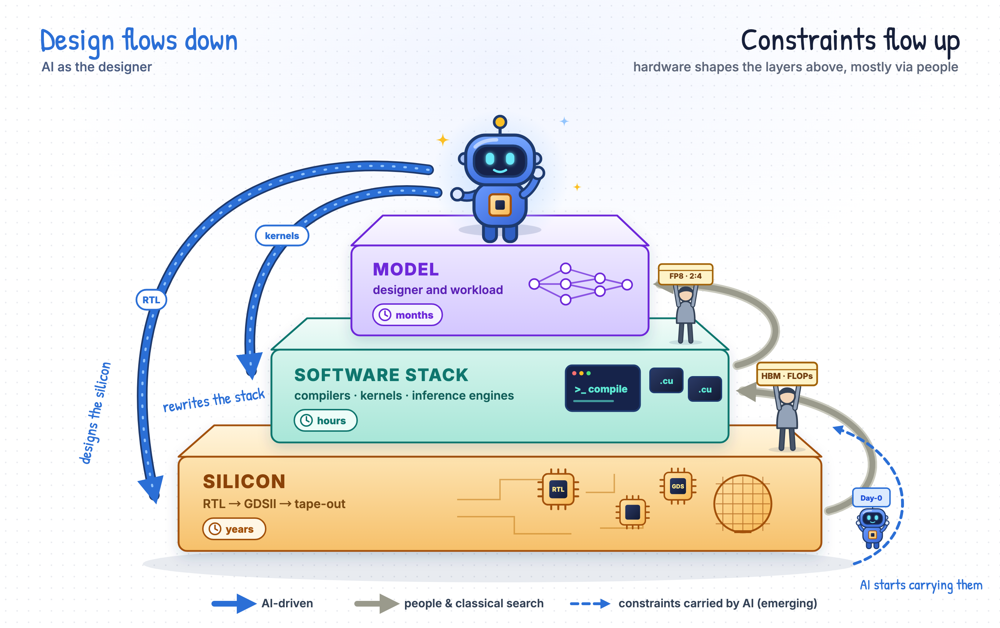

<a id="readme-top"></a>

<div align="center">

<h1>Awesome Model–Silicon Co-Evolution</h1>

<strong>A layer-aware, auditable map of how models, software stacks and chips are starting to improve one another.</strong>

<p>
  <a href="#catalog-at-a-glance"></a>
  <a href="#companion-survey"></a>
  <a href="#the-framework"></a>
  <a href="#the-framework"></a>
</p>

<p>
  <a href="#start-here">🚀 Start Here</a> &nbsp;•&nbsp;
  <a href="#companion-survey">📄 Survey</a> &nbsp;•&nbsp;
  <a href="#the-framework">🧭 Framework</a> &nbsp;•&nbsp;
  <a href="#part-cases">🔁 Closed Loops</a> &nbsp;•&nbsp;
  <a href="#catalog-at-a-glance">📚 Catalog</a> &nbsp;•&nbsp;
  <a href="#latest-updates">🆕 Updates</a> &nbsp;•&nbsp;
  <a href="#contributing">🤝 Contribute</a> &nbsp;•&nbsp;
  <a href="#citation">📝 Cite</a>
</p>

</div>

> This repository accompanies the survey [**When Models Build Their Own Machines: From Silicon to Self-Scaling Intelligence**](#companion-survey) (ACM TODAES, in preparation). Every entry is a reference from the survey, tagged with the layer edge it acts on and, where the survey or the curators can place it, its R&D autonomy level.

Every model runs on a machine it did not design. That is starting to change: language models now write RTL, tune kernels, orchestrate EDA flows and help design the chips that train and serve them. **Co-evolution** treats the model (M), the software stack (S) and the silicon (H) as three layers that keep rewriting each other's objectives: hardware constraints shape the next model, model demands shape the next chip, and every layer chases a target that the other layers have moved. The question this catalog tracks is how far each piece of work pushes that loop around, and who closes it.

<div align="center">
  
  <br>
  <em><b>Figure 1.</b> The co-evolution landscape by R&D autonomy level, from human-led co-design through L4 recursive self-enhancement. Tiles mark the layer edge each work acts on; chips name the mechanisms that carry each level; the number in each column header counts that level's entries in this catalog. The higher the level, the fewer the instances: 37 works at L1, 4 at L2, 2 at L3 and one public case at L4.</em>
</div>

---

<a id="start-here"></a>

## Start Here <sub><a href="#readme-top">↑ top</a></sub>

| Your question | Start with |
| --- | --- |
| **What is model–silicon co-evolution, and how is it different from co-design?** | Read the [framework](#the-framework): co-design solves one fixed problem; co-evolution faces a problem that keeps rewriting itself. |
| **Has any AI system actually closed the loop?** | Go to the [closed-loop case studies](#part-cases). AlphaEvolve is the only public L4 instance, and one turn of its loop is worth about 1% of Gemini training time. |
| **I work on LLMs for EDA. What's adjacent?** | Read [Model → Silicon](#part-model-silicon), then [Silicon → Model](#part-silicon-model) to see the constraint-flow literature that LLM4EDA work rarely cites. |
| **I work on kernels or ML systems.** | Read [Model → Software Stack](#part-model-stack), then the kernel benchmarks and the reward-hacking evidence in [Benchmarks](#part-benchmarks) and [Intelligence](#part-intelligence). |
| **Where are the open problems?** | Read [Where the Loop Breaks](#where-the-loop-breaks), then the cross-layer environment proposal in [Benchmarks](#part-benchmarks). |

> **Curation rule:** An entry is listed because the companion survey cites or maps it. Its level badge reports the survey's own classification where one exists; levels marked **†** were assigned by the curators using the [§3.4 criteria](#the-framework) and are open to correction.

---

<a id="latest-updates"></a>

## Latest Updates <sub><a href="#readme-top">↑ top</a></sub>

1. **2026-10-22 — Repository launched:** The full reference map of the companion survey is released, organized into ten parts that follow the tower: closed-loop cases, Model → Silicon, Model → Software Stack, Silicon → Model, co-design foundations, self-improvement engines, intelligence, benchmarks, related surveys, and outlook. Each entry carries its layer edge, autonomy level where one applies, and a one-line note on its role in the survey.
     

<details>
<summary><strong>Update policy</strong></summary>

- Log an update only when it adds or materially revises source-verified coverage.
- Link research to its proceedings page, DOI or arXiv record, and industry items to the organization's own publication rather than a repost.
- An update enters the catalog only after it is placed on the tower: which layer it acts on, what level of autonomy it shows, and which feedback signal it depends on.

</details>

---

## Table of Contents

- [Start Here](#start-here)
- [Latest Updates](#latest-updates)
- [Companion Survey](#companion-survey)
- [The Framework: Layers, Levels, Signals](#the-framework)
- [Where the Loop Breaks](#where-the-loop-breaks)
- [How to Read the Tags](#how-to-read-the-tags)
- [Catalog at a Glance](#catalog-at-a-glance)
- [1. Closed-Loop Case Studies](#part-cases)
- [2. Design Flows Down (I): Model → Silicon](#part-model-silicon)
- [3. Design Flows Down (II): Model → Software Stack](#part-model-stack)
- [4. Constraints Flow Up: Silicon → Model](#part-silicon-model)
- [5. Formalization and Co-Design Foundations](#part-foundations)
- [6. Self-Improvement Engines](#part-engines)
- [7. Intelligence: Knowledge, Rewards and Verification](#part-intelligence)
- [8. Benchmarks: From Exam Hall to Training Ground](#part-benchmarks)
- [9. Related Surveys](#part-surveys)
- [10. Outlook: Recursion, Governance and World Models](#part-outlook)
- [Contributing](#contributing)
- [Citation](#citation)
- [Data Provenance and Validation](#data-provenance-and-validation)

<a id="companion-survey"></a>

## Companion Survey <sub><a href="#readme-top">↑ top</a></sub>

**When Models Build Their Own Machines: From Silicon to Self-Scaling Intelligence.** Manuscript in preparation for *ACM Transactions on Design Automation of Electronic Systems (TODAES)*. The link will be added here when the preprint is public.

> Every model runs on a machine it did not design. This is changing. Language models already write RTL, tune kernels and orchestrate EDA flows, and they have begun to take part in designing the chips that train and serve them. When models improve chips and chips train stronger models, the growth of intelligence may break through the software ceiling into a scaling loop that drives itself. We treat the chip as the physical layer of recursive self-improvement, describe the co-evolution of model, software stack and silicon as a dynamical system, and propose AI R&D autonomy levels L0–L6, from design assistance, autonomous optimization and end-to-end design to cross-layer co-design and recursive self-enhancement, with self-expansion and open-ended evolution as the horizon. Mapping roughly 260 works, we find that in three years language models have covered most of the ground *within* a single layer, yet decisions that cross layer boundaries are still made by people, and very few works close the loop between silicon and intelligence. The loop breaks in three places: silicon feedback is slow and sparse, agents' horizons are short, and the ecosystem and its training environments are fragmented.

The survey makes three contributions:

1. **Perspective.** The chip is the physical layer of recursive self-improvement: it sets how fast self-improvement can go, and where humans can still keep watch over it.
2. **Framework.** A dynamical formulation of model–stack–silicon co-evolution, and the L0–L6 autonomy levels derived from it. Every work is placed by three coordinates: the layer it acts on, the level it reaches, and the feedback signal it depends on.
3. **Diagnosis and agenda.** Why the loop breaks at the top (physics, agents, ecosystem), and why cross-layer training environments and system-level world models are the keys to closing it.

---

<a id="the-framework"></a>

## The Framework: Layers, Levels, Signals <sub><a href="#readme-top">↑ top</a></sub>

**Three layers.** A computing system that hosts a language model is abstracted into the model layer $M$ (architecture, attention and expert routing, numeric formats, training recipe), the software-stack layer $S$ (compilation, kernels, parallel partitioning, serving) and the hardware layer $H$ (microarchitecture, memory hierarchy, interconnect, RTL, layout). The system pursues a joint objective $J(M, S, H)$ under cost, power and area constraints $C$, for example effective tokens per second per watt.

<div align="center">
  
  <br>
  <em><b>Figure 2.</b> The model–stack–silicon tower. Design flows down with AI as the designer; constraints flow up, so far almost entirely carried by people. Dashed arrows mark the paths where AI has just started to carry constraints upward.</em>
</div>

**Co-evolution dynamics.** Each layer is updated by an operator that reads a measurement of the whole system, and the capability of whoever executes the update may itself depend on the system:

```math
\begin{aligned}
X_{t+1} &= f_X\big(X_t,\ y_t;\ \theta_t\big), \qquad y_t = m(M_t, S_t, H_t), \qquad X \in \{M, S, H\} \\
\theta_{t+1} &= g\big(\theta_t;\ M_{t+1}, S_{t+1}, H_{t+1}\big)
\end{aligned}
```

Three properties separate this from static co-design. **The target moves:** while one layer optimizes, the others change. **Step sizes differ by orders of magnitude:** $f_S$ can run hourly, $f_M$ monthly and $f_H$ yearly, so the slowest layer sets the system's pace. **The executor can be inside the system:** when the executor is a language model, $\theta$ is determined by $M$ and trained and run on $S$ and $H$, so the system can act on the hand that improves it.

**Autonomy levels.** AI's autonomy in the R&D loop is defined by which part of the dynamics it has taken over. The catalog focuses on L0–L4; L5 and L6 are the horizon discussed in the survey's outlook.

| Level | Name | Decision rule | Entries |
| --- | --- | --- | ---: |
|  | Design assistance | AI generates code, designs or analysis but does not run a propose–verify–revise loop on its own. | 19 |
|  | Local autonomous optimization | Given a task, interface and evaluator, AI proposes candidates, calls tools, reads feedback and iterates. | 37 |
|  | End-to-end autonomous design | From a spec, AI decomposes the task, orchestrates tools and delivers a verified system within one layer. | 4 |
|  | Cross-layer autonomous co-design | Around a system-level goal, AI decides which layers to change; one layer's needs or measurements change another layer's design through AI. | 2 |
|  | Recursive self-enhancement | Hardware or software that AI helped design is used to train or run the designer itself or its successors. | 1 |
|  | Recursive self-expansion | R&D gains turn into more compute, facilities and deployment capacity, reinvested into the next round. | — |
|  | Open-ended autonomous evolution | Within external goals and constraints, AI discovers research questions, methods and new computing paradigms. | — |

**Feedback signals.** An update operator is only as good as the signal it reads. Ordered by acquisition cost, the six signal tiers span roughly seven orders of magnitude:

| Signal | What it measures | Typical latency |
| --- | --- | --- |
| **S1** | Syntax and compilation | seconds |
| **S2** | Functional correctness (tests, equivalence checking) | minutes to hours |
| **S3** | Implementation quality: timing, area, power, DRC | hours |
| **S4** | Performance profiling | minutes |
| **S5** | End-to-end measurement on real hardware | hours to days |
| **S6** | Post-silicon and at-scale deployment data | months to years |

Between the expensive tiers, cost models (Roofline, Timeloop, MAESTRO, LLMCompass, Vidur) and scaling laws provide intermediate fidelity; see [Performance models, simulators and scaling laws](#part-foundations).

**The three paths compared** (survey Table 8):

| Path | Main levels | Main signals | Main executor | Typical loop period | Highest-level work |
| --- | --- | --- | --- | --- | --- |
| Model → Silicon | L0–L2 | S1–S3 | LLM agents | design in hours to days; tape-out in years | Design Conductor 2.0 (L3) |
| Model → Stack | L1–L2 | S2, S4–S5 | LLM agents | minutes to hours | AlphaEvolve (L4) |
| Silicon → Model | human-executed | S4–S6 | human teams | months to years | DeepSeek-V3.1 (human cross-layer co-design) |

No path yet has all three of a language-model executor, cross-layer feedback, and an acceptable loop period.

---

<a id="where-the-loop-breaks"></a>

## Where the Loop Breaks <sub><a href="#readme-top">↑ top</a></sub>

Place any work by three coordinates (which layer it acts on, which level it reaches, how slow its feedback is) and a mismatch appears: **the higher the level, the fewer the instances.** LLM-driven work mostly sits at L0 and L1; end-to-end L2 delivery arrived in volume only after 2025; L3 has scattered footprints; L4 has one public instance. Cross-layer coupling is not rare. Hardware has shaped models for years, but the cross-layer decisions have always been made by people.

| Layer of the problem | What breaks | Where to read more |
| --- | --- | --- |
| **Physics** | The lower the layer, the slower, costlier and sparser the feedback: compilation in seconds, place-and-route in hours, silicon in years. One chip generation yields one sample, which invites reward hacking and blurs attribution. | [Multi-fidelity optimization](#part-intelligence), [pre-/post-silicon gap](#part-intelligence) |
| **Agents** | Pretraining and post-training removed early bottlenecks (syntax, tool calls, single-module correctness). The binding constraint is now the agent: a horizon of hours against a loop of years, no memory that survives a chip generation, and capability that grows only where verifiable rewards exist. Kernels have profilers and RTL has testbenches, but there is no cross-layer environment to train in. | [Verifiable rewards](#part-intelligence), [training environments](#part-benchmarks) |
| **Ecosystem** | Layers belong to different labs, chip companies, foundries and EDA vendors, with interfaces fixed by contracts and standards. A cross-layer loop needs one executor with read/write access to several layers, which almost only exists inside vertically integrated firms (AlphaEvolve with TPU and Gemini, MTIA, Pangu with Ascend, Qwen with T-Head). | [Closed-loop cases](#part-cases), [outlook](#part-outlook) |

Two measurements would separate real cross-layer progress from parallel single-layer progress: **cross-layer gain**, whether jointly changing two layers beats the sum of changing each alone (the L2/L3 boundary), and **loop period**, the time to complete one round of modification, evaluation and adoption.

---

<a id="how-to-read-the-tags"></a>

## How to Read the Tags <sub><a href="#readme-top">↑ top</a></sub>

Each entry carries up to three badges:

| Badge | Meaning |
| --- | --- |
|  …  | AI R&D autonomy level of the work's main contribution (see [the framework](#the-framework)). |
|  | Cross-layer co-design whose decisions are made by human teams, not an AI executor. |
|   | Industrial claims that cannot be checked, or where the model's role is not described. |
|     | The edge of the tower the work acts on. |
|    … | Material type: Paper, Survey, Benchmark, Dataset, Tool, Industry (blog, release or press), Essay, Book. |

Levels are only assigned where the question "how much of the R&D loop does the AI run?" applies. Foundational methods, classic hardware papers, and theory carry no level. A **†** after a note means the level was assigned by the curators rather than stated in the survey.

---

<a id="catalog-at-a-glance"></a>

## Catalog at a Glance <sub><a href="#readme-top">↑ top</a></sub>

**303 entries** in 10 parts. Each entry appears once, under its primary topic.

| # | Part | Survey | Entries | Levels present |
| ---: | --- | --- | ---: | --- |
| 1 | [Closed-Loop Case Studies](#part-cases) | §5 | 10 | L1 ×4, L2 ×1, L4 ×1, Human-driven ×2, Claimed ×1, Undisclosed ×1 |
| 2 | [Design Flows Down (I): Model → Silicon](#part-model-silicon) | §2.1, §4.1 | 58 | L0 ×17, L1 ×23, L1–L2 ×1, L2 ×2, L3 ×1 |
| 3 | [Design Flows Down (II): Model → Software Stack](#part-model-stack) | §2.2.4, §4.2 | 35 | L0 ×2, L1 ×10, L2 ×1, Human-driven ×3 |
| 4 | [Constraints Flow Up: Silicon → Model](#part-silicon-model) | §2.2, §4.3 | 47 | Human-driven ×30 |
| 5 | [Formalization and Co-Design Foundations](#part-foundations) | §3 | 27 | — |
| 6 | [Self-Improvement Engines](#part-engines) | §1, §2.3, §3.3 | 14 | — |
| 7 | [Intelligence: Knowledge, Rewards and Verification](#part-intelligence) | §6 | 46 | — |
| 8 | [Benchmarks: From Exam Hall to Training Ground](#part-benchmarks) | §7 | 40 | L3 ×1 |
| 9 | [Related Surveys](#part-surveys) | §1.5, §3 | 16 | — |
| 10 | [Outlook: Recursion, Governance and World Models](#part-outlook) | §8 | 10 | — |

<a id="part-cases"></a>

## 1. Closed-Loop Case Studies <sub><a href="#readme-top">↑ top</a></sub>

Ten cases where an AI-designed artifact reaches the hardware or software that trains or serves AI, dissected with the same template: which layers the loop crosses, which signal each segment reads, where humans intervene, and where the loop breaks. *Survey: §5.* **10 entries.**

**Where each loop breaks** (survey Tables 6 and 7):

| Case | Year · source | Loop path | Level | Executor | Slowest segment | Where the loop breaks |
| --- | --- | --- | --- | --- | --- | --- |
| NVCell | 2021 · DAC | RL generates standard-cell layouts | L1 | dedicated RL policy | tape-out and volume production (years) | The designer is not the model being trained |
| AlphaTensor | 2022 · Nature | Searches matrix-multiplication algorithms for specific hardware | L1 | RL | on-hardware measurement (minutes) | Hardware is fixed; only the algorithm side updates |
| PrefixRL | 2022 · DAC | RL designs prefix circuits that ship in NVIDIA GPUs | L1 | dedicated RL policy | tape-out and volume production (years) | The designer is not the model being trained |
| AlphaDev | 2023 · Nature | Discovered sorting routines merged into LLVM libc++ | L1 | RL | review and merge | Only the software side updates |
| AlphaEvolve | 2025 · DeepMind | One agent rewrites a TPU circuit and a Gemini kernel | **L4** | LLM agent | tape-out of the hardware change (years) | Closed, but one turn is worth ~1% |
| OpenAI × Broadcom | 2025 · announcement, interview | Models find ~20 optimizations on human-optimized blocks | L1 (claimed) | LLM and humans | undisclosed | Cannot be verified |
| MTIA v2 | 2025 · ISCA | Recommendation workloads drive chip design | Human-driven | human teams | chip generation | Executor is not a language model |
| Pangu Ultra × Ascend | 2025 · tech report | Model architecture and recipe built around NPUs | Human-driven | human teams | model generation | Executor is not a language model |
| Jalapeño | 2026 · press release | Nine months from design to tape-out with model help | Undisclosed | LLM and humans | nine-month tape-out | Cannot be verified |
| Qwen chip–model co-evolution | 2026 · tech blog | Chip-module design and inference-stack adaptation in parallel | L2 | LLM agent | chip-side physical implementation | The two ends are not connected |
| *Design Conductor 2.0* (§4) | 2026 · arXiv | Reads an algorithm paper, designs an accelerator | L3 | LLM agent | FPGA and backend (days) | The product does not flow back to the designing model |

Three patterns emerge. **Executor mismatch:** the loop closes physically, but the designer is not the trained model (PrefixRL, AlphaChip) or is a human team (MTIA, Pangu, DeepSeek). **Signal not connected:** the same executor works on both ends, but no measurement flows between them (Qwen). **Gain too small or invisible:** the loop closes and can be checked, but one turn is worth little (AlphaEvolve), or the gain cannot be checked at all (Jalapeño).

<details>
<summary>Show 10 entries</summary>

1. **NVCell: Standard Cell Layout in Advanced Technology Nodes with Reinforcement Learning**  
   [[arXiv](https://arxiv.org/abs/2107.07044)] [[DOI](https://doi.org/10.1109/dac18074.2021.9586188)] · Ren et al. · DAC 2021  
       
   RL generates standard-cell layouts and fixes DRC violations, bringing cell-library development into an automated flow.
1. **Discovering Faster Matrix Multiplication Algorithms with Reinforcement Learning**  
   [[DOI](https://doi.org/10.1038/s41586-022-05172-4)] · Fawzi et al. · Nature 2022  
       
   AlphaTensor searches matrix-multiplication decompositions with RL and can target measured runtime on a specific GPU or TPU, putting hardware measurements directly into algorithm design.
1. **PrefixRL: Optimization of Parallel Prefix Circuits using Deep Reinforcement Learning**  
   [[arXiv](https://arxiv.org/abs/2205.07000)] [[DOI](https://doi.org/10.1109/dac18074.2021.9586094)] [[Link](https://developer.nvidia.com/blog/designing-arithmetic-circuits-with-deep-reinforcement-learning/)] · Roy et al. · DAC 2022  
       
   RL designs parallel-prefix circuits with post-synthesis area/delay as reward; ~13,000 AI-designed circuit instances ship in NVIDIA Hopper.
1. **Faster Sorting Algorithms Discovered Using Deep Reinforcement Learning**  
   [[DOI](https://doi.org/10.1038/s41586-023-06004-9)] · Mankowitz et al. · Nature 2023  
       
   AlphaDev discovers assembly-level sorting routines that were merged into LLVM's libc++, a precedent for AI-found low-level improvements entering production stacks.
1. **AlphaEvolve: A Coding Agent for Scientific and Algorithmic Discovery**  
   [[arXiv](https://arxiv.org/abs/2506.13131)] [[Link](https://deepmind.google/blog/alphaevolve-a-gemini-powered-coding-agent-for-designing-advanced-algorithms/)] · Novikov et al. · Google DeepMind white paper 2025  
       
   The only public L4 instance: a Gemini-driven evolutionary coding agent rewrote a TPU arithmetic circuit and sped up a Gemini training kernel by 23% (~1% of total training time).
1. **Meta's Second Generation AI Chip: Model-Chip Co-Design and Productionization Experiences**  
   [[DOI](https://doi.org/10.1145/3695053.3731409)] · ISCA 2025  
       
   MTIA v2: recommendation-model workloads directly set the chip's compute/memory balance; strong cross-layer coupling executed by human teams.
1. **OpenAI and Broadcom Announce Strategic Collaboration to Deploy 10 Gigawatts of Custom AI Accelerators**  
   [[Link](https://tech.yahoo.com/ai/articles/greg-brockman-says-openais-tech-035921214.html)] · OpenAI & Broadcom · Press release and The OpenAI Podcast 2025  
       
   OpenAI states its models found ~20 optimizations on human-optimized components of its custom accelerator (L1 by description); not independently verifiable.
1. **Pangu Ultra: Pushing the Limits of Dense Large Language Models on Ascend NPUs**  
   [[arXiv](https://arxiv.org/abs/2504.07866)] · Yin et al. · arXiv 2025  
       
   Pangu Ultra: a dense ~100B+ model whose architecture and training recipe were adapted to large Ascend NPU clusters; human-driven co-design.
1. **Chip–Model Co-Evolution: Qwen in Production Chip Design and Inference Adaptation** (芯模协同进化：Qwen 落地生产级芯片设计与推理适配)  
   _link pending_ · Qwen Team · WeChat 2026  
       
   Qwen3.8-Max takes a NoC module from spec through RTL, verification and physical implementation, and separately deploys and tunes a new model on a domestic accelerator; the two ends are not yet connected.
1. **OpenAI and Broadcom Unveil LLM-Optimized Inference Chip Jalapeño**  
   [[Link](https://semiwiki.com/forum/threads/25367)] · OpenAI & Broadcom · Press release 2026  
       
   OpenAI–Broadcom LLM inference chip taped out nine months from initial design, with models said to have helped design and optimization; the model's role is not disclosed.

</details>

<a id="part-model-silicon"></a>

## 2. Design Flows Down (I): Model → Silicon <sub><a href="#readme-top">↑ top</a></sub>

Language models as designers of chips. The learned object moves up from tool parameters and policies, to RTL code and design knowledge, to the EDA tools and flows themselves. Most work reaches L0–L2 inside a single layer; Design Conductor 2.0 is the first to touch L3. *Survey: §2.1, §4.1.* **58 entries.**

### Featured

| Work | Level | Why it matters |
| --- | :---: | --- |
| [AlphaChip](https://doi.org/10.1038/s41586-021-03544-w) (2021) | L1 | AlphaChip: RL macro placement, later reported in use for TPU v5e, v5p and Trillium. |
| [AutoChip](https://arxiv.org/abs/2311.04887) (2023) | L1 | AutoChip feeds compiler and simulation errors back to the LLM, the first-generation prompt-and-feedback loop for RTL. |
| [Chip-Chat](https://arxiv.org/abs/2305.13243) (2023) | L0 | Chip-Chat: a processor designed through conversation with an LLM and taped out, the first LLM-written circuit on real silicon. |
| [ChipNeMo](https://arxiv.org/abs/2311.00176) (2023) | L0 | ChipNeMo: domain-adaptive pretraining on internal NVIDIA design documents, scripts and code, plus domain tokenization and retrieval. |
| [GPT4AIGChip](https://arxiv.org/abs/2309.10730) (2023) | L0 | GPT4AIGChip is an early attempt to generate HLS code for AI accelerators with LLMs. |
| [RTLCoder](https://arxiv.org/abs/2312.08617) (2024) | L0 | RTLCoder synthesizes instruction–code pairs with a strong model; a fully open data-centric RTL generator. |
| [RTLFixer](https://arxiv.org/abs/2311.16543) (2024) | L1 | RTLFixer repairs RTL syntax errors with retrieval augmentation and ReAct-style reasoning, the minimal form of an agent loop. |
| [ASIC-Agent](https://arxiv.org/abs/2508.15940) (2025) | L2 | ASIC-Agent assigns sub-agents to RTL generation, verification, OpenLane hardening and Caravel integration, with an agent-oriented benchmark. |
| [LLM-DSE](https://arxiv.org/abs/2505.12188) (2025) | L1 † | LLM-DSE coordinates router, specialist, arbiter and critic agents to tune HLS directives, ~2.55x over prior methods on HLSyn. |
| [QiMeng-CodeV-R1](https://arxiv.org/abs/2505.24183) (2025) | L1 † | QiMeng-CodeV-R1 rewards equivalence checks against reference designs and filters data by round-trip consistency; its 7B model beats 671B DeepSeek-R1 on RTLLM. |
| [QiMeng](https://arxiv.org/abs/2506.05007) (2025) |  | QiMeng builds hardware- and software-design agents on a processor-chip foundation model; QiMeng-CPU-v1 (~4M gates) is described as the first fully automatically designed processor core. |
| [Saarthi](https://arxiv.org/abs/2502.16662) (2025) | L1 † | Saarthi coordinates multiple agents to carry out end-to-end formal verification. |
| [VeriReason](https://arxiv.org/abs/2505.11849) (2025) | L1 | VeriReason combines testbench feedback with structural heuristics in an RL reward for reasoning-enhanced Verilog generation. |
| [Self-Evolved ABC](https://arxiv.org/abs/2604.15082) (2026) | L1 | Self-Evolved ABC: agents rewrite the million-line ABC synthesis tool itself, guarded by formal equivalence checking, and find heuristics that beat human baselines. |
| [Design Conductor 2.0](https://arxiv.org/abs/2605.05170) (2026) | L3 | Design Conductor 2.0 reads the TurboQuant paper and designs VerTQ, an LLM-inference accelerator (5,129 FP units, 240-stage pipeline) in 80 hours; the first work on this path to touch L3. |
| [Design Conductor](https://arxiv.org/abs/2603.08716) (2026) | L2 | Design Conductor builds a tape-out-ready RISC-V core from a 219-word spec in 12 hours, closing timing at 1.48 GHz in ASAP7. |

Topics: [Classical and open-source EDA substrate](#classical-and-open-source-eda-substrate-5) · [Pre-LLM machine learning for EDA](#pre-llm-machine-learning-for-eda-7) · [LLMs enter chip design](#llms-enter-chip-design-7) · [RTL generation and reasoning models](#rtl-generation-and-reasoning-models-14) · [Debugging and repair](#debugging-and-repair-3) · [Verification](#verification-5) · [HLS and architecture exploration](#hls-and-architecture-exploration-7) · [Physical implementation and EDA tools](#physical-implementation-and-eda-tools-4) · [End-to-end agents](#end-to-end-agents-4) · [Analog circuits](#analog-circuits-2)

### Classical and open-source EDA substrate (5)

<details>
<summary>Show 5 entries</summary>

1. **ABC: An Academic Industrial-Strength Verification Tool**  
   [[DOI](https://doi.org/10.1007/978-3-642-14295-6_5)] · Brayton et al. · CAV 2010  
      
   ABC, the academic logic synthesis and verification system that later became the target of agent-driven source-code evolution (Self-Evolved ABC).
1. **Yosys – A Free Verilog Synthesis Suite**  
   [[Link](https://yosyshq.net/yosys/)] · Wolf et al. · Austrochip 2013  
      
   Yosys, the open-source Verilog synthesis suite underlying many open EDA flows and LLM-for-RTL evaluations.
1. **DREAMPlace: Deep Learning Toolkit-Enabled GPU Acceleration for Modern VLSI Placement**  
   [[DOI](https://doi.org/10.1145/3316781.3317803)] · Lin et al. · DAC 2019  
      
   DREAMPlace casts analytic placement as neural-network training to run on GPU deep-learning toolkits.
1. **RePlAce: Advancing Solution Quality and Routability Validation in Global Placement**  
   [[DOI](https://doi.org/10.1109/tcad.2018.2859220)] · Cheng et al. · TCAD 2019  
      
   RePlAce, an analytic global placer that serves as a strong classical placement baseline.
1. **Toward an Open-Source Digital Flow: First Learnings from the OpenROAD Project**  
   [[DOI](https://doi.org/10.1145/3316781.3326334)] · Ajayi et al. · DAC 2019  
      
   OpenROAD, an autonomous open-source RTL-to-GDSII flow and the backbone of many agentic physical-design studies.

</details>

### Pre-LLM machine learning for EDA (7)

<details>
<summary>Show 7 entries</summary>

1. **Machine Learning Applications in Physical Design: Recent Results and Directions**  
   [[DOI](https://doi.org/10.1145/3177540.3177554)] · Kahng · ISPD 2018  
      
   Overview of ML applications in physical design and their open directions.
1. **RouteNet: Routability Prediction for Mixed-Size Designs Using Convolutional Neural Network**  
   [[DOI](https://doi.org/10.1145/3240765.3240843)] · Xie et al. · ICCAD 2018  
      
   RouteNet predicts routability with a CNN, an early example of ML replacing expensive implementation runs with prediction.
1. **DSO.ai: AI-Driven Design Space Optimization**  
   [[Link](https://www.synopsys.com/ai/chip-design/dso-ai.html)] · Synopsys · Product announcement 2020  
      
   Synopsys DSO.ai uses reinforcement learning to search chip design-space parameters.
1. **A Graph Placement Methodology for Fast Chip Design**  
   [[DOI](https://doi.org/10.1038/s41586-021-03544-w)] · Mirhoseini et al. · Nature 2021  
       
   AlphaChip: RL macro placement, later reported in use for TPU v5e, v5p and Trillium.
1. **Assessment of Reinforcement Learning for Macro Placement**  
   [[DOI](https://doi.org/10.1145/3569052.3578926)] · Cheng et al. · ISPD 2023  
      
   Independent assessment of RL macro placement; part of the reproducibility debate around AlphaChip.
1. **How AlphaChip Transformed Computer Chip Design**  
   [[Link](https://deepmind.google/blog/how-alphachip-transformed-computer-chip-design/)] · Goldie et al. · Google DeepMind Blog 2024  
       
   Google DeepMind's retrospective on AlphaChip and its use across TPU generations.
1. **Reevaluating Google's Reinforcement Learning for IC Macro Placement**  
   [[DOI](https://doi.org/10.1145/3676845)] · Markov · CACM 2024  
      
   Re-evaluates Google's RL macro placement, highlighting how closed design data makes industrial claims hard to verify.

</details>

### LLMs enter chip design (7)

<details>
<summary>Show 7 entries</summary>

1. **DAVE: Deriving Automatically Verilog from English**  
   [[arXiv](https://arxiv.org/abs/2009.01026)] [[DOI](https://doi.org/10.1145/3380446.3430634)] · Pearce et al. · MLCAD 2020  
       
   DAVE fine-tunes GPT-2 to derive Verilog from English, handling only simple tasks. †
1. **Benchmarking Large Language Models for Automated Verilog RTL Code Generation**  
   [[arXiv](https://arxiv.org/abs/2212.11140)] [[DOI](https://doi.org/10.23919/date56975.2023.10137086)] · Thakur et al. · DATE 2023  
      
   Benchmarks LLMs on Verilog generation and shows that fine-tuning on open Verilog narrows the gap left by general models.
1. **Chip-Chat: Challenges and Opportunities in Conversational Hardware Design**  
   [[arXiv](https://arxiv.org/abs/2305.13243)] [[DOI](https://doi.org/10.1109/mlcad58807.2023.10299874)] · Blocklove et al. · MLCAD 2023  
       
   Chip-Chat: a processor designed through conversation with an LLM and taped out, the first LLM-written circuit on real silicon.
1. **ChipGPT: How Far Are We from Natural Language Hardware Design**  
   [[arXiv](https://arxiv.org/abs/2305.14019)] · Chang et al. · arXiv 2023  
       
   ChipGPT asks how far LLMs are from natural-language hardware design, combining prompting with output optimization. †
1. **ChipNeMo: Domain-Adapted LLMs for Chip Design**  
   [[arXiv](https://arxiv.org/abs/2311.00176)] · Liu et al. · arXiv 2023  
       
   ChipNeMo: domain-adaptive pretraining on internal NVIDIA design documents, scripts and code, plus domain tokenization and retrieval.
1. **Pushing the Limits of Machine Design: Automated CPU Design with AI**  
   [[arXiv](https://arxiv.org/abs/2306.12456)] · Cheng et al. · arXiv 2023  
      
   Automated CPU design with AI: a processor core generated from input–output examples without HDL, a precursor of QiMeng-CPU.
1. **QiMeng: Fully Automated Hardware and Software Design for Processor Chip**  
   [[arXiv](https://arxiv.org/abs/2506.05007)] · Zhang et al. · arXiv 2025  
      
   QiMeng builds hardware- and software-design agents on a processor-chip foundation model; QiMeng-CPU-v1 (~4M gates) is described as the first fully automatically designed processor core.

</details>

### RTL generation and reasoning models (14)

<details>
<summary>Show 14 entries</summary>

1. **AutoChip: Automating HDL Generation Using LLM Feedback**  
   [[arXiv](https://arxiv.org/abs/2311.04887)] · Thakur et al. · arXiv 2023  
       
   AutoChip feeds compiler and simulation errors back to the LLM, the first-generation prompt-and-feedback loop for RTL.
1. **AutoVCoder: A Systematic Framework for Automated Verilog Code Generation Using LLMs**  
   [[arXiv](https://arxiv.org/abs/2407.18333)] [[DOI](https://doi.org/10.1109/iccd63220.2024.00033)] · Gao et al. · arXiv 2024  
       
   AutoVCoder adds retrieval augmentation to a systematic Verilog-generation framework. †
1. **BetterV: Controlled Verilog Generation with Discriminative Guidance**  
   [[arXiv](https://arxiv.org/abs/2402.03375)] · Pei et al. · ICML 2024  
       
   BetterV steers Verilog generation with discriminative guidance. †
1. **CodeV: Empowering LLMs for Verilog Generation through Multi-Level Summarization**  
   [[arXiv](https://arxiv.org/abs/2407.10424)] · Zhao et al. · arXiv 2024  
       
   CodeV back-translates code into descriptions through multi-level summarization to build fine-tuning data. †
1. **MAGE: A Multi-Agent Engine for Automated RTL Code Generation**  
   [[arXiv](https://arxiv.org/abs/2412.07822)] [[DOI](https://doi.org/10.1109/dac63849.2025.11133191)] · Zhao et al. · arXiv 2024  
       
   MAGE uses a multi-agent engine with simulation feedback for RTL generation. †
1. **OriGen: Enhancing RTL Code Generation with Code-to-Code Augmentation and Self-Reflection**  
   [[DOI](https://doi.org/10.1145/3676536.3676830)] · Cui et al. · arXiv 2024  
       
   OriGen augments data code-to-code and adds compiler-feedback self-reflection. †
1. **RTLCoder: Fully Open-Source and Efficient LLM-Assisted RTL Code Generation Technique**  
   [[arXiv](https://arxiv.org/abs/2312.08617)] [[DOI](https://doi.org/10.1109/tcad.2024.3483089)] · Liu et al. · TCAD 2024  
       
   RTLCoder synthesizes instruction–code pairs with a strong model; a fully open data-centric RTL generator.
1. **VeriGen: A Large Language Model for Verilog Code Generation**  
   [[arXiv](https://arxiv.org/abs/2308.00708)] [[DOI](https://doi.org/10.1145/3643681)] · Thakur et al. · TODAES 2024  
       
   VeriGen fine-tunes an LLM on open-source Verilog and textbooks.
1. **CraftRTL: High-Quality Synthetic Data Generation for Verilog Code Models with Correct-by-Construction Non-Textual Representations and Targeted Code Repair**  
   [[arXiv](https://arxiv.org/abs/2409.12993)] · Liu et al. · ICLR 2025  
       
   CraftRTL converts Karnaugh maps, state diagrams and waveforms into correct-by-construction samples, anchoring synthetic data to external truth. †
1. **DeepRTL: Bridging Verilog Understanding and Generation with a Unified Representation Model**  
   [[arXiv](https://arxiv.org/abs/2502.15832)] · Liu et al. · ICLR 2025  
       
   DeepRTL unifies Verilog understanding and generation in one representation model. †
1. **QiMeng-CodeV-R1: Reasoning-Enhanced Verilog Generation**  
   [[arXiv](https://arxiv.org/abs/2505.24183)] [[DOI](https://doi.org/10.52202/085713-5160)] · Zhu et al. · NeurIPS 2025  
       
   QiMeng-CodeV-R1 rewards equivalence checks against reference designs and filters data by round-trip consistency; its 7B model beats 671B DeepSeek-R1 on RTLLM. †
1. **VerilogCoder: Autonomous Verilog Coding Agents with Graph-Based Planning and Abstract Syntax Tree (AST)-Based Waveform Tracing Tool**  
   [[arXiv](https://arxiv.org/abs/2408.08927)] [[DOI](https://doi.org/10.1609/aaai.v39i1.32007)] · Ho et al. · AAAI 2025  
       
   VerilogCoder coordinates agents with graph-based planning and an AST-based waveform-tracing debugging tool. †
1. **VeriReason: Reinforcement Learning with Testbench Feedback for Reasoning-Enhanced Verilog Generation**  
   [[arXiv](https://arxiv.org/abs/2505.11849)] [[DOI](https://doi.org/10.1145/3787109.3815310)] · Wang et al. · arXiv 2025  
       
   VeriReason combines testbench feedback with structural heuristics in an RL reward for reasoning-enhanced Verilog generation.
1. **VeriRL: Boosting the LLM-Based Verilog Code Generation via Reinforcement Learning**  
   [[arXiv](https://arxiv.org/abs/2508.18462)] [[DOI](https://doi.org/10.1109/iccad66269.2025.11241003)] · arXiv 2025  
       
   VeriRL boosts LLM Verilog generation with reinforcement learning. †

</details>

### Debugging and repair (3)

<details>
<summary>Show 3 entries</summary>

1. **HDLdebugger: Streamlining HDL Debugging with Large Language Models**  
   [[arXiv](https://arxiv.org/abs/2403.11671)] [[DOI](https://doi.org/10.1145/3735638)] · Yao et al. · arXiv 2024  
       
   HDLdebugger streamlines HDL debugging with LLMs and retrieval. †
1. **MEIC: Re-thinking RTL Debug Automation using LLMs**  
   [[arXiv](https://arxiv.org/abs/2405.06840)] [[DOI](https://doi.org/10.1145/3676536.3676801)] · Xu et al. · arXiv 2024  
       
   MEIC rethinks RTL debug automation to handle functional as well as syntax errors. †
1. **RTLFixer: Automatically Fixing RTL Syntax Errors with Large Language Models**  
   [[arXiv](https://arxiv.org/abs/2311.16543)] [[DOI](https://doi.org/10.1145/3649329.3657353)] · Tsai et al. · DAC 2024  
       
   RTLFixer repairs RTL syntax errors with retrieval augmentation and ReAct-style reasoning, the minimal form of an agent loop.

</details>

### Verification (5)

<details>
<summary>Show 5 entries</summary>

1. **LLM-assisted Generation of Hardware Assertions**  
   [[arXiv](https://arxiv.org/abs/2306.14027)] · Kande et al. · arXiv 2023  
       
   Early use of LLMs to generate security-relevant SystemVerilog assertions. †
1. **LLM4DV: Using Large Language Models for Hardware Test Stimuli Generation**  
   [[arXiv](https://arxiv.org/abs/2310.04535)] [[DOI](https://doi.org/10.1109/fccm62733.2025.00048)] · Zhang et al. · arXiv 2023  
       
   LLM4DV generates hardware test stimuli with LLMs, iterating on coverage feedback. †
1. **AssertLLM: Generating and Evaluating Hardware Verification Assertions from Design Specifications via Multi-LLMs**  
   [[arXiv](https://arxiv.org/abs/2402.00386)] · Fang et al. · arXiv 2024  
       
   AssertLLM extracts verification assertions from design specifications with multiple LLMs. †
1. **UVLLM: An Automated Universal RTL Verification Framework using LLMs**  
   [[arXiv](https://arxiv.org/abs/2411.16238)] [[DOI](https://doi.org/10.1109/dac63849.2025.11435108)] · Hu et al. · arXiv 2024  
       
   UVLLM automates UVM-style RTL verification, generating test environments and fixing errors in a loop. †
1. **Saarthi: An Agentic AI Framework for End-to-End Formal Verification**  
   [[arXiv](https://arxiv.org/abs/2502.16662)] · Kumar et al. · arXiv 2025  
       
   Saarthi coordinates multiple agents to carry out end-to-end formal verification. †

</details>

### HLS and architecture exploration (7)

<details>
<summary>Show 7 entries</summary>

1. **ArchGym: An Open-Source Gymnasium for Machine Learning Assisted Architecture Design**  
   [[arXiv](https://arxiv.org/abs/2306.08888)] [[DOI](https://doi.org/10.1145/3579371.3589049)] · Krishnan et al. · ISCA 2023  
      
   ArchGym wraps ML-driven architecture design-space exploration in a gym: agents tune accelerator parameters, simulators return performance and energy.
1. **GPT4AIGChip: Towards Next-Generation AI Accelerator Design Automation via Large Language Models**  
   [[arXiv](https://arxiv.org/abs/2309.10730)] [[DOI](https://doi.org/10.1109/iccad57390.2023.10323953)] · Fu et al. · ICCAD 2023  
       
   GPT4AIGChip is an early attempt to generate HLS code for AI accelerators with LLMs.
1. **C2HLSC: Can LLMs Bridge the Software-to-Hardware Design Gap?**  
   [[arXiv](https://arxiv.org/abs/2406.09233)] [[DOI](https://doi.org/10.1109/lad62341.2024.10691856)] · Collini et al. · arXiv 2024  
       
   C2HLSC iteratively refactors C into HLS-compatible code using tool feedback. †
1. **HLSPilot: LLM-Based High-Level Synthesis**  
   [[arXiv](https://arxiv.org/abs/2408.06810)] [[DOI](https://doi.org/10.1145/3676536.3676781)] · Xiong et al. · arXiv 2024  
       
   HLSPilot rewrites C code into synthesizable HLS with LLM-guided optimization. †
1. **SpecLLM: Exploring Generation and Review of VLSI Design Specification with Large Language Model**  
   [[arXiv](https://arxiv.org/abs/2401.13266)] [[DOI](https://doi.org/10.1109/iseda65950.2025.11100410)] · Li et al. · arXiv 2024  
       
   SpecLLM explores LLMs for writing and reviewing VLSI architecture specifications. †
1. **LLM-DSE: Searching Accelerator Parameters with LLM Agents**  
   [[arXiv](https://arxiv.org/abs/2505.12188)] · Wang et al. · arXiv 2025  
       
   LLM-DSE coordinates router, specialist, arbiter and critic agents to tune HLS directives, ~2.55x over prior methods on HLSyn. †
1. **LLM-Driven Design Space Exploration of FPGA-based Accelerators**  
   [[arXiv](https://arxiv.org/abs/2605.05920)] · Sharma et al. · Workshop on Intelligent System Design (InSyDe), co-located with EuroSys 2026  
       
   SECDA-DSE connects LLM-driven design-space exploration to SystemC simulation and FPGA execution. †

</details>

### Physical implementation and EDA tools (4)

<details>
<summary>Show 4 entries</summary>

1. **ChatEDA: A Large Language Model Powered Autonomous Agent for EDA**  
   [[arXiv](https://arxiv.org/abs/2308.10204)] [[DOI](https://doi.org/10.1109/mlcad58807.2023.10299852)] · He et al. · TCAD 2024  
       
   ChatEDA lets an LLM agent orchestrate the whole EDA flow from natural-language requests. †
1. **ORFS-Agent: Tool-Using Agents for Chip Design Optimization**  
   [[arXiv](https://arxiv.org/abs/2506.08332)] [[DOI](https://doi.org/10.1109/mlcad65511.2025.11189204)] · arXiv 2025  
       
   ORFS-Agent tunes OpenROAD flow parameters with tool-using agents to improve PPA. †
1. **Autonomous Evolution of EDA Tools: Multi-Agent Self-Evolved ABC**  
   [[arXiv](https://arxiv.org/abs/2604.15082)] · DAC 2026  
       
   Self-Evolved ABC: agents rewrite the million-line ABC synthesis tool itself, guarded by formal equivalence checking, and find heuristics that beat human baselines.
1. **EvoDRC: A Self-Evolving Agentic Framework for Automated DRC Violation Repair**  
   [[arXiv](https://arxiv.org/abs/2607.20019)] · arXiv 2026  
       
   EvoDRC applies a self-evolving agent framework to DRC-violation repair. †

</details>

### End-to-end agents (4)

<details>
<summary>Show 4 entries</summary>

1. **ASIC-Agent: An Autonomous Multi-Agent System for ASIC Design with Benchmark Evaluation**  
   [[arXiv](https://arxiv.org/abs/2508.15940)] [[DOI](https://doi.org/10.1109/iclad65226.2025.00033)] · Allam et al. · ICLAD 2025  
       
   ASIC-Agent assigns sub-agents to RTL generation, verification, OpenLane hardening and Caravel integration, with an agent-oriented benchmark.
1. **Design Conductor 2.0: An Agent Builds a TurboQuant Inference Accelerator in 80 Hours**  
   [[arXiv](https://arxiv.org/abs/2605.05170)] · Krishna et al. · arXiv 2026  
       
   Design Conductor 2.0 reads the TurboQuant paper and designs VerTQ, an LLM-inference accelerator (5,129 FP units, 240-stage pipeline) in 80 hours; the first work on this path to touch L3.
1. **Design Conductor: An Agent Autonomously Builds a RISC-V CPU**  
   [[arXiv](https://arxiv.org/abs/2603.08716)] · Krishna et al. · arXiv 2026  
       
   Design Conductor builds a tape-out-ready RISC-V core from a 219-word spec in 12 hours, closing timing at 1.48 GHz in ASAP7.
1. **The State of Agentic AI in Chip Design Tools in 2026: Cadence, Synopsys, and Siemens All Pitch Autonomous Engineers**  
   [[Link](https://www.tomshardware.com/tech-industry/semiconductors/the-state-of-agentic-ai-in-chip-design-tools-in-2026-cadence-synopsys-and-siemens-all-pitch-autonomous-engineers)] · Tom's Hardware · Tom's Hardware 2026  
       
   Overview of the 2026 agentic EDA products from Cadence, Synopsys and Siemens, which automate whole flow segments rather than single steps.

</details>

### Analog circuits (2)

<details>
<summary>Show 2 entries</summary>

1. **LaMAGIC: Language-Model-Based Topology Generation for Analog Integrated Circuits**  
   [[arXiv](https://arxiv.org/abs/2407.18269)] · Chang et al. · ICML 2024  
       
   LaMAGIC generates power-converter topologies with a language model. †
1. **AnalogCoder: Analog Circuit Design via Training-Free Code Generation**  
   [[arXiv](https://arxiv.org/abs/2405.14918)] [[DOI](https://doi.org/10.1609/aaai.v39i1.32016)] · Lai et al. · AAAI 2025  
       
   AnalogCoder describes and iterates on analog circuits as Python code, training-free with simulation feedback. †

</details>

<a id="part-model-stack"></a>

## 3. Design Flows Down (II): Model → Software Stack <sub><a href="#readme-top">↑ top</a></sub>

The stack is the fastest, cheapest layer to get feedback from (profiles in minutes, end-to-end runs in hours), so it is where loops close first. Kernel agents commonly reach L1, GEAK v4 and Qwen's deployment experiment reach L2, and AlphaEvolve's training kernel flows back into the model that drives it. *Survey: §2.2.4, §4.2.* **35 entries.**

### Featured

| Work | Level | Why it matters |
| --- | :---: | --- |
| [TVM](https://arxiv.org/abs/1802.04799) (2018) |  | TVM, an end-to-end optimizing compiler stack for deep learning. |
| [vLLM / PagedAttention](https://arxiv.org/abs/2309.06180) (2023) |  | vLLM's PagedAttention manages KV-cache memory like virtual memory pages. |
| [Meta LLM Compiler](https://arxiv.org/abs/2407.02524) (2024) | L0 † | Meta LLM Compiler: foundation models pretrained to understand and optimize compiler IR and assembly. |
| [DeepGEMM](https://github.com/deepseek-ai/DeepGEMM) (2025) | Human-driven | DeepGEMM: hand-written FP8 GEMM kernels with fine-grained scaling for Hopper, built for DeepSeek-V3's numeric choices. |
| [GEAK](https://arxiv.org/abs/2507.23194) (2025) | L1 | GEAK generates Triton kernels for AMD GPUs in a Reflexion-style loop: ~55% execution accuracy and 2.59x mean speedup on revised TritonBench. |
| [CUDA Agent](https://arxiv.org/abs/2602.24286) (2026) | L1 | CUDA Agent: large-scale agentic RL over 6,000+ synthetic operators in a sandbox with automatic verification and profiling; beats torch.compile on all three KernelBench levels. |
| [daVinci-kernel](https://arxiv.org/abs/2606.16497) (2026) | L1 | daVinci-kernel co-evolves a skill library with RL training, admitting a skill only after execution confirms a reproducible speedup. |
| [GEAK v4](https://www.amd.com/en/developer/resources/technical-articles/2026/geak-v4.html) (2026) | L2 | GEAK v4 optimizes whole SGLang/vLLM serving workloads: profile, triage with Amdahl's law, generate across Triton/TileLang/HIP, validate end to end. |

Topics: [Tensor compilers and kernel languages](#tensor-compilers-and-kernel-languages-11) · [Human-built stacks for specific models](#human-built-stacks-for-specific-models-3) · [LLM-generated kernels](#llm-generated-kernels-11) · [ML and LLMs for compilers](#ml-and-llms-for-compilers-4) · [Inference systems and deployment adaptation](#inference-systems-and-deployment-adaptation-6)

### Tensor compilers and kernel languages (11)

<details>
<summary>Show 11 entries</summary>

1. **Halide: A Language and Compiler for Optimizing Parallelism, Locality, and Recomputation in Image Processing Pipelines**  
   [[DOI](https://doi.org/10.1145/2491956.2462176)] · Ragan-Kelley et al. · PLDI 2013  
      
   Halide separates algorithm from schedule, the root of the search-plus-cost-model lineage of tensor compilers.
1. **cuDNN: Efficient Primitives for Deep Learning**  
   [[arXiv](https://arxiv.org/abs/1410.0759)] · Chetlur et al. · arXiv 2014  
      
   cuDNN, NVIDIA's library of deep-learning primitives that made GPUs the default DL substrate.
1. **TVM: An Automated End-to-End Optimizing Compiler for Deep Learning**  
   [[arXiv](https://arxiv.org/abs/1802.04799)] · Chen et al. · OSDI 2018  
      
   TVM, an end-to-end optimizing compiler stack for deep learning.
1. **Triton: An Intermediate Language and Compiler for Tiled Neural Network Computations**  
   [[DOI](https://doi.org/10.1145/3315508.3329973)] · Tillet et al. · MAPL 2019  
      
   Triton, a tile-based language and compiler that lowers the bar for writing GPU kernels.
1. **Ansor: Generating High-Performance Tensor Programs for Deep Learning**  
   [[arXiv](https://arxiv.org/abs/2006.06762)] · Zheng et al. · OSDI 2020  
      
   Ansor replaces hand-written templates with generated search spaces and a learned cost model.
1. **MLIR: Scaling Compiler Infrastructure for Domain Specific Computation**  
   [[DOI](https://doi.org/10.1109/cgo51591.2021.9370308)] · Lattner et al. · CGO 2021  
      
   MLIR, a reusable multi-level compiler infrastructure for domain-specific computation.
1. **Tensor Program Optimization with Probabilistic Programs**  
   [[arXiv](https://arxiv.org/abs/2205.13603)] [[DOI](https://doi.org/10.52202/068431-2593)] · Shao et al. · NeurIPS 2022  
      
   MetaSchedule unifies tensor-program scheduling primitives as probabilistic programs.
1. **TensorIR: An Abstraction for Automatic Tensorized Program Optimization**  
   [[arXiv](https://arxiv.org/abs/2207.04296)] [[DOI](https://doi.org/10.1145/3575693.3576933)] · Feng et al. · ASPLOS 2023  
      
   TensorIR, an abstraction for automatic tensorized program optimization.
1. **PyTorch 2: Faster Machine Learning Through Dynamic Python Bytecode Transformation and Graph Compilation**  
   [[DOI](https://doi.org/10.1145/3620665.3640366)] · Ansel et al. · ASPLOS 2024  
      
   PyTorch 2 graph capture and compilation (TorchDynamo/TorchInductor), the torch.compile baseline that kernel agents compare against.
1. **ThunderKittens: Simple, Fast, and Adorable AI Kernels**  
   [[arXiv](https://arxiv.org/abs/2410.20399)] · Spector et al. · arXiv 2024  
      
   ThunderKittens offers hardware-near tile abstractions that approach hand-written kernel performance.
1. **TileLang: A Composable Tiled Programming Model for AI Systems**  
   [[arXiv](https://arxiv.org/abs/2504.17577)] · Wang et al. · arXiv 2025  
      
   TileLang, a composable tiled programming model for AI kernels.

</details>

### Human-built stacks for specific models (3)

<details>
<summary>Show 3 entries</summary>

1. **DeepEP: An Efficient Expert-Parallel Communication Library**  
   [[Link](https://github.com/deepseek-ai/DeepEP)] · DeepSeek-AI · GitHub repository 2025  
       
   DeepEP: expert-parallel communication library; together with DeepGEMM and FlashMLA, the Day-0 adaptation work LLM agents aim to replace.
1. **DeepGEMM: Clean and Efficient FP8 GEMM Kernels with Fine-Grained Scaling**  
   [[Link](https://github.com/deepseek-ai/DeepGEMM)] · DeepSeek-AI · GitHub repository 2025  
       
   DeepGEMM: hand-written FP8 GEMM kernels with fine-grained scaling for Hopper, built for DeepSeek-V3's numeric choices.
1. **FlashMLA: Efficient MLA Decoding Kernels**  
   [[Link](https://github.com/deepseek-ai/FlashMLA)] · DeepSeek-AI · GitHub repository 2025  
       
   FlashMLA: MLA decoding kernels for Hopper, written by hand after the model adopted MLA.

</details>

### LLM-generated kernels (11)

<details>
<summary>Show 11 entries</summary>

1. **Automating GPU Kernel Generation with DeepSeek-R1 and Inference Time Scaling**  
   [[Link](https://developer.nvidia.com/blog/automating-gpu-kernel-generation-with-deepseek-r1-and-inference-time-scaling/)] · NVIDIA · NVIDIA Technical Blog 2025  
       
   NVIDIA pairs DeepSeek-R1 with a verifier and inference-time scaling to generate attention kernels.
1. **CUDA-L1: Improving CUDA Optimization via Contrastive Reinforcement Learning**  
   [[arXiv](https://arxiv.org/abs/2507.14111)] · Li et al. · arXiv 2025  
       
   CUDA-L1 improves CUDA optimization with contrastive reinforcement learning.
1. **GEAK: Introducing Triton Kernel AI Agent & Evaluation Benchmarks**  
   [[arXiv](https://arxiv.org/abs/2507.23194)] · Wang et al. · arXiv 2025  
       
   GEAK generates Triton kernels for AMD GPUs in a Reflexion-style loop: ~55% execution accuracy and 2.59x mean speedup on revised TritonBench.
1. **Kevin: Multi-Turn RL for Generating CUDA Kernels**  
   [[arXiv](https://arxiv.org/abs/2507.11948)] · Baronio et al. · arXiv 2025  
       
   Kevin trains CUDA-kernel writing with multi-turn reinforcement learning.
1. **The AI CUDA Engineer: Agentic CUDA Kernel Discovery, Optimization and Composition**  
   [[Link](https://sakana.ai/ai-cuda-engineer/)] · Lange et al. · Sakana AI technical report 2025  
       
   Sakana's AI CUDA Engineer; its inflated speedups from an evaluation loophole were later corrected, an early warning on reward hacking.
1. **CUDA Agent: Large-Scale Agentic RL for High-Performance CUDA Kernel Generation**  
   [[arXiv](https://arxiv.org/abs/2602.24286)] · arXiv 2026  
       
   CUDA Agent: large-scale agentic RL over 6,000+ synthetic operators in a sandbox with automatic verification and profiling; beats torch.compile on all three KernelBench levels.
1. **daVinci-kernel: Co-Evolving Skill Selection, Summarization, and Utilization via RL for GPU Kernel Optimization**  
   [[arXiv](https://arxiv.org/abs/2606.16497)] · Fu et al. · arXiv 2026  
       
   daVinci-kernel co-evolves a skill library with RL training, admitting a skill only after execution confirms a reproducible speedup.
1. **GEAK v4: From Faster Kernels to Faster Workloads**  
   [[Link](https://www.amd.com/en/developer/resources/technical-articles/2026/geak-v4.html)] · AMD · AMD technical article 2026  
       
   GEAK v4 optimizes whole SGLang/vLLM serving workloads: profile, triage with Amdahl's law, generate across Triton/TileLang/HIP, validate end to end.
1. **KernelBlaster: Continual Cross-Task CUDA Optimization via Memory-Augmented In-Context Reinforcement Learning**  
   [[arXiv](https://arxiv.org/abs/2602.14293)] · Dong et al. · arXiv 2026  
       
   KernelBlaster transfers optimization knowledge across GPU generations with memory-augmented in-context RL.
1. **KernelPro: A Closed-Loop Multi-Agent System for GPU Kernel Optimization**  
   _link pending_ · arXiv 2026  
       
   KernelPro closes the loop with profiler feedback and pluggable bottleneck-detection tools.
1. **STARK: Strategic Team of Agents for Refining Kernels**  
   [[arXiv](https://arxiv.org/abs/2510.16996)] [[Link](https://proceedings.iclr.cc/paper_files/paper/2026/hash/229608737599da1f292d4cf5a18c99f0-Abstract-Conference.html)] · Dong et al. · ICLR 2026  
       
   STARK explores the optimization space with a strategic team of agents, reporting up to ~16x runtime improvement.

</details>

### ML and LLMs for compilers (4)

<details>
<summary>Show 4 entries</summary>

1. **MLGO: A Machine Learning Guided Compiler Optimizations Framework**  
   [[arXiv](https://arxiv.org/abs/2101.04808)] · Trofin et al. · arXiv 2021  
      
   MLGO brings learned policies into LLVM optimization decisions such as inlining.
1. **CompilerGym: Robust, Performant Compiler Optimization Environments for AI Research**  
   [[arXiv](https://arxiv.org/abs/2109.08267)] [[DOI](https://doi.org/10.1109/cgo53902.2022.9741258)] · Cummins et al. · CGO 2022  
      
   CompilerGym wraps compiler optimization as RL environments with code size or runtime as reward.
1. **Large Language Models for Compiler Optimization**  
   [[arXiv](https://arxiv.org/abs/2309.07062)] · Cummins et al. · arXiv 2023  
       
   Trains an LLM to optimize LLVM IR pass ordering directly. †
1. **Meta Large Language Model Compiler: Foundation Models of Compiler Optimization**  
   [[arXiv](https://arxiv.org/abs/2407.02524)] · Cummins et al. · arXiv 2024  
       
   Meta LLM Compiler: foundation models pretrained to understand and optimize compiler IR and assembly. †

</details>

### Inference systems and deployment adaptation (6)

<details>
<summary>Show 6 entries</summary>

1. **Orca: A Distributed Serving System for Transformer-Based Generative Models**  
   [[Link](https://www.usenix.org/conference/osdi22/presentation/yu)] · Yu et al. · OSDI 2022  
      
   Orca introduces iteration-level scheduling for serving generative transformers.
1. **Efficient Memory Management for Large Language Model Serving with PagedAttention**  
   [[arXiv](https://arxiv.org/abs/2309.06180)] [[DOI](https://doi.org/10.1145/3600006.3613165)] · Kwon et al. · SOSP 2023  
      
   vLLM's PagedAttention manages KV-cache memory like virtual memory pages.
1. **DistServe: Disaggregating Prefill and Decoding for Goodput-Optimized Large Language Model Serving**  
   [[arXiv](https://arxiv.org/abs/2401.09670)] · Zhong et al. · OSDI 2024  
      
   DistServe disaggregates prefill and decoding for goodput-optimized serving.
1. **SGLang: Efficient Execution of Structured Language Model Programs**  
   [[arXiv](https://arxiv.org/abs/2312.07104)] [[DOI](https://doi.org/10.52202/079017-2000)] · Zheng et al. · NeurIPS 2024  
      
   SGLang executes structured LLM programs efficiently with RadixAttention.
1. **FlashInfer: Efficient and Customizable Attention Engine for LLM Inference Serving**  
   [[arXiv](https://arxiv.org/abs/2501.01005)] · Ye et al. · MLSys 2025  
      
   FlashInfer, a customizable attention engine for LLM inference serving.
1. **Towards Efficient Agents: A Co-Design of Inference Architecture and System**  
   [[arXiv](https://arxiv.org/abs/2512.18337)] · Lin et al. · arXiv 2025  
      
   AgentInfer co-designs inference architecture and system for agentic workloads.

</details>

<a id="part-silicon-model"></a>

## 4. Constraints Flow Up: Silicon → Model <sub><a href="#readme-top">↑ top</a></sub>

Many defining design choices of large models are responses to hardware constraints, passed up layer by layer: hardware fixes what the stack can implement efficiently, and the stack fixes what models should adopt. This is the most strongly cross-layer path, but the executors are almost entirely human teams. *Survey: §2.2, §4.3.* **47 entries.**

### Featured

| Work | Level | Why it matters |
| --- | :---: | --- |
| [AlexNet](https://papers.nips.cc/paper/2012/hash/c399862d3b9d6b76c8436e924a68c45b-Abstract.html) (2012) |  | AlexNet, trained on GPUs built for graphics: the hardware lottery's most famous winning ticket. |
| [TPU v1](https://arxiv.org/abs/1704.04760) (2017) |  | The first-generation TPU, deployed from 2015 and purpose-built for neural-network inference. |
| [2:4 structured sparsity](https://arxiv.org/abs/2104.08378) (2021) | Human-driven | 2:4 structured sparsity in Ampere tensor cores: hardware fixed the accelerable sparsity pattern, and pruning followed. |
| [The Hardware Lottery](https://arxiv.org/abs/2009.06489) (2021) |  | The Hardware Lottery: research ideas win when they happen to fit available hardware. |
| [FlashAttention](https://arxiv.org/abs/2205.14135) (2022) | Human-driven | FlashAttention tiles attention around the GPU memory hierarchy to reduce HBM reads and writes. |
| [Microscaling (MX) formats](https://arxiv.org/abs/2310.10537) (2023) | Human-driven | OCP Microscaling (MX) formats write block-level scaling into a cross-vendor industry specification. |
| [DeepSeek-V3.1 UE8M0 FP8](https://www.theregister.com/2025/08/22/deepseek_v31_chinese_chip_hints/) (2025) | Human-driven | DeepSeek-V3.1 trains with UE8M0 FP8 scaling for an unreleased domestic chip: a model changing itself for hardware that does not yet exist. |
| [Insights into DeepSeek-V3 (ISCA)](https://arxiv.org/abs/2505.09343) (2025) | Human-driven | DeepSeek's ISCA 2025 industry paper: how memory, compute and interconnect limits shaped V3, and what next-generation hardware should provide. |
| [Native Sparse Attention](https://arxiv.org/abs/2502.11089) (2025) | Human-driven | Native Sparse Attention makes hardware alignment a design principle of sparse attention (ACL 2025 best paper). |

Topics: [From the hardware lottery to specialization](#from-the-hardware-lottery-to-specialization-17) · [Attention and the memory hierarchy](#attention-and-the-memory-hierarchy-8) · [Sparsity, MoE and decoding](#sparsity-moe-and-decoding-5) · [Low precision and numeric formats](#low-precision-and-numeric-formats-12) · [Parallelism and system-level co-design](#parallelism-and-system-level-co-design-5)

### From the hardware lottery to specialization (17)

<details>
<summary>Show 17 entries</summary>

1. **Cramming More Components onto Integrated Circuits**  
   [[DOI](https://doi.org/10.1109/JPROC.1998.658762)] · Moore · Electronics 1965  
      
   Moore's law, which the survey reads as a six-decade, human-coordinated co-evolution loop.
1. **Design of Ion-Implanted MOSFET's with Very Small Physical Dimensions**  
   [[DOI](https://doi.org/10.1109/JSSC.1974.1050511)] · Dennard et al. · JSSC 1974  
      
   Dennard scaling; its end in the mid-2000s pushed performance growth toward specialization.
1. **Large-Scale Deep Unsupervised Learning Using Graphics Processors**  
   [[DOI](https://doi.org/10.1145/1553374.1553486)] · Raina et al. · ICML 2009  
      
   Early large-scale unsupervised deep learning on GPUs.
1. **Dark Silicon and the End of Multicore Scaling**  
   [[DOI](https://doi.org/10.1145/2000064.2000108)] · Esmaeilzadeh et al. · ISCA 2011  
      
   Dark silicon and the end of multicore scaling.
1. **ImageNet Classification with Deep Convolutional Neural Networks**  
   [[Link](https://papers.nips.cc/paper/2012/hash/c399862d3b9d6b76c8436e924a68c45b-Abstract.html)] · Krizhevsky et al. · NeurIPS 2012  
      
   AlexNet, trained on GPUs built for graphics: the hardware lottery's most famous winning ticket.
1. **DianNao: A Small-Footprint High-Throughput Accelerator for Ubiquitous Machine-Learning**  
   [[DOI](https://doi.org/10.1145/2541940.2541967)] · Chen et al. · ASPLOS 2014  
      
   DianNao, a small-footprint, high-throughput machine-learning accelerator.
1. **Deep Compression: Compressing Deep Neural Networks with Pruning, Trained Quantization and Huffman Coding**  
   [[arXiv](https://arxiv.org/abs/1510.00149)] · Han et al. · ICLR 2016  
      
   Deep Compression: pruning, trained quantization and Huffman coding, models reshaped for efficient hardware.
1. **EIE: Efficient Inference Engine on Compressed Deep Neural Network**  
   [[arXiv](https://arxiv.org/abs/1602.01528)] [[DOI](https://doi.org/10.1109/isca.2016.30)] · Han et al. · ISCA 2016  
      
   EIE, an inference engine operating directly on compressed networks.
1. **Eyeriss: An Energy-Efficient Reconfigurable Accelerator for Deep Convolutional Neural Networks**  
   [[DOI](https://doi.org/10.1109/ISSCC.2016.7418007)] · Chen et al. · ISSCC 2016  
      
   Eyeriss, an energy-efficient reconfigurable CNN accelerator.
1. **Efficient Processing of Deep Neural Networks: A Tutorial and Survey**  
   [[arXiv](https://arxiv.org/abs/1703.09039)] [[DOI](https://doi.org/10.1109/jproc.2017.2761740)] · Sze et al. · Proc. IEEE 2017  
      
   Tutorial and survey on efficient processing of deep neural networks.
1. **In-Datacenter Performance Analysis of a Tensor Processing Unit**  
   [[arXiv](https://arxiv.org/abs/1704.04760)] [[DOI](https://doi.org/10.1145/3140659.3080246)] · Jouppi et al. · ISCA 2017  
      
   The first-generation TPU, deployed from 2015 and purpose-built for neural-network inference.
1. **A New Golden Age for Computer Architecture**  
   [[DOI](https://doi.org/10.1145/3282307)] · Hennessy et al. · CACM 2019  
      
   Hennessy and Patterson's new golden age of computer architecture: domain-specific architectures as the main source of future performance.
1. **The Bitter Lesson**  
   [[Link](http://www.incompleteideas.net/IncIdeas/BitterLesson.html)] · Sutton · Website 2019  
      
   The Bitter Lesson: general methods that leverage computation win in the long run.
1. **There's Plenty of Room at the Top: What Will Drive Computer Performance after Moore's Law?**  
   [[DOI](https://doi.org/10.1126/science.aam9744)] · Leiserson et al. · Science 2020  
      
   After Moore's law, performance gains come from software, algorithms and hardware architecture working together.
1. **The Hardware Lottery**  
   [[arXiv](https://arxiv.org/abs/2009.06489)] [[DOI](https://doi.org/10.1145/3467017)] · Hooker · CACM 2021  
      
   The Hardware Lottery: research ideas win when they happen to fit available hardware.
1. **MTIA: First Generation Silicon Targeting Meta's Recommendation Systems**  
   [[DOI](https://doi.org/10.1145/3579371.3589348)] · Firoozshahian et al. · ISCA 2023  
      
   MTIA v1, Meta's first-generation silicon for its recommendation systems.
1. **TPU v4: An Optically Reconfigurable Supercomputer for Machine Learning with Hardware Support for Embeddings**  
   [[arXiv](https://arxiv.org/abs/2304.01433)] [[DOI](https://doi.org/10.1145/3579371.3589350)] · Jouppi et al. · ISCA 2023  
      
   TPU v4, an optically reconfigurable supercomputer with hardware support for embeddings.

</details>

### Attention and the memory hierarchy (8)

<details>
<summary>Show 8 entries</summary>

1. **Fast Transformer Decoding: One Write-Head is All You Need**  
   [[arXiv](https://arxiv.org/abs/1911.02150)] · Shazeer · arXiv 2019  
       
   Multi-query attention shares one key/value head to cut memory traffic during decoding.
1. **FlashAttention: Fast and Memory-Efficient Exact Attention with IO-Awareness**  
   [[arXiv](https://arxiv.org/abs/2205.14135)] [[DOI](https://doi.org/10.52202/068431-1189)] · Dao et al. · NeurIPS 2022  
       
   FlashAttention tiles attention around the GPU memory hierarchy to reduce HBM reads and writes.
1. **FlashAttention-2: Faster Attention with Better Parallelism and Work Partitioning**  
   [[arXiv](https://arxiv.org/abs/2307.08691)] · Dao · arXiv 2023  
       
   FlashAttention-2 improves parallelism and work partitioning.
1. **GQA: Training Generalized Multi-Query Transformer Models from Multi-Head Checkpoints**  
   [[arXiv](https://arxiv.org/abs/2305.13245)] [[DOI](https://doi.org/10.18653/v1/2023.emnlp-main.298)] · Ainslie et al. · EMNLP 2023  
       
   Grouped-query attention trades off between MHA and MQA with memory traffic as the main target.
1. **Mamba: Linear-Time Sequence Modeling with Selective State Spaces**  
   [[arXiv](https://arxiv.org/abs/2312.00752)] · Gu et al. · arXiv 2023  
       
   Mamba achieves linear-time sequence modeling with a hardware-aware parallel scan.
1. **Ring Attention with Blockwise Transformers for Near-Infinite Context**  
   [[arXiv](https://arxiv.org/abs/2310.01889)] · Liu et al. · arXiv 2023  
       
   Ring Attention splits long sequences across devices and overlaps compute with communication.
1. **FlashAttention-3: Fast and Accurate Attention with Asynchrony and Low-Precision**  
   [[arXiv](https://arxiv.org/abs/2407.08608)] [[DOI](https://doi.org/10.52202/079017-2193)] · Shah et al. · arXiv 2024  
       
   FlashAttention-3 exploits Hopper's asynchrony and FP8; one algorithm, three versions for three hardware generations.
1. **Native Sparse Attention: Hardware-Aligned and Natively Trainable Sparse Attention**  
   [[arXiv](https://arxiv.org/abs/2502.11089)] [[DOI](https://doi.org/10.18653/v1/2025.acl-long.1126)] · Yuan et al. · ACL 2025  
       
   Native Sparse Attention makes hardware alignment a design principle of sparse attention (ACL 2025 best paper).

</details>

### Sparsity, MoE and decoding (5)

<details>
<summary>Show 5 entries</summary>

1. **Accelerating Sparse Deep Neural Networks**  
   [[arXiv](https://arxiv.org/abs/2104.08378)] · Mishra et al. · arXiv 2021  
       
   2:4 structured sparsity in Ampere tensor cores: hardware fixed the accelerable sparsity pattern, and pruning followed.
1. **GShard: Scaling Giant Models with Conditional Computation and Automatic Sharding**  
   [[arXiv](https://arxiv.org/abs/2006.16668)] · Lepikhin et al. · ICLR 2021  
       
   GShard scales MoE models with conditional computation and automatic sharding.
1. **Switch Transformers: Scaling to Trillion Parameter Models with Simple and Efficient Sparsity**  
   [[arXiv](https://arxiv.org/abs/2101.03961)] · Fedus et al. · JMLR 2022  
       
   Switch Transformers trade compute sparsity for parameter scale, moving the bottleneck to inter-device communication.
1. **Fast Inference from Transformers via Speculative Decoding**  
   [[arXiv](https://arxiv.org/abs/2211.17192)] · Leviathan et al. · ICML 2023  
       
   Speculative decoding exploits idle compute in memory-bound decoding: an algorithm born from a hardware bottleneck.
1. **DeepSeekMoE: Towards Ultimate Expert Specialization in Mixture-of-Experts Language Models**  
   [[arXiv](https://arxiv.org/abs/2401.06066)] [[DOI](https://doi.org/10.18653/v1/2024.acl-long.70)] · Dai et al. · arXiv 2024  
       
   DeepSeekMoE pushes toward fine-grained expert specialization.

</details>

### Low precision and numeric formats (12)

<details>
<summary>Show 12 entries</summary>

1. **Mixed Precision Training**  
   [[arXiv](https://arxiv.org/abs/1710.0374)] · Micikevicius et al. · ICLR 2018  
       
   Mixed-precision training with FP16 and loss scaling, matched to tensor-core datapaths. †
1. **FP8 Formats for Deep Learning**  
   [[arXiv](https://arxiv.org/abs/2209.05433)] · Micikevicius et al. · arXiv 2022  
       
   FP8 formats jointly defined by hardware vendors and model researchers for training.
1. **LLM.int8(): 8-bit Matrix Multiplication for Transformers at Scale**  
   [[arXiv](https://arxiv.org/abs/2208.07339)] [[DOI](https://doi.org/10.52202/068431-2198)] · Dettmers et al. · NeurIPS 2022  
       
   LLM.int8() adapts existing models to INT8 hardware with outlier handling.
1. **ZeroQuant: Efficient and Affordable Post-Training Quantization for Large-Scale Transformers**  
   [[arXiv](https://arxiv.org/abs/2206.01861)] [[DOI](https://doi.org/10.52202/068431-1970)] · Yao et al. · NeurIPS 2022  
       
   ZeroQuant, efficient post-training quantization for large transformers.
1. **GPTQ: Accurate Post-Training Quantization for Generative Pre-trained Transformers**  
   [[arXiv](https://arxiv.org/abs/2210.17323)] · Frantar et al. · ICLR 2023  
       
   GPTQ, one-shot post-training weight quantization using approximate second-order information.
1. **Microscaling Data Formats for Deep Learning**  
   [[arXiv](https://arxiv.org/abs/2310.10537)] · Rouhani et al. · arXiv 2023  
       
   OCP Microscaling (MX) formats write block-level scaling into a cross-vendor industry specification.
1. **SmoothQuant: Accurate and Efficient Post-Training Quantization for Large Language Models**  
   [[arXiv](https://arxiv.org/abs/2211.10438)] · Xiao et al. · ICML 2023  
       
   SmoothQuant migrates activation outliers into weights to enable W8A8 inference.
1. **AWQ: Activation-aware Weight Quantization for On-Device LLM Compression and Acceleration**  
   [[arXiv](https://arxiv.org/abs/2306.00978)] · Lin et al. · MLSys 2024  
       
   AWQ, activation-aware weight quantization for on-device LLMs.
1. **The Era of 1-bit LLMs: All Large Language Models are in 1.58 Bits**  
   [[arXiv](https://arxiv.org/abs/2402.17764)] · Ma et al. · arXiv 2024  
       
   BitNet b1.58's ternary weights underperform on current hardware, in effect a requirement placed on future hardware.
1. **DeepSeek-V3.1 Release Notes (UE8M0 FP8 scaling format)**  
   [[Link](https://www.theregister.com/2025/08/22/deepseek_v31_chinese_chip_hints/)] · DeepSeek-AI · Model release and WeChat announcement; reported by The Register 2025  
       
   DeepSeek-V3.1 trains with UE8M0 FP8 scaling for an unreleased domestic chip: a model changing itself for hardware that does not yet exist.
1. **Pretraining Large Language Models with NVFP4**  
   [[arXiv](https://arxiv.org/abs/2509.25149)] · NVIDIA · arXiv 2025  
       
   Pretraining LLMs in NVFP4 pushes 4-bit formats into training.
1. **TurboQuant: Online Vector Quantization with Near-Optimal Distortion Rate**  
   [[arXiv](https://arxiv.org/abs/2504.19874)] · Zandieh et al. · arXiv 2025  
       
   TurboQuant compresses the KV cache with online vector quantization; later the input from which Design Conductor 2.0 built an accelerator.

</details>

### Parallelism and system-level co-design (5)

<details>
<summary>Show 5 entries</summary>

1. **Megatron-LM: Training Multi-Billion Parameter Language Models Using Model Parallelism**  
   [[arXiv](https://arxiv.org/abs/1909.08053)] · Shoeybi et al. · arXiv 2019  
       
   Megatron-LM tensor parallelism, which relies on high-bandwidth intra-node interconnect.
1. **ZeRO: Memory Optimizations Toward Training Trillion Parameter Models**  
   [[arXiv](https://arxiv.org/abs/1910.02054)] [[DOI](https://doi.org/10.1109/sc41405.2020.00024)] · Rajbhandari et al. · SC 2020  
       
   ZeRO partitions optimizer state according to device memory capacity.
1. **DeepSeek-V2: A Strong, Economical, and Efficient Mixture-of-Experts Language Model**  
   [[arXiv](https://arxiv.org/abs/2405.04434)] · DeepSeek-AI · arXiv 2024  
       
   DeepSeek-V2 introduces MLA to compress the KV cache.
1. **DeepSeek-V3 Technical Report**  
   [[arXiv](https://arxiv.org/abs/2412.19437)] · DeepSeek-AI · arXiv 2024  
       
   DeepSeek-V3 trains on 2,048 H800s with FP8 mixed precision and compute–communication overlap.
1. **Insights into DeepSeek-V3: Scaling Challenges and Reflections on Hardware for AI Architectures**  
   [[arXiv](https://arxiv.org/abs/2505.09343)] [[DOI](https://doi.org/10.1145/3695053.3731412)] · Zhao et al. · ISCA Industry 2025  
       
   DeepSeek's ISCA 2025 industry paper: how memory, compute and interconnect limits shaped V3, and what next-generation hardware should provide.

</details>

<a id="part-foundations"></a>

## 5. Formalization and Co-Design Foundations <sub><a href="#readme-top">↑ top</a></sub>

The static ancestors of co-evolution: one-shot joint optimization over model, stack and hardware, and the cost models that make the joint objective approximately computable. *Survey: §3.* **27 entries.**

### Featured

| Work | Level | Why it matters |
| --- | :---: | --- |
| [Y-chart approach](https://doi.org/10.1109/asap.1997.606839) (1997) |  | The Y-chart approach separates application and architecture, maps, evaluates and feeds results back: the static prototype of co-evolution. |
| [Roofline](https://doi.org/10.1145/1498765.1498785) (2009) |  | Roofline, the coarsest upper bound on attainable performance. |
| [MnasNet](https://arxiv.org/abs/1807.11626) (2019) |  | MnasNet folds measured on-device latency into the NAS objective. |
| [Neural scaling laws](https://arxiv.org/abs/2001.08361) (2020) |  | Neural scaling laws: small runs predict large-scale training outcomes. |
| [NAAS](https://arxiv.org/abs/2105.13258) (2021) |  | NAAS searches the neural accelerator architecture together with the network. |
| [HW co-design scaling laws](https://arxiv.org/abs/2602.10377) (2026) |  | Writes scaling laws (accuracy) and Roofline (latency) into one objective to choose on-device LLM structures, cutting selection from months to days. |

Topics: [Multi-level optimization and HW/SW co-design theory](#multi-level-optimization-and-hwsw-co-design-theory-6) · [Hardware-aware NAS and model–accelerator co-search](#hardware-aware-nas-and-modelaccelerator-co-search-11) · [Performance models, simulators and scaling laws](#performance-models-simulators-and-scaling-laws-10)

### Multi-level optimization and HW/SW co-design theory (6)

<details>
<summary>Show 6 entries</summary>

1. **New VLSI Tools**  
   [[DOI](https://doi.org/10.1109/MC.1983.1654264)] · Gajski et al. · IEEE Computer 1983  
     
   The Gajski–Kuhn Y-chart maps design between behavioral, structural and geometric views.
1. **An Approach for Quantitative Analysis of Application-Specific Dataflow Architectures**  
   [[DOI](https://doi.org/10.1109/asap.1997.606839)] · Kienhuis et al. · ASAP 1997  
     
   The Y-chart approach separates application and architecture, maps, evaluates and feeds results back: the static prototype of co-evolution.
1. **Hardware/Software Co-Design**  
   [[DOI](https://doi.org/10.1109/5.558708)] · De Micheli et al. · Proc. IEEE 1997  
     
   Classic formulation of hardware/software co-design as a joint optimization for one product generation.
1. **An Overview of Bilevel Optimization**  
   [[DOI](https://doi.org/10.1007/s10479-007-0176-2)] · Colson et al. · Annals of Operations Research 2007  
     
   Overview of bilevel optimization, the structure behind outer-hardware / inner-network joint search.
1. **Hardware/Software Codesign: The Past, the Present, and Predicting the Future**  
   [[DOI](https://doi.org/10.1109/jproc.2011.2182009)] · Teich · Proc. IEEE 2012  
     
   Retrospective on the past, present and future of HW/SW codesign.
1. **A Review on Bilevel Optimization: From Classical to Evolutionary Approaches and Applications**  
   [[arXiv](https://arxiv.org/abs/1705.06270)] [[DOI](https://doi.org/10.1109/tevc.2017.2712906)] · Sinha et al. · TEVC 2018  
     
   Review of bilevel optimization from classical to evolutionary approaches.

</details>

### Hardware-aware NAS and model–accelerator co-search (11)

<details>
<summary>Show 11 entries</summary>

1. **Accuracy vs. Efficiency: Achieving Both through FPGA-Implementation Aware Neural Architecture Search**  
   [[arXiv](https://arxiv.org/abs/1901.11211)] · Jiang et al. · DAC 2019  
     
   FPGA-implementation-aware NAS that co-explores network and accelerator.
1. **FBNet: Hardware-Aware Efficient ConvNet Design via Differentiable Neural Architecture Search**  
   [[arXiv](https://arxiv.org/abs/1812.03443)] [[DOI](https://doi.org/10.1109/cvpr.2019.01099)] · Wu et al. · CVPR 2019  
     
   FBNet, hardware-aware differentiable NAS.
1. **MnasNet: Platform-Aware Neural Architecture Search for Mobile**  
   [[arXiv](https://arxiv.org/abs/1807.11626)] [[DOI](https://doi.org/10.1109/cvpr.2019.00293)] · Tan et al. · CVPR 2019  
     
   MnasNet folds measured on-device latency into the NAS objective.
1. **ProxylessNAS: Direct Neural Architecture Search on Target Task and Hardware**  
   [[arXiv](https://arxiv.org/abs/1812.00332)] · Cai et al. · ICLR 2019  
     
   ProxylessNAS searches directly on the target task and hardware.
1. **EDD: Efficient Differentiable DNN Architecture and Implementation Co-search for Embedded AI Solutions**  
   [[arXiv](https://arxiv.org/abs/2005.02563)] [[DOI](https://doi.org/10.1109/dac18072.2020.9218749)] · Li et al. · DAC 2020  
     
   EDD co-searches DNN architecture and implementation for embedded AI.
1. **HAT: Hardware-Aware Transformers for Efficient Natural Language Processing**  
   [[arXiv](https://arxiv.org/abs/2005.14187)] [[DOI](https://doi.org/10.18653/v1/2020.acl-main.686)] · Wang et al. · ACL 2020  
     
   HAT searches hardware-aware transformers for efficient NLP.
1. **Once-for-All: Train One Network and Specialize It for Efficient Deployment**  
   [[arXiv](https://arxiv.org/abs/1908.09791)] · Cai et al. · ICLR 2020  
     
   Once-for-All trains one supernet and specializes it per deployment target.
1. **DANCE: Differentiable Accelerator/Network Co-Exploration**  
   [[arXiv](https://arxiv.org/abs/2009.06237)] [[DOI](https://doi.org/10.1109/dac18074.2021.9586121)] · Choi et al. · DAC 2021  
     
   DANCE co-explores accelerator and network differentiably.
1. **HW-NAS-Bench: Hardware-Aware Neural Architecture Search Benchmark**  
   [[arXiv](https://arxiv.org/abs/2103.10584)] · Li et al. · ICLR 2021  
     
   HW-NAS-Bench, a benchmark for hardware-aware NAS.
1. **NAAS: Neural Accelerator Architecture Search**  
   [[arXiv](https://arxiv.org/abs/2105.13258)] [[DOI](https://doi.org/10.1109/dac18074.2021.9586250)] · Lin et al. · DAC 2021  
     
   NAAS searches the neural accelerator architecture together with the network.
1. **Hardware Co-Design Scaling Laws via Roofline Modelling for On-Device LLMs**  
   [[arXiv](https://arxiv.org/abs/2602.10377)] · arXiv 2026  
     
   Writes scaling laws (accuracy) and Roofline (latency) into one objective to choose on-device LLM structures, cutting selection from months to days.

</details>

### Performance models, simulators and scaling laws (10)

<details>
<summary>Show 10 entries</summary>

1. **Roofline: An Insightful Visual Performance Model for Multicore Architectures**  
   [[DOI](https://doi.org/10.1145/1498765.1498785)] · Williams et al. · CACM 2009  
     
   Roofline, the coarsest upper bound on attainable performance.
1. **SCALE-Sim: Systolic CNN Accelerator Simulator**  
   [[arXiv](https://arxiv.org/abs/1811.02883)] · Samajdar et al. · arXiv 2018  
     
   SCALE-Sim, a systolic-array accelerator simulator.
1. **Accelergy: An Architecture-Level Energy Estimation Methodology for Accelerator Designs**  
   [[DOI](https://doi.org/10.1109/iccad45719.2019.8942149)] · Wu et al. · ICCAD 2019  
     
   Accelergy, architecture-level energy estimation for accelerators.
1. **Timeloop: A Systematic Approach to DNN Accelerator Evaluation**  
   [[DOI](https://doi.org/10.1109/ispass.2019.00042)] · Parashar et al. · ISPASS 2019  
     
   Timeloop, systematic DNN-accelerator evaluation and mapping.
1. **Understanding Reuse, Performance, and Hardware Cost of DNN Dataflow: A Data-Centric Approach**  
   [[arXiv](https://arxiv.org/abs/1805.02566)] · Kwon et al. · MICRO 2019  
     
   MAESTRO, a data-centric model of DNN dataflow reuse, performance and hardware cost.
1. **Scaling Laws for Neural Language Models**  
   [[arXiv](https://arxiv.org/abs/2001.08361)] · Kaplan et al. · arXiv 2020  
     
   Neural scaling laws: small runs predict large-scale training outcomes.
1. **ZigZag: Enlarging Joint Architecture-Mapping Design Space Exploration for DNN Accelerators**  
   [[DOI](https://doi.org/10.1109/tc.2021.3059962)] · Mei et al. · TC 2021  
     
   ZigZag enlarges the joint architecture–mapping design space for DNN accelerators.
1. **Training Compute-Optimal Large Language Models**  
   [[arXiv](https://arxiv.org/abs/2203.15556)] [[DOI](https://doi.org/10.52202/068431-2176)] · Hoffmann et al. · NeurIPS 2022  
     
   Chinchilla: compute-optimal allocation of parameters and data.
1. **LLMCompass: Enabling Efficient Hardware Design for Large Language Model Inference**  
   [[DOI](https://doi.org/10.1109/isca59077.2024.00082)] · Zhang et al. · ISCA 2024  
     
   LLMCompass simulates hardware designs for LLM inference.
1. **Vidur: A Large-Scale Simulation Framework for LLM Inference**  
   [[arXiv](https://arxiv.org/abs/2405.05465)] · Agrawal et al. · MLSys 2024  
     
   Vidur, a large-scale simulator of LLM inference serving.

</details>

<a id="part-engines"></a>

## 6. Self-Improvement Engines <sub><a href="#readme-top">↑ top</a></sub>

The update operators that let a model act on the system that runs it. They provide the engine of co-evolution but not the transmission: none of them specifies which layer the signal comes from or which layer the update lands on. *Survey: §1, §2.3, §3.3.* **14 entries.**

### Featured

| Work | Level | Why it matters |
| --- | :---: | --- |
| [FunSearch](https://doi.org/10.1038/s41586-023-06924-6) (2024) |  | FunSearch embeds an LLM in evolutionary search scored by a program evaluator; the predecessor of AlphaEvolve. |
| [Darwin Gödel Machine](https://arxiv.org/abs/2505.22954) (2025) |  | Darwin Gödel Machine: a coding agent rewrites its own code and improves round after round on benchmarks. |
| [Three Types of Intelligence Explosion](https://forethought.org/research/three-types-of-intelligence-explosion) (2025) |  | Three feedback loops of AI acceleration (software, chip technology, chip production); the survey tracks the chip-technology loop. |

Topics: [Recursive self-improvement and self-evolving agents](#recursive-self-improvement-and-self-evolving-agents-7) · [LLM-driven iterative optimization](#llm-driven-iterative-optimization-7)

### Recursive self-improvement and self-evolving agents (7)

<details>
<summary>Show 7 entries</summary>

1. **Speculations Concerning the First Ultraintelligent Machine**  
   [[DOI](https://doi.org/10.1016/s0065-2458(08)60418-0)] · Good · Advances in Computers 1965  
     
   I. J. Good's ultraintelligent machine: a machine that designs better machines triggers an intelligence explosion.
1. **Gödel Machines: Self-Referential Universal Problem Solvers Making Provably Optimal Self-Improvements**  
   [[arXiv](https://arxiv.org/abs/cs/0309048)] · Schmidhuber · arXiv 2003  
     
   Gödel Machines, provably optimal self-referential self-improvement.
1. **STaR: Bootstrapping Reasoning with Reasoning**  
   [[arXiv](https://arxiv.org/abs/2203.14465)] [[DOI](https://doi.org/10.52202/068431-1126)] · Zelikman et al. · NeurIPS 2022  
     
   STaR bootstraps reasoning from the model's own correctness-filtered rationales.
1. **Self-Rewarding Language Models**  
   [[arXiv](https://arxiv.org/abs/2401.10020)] · Yuan et al. · ICML 2024  
     
   Self-Rewarding Language Models use their own judgments as the training signal.
1. **The AI Scientist: Towards Fully Automated Open-Ended Scientific Discovery**  
   [[arXiv](https://arxiv.org/abs/2408.06292)] · Lu et al. · arXiv 2024  
     
   The AI Scientist automates idea generation, experiments and paper writing.
1. **Darwin Gödel Machine: Open-Ended Evolution of Self-Improving Agents**  
   [[arXiv](https://arxiv.org/abs/2505.22954)] · Zhang et al. · arXiv 2025  
     
   Darwin Gödel Machine: a coding agent rewrites its own code and improves round after round on benchmarks.
1. **Three Types of Intelligence Explosion**  
   [[Link](https://forethought.org/research/three-types-of-intelligence-explosion)] · Davidson et al. · Forethought 2025  
     
   Three feedback loops of AI acceleration (software, chip technology, chip production); the survey tracks the chip-technology loop.

</details>

### LLM-driven iterative optimization (7)

<details>
<summary>Show 7 entries</summary>

1. **Reflexion: Language Agents with Verbal Reinforcement Learning**  
   [[arXiv](https://arxiv.org/abs/2303.11366)] [[DOI](https://doi.org/10.52202/075280-0377)] · Shinn et al. · NeurIPS 2023  
     
   Reflexion writes records of failures into the next attempt's input.
1. **Self-Refine: Iterative Refinement with Self-Feedback**  
   [[arXiv](https://arxiv.org/abs/2303.17651)] [[DOI](https://doi.org/10.52202/075280-2019)] · Madaan et al. · NeurIPS 2023  
     
   Self-Refine iteratively rewrites outputs using self-generated feedback.
1. **Voyager: An Open-Ended Embodied Agent with Large Language Models**  
   [[arXiv](https://arxiv.org/abs/2305.16291)] · Wang et al. · arXiv 2023  
     
   Voyager accumulates a reusable skill library, an early form of memory that extends an agent's horizon.
1. **Gödel Agent: A Self-Referential Agent Framework for Recursive Self-Improvement**  
   [[arXiv](https://arxiv.org/abs/2410.04444)] [[DOI](https://doi.org/10.18653/v1/2025.acl-long.1354)] · Yin et al. · arXiv 2024  
     
   Gödel Agent moves the search target to the agent's own code.
1. **Large Language Models as Optimizers**  
   [[arXiv](https://arxiv.org/abs/2309.03409)] · Yang et al. · ICLR 2024  
     
   OPRO proposes new solutions from the history of solutions and scores.
1. **Mathematical Discoveries from Program Search with Large Language Models**  
   [[DOI](https://doi.org/10.1038/s41586-023-06924-6)] · Romera-Paredes et al. · Nature 2024  
     
   FunSearch embeds an LLM in evolutionary search scored by a program evaluator; the predecessor of AlphaEvolve.
1. **Automated Design of Agentic Systems**  
   [[arXiv](https://arxiv.org/abs/2408.08435)] · Hu et al. · ICLR 2025  
     
   ADAS automatically designs agentic systems with a meta agent.

</details>

<a id="part-intelligence"></a>

## 7. Intelligence: Knowledge, Rewards and Verification <sub><a href="#readme-top">↑ top</a></sub>

Chip-design ability has grown along the same path as general intelligence: pretraining brings knowledge, post-training teaches iteration toward verifiable targets, and agents extend single generations into long-horizon tool use. Each stage removes a bottleneck and exposes a new boundary. *Survey: §6.* **46 entries.**

### Featured

| Work | Level | Why it matters |
| --- | :---: | --- |
| [Coz](https://arxiv.org/abs/1608.03676) (2015) |  | Coz causal profiling answers the counterfactual: if this code got faster, how much faster would the whole be? |
| [Hyperband](https://arxiv.org/abs/1603.06560) (2018) |  | Hyperband screens many candidates cheaply and sends only winners to expensive evaluation; read S1–S6 as a fidelity ladder. |
| [Data is All You Need (DAC)](https://arxiv.org/abs/2403.11202) (2024) |  | Augments chip-design fine-tuning data with EDA-tool feedback, anchoring synthetic data in external truth. |
| [DeepSeek-R1](https://arxiv.org/abs/2501.12948) (2025) |  | DeepSeek-R1 shows that outcome rewards alone can elicit long chains of reasoning. |
| [robust-kbench](https://arxiv.org/abs/2509.14279) (2025) |  | robust-kbench: removing contaminated tasks cuts mean reported kernel speedup from ~3.1x to ~1.5x. |

Topics: [Pretraining, data and domain adaptation](#pretraining-data-and-domain-adaptation-10) · [Verifiable rewards and post-training](#verifiable-rewards-and-post-training-10) · [Simulation and formal verification tools](#simulation-and-formal-verification-tools-6) · [Reward hacking and specification gaming](#reward-hacking-and-specification-gaming-8) · [Cross-layer attribution and performance analysis](#cross-layer-attribution-and-performance-analysis-4) · [Multi-fidelity optimization and fast simulation](#multi-fidelity-optimization-and-fast-simulation-4) · [The pre-silicon / post-silicon gap](#the-pre-silicon--post-silicon-gap-4)

### Pretraining, data and domain adaptation (10)

<details>
<summary>Show 10 entries</summary>

1. **The Tacit Dimension**  
   Polanyi · University of Chicago Press 1966  
     
   Tacit knowledge, we know more than we can tell: the kind of cross-layer design judgment that text does not capture.
1. **Don't Stop Pretraining: Adapt Language Models to Domains and Tasks**  
   [[DOI](https://doi.org/10.18653/v1/2020.acl-main.740)] · Gururangan et al. · ACL 2020  
     
   Continued pretraining on target-domain text reliably improves downstream performance.
1. **Evaluating Large Language Models Trained on Code**  
   [[arXiv](https://arxiv.org/abs/2107.03374)] · Chen et al. · arXiv 2021  
     
   Codex shows that models trained on large code corpora can write correct programs from natural language.
1. **Scaling Data-Constrained Language Models**  
   [[arXiv](https://arxiv.org/abs/2305.16264)] [[DOI](https://doi.org/10.52202/075280-2191)] · Muennighoff et al. · NeurIPS 2023  
     
   Data-constrained scaling: returns from repeated data fall quickly once unique data runs out.
1. **Textbooks Are All You Need**  
   [[arXiv](https://arxiv.org/abs/2306.11644)] · Gunasekar et al. · arXiv 2023  
     
   phi-1: a small amount of textbook-quality data beats large amounts of unfiltered code.
1. **The Stack: 3 TB of Permissively Licensed Source Code**  
   [[arXiv](https://arxiv.org/abs/2211.15533)] · Kocetkov et al. · TMLR 2023  
     
   The Stack: 3 TB of permissively licensed code in dozens of languages, with HDL only a small fraction.
1. **AI Models Collapse When Trained on Recursively Generated Data**  
   [[DOI](https://doi.org/10.1038/s41586-024-07566-y)] · Shumailov et al. · Nature 2024  
     
   Models collapse when trained on recursively generated data.
1. **Data is All You Need: Finetuning LLMs for Chip Design via an Automated Design-Data Augmentation Framework**  
   [[arXiv](https://arxiv.org/abs/2403.11202)] [[DOI](https://doi.org/10.1145/3649329.3657356)] · Chang et al. · DAC 2024  
     
   Augments chip-design fine-tuning data with EDA-tool feedback, anchoring synthetic data in external truth.
1. **MG-Verilog: Multi-grained Dataset Towards Enhanced LLM-assisted Verilog Generation**  
   [[arXiv](https://arxiv.org/abs/2407.01910)] [[DOI](https://doi.org/10.1109/lad62341.2024.10691738)] · Zhang et al. · LAD 2024  
     
   MG-Verilog provides multi-grained descriptions for the same code.
1. **Will We Run Out of Data? Limits of LLM Scaling Based on Human-Generated Data**  
   [[arXiv](https://arxiv.org/abs/2211.04325)] · Villalobos et al. · ICML 2024  
     
   Estimates that high-quality human-generated text will be exhausted within years.

</details>

### Verifiable rewards and post-training (10)

<details>
<summary>Show 10 entries</summary>

1. **Mastering the Game of Go without Human Knowledge**  
   [[DOI](https://doi.org/10.1038/nature24270)] · Silver et al. · Nature 2017  
     
   AlphaGo Zero surpasses all humans from game rules alone: what a perfect, cheap reward makes possible.
1. **Reinforcement Learning: An Introduction**  
   [[Link](http://incompleteideas.net/book/the-book-2nd.html)] · Sutton et al. · MIT Press 2018  
     
   Sutton and Barto; cross-layer rewards pose the hardest form of long-horizon credit assignment.
1. **Training Verifiers to Solve Math Word Problems**  
   [[arXiv](https://arxiv.org/abs/2110.14168)] · Cobbe et al. · arXiv 2021  
     
   Trained verifiers select math solutions; verification is easier than generation.
1. **CodeRL: Mastering Code Generation through Pretrained Models and Deep Reinforcement Learning**  
   [[arXiv](https://arxiv.org/abs/2207.01780)] [[DOI](https://doi.org/10.52202/068431-1549)] · Le et al. · NeurIPS 2022  
     
   CodeRL rewards code generation with unit-test outcomes.
1. **Competition-Level Code Generation with AlphaCode**  
   [[arXiv](https://arxiv.org/abs/2203.07814)] [[DOI](https://doi.org/10.1126/science.abq1158)] · Li et al. · Science 2022  
     
   AlphaCode filters sampled programs with tests.
1. **Training Language Models to Follow Instructions with Human Feedback**  
   [[arXiv](https://arxiv.org/abs/2203.02155)] [[DOI](https://doi.org/10.52202/068431-2011)] · Ouyang et al. · NeurIPS 2022  
     
   RLHF teaches instruction following, with capability bounded by human judgment.
1. **Let's Verify Step by Step**  
   [[arXiv](https://arxiv.org/abs/2305.2005)] · Lightman et al. · arXiv 2023  
     
   Process reward models extend supervision to intermediate steps.
1. **Tülu 3: Pushing Frontiers in Open Language Model Post-Training**  
   [[arXiv](https://arxiv.org/abs/2411.15124)] · Lambert et al. · arXiv 2024  
     
   Tülu 3 systematizes RL with verifiable rewards (RLVR) in open post-training.
1. **DeepSeek-R1: Incentivizing Reasoning Capability in LLMs via Reinforcement Learning**  
   [[arXiv](https://arxiv.org/abs/2501.12948)] · DeepSeek-AI · arXiv 2025  
     
   DeepSeek-R1 shows that outcome rewards alone can elicit long chains of reasoning.
1. **Does Reinforcement Learning Really Incentivize Reasoning Capacity in LLMs Beyond the Base Model?**  
   [[arXiv](https://arxiv.org/abs/2504.13837)] [[DOI](https://doi.org/10.52202/085713-1933)] · Yue et al. · arXiv 2025  
     
   Finds that RLVR mainly improves sampling efficiency within the base model's existing capability rather than expanding it.

</details>

### Simulation and formal verification tools (6)

<details>
<summary>Show 6 entries</summary>

1. **Equivalence Checking Using Cuts and Heaps**  
   [[DOI](https://doi.org/10.1145/266021.266090)] · Kuehlmann et al. · DAC 1997  
     
   Combinational equivalence checking with cuts and heaps.
1. **Symbolic Model Checking without BDDs**  
   [[DOI](https://doi.org/10.1007/3-540-49059-0_14)] · Biere et al. · TACAS 1999  
     
   Bounded model checking: symbolic model checking without BDDs.
1. **SAT-Based Model Checking without Unrolling**  
   [[DOI](https://doi.org/10.1007/978-3-642-18275-4_7)] · Bradley · VMCAI 2011  
     
   IC3: SAT-based model checking without unrolling.
1. **cocotb: Coroutine-Based Cosimulation Testbench Environment for Verifying VHDL and SystemVerilog RTL Using Python**  
   [[Link](https://www.cocotb.org)] · cocotb contributors · Website 2024  
     
   cocotb, Python coroutine-based cosimulation testbenches.
1. **SymbiYosys: Front-End for Formal Verification Flows**  
   [[Link](https://github.com/YosysHQ/sby)] · YosysHQ · Website 2024  
     
   SymbiYosys packages formal verification flows in open source; hardware has verifiers stronger than software's.
1. **Verilator: Open-Source SystemVerilog Simulator and Lint Tool**  
   [[Link](https://www.veripool.org/verilator/)] · Snyder et al. · Website 2024  
     
   Verilator, a fast open-source SystemVerilog simulator and linter.

</details>

### Reward hacking and specification gaming (8)

<details>
<summary>Show 8 entries</summary>

1. **Concrete Problems in AI Safety**  
   [[arXiv](https://arxiv.org/abs/1606.06565)] · Amodei et al. · arXiv 2016  
     
   Lists reward hacking among the concrete problems in AI safety.
1. **Categorizing Variants of Goodhart's Law**  
   [[arXiv](https://arxiv.org/abs/1803.04585)] · Manheim et al. · arXiv 2018  
     
   A taxonomy of Goodhart's law variants.
1. **Specification Gaming: The Flip Side of AI Ingenuity**  
   [[Link](https://deepmind.google/discover/blog/specification-gaming-the-flip-side-of-ai-ingenuity/)] · Krakovna et al. · DeepMind Blog 2020  
     
   A collection of specification-gaming examples.
1. **Defining and Characterizing Reward Hacking**  
   [[arXiv](https://arxiv.org/abs/2209.13085)] [[DOI](https://doi.org/10.52202/068431-0687)] · Skalse et al. · NeurIPS 2022  
     
   A formal definition and characterization of reward hacking.
1. **Sycophancy to Subterfuge: Investigating Reward-Tampering in Large Language Models**  
   [[arXiv](https://arxiv.org/abs/2406.10162)] · Denison et al. · arXiv 2024  
     
   Models can generalize from simple specification gaming to tampering with their own reward.
1. **Monitoring Reasoning Models for Misbehavior and the Risks of Promoting Obfuscation**  
   [[arXiv](https://arxiv.org/abs/2503.11926)] · Baker et al. · arXiv 2025  
     
   Optimization pressure on chain-of-thought monitors can teach models to hide intent.
1. **Recent Frontier Models Are Reward Hacking**  
   [[Link](https://metr.org/blog/2025-06-05-recent-reward-hacking/)] · METR · METR blog 2025  
     
   METR reports reward hacking by frontier models during evaluations.
1. **Towards Robust Agentic CUDA Kernel Benchmarking, Verification, and Optimization**  
   [[arXiv](https://arxiv.org/abs/2509.14279)] · Lange et al. · arXiv 2025  
     
   robust-kbench: removing contaminated tasks cuts mean reported kernel speedup from ~3.1x to ~1.5x.

</details>

### Cross-layer attribution and performance analysis (4)

<details>
<summary>Show 4 entries</summary>

1. **A Value for n-Person Games**  
   [[DOI](https://doi.org/10.7249/p0295)] · Shapley · Contributions to the Theory of Games II 1953  
     
   The Shapley value, the unique fair split of cooperative gains; a template for attributing gains across layers.
1. **A Top-Down Method for Performance Analysis and Counters Architecture**  
   [[DOI](https://doi.org/10.1109/ispass.2014.6844459)] · Yasin · ISPASS 2014  
     
   Top-down microarchitecture analysis decomposes bottlenecks into frontend, backend and memory.
1. **Coz: Finding Code that Counts with Causal Profiling**  
   [[arXiv](https://arxiv.org/abs/1608.03676)] · Curtsinger et al. · SOSP 2015  
     
   Coz causal profiling answers the counterfactual: if this code got faster, how much faster would the whole be?
1. **A Unified Approach to Interpreting Model Predictions**  
   [[arXiv](https://arxiv.org/abs/1705.07874)] · Lundberg et al. · NeurIPS 2017  
     
   SHAP brings Shapley values to model explanation.

</details>

### Multi-fidelity optimization and fast simulation (4)

<details>
<summary>Show 4 entries</summary>

1. **Gaussian Process Bandit Optimisation with Multi-Fidelity Evaluations**  
   [[arXiv](https://arxiv.org/abs/1603.06288)] · Kandasamy et al. · NeurIPS 2016  
     
   Multi-fidelity Bayesian optimization allocates budget across evaluations of different cost and accuracy.
1. **BOHB: Robust and Efficient Hyperparameter Optimization at Scale**  
   [[arXiv](https://arxiv.org/abs/1807.01774)] · Falkner et al. · ICML 2018  
     
   BOHB combines Bayesian optimization with Hyperband.
1. **FireSim: FPGA-Accelerated Cycle-Exact Scale-Out System Simulation in the Public Cloud**  
   [[DOI](https://doi.org/10.1109/ISCA.2018.00014)] · Karandikar et al. · ISCA 2018  
     
   FireSim compresses weeks of software simulation into hours with FPGA-accelerated, cycle-exact simulation.
1. **Hyperband: A Novel Bandit-Based Approach to Hyperparameter Optimization**  
   [[arXiv](https://arxiv.org/abs/1603.06560)] · Li et al. · JMLR 2018  
     
   Hyperband screens many candidates cheaply and sends only winners to expensive evaluation; read S1–S6 as a fidelity ladder.

</details>

### The pre-silicon / post-silicon gap (4)

<details>
<summary>Show 4 entries</summary>

1. **ASAP7: A 7-nm FinFET Predictive Process Design Kit**  
   [[DOI](https://doi.org/10.1016/j.mejo.2016.04.006)] · Clark et al. · Microelectronics Journal 2016  
     
   ASAP7, the 7 nm predictive PDK in which many academic agents report timing.
1. **Post-Silicon Validation in the SoC Era: A Tutorial Introduction**  
   [[DOI](https://doi.org/10.1109/mdat.2017.2691348)] · Mishra et al. · IEEE Design & Test 2017  
     
   Post-silicon validation: limited observability and expensive debug.
1. **Chipyard: Integrated Design, Simulation, and Implementation Framework for Custom SoCs**  
   [[DOI](https://doi.org/10.1109/mm.2020.2996616)] · Amid et al. · IEEE Micro 2020  
     
   Chipyard, an open framework from SoC generation to tape-out.
1. **SKY130: Open Source Process Design Kit**  
   [[Link](https://github.com/google/skywater-pdk)] · SkyWater Technology & Google · Website 2020  
     
   SKY130, an open PDK that lets academia tape out, far from advanced nodes.

</details>

<a id="part-benchmarks"></a>

## 8. Benchmarks: From Exam Hall to Training Ground <sub><a href="#readme-top">↑ top</a></sub>

With verifiable rewards, a benchmark's verifier becomes a reward and its task set becomes an environment. Almost every benchmark measures ability inside one layer; HSCO-Bench is the closest to an L3 setting. *Survey: §7.* **40 entries.**

### Featured

| Work | Level | Why it matters |
| --- | :---: | --- |
| [VerilogEval](https://arxiv.org/abs/2309.07544) (2023) |  | VerilogEval checks generated designs with testbenches; its problems come from the public HDLBits site. |
| [RE-Bench](https://arxiv.org/abs/2411.15114) (2024) |  | RE-Bench compares frontier agents with human experts on AI R&D under equal time budgets. |
| [SWE-Gym](https://arxiv.org/abs/2412.21139) (2024) |  | SWE-Gym turns real repositories with executable tests into an environment; a few hundred trajectories train notably better agents and verifiers. |
| [CVDP](https://arxiv.org/abs/2506.14074) (2025) |  | CVDP: 783 expert-written problems across 13 task types with a containerized agent version; best models stay below 34% pass@1 on code generation. |
| [KernelBench](https://arxiv.org/abs/2502.10517) (2025) |  | KernelBench, the standard evaluation for LLM-generated GPU kernels. |
| [NotSoTiny](https://arxiv.org/abs/2512.20823) (2025) |  | NotSoTiny builds a living RTL benchmark from real Tiny Tapeout designs, adding new ones every shuttle. |
| [RTL-OPT](https://arxiv.org/abs/2601.01765) (2026) |  | RTL-OPT scores design quality: 36 designs, each with a suboptimal and a hand-optimized reference, graded by PPA improvement. |
| [CLOSER-Bench](https://arxiv.org/abs/2607.16632) (2026) |  | CLOSER-Bench tests budget-constrained, cross-stage design closure. |
| [HSCO-Bench](https://arxiv.org/abs/2605.19399) (2026) | L3 | HSCO-Bench asks agents to design an accelerator and allocate SoC resources from software requirements; the closest benchmark to L3, though the model side is a fixed workload. |
| [KernelQuest](https://www.turing.com/blog/kernelquest-benchmark-ai-agents-triton-kernels) (2026) |  | KernelQuest adds adversarial verification: 565 of 1,200 agent runs were rejected for correctness or authenticity before timing. |

Topics: [RTL, HLS and verification](#rtl-hls-and-verification-12) · [Physical design and EDA datasets](#physical-design-and-eda-datasets-7) · [Kernels and the software stack](#kernels-and-the-software-stack-6) · [Hardware/software co-design](#hardwaresoftware-co-design-1) · [Contamination and living benchmarks](#contamination-and-living-benchmarks-3) · [Training environments](#training-environments-4) · [AI R&D automation and system benchmarks](#ai-rd-automation-and-system-benchmarks-7)

### RTL, HLS and verification (12)

<details>
<summary>Show 12 entries</summary>

1. **VerilogEval: Evaluating Large Language Models for Verilog Code Generation**  
   [[arXiv](https://arxiv.org/abs/2309.07544)] · Liu et al. · ICCAD 2023  
      
   VerilogEval checks generated designs with testbenches; its problems come from the public HDLBits site.
1. **FVEval: Understanding Language Model Capabilities in Formal Verification of Digital Hardware**  
   [[arXiv](https://arxiv.org/abs/2410.23299)] [[DOI](https://doi.org/10.23919/date64628.2025.10992720)] · Kang et al. · arXiv 2024  
      
   FVEval evaluates LLMs on formal verification of digital hardware.
1. **LLM4HWDesign Contest**  
   [[Link](https://nvlabs.github.io/LLM4HWDesign/)] · ICCAD Contest 2024  
      
   The ICCAD 2024 LLM4HWDesign contest focuses on training-data quality.
1. **OpenLLM-RTL: Open Dataset and Benchmark for LLM-Aided Design RTL Generation (RTLLM 2.0)**  
   [[DOI](https://doi.org/10.1145/3676536.3697118)] · Liu et al. · arXiv 2024  
      
   RTLLM 2.0 / OpenLLM-RTL expands the dataset and benchmark.
1. **Revisiting VerilogEval: Newer LLMs, In-Context Learning, and Specification-to-RTL Tasks**  
   [[arXiv](https://arxiv.org/abs/2408.11053)] · Pinckney et al. · arXiv 2024  
      
   VerilogEval v2 adds newer models, in-context learning and specification-to-RTL tasks.
1. **RTL-Repo: A Benchmark for Evaluating LLMs on Large-Scale RTL Design Projects**  
   [[arXiv](https://arxiv.org/abs/2405.17378)] [[DOI](https://doi.org/10.1109/lad62341.2024.10691810)] · Allam et al. · arXiv 2024  
      
   RTL-Repo extends evaluation to repository-level context.
1. **RTLLM: An Open-Source Benchmark for Design RTL Generation with Large Language Model**  
   [[arXiv](https://arxiv.org/abs/2308.05345)] [[DOI](https://doi.org/10.1109/asp-dac58780.2024.10473904)] · Lu et al. · ASP-DAC 2024  
      
   RTLLM, an open benchmark for design-level RTL generation.
1. **AssertionBench: A Benchmark to Evaluate Large-Language Models for Assertion Generation**  
   [[arXiv](https://arxiv.org/abs/2406.18627)] [[DOI](https://doi.org/10.18653/v1/2025.findings-naacl.449)] · Pulavarthi et al. · Findings of NAACL 2025  
      
   AssertionBench evaluates assertion generation.
1. **Comprehensive Verilog Design Problems: A Next-Generation Benchmark Dataset for Evaluating Large Language Models and Agents on RTL Design and Verification**  
   [[arXiv](https://arxiv.org/abs/2506.14074)] · Pinckney et al. · arXiv 2025  
      
   CVDP: 783 expert-written problems across 13 task types with a containerized agent version; best models stay below 34% pass@1 on code generation.
1. **TuRTLe: A Unified Evaluation of LLMs for RTL Generation**  
   [[arXiv](https://arxiv.org/abs/2504.01986)] [[DOI](https://doi.org/10.1109/mlcad65511.2025.11189228)] · Garcia-Gasulla et al. · arXiv 2025  
      
   TuRTLe unifies existing benchmarks from syntax to PPA and finds some syntax benchmarks saturated.
1. **A New Benchmark for the Appropriate Evaluation of RTL Code Optimization**  
   [[arXiv](https://arxiv.org/abs/2601.01765)] · Lu et al. · arXiv 2026  
      
   RTL-OPT scores design quality: 36 designs, each with a suboptimal and a hand-optimized reference, graded by PPA improvement.
1. **Benchmarking Agentic HLS Design Tasks With HLS-Eval**  
   [[arXiv](https://arxiv.org/abs/2609.09526)] · arXiv 2026  
      
   HLS-Eval adds an agentic evaluation flow built on mini-swe-agent.

</details>

### Physical design and EDA datasets (7)

<details>
<summary>Show 7 entries</summary>

1. **OpenABC-D: A Large-Scale Dataset for Machine Learning Guided Integrated Circuit Synthesis**  
   [[arXiv](https://arxiv.org/abs/2110.11292)] · Chowdhury et al. · arXiv 2021  
      
   OpenABC-D, a large dataset for ML-guided logic synthesis.
1. **CircuitNet: An Open-Source Dataset for Machine Learning in VLSI CAD Applications with Improved Domain-Specific Evaluation Metric and Learning Strategies**  
   [[DOI](https://doi.org/10.1109/tcad.2023.3287970)] · Chai et al. · TCAD 2023  
      
   CircuitNet, an open dataset for ML in VLSI CAD.
1. **ChiPBench: Benchmarking End-to-End Performance of AI-based Chip Placement Algorithms**  
   [[DOI](https://doi.org/10.52202/085713-0673)] · arXiv 2024  
      
   ChiPBench evaluates AI placement algorithms by end-to-end PPA.
1. **EDA Corpus: A Large Language Model Dataset for Enhanced Interaction with OpenROAD**  
   [[arXiv](https://arxiv.org/abs/2405.06676)] [[DOI](https://doi.org/10.1109/lad62341.2024.10691774)] · Wu et al. · arXiv 2024  
      
   EDA Corpus, an LLM dataset for interacting with OpenROAD.
1. **CktEvo: Repository-Level RTL Design Evolution Benchmark**  
   [[arXiv](https://arxiv.org/abs/2603.08718)] · 2026  
      
   CktEvo benchmarks repository-level RTL design evolution.
1. **CLOSER-Bench**  
   [[arXiv](https://arxiv.org/abs/2607.16632)] · arXiv 2026  
      
   CLOSER-Bench tests budget-constrained, cross-stage design closure.
1. **PDAgent-Bench**  
   [[arXiv](https://arxiv.org/abs/2606.17253)] · 2026  
      
   PDAgent-Bench targets physical-design agents.

</details>

### Kernels and the software stack (6)

<details>
<summary>Show 6 entries</summary>

1. **Can Large Language Models Write Parallel Code?**  
   [[arXiv](https://arxiv.org/abs/2401.12554)] [[DOI](https://doi.org/10.1145/3625549.3658689)] · Nichols et al. · HPDC 2024  
      
   ParEval asks whether LLMs can write parallel code.
1. **KernelBench: Can LLMs Write Efficient GPU Kernels?**  
   [[arXiv](https://arxiv.org/abs/2502.10517)] · Ouyang et al. · arXiv 2025  
      
   KernelBench, the standard evaluation for LLM-generated GPU kernels.
1. **MultiKernelBench: A Multi-Platform Benchmark for Kernel Generation**  
   [[arXiv](https://arxiv.org/abs/2507.17773)] [[DOI](https://doi.org/10.1145/3832783.3837460)] · arXiv 2025  
      
   MultiKernelBench extends kernel evaluation to multiple hardware platforms.
1. **TritonBench: Benchmarking Large Language Model Capabilities for Generating Triton Operators**  
   [[arXiv](https://arxiv.org/abs/2502.14752)] [[DOI](https://doi.org/10.18653/v1/2025.findings-acl.1183)] · Li et al. · arXiv 2025  
      
   TritonBench evaluates generation of Triton operators.
1. **AgentKernelArena**  
   [[Link](https://github.com/AMD-AGI/AgentKernelArena)] [[arXiv](https://arxiv.org/abs/2605.16819)] · AMD · Benchmark release 2026  
      
   AgentKernelArena tests generalization on unseen configurations.
1. **Introducing KernelQuest: Can Agents Write Triton Kernels?**  
   [[Link](https://www.turing.com/blog/kernelquest-benchmark-ai-agents-triton-kernels)] · Turing Frontier Research Lab · Turing blog 2026  
      
   KernelQuest adds adversarial verification: 565 of 1,200 agent runs were rejected for correctness or authenticity before timing.

</details>

### Hardware/software co-design (1)

<details>
<summary>Show 1 entry</summary>

1. **HSCO-Bench: An Agent-Driven End-to-End Hardware-Software Co-design Benchmark for Systems-on-Chip**  
   [[arXiv](https://arxiv.org/abs/2605.19399)] · arXiv 2026  
       
   HSCO-Bench asks agents to design an accelerator and allocate SoC resources from software requirements; the closest benchmark to L3, though the model side is a fixed workload.

</details>

### Contamination and living benchmarks (3)

<details>
<summary>Show 3 entries</summary>

1. **LiveCodeBench: Holistic and Contamination Free Evaluation of Large Language Models for Code**  
   [[arXiv](https://arxiv.org/abs/2403.07974)] · Jain et al. · ICLR 2025  
     
   LiveCodeBench evaluates only on problems published after a model's training cutoff.
1. **NotSoTiny: A Large, Living Benchmark for RTL Code Generation**  
   [[arXiv](https://arxiv.org/abs/2512.20823)] · Ghorab et al. · arXiv 2025  
     
   NotSoTiny builds a living RTL benchmark from real Tiny Tapeout designs, adding new ones every shuttle.
1. **VeriContaminated: Assessing LLM-Driven Verilog Coding for Data Contamination**  
   [[arXiv](https://arxiv.org/abs/2503.13572)] [[DOI](https://doi.org/10.1109/iclad65226.2025.00017)] · Wang et al. · arXiv 2025  
     
   VeriContaminated detects data contamination in VerilogEval and RTLLM.

</details>

### Training environments (4)

<details>
<summary>Show 4 entries</summary>

1. **OpenAI Gym**  
   [[arXiv](https://arxiv.org/abs/1606.01540)] · Brockman et al. · arXiv 2016  
     
   OpenAI Gym standardizes the state–action–reward interface.
1. **Training Software Engineering Agents and Verifiers with SWE-Gym**  
   [[arXiv](https://arxiv.org/abs/2412.21139)] · Pan et al. · arXiv 2024  
     
   SWE-Gym turns real repositories with executable tests into an environment; a few hundred trajectories train notably better agents and verifiers.
1. **MLGym: A New Framework and Benchmark for Advancing AI Research Agents**  
   [[arXiv](https://arxiv.org/abs/2502.14499)] · Nathani et al. · arXiv 2025  
     
   MLGym: AI-research agents mostly tune hyperparameters and rarely propose new hypotheses or architectures.
1. **Welcome to the Era of Experience**  
   [[Link](https://storage.googleapis.com/deepmind-media/Era-of-Experience%20/The%20Era%20of%20Experience%20Paper.pdf)] · Silver et al. · Preprint of a chapter in Designing an Intelligence (MIT Press, forthcoming) 2025  
     
   The era of experience: AI moving from human data to learning from its own experience in environments.

</details>

### AI R&D automation and system benchmarks (7)

<details>
<summary>Show 7 entries</summary>

1. **MLPerf Inference Benchmark**  
   [[arXiv](https://arxiv.org/abs/1911.02549)] [[DOI](https://doi.org/10.1109/isca45697.2020.00045)] · Reddi et al. · ISCA 2020  
     
   MLPerf Inference, standardized end-to-end inference performance.
1. **MLPerf Training Benchmark**  
   [[arXiv](https://arxiv.org/abs/1910.01500)] · Mattson et al. · MLSys 2020  
     
   MLPerf Training, standardized end-to-end training performance.
1. **MLAgentBench: Evaluating Language Agents on Machine Learning Experimentation**  
   [[arXiv](https://arxiv.org/abs/2310.03302)] · Huang et al. · ICML 2024  
     
   MLAgentBench, ML experimentation in real code bases.
1. **MLE-bench: Evaluating Machine Learning Agents on Machine Learning Engineering**  
   [[arXiv](https://arxiv.org/abs/2410.07095)] · Chan et al. · arXiv 2024  
     
   MLE-bench, ML engineering tasks drawn from Kaggle.
1. **RE-Bench: Evaluating Frontier AI R&D Capabilities of Language Model Agents against Human Experts**  
   [[arXiv](https://arxiv.org/abs/2411.15114)] · Wijk et al. · arXiv 2024  
     
   RE-Bench compares frontier agents with human experts on AI R&D under equal time budgets.
1. **SWE-bench: Can Language Models Resolve Real-World GitHub Issues?**  
   [[arXiv](https://arxiv.org/abs/2310.06770)] · Jimenez et al. · ICLR 2024  
     
   SWE-bench, resolving real GitHub issues.
1. **PaperBench: Evaluating AI's Ability to Replicate AI Research**  
   [[arXiv](https://arxiv.org/abs/2504.01848)] · Starace et al. · arXiv 2025  
     
   PaperBench, replicating AI research papers.

</details>

<a id="part-surveys"></a>

## 9. Related Surveys <sub><a href="#readme-top">↑ top</a></sub>

Surveys on LLMs for EDA, hardware-aware NAS, HW/SW co-design and self-evolving agents. Each covers part of the tower; see the survey's Table 2 for a side-by-side comparison. *Survey: §1.5, §3.* **16 entries.**

### Featured

| Work | Level | Why it matters |
| --- | :---: | --- |
| [LLMs for EDA survey (TODAES)](https://arxiv.org/abs/2501.09655) (2025) |  | Survey of research on LLMs for EDA (TODAES 2025). |
| [Collaborative HW/SW design in the LLM era](https://arxiv.org/abs/2410.07265) (2025) |  | Collaborative hardware/software design in the LLM era; the only compared survey spanning chip, stack and model. |
| [Agentic EDA: A Handoff Perspective](https://arxiv.org/abs/2606.19795) (2026) |  | Agentic EDA from a handoff perspective; its handoff validity is a starting point for verifying assumptions across layers. |

Topics: [AI and LLMs for EDA](#ai-and-llms-for-eda-9) · [Hardware-aware NAS and HW/SW co-design](#hardware-aware-nas-and-hwsw-co-design-3) · [Agents and self-evolution](#agents-and-self-evolution-4)

### AI and LLMs for EDA (9)

<details>
<summary>Show 9 entries</summary>

1. **Machine Learning for Electronic Design Automation: A Survey**  
   [[arXiv](https://arxiv.org/abs/2102.03357)] [[DOI](https://doi.org/10.1145/3451179)] · Huang et al. · TODAES 2021  
     
   ML for EDA survey (TODAES 2021).
1. **LLM4EDA: Emerging Progress in Large Language Models for Electronic Design Automation**  
   [[arXiv](https://arxiv.org/abs/2401.12224)] · Zhong et al. · arXiv 2024  
     
   LLM4EDA: progress of LLMs in EDA.
1. **A Survey of Research in Large Language Models for Electronic Design Automation**  
   [[arXiv](https://arxiv.org/abs/2501.09655)] [[DOI](https://doi.org/10.1145/3715324)] · Pan et al. · TODAES 2025  
     
   Survey of research on LLMs for EDA (TODAES 2025).
1. **Large Language Models for EDA: Future or Mirage?**  
   [[DOI](https://doi.org/10.1145/3736167)] · He et al. · TODAES 2025  
     
   LLMs for EDA: future or mirage? (TODAES 2025).
1. **The Dawn of Agentic EDA: A Survey of Autonomous Digital Chip Design**  
   [[arXiv](https://arxiv.org/abs/2512.23189)] · arXiv 2025  
     
   The dawn of agentic EDA: autonomous digital chip design.
1. **A Survey of Circuit Foundation Model: Foundation AI Models for VLSI Circuit Design and EDA**  
   [[arXiv](https://arxiv.org/abs/2504.03711)] [[DOI](https://doi.org/10.1145/3827602)] · Fang et al. · TODAES 2026  
     
   Circuit foundation models pretrained directly on netlists and schematics (TODAES 2026).
1. **Agentic Electronic Design Automation: A Handoff Perspective**  
   [[arXiv](https://arxiv.org/abs/2606.19795)] · arXiv 2026  
     
   Agentic EDA from a handoff perspective; its handoff validity is a starting point for verifying assumptions across layers.
1. **LLM for EDA in Front-End Design: Challenges and Opportunities**  
   [[arXiv](https://arxiv.org/abs/2607.09616)] · DAC 2026  
     
   Challenges and opportunities of LLMs for front-end design.
1. **LLM-Assisted Circuit Verification: A Comprehensive Survey**  
   [[DOI](https://doi.org/10.1109/asp-dac66049.2026.11420692)] · Liu et al. · ASP-DAC 2026  
     
   Survey of LLM-assisted circuit verification.

</details>

### Hardware-aware NAS and HW/SW co-design (3)

<details>
<summary>Show 3 entries</summary>

1. **Neural Architecture Search: A Survey**  
   [[arXiv](https://arxiv.org/abs/1808.05377)] · Elsken et al. · JMLR 2019  
     
   Survey of neural architecture search.
1. **A Comprehensive Survey on Hardware-Aware Neural Architecture Search**  
   [[arXiv](https://arxiv.org/abs/2101.09336)] · Benmeziane et al. · IJCAI 2021  
     
   Survey of hardware-aware neural architecture search.
1. **A Survey: Collaborative Hardware and Software Design in the Era of Large Language Models**  
   [[arXiv](https://arxiv.org/abs/2410.07265)] [[DOI](https://doi.org/10.1109/mcas.2024.3476008)] · Guo et al. · IEEE CAS Magazine 2025  
     
   Collaborative hardware/software design in the LLM era; the only compared survey spanning chip, stack and model.

</details>

### Agents and self-evolution (4)

<details>
<summary>Show 4 entries</summary>

1. **A Survey on Large Language Model Based Autonomous Agents**  
   [[arXiv](https://arxiv.org/abs/2308.11432)] [[DOI](https://doi.org/10.1007/s11704-024-40231-1)] · Wang et al. · Frontiers of Computer Science 2024  
     
   Survey of LLM-based autonomous agents.
1. **A Comprehensive Survey of Self-Evolving AI Agents**  
   [[arXiv](https://arxiv.org/abs/2508.07407)] · Fang et al. · arXiv 2025  
     
   Comprehensive survey of self-evolving AI agents.
1. **A Survey of Self-Evolving Agents: What, When, How, and Where to Evolve**  
   [[arXiv](https://arxiv.org/abs/2507.21046)] · Gao et al. · TMLR 2025  
     
   Self-evolving agents: what, when, how and where to evolve.
1. **Co-Evolution in Agentic Systems: Toward Self-Directed Evolution Beyond Human Design**  
   [[arXiv](https://arxiv.org/abs/2608.10299)] · Zong et al. · arXiv 2026  
     
   Co-evolution in agentic systems toward self-directed evolution beyond human design.

</details>

<a id="part-outlook"></a>

## 10. Outlook: Recursion, Governance and World Models <sub><a href="#readme-top">↑ top</a></sub>

Whether recursion accelerates or saturates, where humans stay in the loop, and the system-level world model that could turn silicon from the search loop into a calibration step. *Survey: §8.* **10 entries.**

### Featured

| Work | Level | Why it matters |
| --- | :---: | --- |
| [Measuring AI ability to complete long tasks (METR)](https://arxiv.org/abs/2503.14499) (2025) |  | METR: the length of tasks agents complete autonomously doubles roughly every seven months. |

Topics: [Recursion, compute and governance](#recursion-compute-and-governance-7) · [World models](#world-models-3)

### Recursion, compute and governance (7)

<details>
<summary>Show 7 entries</summary>

1. **Superintelligence: Paths, Dangers, Strategies**  
   Bostrom · Oxford University Press 2014  
     
   Superintelligence: the long-running debate on recursive self-improvement.
1. **Are Ideas Getting Harder to Find?**  
   [[DOI](https://doi.org/10.1257/aer.20180338)] · Bloom et al. · American Economic Review 2020  
     
   Ideas are getting harder to find: constant progress needs ever more research effort.
1. **Compute Trends Across Three Eras of Machine Learning**  
   [[arXiv](https://arxiv.org/abs/2202.05924)] [[DOI](https://doi.org/10.1109/ijcnn55064.2022.9891914)] · Sevilla et al. · IJCNN 2022  
     
   Compute trends across three eras of ML; training compute has been driven by human investment, exogenous to models.
1. **Computing Power and the Governance of Artificial Intelligence**  
   [[arXiv](https://arxiv.org/abs/2402.08797)] · Sastry et al. · arXiv 2024  
     
   Compute is the most detectable, excludable and quantifiable input to AI, and so the most practical governance lever.
1. **Hardware-Enabled Governance Mechanisms**  
   [[Link](https://www.rand.org/pubs/working_papers/WRA3056-1.html)] · Kulp et al. · RAND Corporation 2024  
     
   Hardware-enabled governance mechanisms built into chips.
1. **AI 2027**  
   [[Link](https://ai-2027.com/)] · Kokotajlo et al. · AI Futures Project 2025  
     
   AI 2027 places automated AI R&D at the center of acceleration.
1. **Measuring AI Ability to Complete Long Tasks**  
   [[arXiv](https://arxiv.org/abs/2503.14499)] · Kwa et al. · arXiv 2025  
     
   METR: the length of tasks agents complete autonomously doubles roughly every seven months.

</details>

### World models (3)

<details>
<summary>Show 3 entries</summary>

1. **World Models**  
   [[arXiv](https://arxiv.org/abs/1803.10122)] · Ha et al. · arXiv 2018  
     
   World Models: agents learn and plan inside a learned model of the environment.
1. **Mastering Atari, Go, Chess and Shogi by Planning with a Learned Model**  
   [[arXiv](https://arxiv.org/abs/1911.08265)] [[DOI](https://doi.org/10.1038/s41586-020-03051-4)] · Schrittwieser et al. · Nature 2020  
     
   MuZero plans with a learned model to master Atari, Go, chess and shogi.
1. **Mastering Diverse Control Tasks through World Models**  
   [[DOI](https://doi.org/10.1038/s41586-025-08744-2)] · Hafner et al. · Nature 2025  
     
   DreamerV3 masters diverse control tasks through world models.

</details>

<a id="contributing"></a>

## Contributing <sub><a href="#readme-top">↑ top</a></sub>

The README is generated, so please do not edit it by hand. To add or revise an entry:

1. Add the BibTeX record to [`data/refs.bib`](data/refs.bib).
2. Add an annotation to [`data/papers.yaml`](data/papers.yaml) with its topic, type, level (if it applies) and a one-line note. Place it on the tower by stating **which layer it acts on → which signal it reads → which layer it updates → whether the update reaches the executor**.
3. Run `python scripts/resolve_links.py data/refs.bib` to look up arXiv and DOI links, then `python scripts/build_readme.py`.

```yaml
newkey2026example:
  topic: ms-kernel        # see data/taxonomy.yaml
  type: Paper             # Paper | Survey | Benchmark | Dataset | Tool | Industry | Essay | Book
  level: L1               # L0–L4, Human, Claimed, Undisclosed (omit if not applicable)
  lsrc: curator           # survey | curator
  note: "One sentence on what the work changes and what feedback it reads."
```

If a work changes several layers, place it under the highest level it actually demonstrates. See [CONTRIBUTING.md](CONTRIBUTING.md) for details. Corrections to curator-assigned (†) levels are especially welcome.

---

<a id="citation"></a>

## Citation <sub><a href="#readme-top">↑ top</a></sub>

If you find this repository or its framework useful, please cite the companion survey:

```bibtex
@article{model-silicon-coevolution-2026,
  title   = {When Models Build Their Own Machines: From Silicon to Self-Scaling Intelligence},
  author  = {TBD},
  journal = {ACM Transactions on Design Automation of Electronic Systems},
  year    = {2026},
  note    = {Manuscript in preparation}
}
```

---

<a id="data-provenance-and-validation"></a>

## Data Provenance and Validation <sub><a href="#readme-top">↑ top</a></sub>

The catalog is generated from the survey's bibliography ([`data/refs.bib`](data/refs.bib)) and a per-entry annotation file ([`data/papers.yaml`](data/papers.yaml)); a flat export is in [`data/catalog.csv`](data/catalog.csv).

- **303** entries, each listed exactly once under its primary topic.
- **299 / 303** entries have at least one link: **213** arXiv records and **144** DOIs, plus official pages for blogs, releases and tools. Links were resolved by exact-title lookup against DataCite (for arXiv records) and Crossref, and accepted only when the registry title matches the bibliography title (similarity ≥ 0.92) and the year is consistent; all candidate matches are recorded in [`data/resolved.json`](data/resolved.json). Links that could not be matched automatically, or that matched the wrong record, are set by hand in `papers.yaml` after checking the registry entry.
- Entries still without a link (4): `kernelpro2026`, `qwen2026xinmo`, `bostrom2014superintelligence`, `polanyi1966tacit`.
- **69** level assignments come directly from the survey's tables and text; **32** were assigned by the curators with the same criteria and are marked †.

`python scripts/build_readme.py --check` verifies that the README and CSV match the data files; CI runs it on every push.
